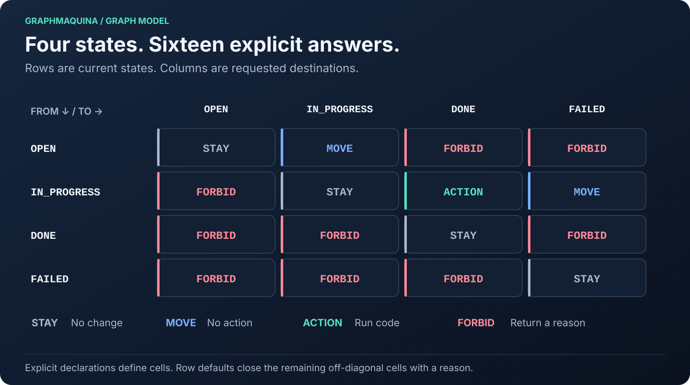
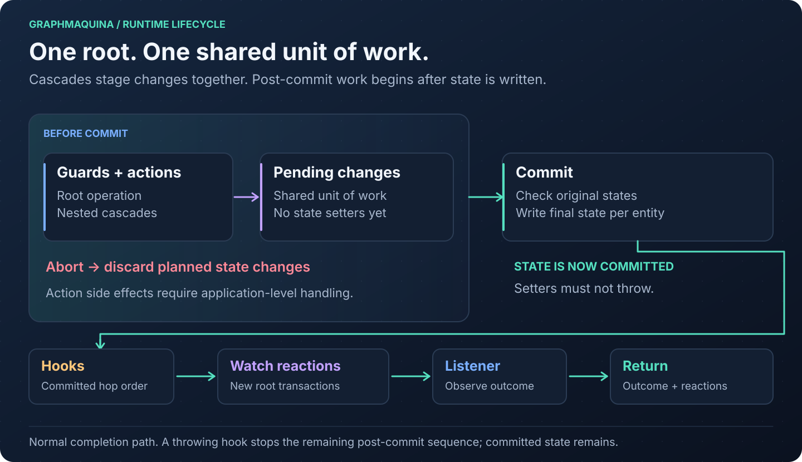

# GraphMaquina

[](https://central.sonatype.com/artifact/io.github.graphmaquina/graphmaquina-core)


Typed, graph-based state machines for Java 21. Declare the transitions your domain allows, give every
forbidden transition a reason, and let the build validate the complete graph before the application runs.

GraphMaquina combines a pre-compilation code generator, a javac annotation processor and an in-process runtime.
Your application calls a generated, typed facade. Actions, guards, hooks, properties and watched states are
bound through Java symbols rather than string names.

The current release is the one the badge above reports, published to Maven Central under
`io.github.graphmaquina`. The examples below do not repeat that number: they read it from a
`graphmaquinaVersion` Gradle property or a `graphmaquina.version` Maven property, set once per build.
Everything in this guide resolves from Maven Central: following it needs no build of this repository.

This README is the developer guide for the current implementation. The quickstart has complete, runnable
files. Later examples are extensions or fragments of the repository's shop example.

## Contents

- [What GraphMaquina provides](#what-graphmaquina-provides)
- [Visual guide](#visual-guide)
- [Requirements and artifacts](#requirements-and-artifacts)
- [How your flow annotations are generated](#how-your-flow-annotations-are-generated)
- [Publication and verification status](#publication-and-verification-status)
- [Configure Gradle](#configure-gradle)
- [Configure Maven](#configure-maven)
- [Quickstart: a complete ticket machine](#quickstart-a-complete-ticket-machine)
- [Understand the transition matrix](#understand-the-transition-matrix)
- [Annotation and binding reference](#annotation-and-binding-reference)
- [Actions, guards and failure routes](#actions-guards-and-failure-routes)
- [Handle transition outcomes](#handle-transition-outcomes)
- [Asynchronous work and timeouts](#asynchronous-work-and-timeouts)
- [Build and manage machine sets](#build-and-manage-machine-sets)
- [Read peers and cascade transitions](#read-peers-and-cascade-transitions)
- [Watch other machines](#watch-other-machines)
- [Commit, hooks and listeners](#commit-hooks-and-listeners)
- [Concurrency, identity and persistence](#concurrency-identity-and-persistence)
- [Inspect graphs and export diagrams](#inspect-graphs-and-export-diagrams)
- [Test your machines](#test-your-machines)
- [Generation lifecycle and IDE setup](#generation-lifecycle-and-ide-setup)
- [Multiple modules and published JARs](#multiple-modules-and-published-jars)
- [Programmatic DSL](#programmatic-dsl)
- [Diagnostics and troubleshooting](#diagnostics-and-troubleshooting)
- [Known limitations](#known-limitations)
- [Build, verify and release this repository](#build-verify-and-release-this-repository)
- [Component benchmarks](benchmarks/README.md)
- [Further reference](#further-reference)
- [License](#license)

## What GraphMaquina provides

| Capability | How it works |
| --- | --- |
| Exhaustive transition definitions | Every pair of states has an `ACTION`, `MOVE`, `STAY` or `FORBID` cell. Undeclared transitions are closed explicitly with a reason. |
| Compile-time structural validation | Checks include reachability, terminal states, intentional cycles, duplicate cells, failure routes and watch destinations. |
| Typed operations | A machine interface exposes domain operations such as `start(ticket)` or `pay(order)`, returning `Outcome<E, S>`. |
| Explicit bindings | Generated `Refs` classes identify marked methods and properties; the processor checks their roles and signatures. |
| Synchronous and asynchronous actions | Actions and guards may return values or `CompletionStage` results. The runtime waits under configured deadlines. |
| Coordinated state changes | Cascades share a unit of work; entity state setters run after the root transition succeeds or selects a handled failure route. |
| Declared watches | After a peer commits, a matching owner can be reevaluated using ordered rules. |
| Inspectable execution | Outcomes carry transition records and watch reactions; technical aborts carry diagnostic details where applicable. |
| Graph inspection | Render the complete matrix or export a deterministic Graphviz state diagram. |

GraphMaquina manages state transitions in objects you supply. It does not provide a database, entity locking,
a durable job queue, HTTP endpoints or distributed transactions. See [persistence and concurrency](#concurrency-identity-and-persistence)
for the responsibilities that remain with your application.

The build and runtime have separate jobs:


## Visual guide

Follow the pictures for an overview, then use the linked sections for declarations, commands and complete
examples. Each illustration is an SVG: open it to inspect labels at full size.

| Question | Diagram | Read next |
| --- | --- | --- |
| How can my source use annotations that do not exist yet? | [Source → vocabulary → compilation](docs/images/annotation-bootstrap.svg) | [First generation](#how-your-flow-annotations-are-generated) |
| Which transitions are permitted? | [Complete transition matrix](docs/images/transition-matrix.svg) | [Matrix rules](#understand-the-transition-matrix) |
| Why did an operation apply, reject or fail? | [Operation decision flow](docs/images/operation-decisions.svg) | [Outcomes](#handle-transition-outcomes) |
| Which thread waits for my service? | [Direct call and async submission](docs/images/async-execution.svg) | [Calling styles](#choose-the-calling-style) |
| How much time is left for an action? | [Root and action deadline timeline](docs/images/async-deadlines.svg) | [Deadline rules](#deadline-rules) |
| What happens if the service finishes too late? | [Timeout and late completion](docs/images/async-late-completion.svg) | [Cancellation](#timeout-cancellation-and-late-completion) |
| What can I safely use in a callback? | [Context and thread boundary](docs/images/async-context-boundary.svg) | [Context ownership](#contexts-and-completion-callbacks) |
| Does a completed future mean the operation succeeded? | [Future result branches](docs/images/async-future-results.svg) | [Result handling](#read-the-future-and-domain-result) |
| Do both machines commit together? | [Cascade versus watch](docs/images/cascade-vs-watch.svg) | [Machine coordination](#read-peers-and-cascade-transitions) |
| When do hooks and reactions run? | [Commit lifecycle](docs/images/commit-lifecycle.svg) | [Commit and hooks](#commit-hooks-and-listeners) |

## Requirements and artifacts

- JDK 21 or later, including `javac`, for generation and compilation. Use Java 21 as the baseline unless
  your application deliberately targets a newer release.
- The repository uses Gradle 9.2.1 through its wrapper. This is the verified Gradle version; the project
  does not declare a broader tested compatibility matrix.
- Maven consumers need Maven and a Java 21 JDK. The complete configuration below uses
  maven-compiler-plugin 3.15.0, matching the repository's integration fixtures.
- Lombok is optional for consumer entities and action classes. The quickstart uses handwritten accessors.
  If you use Lombok, place its annotation processor before GraphMaquina's.
- Keep the runtime, generator, processor and adapter on the same GraphMaquina version.

| Module | Coordinates / plugin ID | Add it to |
| --- | --- | --- |
| Runtime and public annotations | `io.github.graphmaquina:graphmaquina-core` | Application dependencies |
| Pre-compilation generator | `io.github.graphmaquina:graphmaquina-codegen` | Build tooling; resolved by the adapter |
| Annotation processor | `io.github.graphmaquina:graphmaquina-processor` | javac annotation-processor path |
| Typed testing assertions and probes | `io.github.graphmaquina:graphmaquina-test` | Test dependencies; ships with the next release |
| Gradle plugin | plugin ID `io.github.graphmaquina` | Gradle `plugins` block |
| Maven plugin | `io.github.graphmaquina:graphmaquina-maven-plugin` | Maven build plugins |
| Reference application | `graphmaquina-example` | Source and tests in this repository; not an application dependency |

Every coordinate takes the version the badge at the top reports, set once as the `graphmaquinaVersion` Gradle
property or the `graphmaquina.version` Maven property; the examples below read it from there.

The generator and processor are build-time tools. Do not add them as application runtime dependencies.
Application imports begin with `io.github.graphmaquina`.

## How your flow annotations are generated

You write the machine interface; GraphMaquina generates its annotation types before compiling your
application. The generator writes `TicketsGraph` from the name and type parameters of `Tickets`. You do not
need an already compiled `Tickets` class or an existing `TicketsGraph` to start.

There are three kinds of API:

| API | Who supplies it? | When is it available? |
| --- | --- | --- |
| `@GenerateGraphApi`, `@GraphProperty`, `@GraphAction`, `@GraphGuard`, `@StateGraphs`, `Machine` | The `graphmaquina-core` dependency | As soon as dependencies resolve |
| `TicketsGraph.Definition`, `TicketsGraph.Action`, `TicketsGraph.Move`, `TicketRefs`, `TicketActionsRefs` | The pre-compilation generator, from your declarations | After the generation task/phase, before application compilation |
| `TicketsRuntime`, `TicketMachinesRuntime` | The annotation processor, from the validated flow | During application compilation |


The generator creates the annotation types; you choose the flow by using those annotations. It does not
infer transitions from action method bodies. For example, `Machine<Ticket, TicketStatus>` tells it that the
`initial`, `from` and `to` elements must use `TicketStatus`. Your `@TicketsGraph.Action(from = ..., to = ...)`
declaration then specifies an actual transition.

### Start with a minimal machine

First configure the [Gradle plugin](#configure-gradle) or the [Maven lifecycle](#configure-maven), including
the annotation processor. Create `TicketStatus`, `Ticket` and `TicketActions` from the
[quickstart](#quickstart-a-complete-ticket-machine). Then create
`src/main/java/com/example/tickets/Tickets.java` with this initial content:

```java
package com.example.tickets;

import io.github.graphmaquina.annotation.GenerateGraphApi;
import io.github.graphmaquina.api.Machine;

@GenerateGraphApi
public interface Tickets extends Machine<Ticket, TicketStatus> {
}
```

This is enough to generate the annotation vocabulary. It is not yet a complete, valid flow: the definition,
rows and operations are added in the next step. The entity and state enum must be resolvable, and source files
must contain valid Java syntax.

From the application directory, run just generation with your chosen build tool:

```bash
# Gradle: generate vocabulary without compiling the application
./gradlew generateStateGraphApi

# Maven: execute the configured generate-sources phase without compiling the application
mvn generate-sources
```

With the quickstart's marked entity and action members, these files now exist in the same Java package as
their handwritten declarations:

| File | Gradle | Maven |
| --- | --- | --- |
| `TicketsGraph.java` | `build/generated/sources/graphmaquina/main/com/example/tickets/` | `target/generated-sources/graphmaquina/com/example/tickets/` |
| `TicketRefs.java` | Same directory | Same directory |
| `TicketActionsRefs.java` | Same directory | Same directory |

`TicketsGraph.java` contains the nested annotations `Definition`, `Row`, `Action`, `Move`, `Cell` and `Forbid`
(and containers for repeatable annotations). `TicketRefs` contains symbols for `@GraphProperty` members;
`TicketActionsRefs` contains symbols for marked actions, guards and hooks. Generation alone does not produce
`TicketsRuntime` or `TicketMachinesRuntime`.

Refresh the IDE's build model if needed. You can now replace the minimal `Tickets.java` with the
[complete flow declaration](#ticketsjava), using `@TicketsGraph.Definition`, `@TicketsGraph.Move` and
`@TicketsGraph.Action`. Add `TicketMachines.java` and `App.java` from the quickstart, then build and run:

```bash
# Gradle: generation, compilation and execution
./gradlew run

# Maven: generation and compilation; then use the quickstart's Java command to run App
mvn compile
```

During this build, the processor validates the flow and generates the `Runtime` implementations. javac also
compiles those generated implementations and application code that references them in the same invocation.

### You can also write the complete flow immediately

The initial generation-only step is optional: it is useful when you want the generated annotations available
in the editor before writing the flow. You may instead create all six complete quickstart files at once,
including references to `TicketsGraph`, `TicketRefs` and `TicketMachinesRuntime`, and run the normal build.

This works on a clean checkout because reading Java syntax and checking Java types are separate operations:

1. The generator reads the original `.java` files as syntax. It uses the library markers, machine type
   parameters and marked members to create the vocabulary. References to the not-yet-generated annotations
   do not require those annotation classes to exist at this stage.
2. The build adapter adds the generated source directory to the compilation and supplies the generated
   manifest to the processor.
3. javac type-checks the handwritten sources together with the generated vocabulary. The processor
   validates your graph and emits its implementations. Compilation errors are reported at this stage if
   the flow or its bindings are invalid.

The build generates from source before attempting application compilation. A clean checkout does not need a
first compilation that fails, placeholder annotations, or a previously built JAR of your own machine. After
changing machine names, state enums or exported members, run the same build again to regenerate the API.

An editor may underline missing generated types before the first generation. Use the commands above and
[refresh the generated roots](#ide-workflow); plain `javac` or an IDE build that bypasses the configured adapter
does not perform the required pre-generation step.

## Publication and verification status

GraphMaquina is available from Maven Central and the badge at the top reports the current release. The
namespace `io.github.graphmaquina` is verified. A release contains the runtime, generator, processor, testing
module, Maven plugin, Gradle plugin and Gradle plugin marker. `graphmaquina-test` joins that publication with
the next release; the release the badge reports does not carry it yet, so until then it is built from a
checkout as [typed assertions, probes and graph snapshots](#typed-assertions-probes-and-graph-snapshots)
describes.

| Check | Current development result |
| --- | --- |
| Automated library/build suites | `./gradlew test` runs the root build's ordinary suites; `./gradlew build` also runs `:graphmaquina-test:publishedArtifactTest` through `check`. The included Gradle adapter requires `:graphmaquina-gradle-plugin:test` explicitly. See [verification commands](#build-verify-and-release-this-repository). |
| README quickstart | [ReadmeQuickstartTest](graphmaquina-test/src/test/java/consumer/ReadmeQuickstartTest.java) compiles the literal Gradle and Ticket sources with strict lint, runs `App` and checks `TicketsTest` against locally staged Maven artifacts. This JUnit consumer check covers local Gradle, not Maven execution or released artifacts. |
| Async guide | Complete async example compiled and ran with both build tools; 11 additional behavior checks passed. |
| Remaining acceptance work | Manual IntelliJ acceptance and full strict-lint acceptance of the external payments demo remain pending. |

Browse the [published artifacts](https://repo.maven.apache.org/maven2/io/github/graphmaquina/) or the
[core artifact on Maven Central](https://central.sonatype.com/artifact/io.github.graphmaquina/graphmaquina-core).
MVNRepository is an independent index; appearing in its search results is not required for Maven or Gradle
resolution. Sonatype does not control its update schedule; see the
[official explanation](https://central.sonatype.org/faq/mvnrepository/).

The signing identity is `Hugo G <60438622+0xhug0@users.noreply.github.com>`. The public fingerprint is:

```text
851F 7594 9D70 884A C95A AB56 455A D78F 0EC0 B9F1
```

This fingerprint and the public key allow consumers to verify signatures; they do not permit signing a
release. Private signing material is stored in 1Password. See [release signing](docs/release-signing.md)
for verification commands and maintainer setup. Publishing a release does not resolve the
[known limitations](#known-limitations).

## Configure Gradle

The following files build and run the [ticket quickstart](#quickstart-a-complete-ticket-machine). Create a
separate application directory, `tickets-demo`, and put these files at its root.

### gradle.properties

```properties
graphmaquinaVersion=x.y.z
```

Use the version the badge at the top reports. The two scripts below read it from here, so no coordinate
repeats it.

### settings.gradle.kts

```kotlin
pluginManagement {
    repositories {
        mavenCentral()
        gradlePluginPortal()
    }
    plugins {
        id("io.github.graphmaquina") version providers.gradleProperty("graphmaquinaVersion").get()
    }
}

dependencyResolutionManagement {
    repositories {
        mavenCentral()
    }
}

rootProject.name = "tickets-demo"
```

A `plugins` block in a build script cannot interpolate a version, so the plugin request carries it here and
the build script applies the plugin by ID alone. `gradlePluginPortal()` is included for other plugins; this
guide does not require a separate GraphMaquina publication to the Gradle Plugin Portal.

### build.gradle.kts

```kotlin
plugins {
    java
    application
    id("io.github.graphmaquina")
}

group = "com.example"
version = "1.0.0"

java {
    toolchain {
        languageVersion = JavaLanguageVersion.of(21)
    }
}

val graphmaquinaVersion: String = providers.gradleProperty("graphmaquinaVersion").get()

dependencies {
    implementation("io.github.graphmaquina:graphmaquina-core:$graphmaquinaVersion")
    annotationProcessor("io.github.graphmaquina:graphmaquina-processor:$graphmaquinaVersion")
}

application {
    mainClass = "com.example.tickets.App"
}

tasks.withType<JavaCompile>().configureEach {
    options.release = 21
    options.compilerArgs.addAll(listOf("-Xlint:all,-serial", "-Werror"))
}
```

The GraphMaquina plugin reacts to the Java plugin; it does not apply Java itself. The `application` plugin is
used here only to provide `run` and a distribution containing runtime dependencies.

From the application directory, use an installed Gradle 9.2.1 to create a wrapper, or invoke the wrapper from
your GraphMaquina checkout with `-p` pointing to this directory:

```bash
gradle wrapper --gradle-version 9.2.1
./gradlew clean run
./gradlew build
./gradlew installDist
```

### Add Lombok when you need it

Add these dependency declarations before the GraphMaquina processor declaration:

```kotlin
compileOnly("org.projectlombok:lombok:1.18.48")
annotationProcessor("org.projectlombok:lombok:1.18.48")
annotationProcessor("io.github.graphmaquina:graphmaquina-processor:$graphmaquinaVersion")
```

Do not duplicate the GraphMaquina entry already present in the build. Lombok supplies accessors; it does not
replace GraphMaquina's generator or annotation processor.

### Source sets and generator selection

Generation participates in a source set only when that source set declares the GraphMaquina processor. Main
uses `annotationProcessor`; test uses `testAnnotationProcessor`. Tests that only call already generated main
facades normally do not need their own processor.

For graph declarations under `src/test/java`, add to the same `dependencies` block:

```kotlin
testAnnotationProcessor("io.github.graphmaquina:graphmaquina-processor:$graphmaquinaVersion")
```

If test entities use Lombok, add its test compile-only and annotation-processor dependencies, preserving order.

| Task | Purpose |
| --- | --- |
| `generateStateGraphApi` | Generate the main source set vocabulary |
| `generateTestStateGraphApi` | Generate test vocabulary if test participates |
| `generate<SourceSet>StateGraphApi` | Generate vocabulary for a custom source set |
| `compileJava` / `compileTestJava` | Run generation and the verified compilation lifecycle for participating scopes |

The plugin resolves the generator version matching its own version. Advanced overrides use:

```kotlin
graphmaquina {
    generatorVersion.set("x.y.z")  // the version the badge at the top reports
}
```

An explicit dependency on `graphmaquinaGenerator` replaces the default dependency. The repository example uses
this to run the sibling codegen project. Use matching versions for every GraphMaquina artifact.

## Configure Maven

This is a complete alternative build for the same ticket source files. Save it as `pom.xml` in
`tickets-demo`. It includes all six lifecycle executions and distinct main/test manifest arguments.
Maven resolves every GraphMaquina artifact from Central, at the single version the `graphmaquina.version`
property sets. For an internal repository, configure both dependency and plugin repositories as shown in
[the build guide](docs/typed-annotations-build.md#where-the-artifacts-come-from).

### pom.xml

```xml
<?xml version="1.0" encoding="UTF-8"?>
<project xmlns="http://maven.apache.org/POM/4.0.0"
         xmlns:xsi="http://www.w3.org/2001/XMLSchema-instance"
         xsi:schemaLocation="http://maven.apache.org/POM/4.0.0 https://maven.apache.org/xsd/maven-4.0.0.xsd">
  <modelVersion>4.0.0</modelVersion>
  <groupId>com.example</groupId>
  <artifactId>tickets-demo</artifactId>
  <version>1.0.0</version>

  <properties>
    <project.build.sourceEncoding>UTF-8</project.build.sourceEncoding>
    <maven.compiler.release>21</maven.compiler.release>
    <!-- the version the badge at the top of this README reports -->
    <graphmaquina.version>x.y.z</graphmaquina.version>
  </properties>

  <dependencies>
    <dependency>
      <groupId>io.github.graphmaquina</groupId>
      <artifactId>graphmaquina-core</artifactId>
      <version>${graphmaquina.version}</version>
    </dependency>
  </dependencies>

  <build>
    <plugins>
      <plugin>
        <groupId>org.apache.maven.plugins</groupId>
        <artifactId>maven-compiler-plugin</artifactId>
        <version>3.15.0</version>
        <configuration>
          <release>${maven.compiler.release}</release>
          <annotationProcessorPaths>
            <path>
              <groupId>io.github.graphmaquina</groupId>
              <artifactId>graphmaquina-processor</artifactId>
              <version>${graphmaquina.version}</version>
            </path>
          </annotationProcessorPaths>
        </configuration>
        <executions>
          <execution>
            <id>default-compile</id>
            <configuration>
              <compilerArgs>
                <arg>-Agraphmaquina.annotationManifest=${project.build.directory}/graphmaquina/main/annotation-manifest.json</arg>
                <arg>-Xlint:all,-serial</arg>
                <arg>-Werror</arg>
              </compilerArgs>
            </configuration>
          </execution>
          <execution>
            <id>default-testCompile</id>
            <configuration>
              <compilerArgs>
                <arg>-Agraphmaquina.annotationManifest=${project.build.directory}/graphmaquina/test/annotation-manifest.json</arg>
                <arg>-Xlint:all,-serial</arg>
                <arg>-Werror</arg>
              </compilerArgs>
            </configuration>
          </execution>
        </executions>
      </plugin>
      <plugin>
        <groupId>io.github.graphmaquina</groupId>
        <artifactId>graphmaquina-maven-plugin</artifactId>
        <version>${graphmaquina.version}</version>
        <executions>
          <execution>
            <id>graphmaquina-generate</id>
            <phase>generate-sources</phase>
            <goals><goal>generate</goal></goals>
          </execution>
          <execution>
            <id>graphmaquina-prepare</id>
            <phase>process-sources</phase>
            <goals><goal>prepare</goal></goals>
          </execution>
          <execution>
            <id>graphmaquina-complete</id>
            <phase>compile</phase>
            <goals><goal>complete</goal></goals>
          </execution>
          <execution>
            <id>graphmaquina-generate-test</id>
            <phase>generate-test-sources</phase>
            <goals><goal>generate-test</goal></goals>
          </execution>
          <execution>
            <id>graphmaquina-prepare-test</id>
            <phase>process-test-sources</phase>
            <goals><goal>prepare-test</goal></goals>
          </execution>
          <execution>
            <id>graphmaquina-complete-test</id>
            <phase>test-compile</phase>
            <goals><goal>complete-test</goal></goals>
          </execution>
        </executions>
      </plugin>
    </plugins>
  </build>
</project>
```

Run from the application directory:

```bash
mvn --version
mvn clean verify
```

To run the quickstart after Maven has resolved the library and compiled the application, let Maven write the
dependency classpath and put the compiled classes in front of it:

```bash
mvn -q dependency:build-classpath -Dmdep.outputFile=target/classpath.txt
java -cp "target/classes:$(cat target/classpath.txt)" com.example.tickets.App
```

The generated file holds absolute paths into your local repository, wherever that is; on Windows, use `;` as
the Java classpath separator.

For Lombok, add `org.projectlombok:lombok:1.18.48` as a `provided` dependency and place its `<path>` before the
GraphMaquina processor's `<path>`. Unlike a Spring Boot parent, this standalone POM does not supply dependency
versions implicitly.

### Maven lifecycle and constraints

| Goal | Phase | Responsibility |
| --- | --- | --- |
| `generate` | `generate-sources` | Generate vocabulary and add the main generated source root |
| `prepare` | `process-sources` | Retire previous owned compilation outputs |
| `complete` | `compile`, after javac | Publish accepted exports and seal ownership |
| `generate-test` | `generate-test-sources` | Generate test vocabulary |
| `prepare-test` | `process-test-sources` | Prepare test compilation |
| `complete-test` | `test-compile`, after test javac | Publish test exports and seal ownership |

Merely declaring the plugin does not activate these goals. Use the executions above. Invoking
`compiler:compile` directly skips the required preceding lifecycle; use `mvn compile`, `mvn test-compile` or
`mvn verify` instead.

The adapter validates the effective Java release, processor path, manifest paths and JDK alignment. It rejects
`-proc:none`, missing processor configuration, divergent main/test manifests and skipped compilation such as
`maven.main.skip` or `maven.test.skip`. Run the normal lifecycle when generating graphs.

| Optional property | Meaning |
| --- | --- |
| `graphmaquina.javaExecutable` | Explicit Java executable for generation; it must agree with the compiler JDK |
| `graphmaquina.compilationId` | Override compilation identity; defaults distinguish artifact and main/test scope |

See the [Maven adapter reference](docs/typed-annotations-build.md#maven) for toolchains and custom compiler paths.

## Quickstart: a complete ticket machine

Create the following six files under `src/main/java/com/example/tickets/`. They are shared by the Gradle and
Maven configurations above and require no Lombok, framework or external service. You can write all six files
before the first build; [the generation walkthrough](#how-your-flow-annotations-are-generated) explains why
the references to generated annotations are valid in this workflow.

The workflow is `OPEN → IN_PROGRESS → DONE`, with a handled completion failure leading to `FAILED`.


### TicketStatus.java

```java
package com.example.tickets;

public enum TicketStatus {
    OPEN, IN_PROGRESS, DONE, FAILED
}
```

### Ticket.java

```java
package com.example.tickets;

import io.github.graphmaquina.annotation.GraphProperty;
import java.util.Objects;

public final class Ticket {
    @GraphProperty
    private final String id;

    @GraphProperty
    private TicketStatus status = TicketStatus.OPEN;

    private final String title;
    private final boolean approved;

    public Ticket(String id, String title, boolean approved) {
        this.id = Objects.requireNonNull(id);
        this.title = Objects.requireNonNull(title);
        this.approved = approved;
    }

    public String getId() { return id; }
    public TicketStatus getStatus() { return status; }
    public String getTitle() { return title; }
    public boolean isApproved() { return approved; }

    public void setStatus(TicketStatus status) {
        this.status = Objects.requireNonNull(status);
    }
}
```

The state starts initialized. `initial = OPEN` describes the graph; it does not initialize new entities.
The runtime calls the state setter during commit. Action code must not call it.

### TicketActions.java

```java
package com.example.tickets;

import io.github.graphmaquina.annotation.GraphAction;
import io.github.graphmaquina.annotation.GraphGuard;
import io.github.graphmaquina.annotation.GraphHook;
import io.github.graphmaquina.api.ActionOutcome;
import io.github.graphmaquina.api.GuardContext;
import io.github.graphmaquina.api.GuardResult;
import io.github.graphmaquina.api.TransitionContext;

public final class TicketActions {
    @GraphGuard
    public GuardResult hasTitle(GuardContext<Ticket, TicketStatus> ctx) {
        return ctx.entity().getTitle().isBlank()
                ? GuardResult.reject("a ticket needs a title")
                : GuardResult.pass();
    }

    @GraphAction
    public ActionOutcome complete(TransitionContext<Ticket, TicketStatus> ctx) {
        return ctx.entity().isApproved()
                ? ActionOutcome.ok()
                : ActionOutcome.failed("approval was declined");
    }

    @GraphHook
    public void completed(Ticket ticket) {
        System.out.println("Committed " + ticket.getId() + " -> " + ticket.getStatus());
    }
}
```

### Tickets.java

```java
package com.example.tickets;

import static com.example.tickets.TicketStatus.DONE;
import static com.example.tickets.TicketStatus.FAILED;
import static com.example.tickets.TicketStatus.IN_PROGRESS;
import static com.example.tickets.TicketStatus.OPEN;

import io.github.graphmaquina.annotation.GenerateGraphApi;
import io.github.graphmaquina.api.Machine;
import io.github.graphmaquina.api.Outcome;

@GenerateGraphApi
@TicketsGraph.Definition(initial = OPEN, terminals = {DONE, FAILED},
        state = TicketRefs.Status.class, id = TicketRefs.Id.class)
@TicketsGraph.Row(state = OPEN, otherwise = "start the ticket before completing it")
@TicketsGraph.Row(state = IN_PROGRESS, otherwise = "an active ticket must complete or fail")
@TicketsGraph.Cell(from = IN_PROGRESS, to = FAILED)
public interface Tickets extends Machine<Ticket, TicketStatus> {
    @TicketsGraph.Move(from = OPEN, to = IN_PROGRESS,
            guards = TicketActionsRefs.HasTitle.class)
    Outcome<Ticket, TicketStatus> start(Ticket ticket);

    @TicketsGraph.Action(from = IN_PROGRESS, to = DONE,
            action = TicketActionsRefs.Complete.class,
            onFailure = FAILED,
            afterCommit = TicketActionsRefs.Completed.class)
    Outcome<Ticket, TicketStatus> complete(Ticket ticket);
}
```

`TicketsGraph`, `TicketRefs` and `TicketActionsRefs` do not exist in handwritten source. The generator writes
them before javac compiles this interface, using `@GenerateGraphApi`, `Machine<Ticket, TicketStatus>` and the
marked members. See [the first-generation walkthrough](#how-your-flow-annotations-are-generated) for the
minimal-interface and complete-source workflows. Do not create placeholder versions of these classes.

### TicketMachines.java

```java
package com.example.tickets;

import io.github.graphmaquina.annotation.StateGraphs;
import io.github.graphmaquina.api.Machines;

@StateGraphs
public interface TicketMachines extends Machines {
    Tickets tickets();
}
```

The processor generates `TicketsRuntime` and `TicketMachinesRuntime`. The set owns the runtime machines
and closes their default executors together.

### App.java

```java
package com.example.tickets;

import io.github.graphmaquina.api.Outcome;

public final class App {
    private App() { }

    public static void main(String[] args) {
        try (TicketMachines machines = TicketMachinesRuntime.builder(new TicketActions()).build()) {
            Tickets tickets = machines.tickets();

            Ticket accepted = new Ticket("T-1", "Document the workflow", true);
            require(tickets.start(accepted) instanceof Outcome.Applied<?, ?>, "start should apply");
            require(tickets.complete(accepted) instanceof Outcome.Applied<?, ?>, "complete should apply");
            require(accepted.getStatus() == TicketStatus.DONE, "successful ticket should be DONE");

            Ticket invalid = new Ticket("T-2", "", true);
            require(tickets.start(invalid) instanceof Outcome.Rejected<?, ?>, "blank title should reject");
            require(invalid.getStatus() == TicketStatus.OPEN, "rejected ticket should remain OPEN");

            Ticket declined = new Ticket("T-3", "Await approval", false);
            tickets.start(declined);
            require(tickets.complete(declined) instanceof Outcome.Failed<?, ?>, "decline should be handled");
            require(declined.getStatus() == TicketStatus.FAILED, "failure route should commit FAILED");

            require(tickets.complete(new Ticket("T-4", "Not started", true))
                    instanceof Outcome.Rejected<?, ?>, "completion from OPEN should be forbidden");
            System.out.println("All ticket scenarios passed.");
        }
    }

    private static void require(boolean condition, String message) {
        if (!condition) {
            throw new IllegalStateException(message);
        }
    }
}
```

Expected application output:

```text
Committed T-1 -> DONE
All ticket scenarios passed.
```

The success hook runs only on the committed success edge. The declined action commits the internal failure
cell instead. The program checks successful transitions, a rejecting guard, a handled failure and a forbidden
operation; it does not rely on Java assertions being enabled.

## Understand the transition matrix

With `N` enum constants, the graph has `N × N` cells. Rows represent the current state; columns represent the
requested destination. The ticket example resolves to this matrix:



| From / to | OPEN | IN_PROGRESS | DONE | FAILED |
| --- | --- | --- | --- | --- |
| OPEN | STAY | MOVE + `hasTitle` | FORBID | FORBID |
| IN_PROGRESS | FORBID | STAY | ACTION `complete` | MOVE, internal failure route |
| DONE | FORBID | FORBID | STAY | FORBID |
| FAILED | FORBID | FORBID | FORBID | STAY |

| Cell kind | Runtime behavior |
| --- | --- |
| `ACTION` | Evaluate guards, run the action, then commit its destination or its handled failure route. |
| `MOVE` | Evaluate guards and commit the destination without running an action. |
| `STAY` | Return `Outcome.Ignored`; no state change. The typed annotation API supplies the diagonal automatically. |
| `FORBID` | Return `Outcome.Rejected` with the declared reason; no guards or actions run. |

Every nonterminal state must have a `@<Machine>Graph.Row` with a nonblank `otherwise` reason. That reason closes
its undeclared off-diagonal cells. Declared actions, moves, internal cells and explicit forbids take their
respective cells; a row default does not override them. Terminal states are closed automatically, but you can
declare an explicit row to customize their reasons.

Use `@<Machine>Graph.Forbid(from = ..., to = ..., reason = "...")` for a particular forbidden cell whose
explanation differs from the row default. Two explicit declarations cannot claim the same cell.

### Structural rules

- All enum constants participate, and every state must be reachable from `initial` through actions or moves.
- A terminal has no action or move exit to another state. A state without an exit must be terminal.
- The diagonal is `STAY`. An action or move cannot declare the same state in `from` and `to`.
- Every cycle must intersect at least one state listed in `allowsCycle`. An allowance for a state that is not
  part of any cycle is rejected too.
- An `onFailure` destination must have a separately declared action or move from the original source state.
- Every watch destination must also be an action or move from the watched state. A terminal cannot watch.

For example, the shop permits `NEW → PAYMENT_DECLINED → NEW` by declaring
`allowsCycle = PAYMENT_DECLINED`. This documents an intentional retry loop; guards still decide when another
retry is permitted.

### Operations and internal cells

A public operation has this shape:

```java
Outcome<Ticket, TicketStatus> complete(Ticket ticket);
```

It carries one action or move annotation from its own generated vocabulary. The generated implementation
requests that annotation's destination from the entity's current state. The matrix decides what happens from
that current state; `from` declares graph cells, rather than adding a separate imperative precondition inside
the Java method. Avoid assigning the same target to operations that you expect to mean different things: the
runtime selects behavior by `(current state, target state)`.

An operation may accept a second argument: `Outcome<Entity, Status> screen(Entity entity, Verdict verdict)`.
Guards and actions read it through `ctx.input(Verdict.class)`, which returns `Optional<Verdict>`. This lets
a guard decide from a fact the caller has already obtained without storing a temporary argument on the
entity or calling a service from the guard. Use an immutable record for related input fields; a Java file
has only one public top-level type, so it gets its own file:

```java
// Verdict.java
public record Verdict(boolean eligible) { }
```

A declaration like this belongs on the machine interface, beside its other operations — the same place as
`complete` in this quickstart's `Tickets.java` — and its guard belongs on the bindings host, beside its other
guards, the same place as `hasTitle` in `TicketActions.java`. The snippet below declares its own screening
vocabulary rather than the ticket one; adapt the graph annotation and the `Refs` class — following the
naming rule under [Generated names](#generated-names) — and the states to your own machine:

```java
@ScreeningGraph.Move(from = NEW, to = SCREENED, guards = RulesRefs.Eligible.class)
Outcome<Entity, Status> screen(Entity entity, Verdict verdict);
```

```java
@GraphGuard
public static GuardResult eligible(GuardContext<Entity, Status> ctx) {
    return ctx.input(Verdict.class)
            .map(verdict -> verdict.eligible() ? GuardResult.pass() : GuardResult.reject("ineligible"))
            .orElseGet(() -> GuardResult.reject("missing verdict"));
}
```

`@Cell` declares an internal transition without adding a facade method. It is useful for failure routes,
cascades and watches. Omitting its `action` makes it a move. A typed facade intentionally exposes no generic
`transitionTo`: application entry points are the operations you declared, plus `reevaluate`.

`allowedFrom(state)` returns graph destinations with action or move cells, including internal cells. It does
not run guards or predict whether a particular entity will succeed.

## Annotation and binding reference

### Handwritten markers

Import these from `io.github.graphmaquina.annotation`:

| Annotation | Place it on | Purpose |
| --- | --- | --- |
| `@GenerateGraphApi` | Top-level `Machine<E, S>` interface | Generate its typed graph vocabulary |
| `@StateGraphs` | Top-level interface extending `Machines` | Generate a set and builder for its machine accessors |
| `@GraphProperty` | Entity field or getter | Export a property symbol |
| `@GraphAction` | Action method | Export an action binding |
| `@GraphGuard` | Guard method | Export a guard binding |
| `@GraphHook` | Hook method | Export an after-commit binding |
| `@GraphCondition` | Watch-condition method | Export a custom watch predicate |
| `@GraphBindings` | Concrete binding host | Export inherited marked members through this concrete host |
| `@GraphPeers` | Watching machine interface | Request typed vocabulary for its declared owner/peer pairs |
| `@Timeout` | Nested annotation element | Express seconds and nanoseconds for an asynchronous action timeout |

Markers identify exports; marking a method alone does not attach it to a transition. Reference its generated
symbol from the graph declaration.

### Generated names

| Handwritten declaration | Generated API |
| --- | --- |
| `Tickets extends Machine<Ticket, TicketStatus>` | `TicketsGraph.Definition`, `.Row`, `.Action`, `.Move`, `.Cell`, `.Forbid` |
| Property `Ticket.status` | `TicketRefs.Status.class` |
| Marked method `TicketActions.hasTitle` | `TicketActionsRefs.HasTitle.class` |
| `@GraphPeers(Items.class)` on `Orders` | `OrdersItems.Watch` and `OrdersItems.When`, in the owner's package |
| Machine `Tickets` | `TicketsRuntime`, including `KEY`, graph construction and facade implementation |
| Set `TicketMachines` | `TicketMachinesRuntime`, including the generated builder |

Generated type names use PascalCase with no underscores. Underscores and nesting dots separate words:
`_id` → `Id`, `has_title` → `HasTitle`, and `Outer.Inner` → `OuterInnerRefs`. Existing internal case and
uppercase acronyms are preserved: `hasTitle` → `HasTitle`, `URL` → `URL`. `Graph` and `Refs` retain their roles.
Original Java declarations and invocation names remain unchanged. If normalization merges two names, generation
fails with `SG603` naming both sources: `id` / `_id` and `authorize` / `Authorize` conflict within one references
container. A conflict with the container itself also fails; there are no underscore escapes or opaque suffixes.
Names that cannot produce a valid nonempty Java identifier are rejected.

A generated symbol is a compile-time reference. It is not an action instance, a dependency-injection bean or
a reflective lookup. The facade calls the selected declaration directly, preserving the marked overload.

### Generated graph annotation elements

In this table, `S` is the machine's state enum and `P` is a property symbol class.

| Annotation | Required elements | Optional elements |
| --- | --- | --- |
| `Definition` | `initial: S`, `state: P`, `id: P` | `terminals: S[]`, `allowsCycle: S[]`, `afterCommit: HookSymbol` |
| `Row` | `state: S`, `otherwise: String` | None |
| `Action` | `from: S[]`, `to: S`, `action: ActionSymbol` | `guards`, `onFailure`, `failsOn`, `timeout`, `afterCommit` |
| `Move` | `from: S[]`, `to: S` | `guards`, `afterCommit` |
| `Cell` | `from: S[]`, `to: S` | `action`, `guards`, `onFailure`, `failsOn`, `timeout`, `afterCommit` |
| `Forbid` | `from: S`, `to: S`, `reason: String` | None |

Rows, internal cells and forbids are repeatable. `from` must contain at least one state. Guard arrays execute
in declaration order. `failsOn` takes exception class literals.

Java annotations do not have nullable elements, so the API represents optional single values as arrays.
`onFailure`, `timeout`, `afterCommit`, `Cell.action` and custom `When.condition` accept zero or one value.
Use the single-value syntax, for example `onFailure = FAILED`, or omit the element. Multiple values are `SG607`.

### Properties and accessors

For a field marked `@GraphProperty`, the processor looks for public instance readers in this order:
`property()`, `getProperty()`, `isProperty()`. It searches for state writers as `setProperty(value)` and then
`property(value)`. A field marker does not grant access to the field and does not generate an accessor.

A marker on a getter selects that getter directly. Its logical property name follows JavaBeans
normalization: `getStatus()` exports `status`, `items()` exports `items`, and `getURL()` exports `URL`.

| Property use | Required shape |
| --- | --- |
| `Definition.state` | Public instance reader returning the machine's state enum; compatible public instance writer |
| `Definition.id` | Public instance reader returning an identity value; values must be non-null at runtime |
| `Watch.peers` | Owner reader returning `Collection<? extends PeerEntity>` |
| `Watch.owner` | Peer reader returning `Optional<OwnerEntity>` or an owner entity |

Use `Optional.empty()` for a peer with no owner. Keep relationship accessors consistent and return non-null
collections. If the setter overloads are ambiguous, the processor reports the ambiguity instead of choosing
based on declaration order.

### Method signatures

Public methods must match the role where the graph uses them. `E/S` refer to the owner entity/state types;
`P/Q` refer to the peer entity/state types.

| Marker | Supported signature |
| --- | --- |
| `@GraphAction` | `ActionOutcome method(TransitionContext<E, S> ctx)` |
| `@GraphAction`, async | `CompletionStage<ActionOutcome> method(TransitionContext<E, S> ctx)` |
| `@GraphGuard` | `GuardResult method(GuardContext<E, S> ctx)` |
| `@GraphGuard`, async | `CompletionStage<GuardResult> method(GuardContext<E, S> ctx)` |
| `@GraphHook` | `void method(E entity)` or `void method(E entity, CommitContext<S> context)` |
| `@GraphCondition` | `boolean method(E owner, Collection<? extends P> peers, PeerView<P, Q> view)` |

Static bindings are called statically. Instance bindings become constructor/builder dependencies. For example,
using three instance members of `OrderActions` adds one `OrderActions` dependency, not three instances. A class
used only through static members needs no builder argument.

To expose inherited marked members under a concrete host, use `@GraphBindings` on that host. The processor
checks the inherited signature with the concrete generic arguments substituted. Generated output and JAR
exports are checked for collisions; do not manually create classes in generated namespaces or edit symbols.

## Actions, guards and failure routes

The ticket quickstart shows a synchronous action and guard. Actions receive `TransitionContext<E, S>`:

| Method | Meaning |
| --- | --- |
| `entity()` | The object supplied by the caller |
| `from()` / `to()` | Source state and requested destination of this transition |
| `depth()` | `0` for the root, increasing through cascades |
| `peer(...)` | Read another registered machine through a `PeerView` |
| `cascade(...)` | Request a peer transition within this unit of work |
| `cascadeAll(...)` | Apply a cascade to a collection using the selected policy |
| `input()` / `input(Class)` | The operation's second argument, if the caller passed one |

Guards receive `GuardContext<E, S>`, which exposes the entity, source, target, read-only peer access and the
same `input` accessors. It has no cascade API. Return `GuardResult.pass()` or `GuardResult.reject("reason")`;
do not return null. A rejecting guard stops the transition before its action runs. Guard code should be free
of mutations and external side effects.

Without an input, or when the caller passes null, the optional is empty. A value of an incompatible class
throws `ClassCastException`; absence and a wrong type are different conditions. Primitive operation
arguments are boxed; read them with wrapper tokens such as `Integer.class`. Class tokens cannot validate
erased generic arguments. Input operations do not support method type parameters or varargs.

The same input reaches the transition's guards, action and handled failure action. Existing cascades and
watch reactions have no input of their own and receive an empty optional. A shared guard must handle that
absence. Hooks, listeners and transition records retain their existing contracts.

### Domain failures

An action returns `ActionOutcome.ok()` or `ActionOutcome.failed("reason")`. A failed action is a handled
business result only when the edge has an `onFailure` destination. Without one, the runtime throws
`UnhandledFailureException` and does not commit the planned state changes.

A failure route is declared from the original source, as in the ticket example:

```java
@TicketsGraph.Cell(from = IN_PROGRESS, to = FAILED)
```

When completion fails, the runtime discards the success edge's pending changes and selects
`IN_PROGRESS → FAILED`. It returns `Outcome.Failed`, and the entity is now `FAILED`.

The failure route can itself be an action. Its guards are bypassed when entered as failure handling, and its
own failure route is not chained. A failure or exception from that route aborts. Hooks apply to the edge that
actually committed, so a success-edge hook does not run for its failure route.

### Map specific exceptions to a domain failure

This declaration is an excerpt from the shop's `Orders` machine:

```java
@OrdersGraph.Action(from = NEW, to = PAID,
        action = OrderActionsRefs.Charge.class,
        guards = OrderActionsRefs.RetryBudgetLeft.class,
        onFailure = PAYMENT_DECLINED,
        failsOn = IOException.class,
        timeout = @Timeout(seconds = 5))
Outcome<Order, OrderStatus> pay(Order order);
```

The corresponding async action calls a gateway and returns a stage. An exceptional completion with a matching
`IOException` uses the declared failure route. The runtime unwraps completion/execution wrappers before
classifying their cause. `failsOn` applies to action failures; a guard exception is a technical abort.

`failsOn` cannot be a blanket `Throwable`, `Exception` or `RuntimeException`, an `Error`, or a library engine
exception. Declare specific foreign exception types. Timeout, interruption and cancellation are not a
substitute for a returned domain failure. `@Timeout` is valid only for asynchronous actions.

The full action implementation is in
[OrderActions.java](graphmaquina-example/src/main/java/io/github/graphmaquina/example/order/OrderActions.java).

## Handle transition outcomes


`Outcome<E, S>` is a sealed interface. Use its variants to distinguish business results:

| Variant | State changes? | Useful fields |
| --- | --- | --- |
| `Applied` | Yes, the requested edge committed | `from`, `to`, `records`, `reactions` |
| `Ignored` | No | `from`, `to`; stay, convergent no-op or reevaluation without a match |
| `Rejected` | No | `reason`, optional rejecting `guard`, requested `to` |
| `Failed` | Yes, the handled failure route committed | requested `to`, actual `movedTo`, `reason`, optional `cause`, `records`, `reactions` |

Every outcome has `entity()`, `from()` and `current()`. For `Failed`, `current()` is `movedTo()`, not the
requested destination. Outcomes describe that call's result; later watch reactions or subsequent operations
can move an entity again. Read the entity when you need its live state.

This method can be added to the quickstart's `App`:

```java
static String describe(Outcome<Ticket, TicketStatus> outcome) {
    return switch (outcome) {
        case Outcome.Applied<Ticket, TicketStatus> applied -> "Moved to " + applied.to();
        case Outcome.Ignored<Ticket, TicketStatus> ignored -> "Unchanged at " + ignored.current();
        case Outcome.Rejected<Ticket, TicketStatus> rejected -> "Rejected: " + rejected.reason();
        case Outcome.Failed<Ticket, TicketStatus> failed ->
                "Moved to " + failed.movedTo() + ": " + failed.reason();
    };
}
```

Technical failures throw instead of becoming a fifth outcome. Inspect the exception type and phase before
retrying: after-commit failures occur after state was already written.

### Records, journals and reactions

- `TransitionRecord` describes a planned-and-committed hop: machine key, entity, source, destination, cell
  kind, action label, cascade depth and whether it was a convergent no-op.
- Root `Applied` and `Failed` outcomes include the transaction's records. A nested `cascade` result is
  provisional and has no independent root commit or reaction list.
- An abort journal uses `ActionRecord` and `ActionStatus` (`RUNNING`, `OK`, `FAILED`, `THREW`) to report actions
  that actually ran. A journal is execution evidence, not an undo log for external side effects.
- A watch produces `Reaction.Done`, carrying its own outcome, or `Reaction.Aborted`, carrying its exception.
  Inspect reactions even when the root operation succeeded. `Reaction.Aborted` can also report a hook/listener
  failure after the reaction itself committed; it is not proof that the reaction left state unchanged.

## Asynchronous work and timeouts

GraphMaquina supports asynchronous actions and guards while keeping each transition's execution and commit
ordered. There are two independent decisions: whether a binding returns a stage, and whether the caller
submits the whole operation through `machine.async(...)`.

Read the subsections in this order:

- [Choose the calling style](#choose-the-calling-style).
- [Build a runnable async ticket](#runnable-async-ticket-example).
- [Read the future and domain result](#read-the-future-and-domain-result).
- [Configure deadlines](#deadline-rules).
- [Handle timeout and cancellation](#timeout-cancellation-and-late-completion).
- [Use contexts safely](#contexts-and-completion-callbacks).
- [Manage executors and machine lifetime](#executors-and-machine-lifetime).
- [Test async behavior](#test-async-behavior).

### Choose the calling style

| Action/guard implementation | How you invoke the machine | What the caller experiences |
| --- | --- | --- |
| Returns `ActionOutcome` / `GuardResult` | `tickets.complete(ticket)` | Executes inline and returns an `Outcome` |
| Returns `CompletionStage<ActionOutcome>` / `CompletionStage<GuardResult>` | `tickets.complete(ticket)` | Invokes the binding inline, waits for its stage, then returns an `Outcome` |
| Either kind of binding | `tickets.async(() -> tickets.complete(ticket))` | Submits the whole operation to the configured executor and returns `CompletableFuture<Outcome<...>>` |

With the default executor, the last form runs the operation on a virtual thread, allowing the calling thread
to continue. A custom executor determines its own scheduling; a direct executor can execute inline.


Returning a stage does not change the generated operation's return type: the facade still returns
`Outcome<E, S>`. The outer `CompletableFuture` comes from `machine.async(...)`. Calling `join()` immediately
on that future blocks the caller again; at an asynchronous application boundary, compose and return the
future instead of joining it on an event-loop thread.

Guards execute in order. Each async guard is awaited before the next guard or action runs. A guard rejection
stops the edge. The action method itself runs on the operation thread up to the point where it returns its
stage. Any blocking I/O performed before that return still blocks the operation thread. Use a service API
that returns promptly, or an application-managed executor for genuinely blocking service code.

### Runnable async ticket example

This example adds an asynchronous eligibility check and approval service to the ticket domain. Reuse
`Ticket.java` and `TicketStatus.java` from the [quickstart](#quickstart-a-complete-ticket-machine), with the
same Gradle or Maven configuration and dependencies. Add the following five files under
`src/main/java/com/example/tickets/`. They can coexist with the synchronous quickstart.

The service contract returns stages; the example implementation controls their completion explicitly so
there is no external server, `Thread.sleep`, or scheduling guesswork.

#### TicketReviewService.java

```java
package com.example.tickets;

import java.util.concurrent.CompletionStage;

public interface TicketReviewService {
    CompletionStage<Boolean> canStart(String ticketId);
    CompletionStage<Boolean> approved(String ticketId);
}
```

#### AsyncTicketActions.java

```java
package com.example.tickets;

import io.github.graphmaquina.annotation.GraphAction;
import io.github.graphmaquina.annotation.GraphGuard;
import io.github.graphmaquina.api.ActionOutcome;
import io.github.graphmaquina.api.GuardContext;
import io.github.graphmaquina.api.GuardResult;
import io.github.graphmaquina.api.TransitionContext;
import java.util.Objects;
import java.util.concurrent.CompletionStage;

public final class AsyncTicketActions {
    private final TicketReviewService reviews;

    public AsyncTicketActions(TicketReviewService reviews) {
        this.reviews = Objects.requireNonNull(reviews);
    }

    @GraphGuard
    public CompletionStage<GuardResult> canStart(GuardContext<Ticket, TicketStatus> ctx) {
        String ticketId = ctx.entity().getId();
        return reviews.canStart(ticketId).thenApply(allowed -> allowed
                ? GuardResult.pass()
                : GuardResult.reject("ticket is not eligible"));
    }

    @GraphAction
    public CompletionStage<ActionOutcome> complete(TransitionContext<Ticket, TicketStatus> ctx) {
        String ticketId = ctx.entity().getId();
        return reviews.approved(ticketId).thenApply(approved -> approved
                ? ActionOutcome.ok()
                : ActionOutcome.failed("approval was declined"));
    }
}
```

Both methods capture the immutable identifier before calling the service. Their callbacks only translate a
service value; they do not use the transaction context or mutate the entity. Approval comes from the service
in this example, rather than the quickstart entity's `approved` field.

#### AsyncTickets.java

```java
package com.example.tickets;

import static com.example.tickets.TicketStatus.DONE;
import static com.example.tickets.TicketStatus.FAILED;
import static com.example.tickets.TicketStatus.IN_PROGRESS;
import static com.example.tickets.TicketStatus.OPEN;

import io.github.graphmaquina.annotation.GenerateGraphApi;
import io.github.graphmaquina.annotation.Timeout;
import io.github.graphmaquina.api.Machine;
import io.github.graphmaquina.api.Outcome;
import java.io.IOException;

@GenerateGraphApi
@AsyncTicketsGraph.Definition(initial = OPEN, terminals = {DONE, FAILED},
        state = TicketRefs.Status.class, id = TicketRefs.Id.class)
@AsyncTicketsGraph.Row(state = OPEN, otherwise = "start the ticket first")
@AsyncTicketsGraph.Row(state = IN_PROGRESS, otherwise = "complete or fail the ticket")
@AsyncTicketsGraph.Cell(from = IN_PROGRESS, to = FAILED)
public interface AsyncTickets extends Machine<Ticket, TicketStatus> {
    @AsyncTicketsGraph.Move(from = OPEN, to = IN_PROGRESS,
            guards = AsyncTicketActionsRefs.CanStart.class)
    Outcome<Ticket, TicketStatus> start(Ticket ticket);

    @AsyncTicketsGraph.Action(from = IN_PROGRESS, to = DONE,
            action = AsyncTicketActionsRefs.Complete.class,
            onFailure = FAILED,
            failsOn = IOException.class,
            timeout = @Timeout(seconds = 2))
    Outcome<Ticket, TicketStatus> complete(Ticket ticket);
}
```

`canStart` uses the machine's root wait deadline. The `complete` action also has a two-second wait
limit. A service result of `false` becomes a handled failure; a stage completed exceptionally with
`IOException` also uses the declared `IN_PROGRESS → FAILED` route. A guard exception or an action wait timeout
is a technical abort, even though the action declares `onFailure`.

#### AsyncTicketMachines.java

```java
package com.example.tickets;

import io.github.graphmaquina.annotation.StateGraphs;
import io.github.graphmaquina.api.Machines;

@StateGraphs
public interface AsyncTicketMachines extends Machines {
    AsyncTickets tickets();
}
```

#### AsyncApp.java

```java
package com.example.tickets;

import io.github.graphmaquina.api.Outcome;
import java.time.Duration;
import java.util.concurrent.CompletableFuture;
import java.util.concurrent.CompletionStage;

public final class AsyncApp {
    private AsyncApp() { }

    public static void main(String[] args) {
        CompletableFuture<Boolean> approval = new CompletableFuture<>();
        TicketReviewService reviews = new TicketReviewService() {
            @Override
            public CompletionStage<Boolean> canStart(String ticketId) {
                return CompletableFuture.completedFuture(true);
            }

            @Override
            public CompletionStage<Boolean> approved(String ticketId) {
                return approval;
            }
        };

        try (AsyncTicketMachines machines = AsyncTicketMachinesRuntime.builder(
                Duration.ofSeconds(5), new AsyncTicketActions(reviews)).build()) {
            AsyncTickets tickets = machines.tickets();
            Ticket ticket = new Ticket("T-ASYNC", "Review the documentation", true);

            Outcome<Ticket, TicketStatus> started =
                    tickets.async(() -> tickets.start(ticket)).join();
            if (!(started instanceof Outcome.Applied<?, ?>)) {
                throw new IllegalStateException("start was not applied: " + started);
            }

            CompletableFuture<Outcome<Ticket, TicketStatus>> pending =
                    tickets.async(() -> tickets.complete(ticket));
            System.out.println("Caller can do other work while approval is pending.");

            // In a real service, its client completes this stage when the response arrives.
            approval.complete(true);

            Outcome<Ticket, TicketStatus> completed = pending.join();
            if (!(completed instanceof Outcome.Applied<?, ?>)
                    || ticket.getStatus() != TicketStatus.DONE) {
                throw new IllegalStateException("completion was not applied: " + completed);
            }
            System.out.println("Async ticket -> " + ticket.getStatus());
        }
    }
}
```

This command-line demonstration deliberately joins before exiting so the machine set remains alive for all
submitted work. In Gradle, change the existing `application.mainClass` to `"com.example.tickets.AsyncApp"`,
then run `./gradlew clean run`. In Maven:

```bash
mvn clean compile
mvn -q dependency:build-classpath -Dmdep.outputFile=target/classpath.txt
java -cp "target/classes:$(cat target/classpath.txt)" com.example.tickets.AsyncApp
```

Expected application output:

```text
Caller can do other work while approval is pending.
Async ticket -> DONE
```

To explore another branch, complete `approval` with `false` instead of `true`: the operation then returns
`Outcome.Failed` and the ticket becomes `FAILED`, so update the demonstration's success assertion accordingly.
Use `approval.completeExceptionally(new java.io.IOException("service unavailable"))` to exercise `failsOn`.
An unexpected exception, such as `IllegalStateException`, completes the operation future exceptionally.

### Read the future and domain result

There are two layers of result. A future that completes normally does not imply `Outcome.Applied`:
`Rejected`, `Ignored` and a handled `Failed` are normal values too.


With the `tickets` and `ticket` from the example, this fragment observes completion without joining:

```java
CompletableFuture<Outcome<Ticket, TicketStatus>> pending =
        tickets.async(() -> tickets.complete(ticket));

CompletableFuture<Void> observed = pending.thenAccept(outcome -> {
    switch (outcome) {
        case Outcome.Applied<Ticket, TicketStatus> applied ->
                System.out.println("Completed: " + applied.to());
        case Outcome.Failed<Ticket, TicketStatus> failed ->
                System.out.println("Handled decline: " + failed.reason());
        case Outcome.Rejected<Ticket, TicketStatus> rejected ->
                System.out.println("Not allowed: " + rejected.reason());
        case Outcome.Ignored<Ticket, TicketStatus> ignored ->
                System.out.println("Unchanged: " + ignored.current());
    }
});

observed.whenComplete((unused, error) -> {
    if (error != null) {
        System.err.println("Operation or observer failed: " + error);
    }
});
```

Keep or return the relevant future to the caller. `join()` wraps an exceptional completion in
`CompletionException`; `get()` uses `ExecutionException` and can be interrupted. If the outer future itself
is cancelled, either method can throw `CancellationException` directly. Inspect the underlying
cause before deciding whether to retry. `AfterCommitException` may mean the requested state was already
written; an exceptional future is not proof that nothing happened. A callback you attach can also fail
independently of the machine operation.

Avoid a blanket `exceptionally(error -> ActionOutcome.failed(...))` inside an action unless every covered
exception truly means a business decline. It would also turn unexpected service/programming errors into a
normal failure route. Return `ActionOutcome.failed(reason)` for known business failure and use specific
`failsOn` types when the graph is intended to handle those action exceptions.

### Deadline rules

A generated set with declared async actions or guards requires a positive default `Duration` as the first
builder argument. The runnable example uses five seconds. An optional per-machine override changes the
budget installed on that asynchronous machine:

```java
AsyncTicketMachines machines = AsyncTicketMachinesRuntime.builder(
        Duration.ofSeconds(10), new AsyncTicketActions(reviews))
        .asyncTimeout(AsyncTickets.class, Duration.ofSeconds(8))
        .build();
```

Close `machines` when its work is finished. The override is accepted only for an asynchronous machine in the
set. A synchronous-only set such as `TicketMachines` has no timeout builder argument, even when you use its
`async(...)` method to submit a synchronous operation.

| Setting | When its clock starts | What it bounds |
| --- | --- | --- |
| Set default or per-machine `asyncTimeout` | When a root operation begins execution, after executor queueing | Pending async waits in that root and its nested cascades |
| Action `@Timeout` | After the action method returns its stage | That action's pending wait, capped by the root's remaining deadline |
| Async guard | Uses the existing root deadline | That guard's pending wait; an action's `@Timeout` does not cover its guards |
| Service/client timeout | Defined by your service client | The service request according to that client's cancellation/timeout contract |


The effective action wait deadline is the earlier of the root deadline and the action-specific deadline.
If guards and other synchronous work have already consumed four seconds of an eight-second root budget, an
async action with `@Timeout(seconds = 5)` cannot get five additional seconds. The diagram illustrates this
with a stage returned at second four.

These settings are wait budgets, not a hard end-to-end execution timeout. They do not preempt synchronous
code, including blocking work inside a method that eventually returns a stage. The action-specific clock is
calculated after that return. A stage already completed when inspected can succeed even with zero remaining
wait time. There is no deadline check that interrupts setters, after-commit hooks or listeners.

Cascades share the root's unit of work and deadline; entering a peer does not restart its machine-level
budget. Set defaults are installed only on machines with declared async bindings. A synchronous-only root
that cascades to an async peer therefore has no root deadline supplied just by the set default. A timeout on
the peer action can still bound its wait, but an async guard on that path has no finite root budget. Choose
the entry point and timeout configuration deliberately when mixing synchronous and asynchronous machines.

Watch reactions are different: they execute after the triggering commit and start separate root
transactions with their own deadlines. The original operation waits for synchronous watch dispatch before
returning; its root wait budget does not impose one global deadline on the entire reaction chain.

### Timeout, cancellation and late completion

On an engine wait timeout, the operation throws `TransitionAbortedException`, pending graph-state changes
are discarded, and transaction-aware context operations become invalid. Through `machine.async`, that
exception completes the operation future exceptionally. The declared `onFailure` route is not used for this
timeout. The user's stage and the underlying service request are left running.


Three objects can be involved:

| What you stop or time out | Consequence |
| --- | --- |
| GraphMaquina's wait on an action or guard | Technical abort; no pending graph-state commit; the library does not cancel the user stage |
| The action's own stage is cancelled by its owner | Cancellation is treated as a technical action failure, not a handled business result |
| The outer operation future is cancelled or given a caller timeout | No cancellation link stops the running operation; do not assume it prevented commit |

In particular, `pending.cancel(true)`, `pending.orTimeout(...)` or a timed `pending.get(...)` is not a
transaction rollback API. The operation may already be running, may continue running and may commit after
the caller stops waiting. Interrupting an operation thread while it is waiting causes a technical abort,
but GraphMaquina still does not cancel the foreign stage.

A late remote success can mean "the service processed the request, but the graph did not commit". Use a
stable request/idempotency key and a service-level deadline where needed. Reconcile uncertain remote results
before retrying an external side effect. GraphMaquina neither rolls back arbitrary field mutations made by
actions nor reverses HTTP calls, payments, messages or database writes performed outside its state setters.

### Contexts and completion callbacks

Capture the data required by the service while the action or guard is running. Prefer immutable values, as
`AsyncTicketActions` does with `String ticketId`, over passing a mutable entity or live context to a callback.


`ctx.peer(...)`, `ctx.cascade(...)`, `ctx.cascadeAll(...)` and context-derived peer views require both the
original operation thread and a live transaction. A wrong thread produces `WrongThreadException`; use after
invalidation produces `StaleContextException`. After the root commits or aborts, its transaction-aware
context is invalidated before post-commit hooks run.

Neither `thenApply` nor `thenApplyAsync` promises to run on that original operation thread. Even a callback
without the `Async` suffix may run on the service's completion thread. Do not hide a cascade in one of these
callbacks. Read peers or stage required cascades while on the operation thread; after an external result, a
separate facade invocation is a new transaction, not a continuation of the original unit of work.

The context's simple entity/from/to/depth getters do not enforce these lifetime/thread checks. That does not
make the entity immutable or safe for concurrent access. Do not mutate the state property in an action or a
late callback; GraphMaquina owns graph-state writes during commit.

Both `screen(entity, verdict)` and `machine.async(() -> machine.screen(entity, verdict))` carry the value.
Input getters are simple data accessors like entity/from/to/depth; the library neither copies nor freezes
the value. Capture immutable data for asynchronous callbacks. Peer views and cascades still require the
original execution thread and a live transaction.

### Executors and machine lifetime

Each machine uses a virtual-thread-per-task executor by default. `machine.async(supplier)` submits the whole
supplier to that executor. It does not automatically create one transaction spanning several operations
inside the supplier: each facade operation starts its own root. Use `cascade` inside an action when multiple
machines must share one graph transaction.

A set can use an application-owned executor instead. For this example, import
`java.util.concurrent.Executors` and `java.util.concurrent.ExecutorService`:

```java
try (ExecutorService operations = Executors.newVirtualThreadPerTaskExecutor();
     AsyncTicketMachines machines = AsyncTicketMachinesRuntime.builder(
             Duration.ofSeconds(5), new AsyncTicketActions(reviews))
             .asyncExecutor(operations)
             .build()) {
    Outcome<Ticket, TicketStatus> started = machines.tickets()
            .async(() -> machines.tickets().start(ticket)).join();
    System.out.println(started.current());
}
```

The example waits before closing. The executor is closed by the application's try-with-resources statement,
not by the machine set. With the defaults, closing a set closes its owned executors and waits for their
submitted work. With a custom executor, the caller owns shutdown and must keep the machines and any service
dependencies alive until operations finish. Closing the registry is not a general cancellation barrier for
synchronous calls or work submitted through a still-running custom executor. A rejected submission yields an
exceptionally completed future.

Avoid using the same small fixed executor for operation workers and service completions scheduled by
those operations. If every worker is blocked waiting for a service stage whose completion is queued behind
those workers, the executor can be starved. Keep service execution independent or provision an execution
model that does not block the resources its completions need. A custom direct executor such as `Runnable::run`
runs inline and removes the offloading behavior shown for the default executor.

Multiple virtual threads do not serialize access to a shared entity. Two concurrent operations on the same
ticket need an application-level concurrency policy. The commit precheck detects some state conflicts; it
is not a lock or a compare-and-set transaction with your database. See [concurrency](#concurrency-identity-and-persistence).

### Test async behavior

Use controllable futures rather than timing guesses. For each case below, build a fresh set and entity,
complete the service future deliberately, then inspect both the outcome/exception and the entity state.
For the action/`approved` cases, first let `start` succeed so the ticket begins that check in `IN_PROGRESS`;
a fresh ticket starts in `OPEN`, where calling `complete` directly is forbidden.

| Case | Service behavior | Expected observation |
| --- | --- | --- |
| Async guard passes | `canStart` completes `true` | `start` returns `Applied`; state is `IN_PROGRESS` |
| Async guard rejects | `canStart` completes `false` | `start` returns `Rejected`; state stays `OPEN` |
| Action succeeds | `approved` completes `true` | `complete` returns `Applied`; state is `DONE` |
| Business decline | `approved` completes `false` | `complete` returns `Failed`; state is `FAILED` |
| Declared action exception | Stage fails with `IOException` | Declared failure route commits `FAILED` |
| Unexpected action exception | Stage fails with `IllegalStateException` | Technical abort; state remains `IN_PROGRESS` |
| Pending action exceeds wait budget | Leave its stage incomplete | `TransitionAbortedException`; state remains `IN_PROGRESS`; service stage is not cancelled |
| Service finishes after wait timeout | Complete that same stage later | No late graph-state commit |
| Guard stage throws | Fail `canStart` exceptionally | Technical abort; state stays `OPEN`; action is not called |

Also cover hook/listener failures and concurrent-entity policy in the application. The repository's
[async runtime tests](graphmaquina-core/src/test/java/io/github/graphmaquina/runtime/AsyncTest.java) and
[context lifetime tests](graphmaquina-core/src/test/java/io/github/graphmaquina/runtime/SingleMachineTest.java)
provide focused examples of deadline and ownership behavior.

## Build and manage machine sets

Declare one top-level set interface extending `Machines`, with one no-argument accessor per machine. The
reference set is:

```java
@StateGraphs
public interface ShopMachines extends Machines {
    Orders orders();
    Items items();
}
```

The generated builder takes the instance binding hosts used by the machines. Its signature is generated from
the set's declarations; inspect the generated method or completion when dependencies change. GraphMaquina does
not instantiate service classes or discover dependency-injection beans.

| Builder option | Purpose / default |
| --- | --- |
| `asyncTimeout(Machine.class, Duration)` | Override timeout for one asynchronous machine |
| `asyncExecutor(Executor)` | Supply the executor used by `async` calls; otherwise each machine owns a virtual-thread executor |
| `maxCascadeDepth(int)` | Bound nested cascades; default `10`, minimum `1`, root depth is `0` |
| `maxWatchChain(int)` | Bound successive watch reactions; default `10`, minimum `1` |
| `listener(TransitionListener)` | Observe outcomes across the set |
| `build()` | Construct the registry and facades |

Close the set with try-with-resources or your application's shutdown lifecycle. `close()` closes executors
owned by the set and waits for submitted operations to finish. An executor you supply remains your
responsibility. Avoid sharing a short-lived set across requests that outlive its scope.

For dependency injection, register the generated set as an application-managed component using your existing
`OrderActions` and `ItemActions` instances, then inject its facades into services. Arrange for `close()` at
shutdown. There is no required Spring dependency or GraphMaquina-specific container integration.

## Read peers and cascade transitions


Register interacting machines in the same set. Inside a guard or action, use the peer's facade class so
Java infers its entity and enum types:

```java
@GraphGuard
public GuardResult allItemsPacked(GuardContext<Order, OrderStatus> ctx) {
    return ctx.peer(Items.class).allIn(ctx.entity().items(), ItemStatus.PACKED)
            ? GuardResult.pass()
            : GuardResult.reject("there are unpacked items");
}
```

This is a method from the shop's `OrderActions`. `PeerView.stateOf(peer)` reads pending state from the current
unit of work before falling back to the entity's getter. Calling the entity getter directly during a cascade
can therefore miss an uncommitted state change.

| Peer helper | Empty collection | Nonempty collection |
| --- | --- | --- |
| `allIn(peers, state)` | `false` | Every peer must be in the state |
| `anyIn(peers, state)` | `false` | At least one peer must be in the state |
| `noneIn(peers, state)` | `true` | No peer may be in the state |

### Cascade a transition

Actions can change peers as part of their own unit of work:

```java
@GraphAction
public ActionOutcome cancel(TransitionContext<Order, OrderStatus> ctx) {
    ctx.cascadeAll(Items.class, ctx.entity().items(), ItemStatus.CANCELLED,
            CascadePolicy.COLLECT);
    return ActionOutcome.ok();
}
```

For one entity, use `ctx.cascade(Items.class, item, ItemStatus.CANCELLED)`. Machine-key overloads also exist
for lower-level integrations.

A cascade runs the peer's normal matrix, guards and action. Its success stages a change; it does not commit
independently. The root commits after all required work succeeds. A peer already staged at the requested
state can converge to an ignored no-op; a conflicting in-flight request is a cascade cycle.

| Policy | Behavior |
| --- | --- |
| `FAIL_FAST` | Stop when a cascade fails. |
| `COLLECT` | Try peers under savepoints, aggregate transition-abort errors, then abort the whole root if any were collected. Other engine failures can abort immediately. |

`COLLECT` is not partial commit. A forbidden or guard-rejected nested transition is an abort, rather than an
ordinary root-level `Rejected` result. A handled domain failure can select the child's declared failure route.
An engine failure poisons the unit of work; catching it in your action does not make the transaction safe to
commit. Use `ctx.cascade` instead of calling another facade operation from inside an action: nested facade
entry points violate the runtime's reentrancy rules.

`@GraphPeers` is for generating watch vocabulary. A runtime peer read or cascade alone does not require an
unused watch-pair declaration.

## Watch other machines

A watch reevaluates an owner after one of its peers changes state. It declares both directions of the
relationship: owner → peer collection and peer → optional owner.

The shop has orders and items. An order watches its items while it is `PAID`, and ships when all are `PACKED`.


This excerpt belongs on the shop's `Orders` interface, alongside its definition, rows and operations:

```java
@GraphPeers(Items.class)
@OrdersItems.Watch(
        state = PAID,
        peers = OrderRefs.Items.class,
        owner = ItemRefs.Order.class,
        rules = @OrdersItems.When(allIn = ItemStatus.PACKED, goTo = SHIPPED))
```

`OrdersItems` is generated from the pair. `goTo` is an `OrderStatus`; `allIn` is an `ItemStatus`. Mixing those
enums is a javac type error. The `PAID → SHIPPED` edge must exist and is executed normally, including its guard,
action and hook.

### Ordered rules

A watch has one or more rules, and the first matching rule wins. Each rule uses exactly one of:

| Rule element | Condition |
| --- | --- |
| `allIn = ItemStatus.PACKED` | Nonempty peers, all in the given state |
| `anyIn = ItemStatus.CANCELLED` | At least one peer in the given state |
| `noneIn = ItemStatus.PACKING` | No peer in the given state; true for empty peers |
| `condition = OrderConditionsRefs.Ready.class` | A marked custom predicate |

Each built-in filter takes one peer state; it is not a set-membership expression. For a more complex
predicate, add a host such as this alongside the shop's classes:

```java
package io.github.graphmaquina.example.order;

import io.github.graphmaquina.annotation.GraphCondition;
import io.github.graphmaquina.api.PeerView;
import io.github.graphmaquina.example.item.Item;
import io.github.graphmaquina.example.item.ItemStatus;
import java.util.Collection;

public final class OrderConditions {
    @GraphCondition
    public boolean ready(Order owner, Collection<? extends Item> peers,
                         PeerView<Item, ItemStatus> view) {
        return !peers.isEmpty() && view.allIn(peers, ItemStatus.PACKED);
    }
}
```

Replace the built-in rule with
`@OrdersItems.When(condition = OrderConditionsRefs.Ready.class, goTo = SHIPPED)`. Regenerate and supply the new
`OrderConditions` instance to the resulting set builder. Custom conditions are synchronous predicates.

With this replacement in the reference shop, the generated builder becomes:

```java
ShopMachines shop = ShopMachinesRuntime.builder(
        Duration.ofSeconds(10), new OrderConditions(), new OrderActions(gateway, carrier), new ItemActions())
        .build();
```

Close this set as described in [machine lifecycle](#build-and-manage-machine-sets). Binding changes can change
the generated builder's parameter list and order; regenerate before updating the application's wiring.

A machine can have at most one watch per owner state. Multiple rules belong inside that watch. Declare only
pairs that are actually watched; duplicate or unused `@GraphPeers` entries are errors.

### Triggering and observing watches

After a root commit, the runtime finds watched owners from peers whose final state differs from their
original state. Intermediate hops that return a peer to its original state do not trigger dispatch. It reevaluates an owner only if it
is currently in the watched state and deduplicates owners within that dispatch. Each reaction is a new root
transaction. A reaction failure does not roll back the peer commit that triggered it.

Changing a collection or setting a field directly does not emit a transition event. If your application
changes relationships outside a peer transition, explicitly request reevaluation where appropriate:

```java
Outcome<Order, OrderStatus> outcome = shop.orders().reevaluate(order);
```

No watch or no matching rule produces `Outcome.Ignored`. A matching rule can still be rejected by the target
edge's guards. Rules are not polled on a timer, and creating or paying an owner does not automatically mean all
of its existing peers changed state.

Cross-JAR watches are not supported yet. The owner and peer APIs must be generated in the same compilation.
A peer in another module or dependency JAR is rejected with `SG608`. Track the enhancement in
[issue #1](https://github.com/graphmaquina/graphmaquina/issues/1).

## Commit, hooks and listeners



The runtime's normal root execution follows this sequence:

1. Read the entity state and resolve its matrix cell.
2. Evaluate guards and run actions, including any nested cascades, against a shared unit of work.
3. Before commit, verify that participating entities still have their expected original states.
4. Write each participating entity's final state through its setter.
5. Invalidate transition contexts and release the root reentrancy marker.
6. Run hooks for the committed hops, in log order.
7. Dispatch watch reactions for moved peers.
8. Notify the listener with this call's outcome and return it.

A rejected or ignored root does not commit state changes. A handled failure does commit its failure route.
External side effects performed by actions, and mutations to other entity fields, are not automatically undone
when the unit of work aborts.

### After-commit hooks

Use a `@GraphHook` when code must run after GraphMaquina has written state. The quickstart prints the completed
ticket from such a hook. The shop notifies its carrier after the shipping edge commits.

Hooks run synchronously on the operation's thread. A hook runtime exception becomes `AfterCommitException`:
the state is already committed. The exception stops the remaining normal post-commit sequence, so do not
assume later hooks, watch dispatch or listener notification ran. Make externally visible notifications
idempotent and choose durable delivery separately if your application needs it.

A hook sees the entity's committed final state. When a cascade stages multiple hops for one entity, the setter
writes its final destination once, while hooks still follow committed hop order.

For the source, destination, cell kind and terminality of that particular hop, add a `CommitContext<S>`
parameter. The original entity-only signature remains supported:

```java
import io.github.graphmaquina.api.CommitContext;

@GraphHook
public void completed(Ticket ticket, CommitContext<TicketStatus> commit) {
    System.out.println(commit.from() + " -> " + commit.to() + " (" + commit.kind() + ")");
    if (commit.isTerminal()) {
        System.out.println("Workflow closed: " + ticket);
    }
}
```

`isTerminal()` describes the hop's destination and comes from `Definition.terminals` (or the DSL's
`terminal(...)` declarations). There is no need for a second terminal flag on the state enum. The context
is immutable and can be retained; it has no transaction operations. In a multi-hop cascade, `commit.to()`
can differ from the entity's final state. Hooks on handled failure routes receive the route cell's context.

The DSL takes the entity-only form through `afterCommit("completed", actions::completed)` and the contextual
one through `afterCommitWith("completed", (entity, commit) -> ...)`; a cell declares at most one hook. An
annotated context must use the machine's exact state type. Other parameter shapes, non-void returns and
ambiguous symbols with both signatures marked are rejected.

Declare `afterCommit` on `Definition` to supply a default hook for every `Action`, `Move` and internal `Cell`
in that machine. An edge's explicit hook replaces the default; the two are not composed. Omitting the edge
element, or setting it to `{}`, inherits the default. `Definition.afterCommit` also accepts zero or one value;
multiple values are `SG607`.

The default applies to committed ACTION/MOVE hops, including failure-route cells and transitions triggered by
watches. STAY, FORBID, rejected or ignored calls, and convergent cascade records do not run it. A failure
route uses its own effective hook, not the hook of the action that failed. Hooks still run per committed hop,
so one entity can reach the default more than once in a cascade.

### Listeners

A listener receives each completed outcome, including ignored and rejected operations. With the ticket set:

```java
TicketMachines machines = TicketMachinesRuntime.builder(new TicketActions())
        .listener((key, outcome) -> System.out.println(
                key.entity().getSimpleName() + ": " + outcome.getClass().getSimpleName()
                        + " -> " + outcome.current()))
        .build();
```

Close `machines` through the application's lifecycle. A listener sees watch-reaction outcomes through their
own calls; do not recursively emit them again from the parent's `reactions()` list. Reaction outcomes can
arrive before the triggering root's notification. Technical aborts that never produce an outcome do not
become listener outcome events.

Listener runtime exceptions also surface as `AfterCommitException`. For an ignored or rejected outcome, no state
change occurred; for an applied or handled-failure outcome, state has already committed. A listener exception
must not be interpreted as proof that an operation never happened.

## Concurrency, identity and persistence

### Initialize and protect state

The entity owns its state. Initialize it in the constructor or field declaration, and persist it with your
normal entity mapping. Null state is an `UninitializedStateException`; the runtime does not silently replace
it with the graph's initial state.

During a transition, only the runtime should call the state setter. It checks state again before commit to
catch action code or outside code that changed it unexpectedly. This check is not a lock: your application
must serialize conflicting operations, or provide an appropriate database locking/versioning strategy.

The runtime does not roll back a setter that already ran if a subsequent setter throws.
`CommitFailedException` reports applied and pending entities. Keep state setters simple and total for valid
states; avoid remote calls, persistence flushes and unrelated business logic inside them.

### Stable identity

An identity is scoped by the machine key, which contains the entity and state types. It must be stable,
non-null and suitable for identifying one domain entity. Using two different object instances with the same
machine identity in one unit of work is an `AmbiguousIdentityException`; this prevents silently treating two
representations of one row as separate entities.

When working with an ORM, load and reuse a consistent object instance for each identity within the operation.
Identity tracking does not provide database uniqueness enforcement or cross-process coordination.

### Framework and database boundaries

Create the set once at the lifecycle scope appropriate for your application and inject its action hosts with
existing repositories and services. Retrieve entities, invoke the facade, inspect the outcome and persist using
your application's transaction boundary.

GraphMaquina's after-commit means its in-memory state commit. It does not mean a surrounding database
transaction committed. If a message must follow a durable database commit, use your persistence framework's
transaction-completion facility or a transactional outbox rather than assuming the graph hook provides that
guarantee.

Executor-based calls do not automatically propagate thread-local transactions, security contexts or ORM
sessions. Arrange those boundaries on the execution thread. Async action callbacks must not use an entity or
persistence context concurrently without the application's own coordination.

A single `Definition.afterCommit` declaration covers every committed hop of the machine:

```java
@GenerateGraphApi
@DocumentsGraph.Definition(initial = DRAFT, terminals = ARCHIVED,
        state = DocumentRefs.Status.class, id = DocumentRefs.Id.class,
        afterCommit = DocumentPersistenceRefs.Save.class)
@DocumentsGraph.Row(state = DRAFT, otherwise = "publish before archiving")
@DocumentsGraph.Row(state = PUBLISHED, otherwise = "archive next")
public interface Documents extends Machine<Document, DocumentStatus> {
    @DocumentsGraph.Move(from = DRAFT, to = PUBLISHED)
    Outcome<Document, DocumentStatus> publish(Document document);

    @DocumentsGraph.Move(from = PUBLISHED, to = ARCHIVED)
    Outcome<Document, DocumentStatus> archive(Document document);
}

public final class DocumentPersistence {
    private final java.util.function.Consumer<Document> save;

    public DocumentPersistence(java.util.function.Consumer<Document> save) {
        this.save = java.util.Objects.requireNonNull(save);
    }

    @GraphHook
    public void save(Document document) {
        save.accept(document);
    }
}
```

`Documents`, `Document`, `DocumentStatus` and `DocumentPersistence` are public types and belong in separate
files, each with the usual annotation and API imports and `import static ...DocumentStatus.*` for the state
constants. `Document` exports `id` and `status` the same way described under Properties and accessors.

Assemble `Documents` into a `@StateGraphs` set as the quickstart shows, and inject `DocumentPersistence` through
that set's generated builder, providing your repository's save operation. If an edge declares a replacement hook,
that hook must call the shared persistence method too when the application requires every transition to be saved.
This hook runs after GraphMaquina's in-memory commit; the application's database transaction still controls
durable commit and rollback.

## Inspect graphs and export diagrams

Every facade exposes its definition:

```java
System.out.println(tickets.definition().render());
System.out.println(tickets.allowedFrom(TicketStatus.OPEN));
```

`render()` shows the exhaustive matrix, including forbidden transitions and their reasons.
`definition().edge(from, to)` exposes the resolved cell, and `definition().graph()` exposes the graph of
moving edges. `initial()`, `terminals()`, `watch(state)` and `hasAsync()` are also available.

To export [Graphviz DOT](https://graphviz.org/doc/info/lang.html) from an existing ticket facade:

```java
import io.github.graphmaquina.export.Detail;
import io.github.graphmaquina.export.GraphView;
import io.github.graphmaquina.export.GraphvizExporter;

String diagram = GraphvizExporter.render(GraphView.of(tickets.definition()));
String fullDiagram = GraphvizExporter.render(GraphView.of(tickets.definition()), Detail.FULL);
System.out.println(diagram);
```

This is a fragment: put the imports at file scope and the statements inside a method. The default detail is
`TRANSITABLE`, showing action and move edges; `FULL` includes stay and forbid cells. Export does not run
transitions or evaluate guards.

The export is deterministic DOT text with LF line endings. The initial state has an incoming arrow from
a point, terminal states have double outlines, and watches appear as notes connected by dashed lines.
State names and labels are escaped, and all known states remain visible even when edges are filtered.

Save the result as UTF-8 in `tickets.dot`, then use an installed [Graphviz](https://graphviz.org/download/)
to render an image:

```sh
dot -Tsvg tickets.dot -o tickets.svg
dot -Tpng tickets.dot -o tickets.png
```

The Java exporter needs no external library or native executable. Image rendering is a separate step.
Consumers of the previous diagram exporter must update their imports and calls to `GraphvizExporter`,
use `.dot` files, and render them with Graphviz; the previous exporter API has been removed.

You can also build a definition directly through `TicketsRuntime.graph(new TicketActions())` without constructing a
running set.

Use typed assertions on `GraphDefinition` and `EdgeSpec`, or `GraphSnapshots` with `.graph` resources,
for structural contracts. Validate behavior through real operations, outcomes, reactions and observed entity
states. Neither `definition().render()` nor a graphical export is an oracle for machine logic.
`GraphGoldens` with `.dot` resources checks visual output only; keep those tests separate from contract and
behavior tests. The [testing guide](docs/testing.md#goldens-and-structural-snapshots) describes both APIs and
their Gradle and Maven update configuration.

[The illustrated ticket workflow](docs/images/ticket-workflow.svg) summarizes the moving edges and failure
route. The exporter produces its own labels from the definition. The repository keeps exact expected exports in
[the example's golden diagrams](graphmaquina-example/src/test/resources/golden).

The illustrations in this guide are maintained separately from the Graphviz exporter. Their accessible SVG
sources and regeneration instructions are in [docs/images](docs/images/README.md).

## Test your machines

Test through generated facades using real entities and deterministic action dependencies. The quickstart's
`App` is an executable smoke test, and
[OrderFlowTest](graphmaquina-example/src/test/java/io/github/graphmaquina/example/OrderFlowTest.java)
shows JUnit tests for payment, retries, cascades, watches and journals.

The test below reads its outcome with `graphmaquina-test`, the module that holds the typed assertions. It
ships with the next release, so Maven Central does not carry it yet and the quickstart's `mavenCentral()`
cannot resolve it. Install it first from a GraphMaquina checkout, passing the version this build already
sets in `gradle.properties`:

```bash
./gradlew :graphmaquina-core:publishToMavenLocal :graphmaquina-test:publishToMavenLocal \
          -PgraphmaquinaVersion=x.y.z
```

Then add `mavenLocal()` above `mavenCentral()` in the `dependencyResolutionManagement` block of
[settings.gradle.kts](#settingsgradlekts), so both modules resolve from there: the testing module's POM pins
`graphmaquina-core` at its own version, which Central does not carry for an unreleased one. For a Gradle
application using JUnit, add:

```kotlin
dependencies {
    testImplementation(platform("org.junit:junit-bom:5.13.4"))
    testImplementation("org.junit.jupiter:junit-jupiter")
    testRuntimeOnly("org.junit.platform:junit-platform-launcher")
    testImplementation("io.github.graphmaquina:graphmaquina-test:$graphmaquinaVersion")
}

tasks.test {
    useJUnitPlatform()
}
```

Create `src/test/java/com/example/tickets/TicketsTest.java`:

```java
package com.example.tickets;

import static io.github.graphmaquina.test.GraphAssertions.assertThat;

import org.junit.jupiter.api.Test;

class TicketsTest {
    @Test
    void aDomainFailureCommitsItsDeclaredFailureState() {
        try (TicketMachines machines = TicketMachinesRuntime.builder(new TicketActions()).build()) {
            Ticket ticket = new Ticket("T-5", "Declined approval", false);
            assertThat(machines.tickets().start(ticket)).isApplied();
            assertThat(machines.tickets().complete(ticket)).isFailed()
                    .movedTo(TicketStatus.FAILED)
                    .hasEntityState(Ticket::getStatus, TicketStatus.FAILED);
        }
    }
}
```

`isFailed()` narrows the outcome and fails with the kind it actually got; `movedTo` reads the failure route
the outcome recorded, and `hasEntityState` reads the entity itself. Run `./gradlew test` in your application.
The repository's [ReadmeQuickstartTest](graphmaquina-test/src/test/java/consumer/ReadmeQuickstartTest.java)
extracts these literal Gradle blocks and Ticket Java files, generates and compiles the main sources, runs
`App`, and verifies this named JUnit test and its result counts in an external Gradle consumer using locally
staged artifacts. This verifies the local Gradle workflow; it does not execute this JUnit sample through
Maven or against released artifacts. This test consumes generated main code; it does not declare test graphs
and needs no `testAnnotationProcessor`. In Maven, add JUnit and a compatible test runner through your application's usual
test configuration, together with the test-scoped `graphmaquina-test` dependency shown under
[typed assertions, probes and graph snapshots](#typed-assertions-probes-and-graph-snapshots); the local
install above writes into the `~/.m2` repository Maven already reads, so it needs no repository entry.
Preserve the graph generation lifecycle for any test graphs.

### Typed assertions, probes and graph snapshots

`graphmaquina-test` is a test-scoped module that asserts over the runtime's own values — definitions, cells,
outcomes, transition records, reactions and engine exceptions — and reports every unmet expectation as a
`GraphAssertionError` carrying the context, the property, the expected value and the actual one. It imposes
no test framework: nothing in its API mentions JUnit or AssertJ, so it works under the runner your project
already uses.

It is a module of the **next** release. The release the badge at the top reports does not contain it yet, so
until then build it from a GraphMaquina checkout with
`./gradlew :graphmaquina-core:publishToMavenLocal :graphmaquina-test:publishToMavenLocal -PgraphmaquinaVersion=<version>`
and resolve it from `mavenLocal()` — its POM pins `graphmaquina-core` at the same version, which Maven
Central does not carry for an unreleased one. The coordinates take the same version variable as every other
module:

```kotlin
dependencies {
    testImplementation("io.github.graphmaquina:graphmaquina-test:$graphmaquinaVersion")
}
```

```xml
<dependency>
  <groupId>io.github.graphmaquina</groupId>
  <artifactId>graphmaquina-test</artifactId>
  <version>${graphmaquina.version}</version>
  <scope>test</scope>
</dependency>
```

One static import of `io.github.graphmaquina.test.GraphAssertions.assertThat` reaches the view for every
subject a test holds, and the chain keeps the entity and state types of that subject:

```java
assertThat(orders.pay(order)).isApplied().movedTo(OrderStatus.PAID)
        .hasEntityState(Order::status, OrderStatus.PAID);
```

Beyond assertions it carries scripted probes for guards, actions, hooks and the state setter, fixtures that
let a test decide when an asynchronous callback answers, a listener recorder, entity-state snapshots, and
golden comparison for both the rendered diagram and the complete structure of a graph. The
[testing guide](docs/testing.md) covers installation, what each entry point checks, what each check does not
prove, and the golden update procedure for Gradle and Maven. Every sample in it is copied from a test that
runs in this repository.

Useful behavior to cover in your own domain:

- Every action's success and handled-failure result, including the actual entity state.
- Each guard rejection and forbidden transition reason.
- Exceptions that are mapped through `failsOn`, and exceptions that must abort.
- Cascade rollback behavior and collected error details.
- First-match watch order, empty peer collections and aborted reactions.
- Async timeout behavior and late completions.
- Hooks and listeners that fail after state has committed.
- Declared graph contracts through typed assertions or structural snapshots.

Visual export tests may separately pin `.dot` goldens when changes to diagram output require review.

A passing runtime test does not replace compile-time graph validation. Conversely, a valid graph does not prove
that your action performs the correct domain operation.

## Generation lifecycle and IDE setup

GraphMaquina uses pre-compilation generation, because the annotations and symbols used by your source must
exist before javac can type-check that source:

```text
generate -> prepare-compile -> javac (Lombok if used, then GraphMaquina) -> complete-compile
```

The source-reading step uses `JavacTask.parse()` with annotation processing disabled; it does not type-check
the original application or require its generated annotation classes. It resolves the headers and exported
members needed for generation, then emits vocabulary plus a manifest. The processor verifies that the manifest
matches the declarations javac accepted, resolves bindings, checks the graph and emits facades. Completion
publishes the validated export index and records ownership of generated outputs.

### Generated files

| Content | Gradle | Maven |
| --- | --- | --- |
| Main vocabulary / symbols | `build/generated/sources/graphmaquina/main` | `target/generated-sources/graphmaquina` |
| Test vocabulary / symbols | `build/generated/sources/graphmaquina/test` | `target/generated-test-sources/graphmaquina` |
| Main processor-generated facades, default Java compiler location | `build/generated/sources/annotationProcessor/java/main` | `target/generated-sources/annotations` |
| Main work directory | `build/graphmaquina/main` | `target/graphmaquina/main` |
| Test work directory | `build/graphmaquina/test` | `target/graphmaquina/test` |
| Published main export index | `build/classes/java/main/META-INF/graphmaquina/exports.json` | `target/classes/META-INF/graphmaquina/exports.json` |

Work directories contain `request.json`, `annotation-manifest.json`, ownership inventories and processor
inventory. A failed generation can leave `annotation-manifest.pending.json` for ownership recovery; this is
not a manifest javac should consume.

Do not hand-edit, commit or copy these generated outputs into `src/main/java`. Preserve the export index when
packaging a producer JAR. Normal rebuilds retire owned outputs for renamed or deleted declarations without
requiring `clean`; handwritten files in output locations are not silently adopted as generated files.

Gradle registers generated vocabulary as a source-set root, so source archives and IDE imports can see it.
The plugin disables javac incremental compilation for the project's Java tasks so partial javac output does
not conflict with complete ownership inventories. Gradle task up-to-date checks and configuration-cache
support are separate; unchanged builds can still skip work.

### IDE workflow

1. Import the project through its Gradle or Maven model, using the intended Java 21 JDK.
2. For a minimal machine still being written, run `./gradlew generateStateGraphApi` or `mvn generate-sources`
   to create vocabulary first. Once the flow is complete, run `./gradlew compileJava` or `mvn compile` to
   validate it and create runtime implementations.
3. Refresh the build model so generated source roots are visible.
4. After renaming graph declarations or bindings, run the normal build to regenerate references and retire old
   outputs. Fix handwritten references to the renamed symbols as required by javac.

An IDE's plain javac invocation is insufficient if it bypasses the pre-generation adapter. Delegate builds to
the configured build tool or run that lifecycle explicitly. Do not fix missing generated symbols by creating
empty source files with those names.

The automated build checks cover generated roots. Manual IntelliJ editor/navigation/rename acceptance remains
pending; see [known limitations](#known-limitations).

## Multiple modules and published JARs

A producer built through the complete lifecycle packages its accepted graph exports in
`META-INF/graphmaquina/exports.json`. A consumer can use exported symbols and include published machines in its
set without needing the producer's sources. Generated dependencies remain typed and are validated against the
producer index.

For a multi-module build:

1. Configure generation and the processor in each module that declares or consumes generated graph APIs.
2. Build the producer before the consumer and declare it as a normal dependency.
3. Package the generated classes and export index together. Avoid assembly steps that silently drop or
   overwrite `META-INF/graphmaquina` metadata.
4. Regenerate and recompile consumers after changing a producer's exported API. A stale or missing index is a
   build error.

Support for published symbols and sets does not imply support for a watch whose pair spans separate
compilations. Keep watched owner and peer declarations in the same compilation until
[issue #1](https://github.com/graphmaquina/graphmaquina/issues/1) is implemented.

## Programmatic DSL

The typed annotation API is the main application workflow. The core artifact also includes a Java DSL under
`io.github.graphmaquina.dsl`, which constructs a `GraphDefinition` at runtime. Its graph validation happens
when `build()` runs, rather than during javac. The DSL entry point is `StateGraph.define(key)`.

The following complete utility can be added to the ticket quickstart package. It creates an alternative
programmatic definition using the same entity, without using its generated facade:

```java
package com.example.tickets;

import io.github.graphmaquina.api.ActionOutcome;
import io.github.graphmaquina.api.GraphDefinition;
import io.github.graphmaquina.api.MachineKey;
import io.github.graphmaquina.api.Outcome;
import io.github.graphmaquina.dsl.StateGraph;
import io.github.graphmaquina.runtime.MachineRegistry;
import io.github.graphmaquina.runtime.StateMachines;

public final class ProgrammaticTickets {
    private ProgrammaticTickets() { }

    public static Outcome<Ticket, TicketStatus> run(Ticket ticket) {
        MachineKey<Ticket, TicketStatus> key = MachineKey.of(Ticket.class, TicketStatus.class);
        GraphDefinition<Ticket, TicketStatus> graph = StateGraph.define(key)
                .initial(TicketStatus.OPEN)
                .terminal(TicketStatus.DONE)
                .terminal(TicketStatus.FAILED)
                .from(TicketStatus.OPEN)
                    .stay()
                    .to(TicketStatus.IN_PROGRESS).move()
                    .forbidOthers("start before completing")
                .from(TicketStatus.IN_PROGRESS)
                    .stay()
                    .to(TicketStatus.DONE).action("complete", ctx -> ctx.entity().isApproved()
                            ? ActionOutcome.ok() : ActionOutcome.failed("approval declined"))
                        .onFailure(TicketStatus.FAILED)
                    .to(TicketStatus.FAILED).move()
                    .forbidOthers("complete or fail")
                .from(TicketStatus.DONE)
                    .stay()
                    .forbidOthers("done is final")
                .from(TicketStatus.FAILED)
                    .stay()
                    .forbidOthers("failed is final")
                .build();

        try (MachineRegistry registry = MachineRegistry.builder()
                .add(StateMachines.from(graph)
                        .state(Ticket::getStatus, Ticket::setStatus)
                        .identity(Ticket::getId))
                .build()) {
            registry.of(key).transitionTo(ticket, TicketStatus.IN_PROGRESS);
            return registry.of(key).transitionTo(ticket, TicketStatus.DONE);
        }
    }
}
```

Unlike the typed annotation vocabulary, the DSL declares diagonal `.stay()` cells explicitly. It also exposes
runtime functions directly, so this alternative does not need generated action symbols. It deliberately omits
the quickstart's title guard and completion hook; add them through the DSL when that behavior is required.

Other DSL stages support named guards, async guards, async actions, `failsOn`, `afterCommit`, `afterCommitWith`,
watches and cycle allowances. A low-level `StateMachine` exposes `transitionTo` and `async().transitionTo`; a
generated application facade intentionally presents the domain operations instead. Keep registry lifetime
explicit to close owned executors.

## Diagnostics and troubleshooting

Read the full compiler message, including the source location and member it identifies. A wrong enum type or
symbol category may be an ordinary javac error rather than an `SG` diagnostic.

### Graph and declaration diagnostics

| Code | Meaning / corrective action |
| --- | --- |
| `SG101` | Incomplete matrix in the DSL: declare every cell or close the row. |
| `SG102` | Duplicate cell or row declaration: remove overlapping explicit declarations. |
| `SG103` | Missing/blank reason: provide a useful forbid or row explanation. |
| `SG104` | Invalid diagonal: use STAY, not an action or move to the same state. |
| `SG105` | Duplicate guard declaration: list each guard once per cell. |
| `SG106` | DSL callback has no inferable name: provide the explicit name overload for a lambda. |
| `SG107` | Blank DSL callback or condition name: supply a nonblank label. |
| `SG201` | Missing or repeated DSL initial declaration. |
| `SG202` | Terminal/exits mismatch: terminal states cannot exit, and exitless states must be terminal. |
| `SG203` | Unreachable state: add a real path from initial or remove the state. |
| `SG204` | Unapproved cycle: mark an intentional cycle with `allowsCycle`. |
| `SG205` | Unused cycle allowance: the named state belongs to no cycle. |
| `SG301` | Invalid failure route: declare the original-source-to-failure cell as action or move. |
| `SG302` | Forbidden `failsOn` type: use a specific permitted foreign exception. |
| `SG401` | Watch target has no action/move cell from its watched state. |
| `SG402` | A terminal state declares a watch. |
| `SG403` | More than one watch on the same state. |
| `SG404` | A watch has no rules. |
| `SG502` | Invalid machine or set declaration, such as an unsupported nested interface or incorrect base type. |
| `SG503` | Missing or incompatible public property accessor. |
| `SG504` | Invalid operation annotation/signature; use one typed action/move and `Outcome<E, S> operation(E)` or `Outcome<E, S> operation(E, I)`. Zero, three or more parameters, a wrong entity or return type, and varargs or a method type parameter are all still rejected. |
| `SG505` | Exported method does not uniquely fit the action, guard, hook or condition role. |
| `SG506` | A nonterminal state has no closing `Row`. |
| `SG507` | Invalid transition elements: empty `from`, action-only settings without an action, or timeout on a synchronous action. |
| `SG508` | Watch rule must choose exactly one supported predicate alternative. |
| `SG509` | Invalid peer-machine type. |
| `SG510` | Invalid set accessor, duplicate/missing machine or missing watched peer in the set. |
| `SG511` | Invalid timeout duration. |

### Generation and typed binding diagnostics

| Code | Meaning / corrective action |
| --- | --- |
| `SG601` | Bootstrap declaration cannot be resolved, is ambiguous or contradicts another declaration. Check source and dependency types. |
| `SG602` | Manifest/index is missing, incompatible or stale. Run the full generation/compilation lifecycle with aligned versions. |
| `SG603` | Generated output or export collision, including names that normalize to the same PascalCase spelling. The diagnostic names both conflicting sources; rename a declaration and its references. |
| `SG604` | Invalid or contradictory export/role. Check markers and exported signatures. |
| `SG605` | Symbol has no valid original member, or belongs to the wrong host/role. Use the correct generated reference. |
| `SG606` | Graph or watch vocabulary belongs to another machine/pair. |
| `SG607` | Too many values in an optional singleton element. |
| `SG608` | Invalid, duplicated or unused peer, or a watched peer outside this compilation. |
| `SG609` | Unsupported string-based graph declaration. Use `@GenerateGraphApi` and the generated typed annotations. |

### Runtime exceptions

| Exception | What to investigate |
| --- | --- |
| `UninitializedStateException` | Entity state was null. Initialize or correctly hydrate it before calling the machine. |
| `TransitionAbortedException` | A technical failure aborted execution; inspect cause, path and action journal. |
| `UnhandledFailureException` | An action failed without an `onFailure` route. |
| `CascadeException` | Collected nested transition errors; inspect `errors()` and the journal. |
| `CascadeCycleException` | Conflicting transition to an in-flight entity. |
| `CascadeDepthExceededException` | Nested work exceeded the configured cascade depth. |
| `WatchChainExceededException` | A watch chain exceeded its limit; inspect reaction cycles. |
| `AmbiguousIdentityException` | Different instances represented one machine identity in the same unit of work. |
| `ReentrantTransitionException` | An action/guard entered another root operation; use context peer/cascade APIs. |
| `PoisonedUnitOfWorkException` | Work continued after an earlier nested abort. |
| `StaleContextException` | A context or context-derived view was used after invalidation. |
| `java.lang.WrongThreadException` | Context peer/cascade access or a derived peer view was used from another thread; it can appear as the cause of an abort. |
| `UnknownFacadeException` / `UnknownPeerMachineException` | The requested peer was not registered in the set/registry. |
| `CommitFailedException` | Pre-commit state check failed or a setter threw; inspect applied/pending entities before retrying. |
| `AfterCommitException` | A hook or listener threw; inspect whether state already committed. |
| `InvalidGraphException` | Programmatic DSL definition failed validation; inspect its problem list. |

These are not HTTP status codes. Map rejected transitions, business failures and technical failures to your
application's own API contract.

### Common build problems

| Symptom | Remedy |
| --- | --- |
| `TicketsGraph` / `TicketRefs` cannot be found | Run generation before javac; check processor participation and original source roots. |
| Gradle plugin cannot resolve | Add `mavenCentral()` to `pluginManagement.repositories`. |
| Core resolves but Maven plugin does not | Configure `<pluginRepositories>` as well as `<repositories>` for an internal repository. |
| Processor reports no manifest | Use the Gradle plugin or add Maven's per-execution manifest arguments and six goals. |
| A Lombok accessor is missing | Put Lombok first on the processor path, or provide a public handwritten accessor. |
| A newly renamed symbol still appears | Run the normal lifecycle, check whether generation succeeded, and inspect the original declaration and ownership diagnostics. |
| Generation task skips | That source set does not declare `graphmaquina-processor` on its annotation-processor configuration. |
| Async graph cannot be built | Supply a positive default timeout through the generated set builder. |
| Watch never triggers | Check relationship accessors, owner state, first-match rules, target guards and whether a peer transition actually committed. |
| Strict lint reports unclaimed third-party annotations | Inspect the application's processor setup. GraphMaquina claims its own declarations; it is not a wildcard processor for Spring, Jakarta or test annotations. |

For a reproducible issue, include JDK/build-tool versions, relevant build configuration, the minimal graph and
binding declarations, the full diagnostic and whether the problem occurs on a clean build. Report issues at
[GitHub Issues](https://github.com/graphmaquina/graphmaquina/issues).

## Known limitations

| Area | Current status |
| --- | --- |
| Watches between JARs/modules | Unsupported: both machines must be generated in one compilation. External peers fail with `SG608`; [issue #1](https://github.com/graphmaquina/graphmaquina/issues/1). |
| IDE acceptance | Generated-root build integration is automated; manual IntelliJ navigation, editor completion and rename/regeneration checks remain pending. |
| External payments demo | Its strict-lint acceptance is still partial; it is outside this repository's library test totals. |
| Durability and concurrent access | Application responsibilities; there is no automatic DB transaction, durable watch queue or entity lock. |
| Async timeout | Stops waiting; does not terminate synchronous code or cancel a user's running stage. |
| Public compatibility matrix | Java 21 is the baseline; no claim of verification across all newer JDKs or Gradle versions. |

## Build, verify and release this repository

These commands run from the GraphMaquina checkout, not the ticket application's directory:

```bash
./gradlew --no-daemon build
./gradlew :graphmaquina-core:publishMavenPublicationToAdapterTestsRepository \
          :graphmaquina-codegen:publishMavenPublicationToAdapterTestsRepository \
          :graphmaquina-processor:publishMavenPublicationToAdapterTestsRepository
./gradlew --no-daemon test :graphmaquina-gradle-plugin:test
./gradlew --no-daemon :graphmaquina-test:publishedArtifactTest --offline
./gradlew :graphmaquina-example:test
./gradlew :graphmaquina-codegen:test :graphmaquina-processor:test
./gradlew :graphmaquina-maven-plugin:test
```

Stage the sibling artifacts before running the Gradle adapter's TestKit suite, especially in a fresh checkout
or after changing versions. This uses a file repository under `build/adapter-test-repository`.
The combined `test` command explicitly includes that suite. Its plugin is a separate included
build, while the Maven adapter's integration suite drives actual Maven builds. Have `mvn` available to run it.
The example applies the included plugin and uses the sibling generator project.

`./gradlew test` runs the ordinary suites for core, processor, codegen, example, Maven adapter and testing
support. In `graphmaquina-test`, it excludes `PublishedArtifactSmokeTest` and `ReadmeQuickstartTest`.
`./gradlew build` reaches both through `check` → `:graphmaquina-test:publishedArtifactTest`, which stages
core, testing support, generator, processor, Gradle plugin and its marker into the local file repository.
The published-artifact task also runs independently with the command above. Its external README consumer
resolves dependencies offline, so third-party dependencies must already be cached.

The included Gradle adapter's suite requires the explicit `:graphmaquina-gradle-plugin:test` command;
`build` does not run it. Ordinary test reports are under each module's `build/reports/tests/test`, and the
artifact smoke reports are under `graphmaquina-test/build/reports/tests/publishedArtifactTest`.

### Release to Maven Central

Releasing is a maintainer operation. The version comes from git tags, so a release creates a tag and edits no
file. Releases stay in the `1.0.x` patch series, and a published version can never be replaced or deleted.

To build and check a bundle without publishing it, configure `SIGNING_KEY` with the project's ASCII-armored
private release key and `SIGNING_PASSWORD` with its passphrase, then run:

```bash
./gradlew --no-daemon centralBundle
```

Without `-PgraphmaquinaVersion`, that stages the most recent tag's version, which is already published; pass
the flag to stage a different one. Maintainers using 1Password CLI can inject both secrets for this command
without copying them into the checkout or shell history. Replace `<vault>` and `<item>` with the vault and
signing item's names or IDs; the item must have a `Private PGP key` field containing the armored secret key
and a `password` field. 1Password shows that field under two names, the id `private_key` and the label
`Private PGP key`; they are one field, and these examples address it by its label:

```bash
SIGNING_KEY='op://<vault>/<item>/Private PGP key' \
SIGNING_PASSWORD='op://<vault>/<item>/password' \
op run -- ./gradlew --no-daemon --no-configuration-cache centralBundle
```

The `op://` values are references, not credentials. `op run` resolves them into the child process's
environment and masks secrets in its output. Keep the private key, passphrase and revocation certificate
in the vault. Only distribute the public key. See [release signing](docs/release-signing.md) for the
public fingerprint, key retrieval and verification commands.

The task stages six binary publications and the Gradle plugin marker, validates required artifacts and POM
metadata, checks signature files and checksums, then produces:

```text
build/graphmaquina-central-bundle.zip
```

Central staging requires the signing key. The task itself uploads nothing: the release script does that, or a
maintainer can upload the ZIP through Central Portal with the authorized namespace and release credentials.
Portal validation and public availability remain separate steps. The local structural validator does not
replace cryptographic signature verification or Portal checks.

Do not publish a bundle signed with a temporary test key. See the
[release preparation reference](docs/typed-annotations-build.md#preparing-a-central-release) for details.

## Further reference

| Reference | What to use it for |
| --- | --- |
| [Build integration guide](docs/typed-annotations-build.md) | Adapter lifecycle, toolchain checks, paths and repository configuration |
| [Shop source](graphmaquina-example/src/main/java/io/github/graphmaquina/example) | Complete two-machine domain with async payment, guards, cascades and watches |
| [Shop tests](graphmaquina-example/src/test/java/io/github/graphmaquina/example) | Executable behavior and expected diagrams |
| [Public API source](graphmaquina-core/src/main/java/io/github/graphmaquina/api) | Exact signatures and outcome types |
| [Programmatic DSL source](graphmaquina-core/src/main/java/io/github/graphmaquina/dsl) | Lower-level builder stages |

## License

GraphMaquina is licensed under Apache License 2.0. See [LICENSE](LICENSE) and [NOTICE](NOTICE).

The code emitted into a consuming project by this project's generator and annotation processor belongs to
that project. The repository's license notice states that its license does not extend to that generated output.
