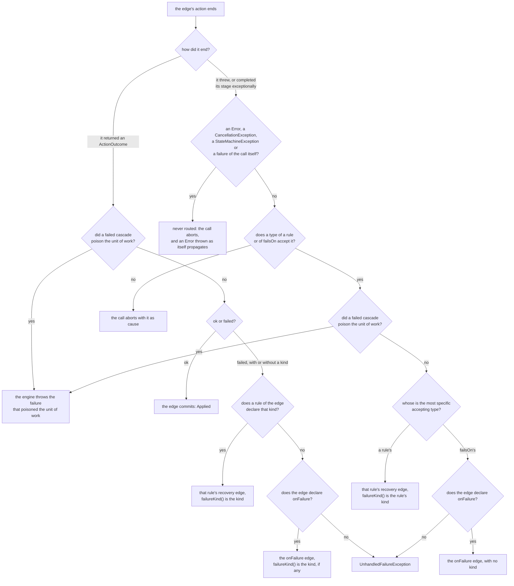

# Actions, guards and failure routes

Guards decide whether an edge may run; actions do the edge's work and say whether it succeeded. This page covers what
both receive, how a failure becomes a declared route, and how recovery rules send different failures to different
states.

The [quickstart](quickstart.md) shows synchronous actions and a guard. Actions receive `TransitionContext<E, S, T>`:

| Method | Meaning |
| --- | --- |
| `entity()` | The entity this step moves: the object supplied by the caller at the root, the peer in a cascaded step, the parent in the exit of a sub-machine |
| `transition()` | The identifier that selected this edge |
| `from()` / `to()` | The endpoints of the edge being executed |
| `depth()` | `0` for the root, increasing through cascades |
| `peer(...)` | Read another registered machine through a `PeerView` |
| `cascade(...)` | Request a peer transition, by identifier, within this unit of work |
| `cascadeAll(...)` | Apply a cascade to a collection using the selected policy |
| `input()` / `input(Class)` | The operation's second argument, if the caller passed one |
| `flow()` | The call's flow: typed values every step of the call shares, and the entity the call was made for; see [the call's flow](call-flow.md) |

Guards receive `GuardContext<E, S, T>`, which exposes the entity, the identifier, both endpoints, read-only
peer access, the same `input` accessors and a read-only `flow()`. It has no cascade API. Return `GuardResult.pass()` or
`GuardResult.reject("reason")`, whose reason may not be blank (`IllegalArgumentException`). A guard that returns null,
or an asynchronous one whose stage is null or completes with null, aborts the call with a `TransitionAbortedException`. A rejecting guard stops the edge before its action runs
and produces `Rejected` with `RejectionKind.GUARD` and the guard's name. In a graph the DSL built, the guards of one
edge have distinct names, so the name tells which one rejected: a generated guard is named by its member's simple name,
and two guards of one name on an edge are refused with `SG105`. A definition assembled without the DSL is not checked
for it. Guard code should be free of mutations and external side effects.

Without an input the optional is empty. A null input is refused before the call starts, as a null entity is, with a
`NullPointerException` that names the parameter. A value of an incompatible class throws `ClassCastException`;
absence and a wrong type are different conditions. Primitive operation arguments are boxed; read them with wrapper
tokens such as `Integer.class`. Class tokens cannot validate erased generic arguments. Input operations do not
support method type parameters or varargs.

The same input reaches the transition's guards, action and handled failure action. Cascades, the exits of
sub-machines, watch reactions and reevaluation have no input of their own and receive an empty optional. A shared
guard must handle that absence. An action can copy its input into [the call's flow](call-flow.md) for the
cascades, exits and hooks of the same call. Hooks, observers and transition records do not receive the input itself.

## Contents

- [Domain failures](#domain-failures)
- [Map specific exceptions to a domain failure](#map-specific-exceptions-to-a-domain-failure)
- [Recover by failure kind and exception type](#recover-by-failure-kind-and-exception-type)

## Domain failures

An action returns `ActionOutcome.ok()`, `ActionOutcome.failed("reason")`, or `ActionOutcome.failed(kind, "reason")`
with a failure kind, a final class or record that implements `FailureKind`; a blank reason or an invalid kind throws
`IllegalArgumentException`. An action that returns null, or an asynchronous one whose stage is null or completes with
null, aborts the call with a `TransitionAbortedException`, as a guard does. A failed action is a handled business
result when a recovery rule of the edge declares its failure kind, which selects that rule's recovery identifier, or
else when the edge names an `onFailure` identifier, which takes every other returned failure and keeps its kind in
`Outcome.Failed.failureKind()`. Without either, the runtime throws `UnhandledFailureException` and does not commit the
planned state changes.

A failure route is an ordinary edge, declared from the origin of the edge that may fail. In the quickstart:

```java
@TicketsGraph.Transition(
    id = TicketTransition.DECLINE,
    from = TicketState.OPEN,
    to = TicketState.FAILED)
```

When `register` fails, the runtime discards the `SUBMIT` edge's pending changes, resolves `DECLINE` from
`OPEN` — the origin, never the destination it was heading for — and commits it. It returns `Outcome.Failed`,
whose `transition()` is `SUBMIT`, whose `to()` is `REVIEW`, the destination it did not reach, whose
`failureTransition()` is `DECLINE` and whose `movedTo()` is `FAILED`.

`onFailure` names an identifier, so a route may legitimately reach the same destination as the edge it
recovers: identity, not the destination, distinguishes them. Naming the failing edge's own key is `SG301`, as
is naming an identifier that has no edge from that origin.

The failure route can itself be an action. Its guards are bypassed when entered as failure handling, and its
own failure route is not chained. A failure or exception from that route aborts. Hooks apply to the edge that
actually committed, so the failing edge's hook does not run and the route's effective hook does.

## Map specific exceptions to a domain failure

This declaration is an excerpt from the shop's `Orders` machine:

```java
// an IOException is a domain failure here; onFailure routes it to PAYMENT_DECLINED
@OrdersGraph.Transition(
    id = OrderTransition.PAY,
    from = NEW,
    to = PAID,
    action = OrderActionsRefs.Charge.class,
    guards = OrderActionsRefs.RetryBudgetLeft.class,
    onFailure = OrderTransition.PAYMENT_DECLINED,
    failsOn = IOException.class,
    timeout = @Timeout(seconds = 5))
Outcome<Order, OrderStatus, OrderTransition> pay(Order order);
```

`OrderTransition.PAYMENT_DECLINED` is an identifier that happens to share its spelling with the state
`OrderStatus.PAYMENT_DECLINED`. They are two enums, so javac keeps them apart, and the edge it names is
declared on the interface itself:

```java
@OrdersGraph.Transition(id = OrderTransition.PAYMENT_DECLINED, from = NEW, to = PAYMENT_DECLINED)
```

The corresponding async action calls a gateway and returns a stage. An exceptional completion with a matching
`IOException` uses the declared failure route. The runtime unwraps a `CompletionException` or
`ExecutionException` that carries a cause before classifying that cause. It unwraps exactly those two classes:
an exception of a subclass of either is classified as itself, not through its cause. It also classifies a
checked exception that an action throws like any other, whether the method declares it, so that an action
declared `throws IOException` with `failsOn = IOException.class` takes the failure route, or throws it without
declaring it, as Kotlin or `@SneakyThrows` code can. A guard, a hook, a watch condition, a lookup, a state or identity
accessor, a watch's peers or owner reader, or a sub-machine's child or parent reader may declare a checked exception
too: the generated companion compiles, and the exception is handled as the same exception thrown undeclared would be.
`failsOn` applies to action failures; a guard exception is a technical abort. A library exception, a
`StateMachineException`, that a guard or action throws or completes its stage with, bare or wrapped in one of those two
classes, is never matched against `failsOn`, whatever the edge lists: it aborts the call and becomes its cause, so a
failure of another call never passes for a failure of this one. A failure of the call itself, such as the abort a failed
cascade throws into the action, is the exception: the engine throws it as itself or, when the transaction is poisoned,
the failure that poisoned the transaction. An `Error` is never routed either: thrown as itself it propagates unchanged,
and one that completes a stage, or that one of those two classes carries, aborts.

`failsOn` cannot be a blanket `Throwable`, `Exception` or `RuntimeException`, an `Error`, a library engine exception, or
a `CancellationException` or one of its subtypes, which are never domain failures; nor `CompletionException` or
`ExecutionException` themselves, which are unwrapped before matching whenever they carry a cause, so declare the type of
their cause. All of these are `SG302`. Declare specific foreign throwable types, usually exceptions. Timeout,
interruption and cancellation are not a substitute for a returned domain failure. `@Timeout` is valid only for
asynchronous actions.

The generated companion declares each edge, from each of its origins, as one chained expression, with one call per
guard, `failsOn` class and recovery rule, and javac attributes a chain recursively, so the stack of the thread it runs
on bounds how long one can be. With JDK 21 on a thread with a 1 MiB stack, javac compiled a chained declaration of an
edge with 400 `failsOn` calls and failed with a `StackOverflowError` on one with 800. A statement written by hand with the DSL is bounded
the same way, by every call it chains, every edge of the graph when one statement declares them all: on that thread,
one of 400 edges without actions, 803 calls, compiled, and one of 600 edges failed. Keep an edge, or such a statement,
to a few hundred calls.

The full action implementation is in
[OrderActions.java](../graphmaquina-example/src/main/java/io/github/graphmaquina/example/order/OrderActions.java).

## Recover by failure kind and exception type

`onFailure` gives an edge a fallback recovery for admitted failures that no rule takes. When the failures of one
edge must end in different states, declare recovery rules. A rule names a failure kind and the identifier of its
recovery edge, and may list the throwable types that select it. `onFailure` stays the fallback for a failure that
no rule takes.

### Declare failure kinds

A failure kind is a type: a named final class or record that implements `io.github.graphmaquina.api.FailureKind`,
top-level or a member, and not an interface, an enum, a local or anonymous class, or a `Throwable`. The library
never creates an instance of it and keeps no catalogue of kinds. It compares the `Class`, so any edge of any
machine can use the same kind. One record per kind is enough:

```java
/** The states of a publication. */
public enum PublicationState {
    READY, PUBLISHED, RETRY_PENDING, REJECTED_BY_PROVIDER, INTEGRATION_FAILED, CLOSED
}

/** The operations and recovery identifiers of a publication. */
public enum PublicationChange {
    PUBLISH, SCHEDULE_RETRY, RECORD_REJECTION, MARK_INTEGRATION_FAILED, RETRY, CLOSE
}

/** Failure kinds reported by the publication adapter. */
public final class PublicationFailures {
    private PublicationFailures() { }

    /** The provider cannot take the publication now. */
    public record Unavailable() implements FailureKind { }

    /** The provider refused the content. */
    public record Rejected() implements FailureKind { }
}
```

Each public type goes in its own file.

### Declare the rules

`ServiceUnavailableException`, `ProviderRejectedException` and `InvalidResponseException` are the adapter's own
unchecked exceptions. An action reports a kind by returning
`ActionOutcome.failed(kind, reason)`, or by throwing an exception whose most specific declared type is one of the
types of the rule that declares that kind, within the exclusions below. In the DSL, each `recover(kind, transition)`
call declares one rule. A third argument adds one throwable type to the rule, and a `List` adds several; the list is
copied when the rule is declared. A rule without types is selected only by a returned failure of its kind:

```java
GraphDefinition<Publication, PublicationState, PublicationChange> graph = StateGraph.define(key)
        .initial(PublicationState.READY)
        .terminal(PublicationState.PUBLISHED)
        .terminal(PublicationState.CLOSED)
        .allowsCycle(PublicationState.READY)
        .statePolicy(PublicationState.READY, "publish the article first")
        .statePolicy(PublicationState.RETRY_PENDING, "retry the publication explicitly")
        .statePolicy(PublicationState.REJECTED_BY_PROVIDER, "close the rejected publication")
        .statePolicy(PublicationState.INTEGRATION_FAILED, "close after manual review")
        .transition(PublicationChange.PUBLISH, PublicationState.READY, PublicationState.PUBLISHED)
            .action(
                "publish",
                (TransitionContext<Publication, PublicationState, PublicationChange> ctx) ->
                    adapter.publish(ctx.entity()))
            // one rule per failure kind; its exception type selects it too
            .recover(
                PublicationFailures.Unavailable.class,
                PublicationChange.SCHEDULE_RETRY,
                ServiceUnavailableException.class)
            .recover(
                PublicationFailures.Rejected.class,
                PublicationChange.RECORD_REJECTION,
                ProviderRejectedException.class)
            // fallback: returned failures no rule takes, and InvalidResponseException
            .failsOn(InvalidResponseException.class)
            .onFailure(PublicationChange.MARK_INTEGRATION_FAILED)
            .endTransition()
        .transition(
                PublicationChange.SCHEDULE_RETRY,
                PublicationState.READY,
                PublicationState.RETRY_PENDING)
            .endTransition()
        .transition(
                PublicationChange.RECORD_REJECTION,
                PublicationState.READY,
                PublicationState.REJECTED_BY_PROVIDER)
            .endTransition()
        .transition(
                PublicationChange.MARK_INTEGRATION_FAILED,
                PublicationState.READY,
                PublicationState.INTEGRATION_FAILED)
            .endTransition()
        .transition(PublicationChange.RETRY, PublicationState.RETRY_PENDING, PublicationState.READY)
            .endTransition()
        .transition(
                PublicationChange.CLOSE,
                PublicationState.REJECTED_BY_PROVIDER,
                PublicationState.CLOSED)
            .endTransition()
        .transition(
                PublicationChange.CLOSE,
                PublicationState.INTEGRATION_FAILED,
                PublicationState.CLOSED)
            .endTransition()
        .build();
```

`adapter` stands for the application's client of the provider: its `publish` returns `ActionOutcome.ok()` or a
failure, or throws one of the three exceptions. With annotations, a `Transition` lists the same rules in
`recoveries`, one `Recovery` of the machine's vocabulary per rule. This operation belongs on a `Publications`
facade whose bindings host is `PublicationActions`, and its recovery edges are declared like `DECLINE` in the
quickstart, by type-level `Transition`s:

```java
@PublicationsGraph.Transition(
    id = PublicationChange.PUBLISH,
    from = PublicationState.READY,
    to = PublicationState.PUBLISHED,
    action = PublicationActionsRefs.Publish.class,
    recoveries = {
        @PublicationsGraph.Recovery(
            kind = PublicationFailures.Unavailable.class,
            transition = PublicationChange.SCHEDULE_RETRY,
            failsOn = ServiceUnavailableException.class),
        @PublicationsGraph.Recovery(
            kind = PublicationFailures.Rejected.class,
            transition = PublicationChange.RECORD_REJECTION,
            failsOn = ProviderRejectedException.class)},
    failsOn = InvalidResponseException.class,
    onFailure = PublicationChange.MARK_INTEGRATION_FAILED)
Outcome<Publication, PublicationState, PublicationChange> publish(Publication publication);
```

### How a failure selects its route

The whole decision, for an edge with an action, before the tables below detail each branch:



A `Recovery` is written only as a value of `recoveries`. Several values are several rules, not several fallbacks,
so they are not `SG607`. Whichever way it is declared, the edge routes admitted failures according to its rules
and fallback. In this table, `Unavailable` and `Rejected` are the two members of `PublicationFailures`:

| `PUBLISH`'s action | Recovery edge | `movedTo()` | `failureKind()` | `cause()` |
| --- | --- | --- | --- | --- |
| returns `failed(Unavailable.class, reason)` | `SCHEDULE_RETRY` | `RETRY_PENDING` | `Unavailable` | empty |
| throws `ServiceUnavailableException` | `SCHEDULE_RETRY` | `RETRY_PENDING` | `Unavailable` | the exception |
| returns `failed(Rejected.class, reason)` | `RECORD_REJECTION` | `REJECTED_BY_PROVIDER` | `Rejected` | empty |
| throws `ProviderRejectedException` | `RECORD_REJECTION` | `REJECTED_BY_PROVIDER` | `Rejected` | the exception |
| returns `failed("invalid response")` | `MARK_INTEGRATION_FAILED` | `INTEGRATION_FAILED` | empty | empty |
| throws `InvalidResponseException` | `MARK_INTEGRATION_FAILED` | `INTEGRATION_FAILED` | empty | the exception |
| throws any other exception | none: the call aborts | no outcome; the entity stays `READY` | — | — |

A returned failure is routed by its kind alone:

| The action returns | A rule declares that kind | `onFailure` declared | Result |
| --- | --- | --- | --- |
| `failed(reason)` | — | yes | the fallback, with no kind |
| `failed(reason)` | — | no | `UnhandledFailureException` |
| `failed(kind, reason)` | yes | either way | that rule's recovery, with its kind |
| `failed(kind, reason)` | no | yes | the fallback; `failureKind()` still reports the kind |
| `failed(kind, reason)` | no | no | `UnhandledFailureException`, which does not carry the kind |

The kind changes nothing about admission: returning a failure declares a domain failure, with a kind or without
one. Kinds have no hierarchy, the reason selects nothing, and a returned failure carries no cause.

### Route an exception by its most specific type

An exception is routed by the most specific declared type that accepts it. The types of every rule and the
types of the edge's own `failsOn` compete together. A type in a rule leads to that rule's recovery, with its kind;
a type in `failsOn` leads to the fallback, with no kind. Neither the order of the declarations nor the place a type
is declared changes the winner. On an edge with an action that declares

```java
.failsOn(SocketTimeoutException.class)
.onFailure(PublicationChange.MARK_INTEGRATION_FAILED)
.recover(PublicationFailures.Unavailable.class, PublicationChange.SCHEDULE_RETRY, IOException.class)
```

a `SocketTimeoutException` goes to `MARK_INTEGRATION_FAILED` with no kind, because its own type is declared and is
more specific than `IOException`. Any other `IOException` goes to `SCHEDULE_RETRY` with the kind `Unavailable`.
Swap the two types, `failsOn(IOException.class)` and the rule on `SocketTimeoutException`, and the timeout goes to
the rule while every other `IOException` goes to the fallback.

- One type declared in two rules, twice in one rule, or in a rule and in `failsOn`, is `SG304`, so the winner is
  always one type. A
  type repeated inside `failsOn` alone is accepted, since every copy leads to the fallback.
- `onFailure` never admits a throwable by itself: a throwable that no declared type accepts aborts the call with it as
  cause even when the edge has a fallback, except an `Error` thrown as itself, which propagates, and a failure of the
  call itself, which the engine throws as itself or, when the transaction is poisoned, as the failure that poisoned
  the transaction. If the most specific matching type belongs to the edge's own `failsOn` and the edge has no
  `onFailure`, the call ends in `UnhandledFailureException`, unless a failed cascade poisoned the transaction, in which
  case the engine throws the failure that poisoned the transaction.
- The reason is composed from the exception's simple name and its message, or from its binary name for an
  anonymous class. A message that cannot be read, because `getMessage()` throws anything but an `Error`, reads
  `<getMessage threw <exception class>>`, and the route is taken all the same, with the thread interrupted again when
  what `getMessage()` threw is an `InterruptedException`. `cause()` is the very exception the action threw, once
  unwrapped.
- Wherever the engine contains an `InterruptedException` that application code throws on the thread the engine called it
  on, it interrupts that thread again, since the blocking call that threw it cleared the interrupt: one that an action
  or a guard throws, whatever the engine then does with it, and one that a hook, a state getter or setter, an identity
  function, the trail's clock, a sub-machine's `childOf` or `parentOf`, a watch's `peersOf`, `ownerOf` or condition, an
  observer, the logger's backend, a value's `toString()` or a call submitted through `supplyAsync` throws. One that
  completes a stage leaves the thread as it is. Once the engine interrupts the thread again, the rest of the call runs
  on an interrupted thread, as an interrupt asks, the recovery of a routed failure included: a later wait of the call
  for a stage that is still pending, the recovery action's for one, ends at once and aborts the call as interrupted,
  while a synchronous action, and an asynchronous one whose stage has already completed, complete.
- `explanation()` holds the reason of a returned failure and stays empty when an exception was routed, whichever
  route took it.

### Failures that no rule takes

The engine keeps the boundary between domain failures and technical ones:

- Only what the action throws, or completes its stage with, is classified. A `CompletionException` or an
  `ExecutionException` that carries a cause is unwrapped first; a subclass of either is classified as itself.
- `Error`, `CancellationException` and `StateMachineException`, with their subtypes, are excluded: the runtime never
  matches them, so no declared type accepts them, whatever an edge declares, and it excludes them before it reads any
  declaration, so a rule on `IllegalStateException` never receives a `CancellationException`. Exclusion is what the
  runtime never matches; `SG302` is what you may not declare, in a rule as in `failsOn`: `Throwable`, `Exception`,
  `RuntimeException`, an `Error`, a library exception, a `CancellationException` or one of its subtypes, and exactly
  `CompletionException` or `ExecutionException`. An `Error` the action throws propagates as itself; one that completes
  the stage, or arrives wrapped, aborts the call with it as cause.
- A failure of the call itself, such as the abort a failed cascade throws into the action, is never routed: the engine
  throws it as itself or, when the transaction is poisoned, the failure that poisoned the transaction. Once a failed
  cascade poisoned the unit of work, an exception that a declared type accepts, from an action that does not run as a
  recovery action, takes no route either: the engine throws the failure that poisoned the transaction, before any route
  is chosen.
- A cancelled stage, and the timeout, interruption or refusal of the engine's own wait, abort the call and never
  reach a rule. A timeout that the adapter's own client throws, such as a `SocketTimeoutException`, is an exception
  like any other and can be declared.
- The engine throws a few JDK exceptions from an action's context and its flow: `NullPointerException` for a null
  argument, `IllegalArgumentException` for a primitive class token in `input(Class)` or `flow().entity(Class)` or an
  identifier of another catalogue, `ClassCastException` when `input(Class)` reads an input of another type, when
  `flow().put` receives a value that is not an instance of its key's type or when `flow().entity(Class)` names a
  class the root entity is not an instance of, and `WrongThreadException` when the context or its flow is used from
  another thread than the one running the action. They are not library exceptions: if the action lets one through and a
  declared type accepts it, a rule or `failsOn` routes it like the adapter's own exceptions. None of them is an
  `IllegalStateException`. The context does throw one for a cascade attempted once the commit has begun or while a
  step is rolled back, but only a retained context, called from a getter, a setter or an identity's `equals` or
  `hashCode`, can attempt that, never your running action. Declare the narrowest types the adapter throws.
- Checked exceptions are classified like the others, however they arrive: thrown by a synchronous action without
  being declared, declared by an annotated action method and rethrown unchanged by the generated companion, or
  completing a stage, inside an exact `CompletionException` too.
- Synchronous and asynchronous actions use the same selection: a returned failure, an exception thrown before the
  stage is handed back and an exceptional completion select the same route, kind and cause.

### Run the recovery edge

A recovery is an ordinary edge, resolved by its identifier from the origin of the edge that failed, as the
fallback is. The recovery identifier of every rule, like the fallback's, needs an edge from that origin, from each
of them when a `Transition` declares several, and may not be the failing edge's own key: `SG301` otherwise. Two
rules may share a recovery, and a recovery may lead to the state the failing edge was heading for. Before the
recovery runs, the engine returns to the savepoint taken before the failing edge, which discards that edge's pending
states and cascades, its destination included, and what its action and those cascades wrote to
[the call's flow](call-flow.md); the journal keeps the actions that started. Entered as a recovery, the edge, a
move or an action:

- runs none of its guards;
- passes the same input to its action;
- consults neither its own rules nor its own `onFailure`, so recoveries never chain;
- may cascade, within the usual limits;
- waits under its own effective timeout, inside the budget of the root call, and runs its own effective hook after
  the commit.

Requested by an ordinary call, the same identifier runs its guards and applies its own rules. If the recovery fails,
because it returns a failure, throws, fails its wait or runs a cascade that fails, the call aborts as that failure
always aborts: no other rule is tried and the fallback is not used. The journal still lists the actions that ran, but
not the kind or the cause of the first failure. A recovery action that returns a failed outcome ends the call in a
`TransitionAbortedException` whose message includes `the failure route action <name> returned failed (<its reason>)
after the original failure (<reason>)`, whose `transition()` and `action()` are the recovery's, and whose cause is the
throwable that selected the route, when one did. When the recovery action throws, or completes its stage with, a
throwable that is neither an `Error` thrown as itself nor a failure of the call, the abort that carries it also holds
the exception that selected the route, if one did, as suppressed, unless it is that very exception. So do these aborts
that the engine builds for the recovery step: when its action returns a null outcome or stage, or its wait times out, is
interrupted or is refused, unless a failed cascade had poisoned the call, which then ends in that poison as it is; when
a sub-machine that the recovery hop enters cannot start; and when the exit that a terminal state selects after the
recovery cannot run, because that state maps to no exit or the exit would run deeper than `maxCascadeDepth`. An abort of
the exit's own step holds no such exception. A recovery that an `InterruptedException` selected, or that runs after the
engine contained one in the same call, runs on an interrupted thread, since the engine interrupts the thread again: when
its action has to wait for a stage that is still pending, that wait is interrupted at once and the call aborts as just
said, while a synchronous recovery action, or one whose stage has already completed, completes. A definition assembled
without the DSL whose rule names an identifier with no edge from the origin aborts the call when that rule is selected,
as such an `onFailure` does.

### Read the kind and validate the rules

`Outcome.Failed` reports the kind as `failureKind()`, empty when the failure has none, beside
`failureTransition()`, the identifier of the recovery edge that ran. `status()` is `FAILED` and `code()` is
`FAILURE_ROUTED` whichever route was taken, and the `Outcome.Failed` that a cascade returns carries its kind to the
calling action. A failure that no rule and no fallback takes still ends the call in `UnhandledFailureException`,
which does not carry the kind:

```java
Outcome<Publication, PublicationState, PublicationChange> outcome =
        machine.execute(publication, PublicationChange.PUBLISH);
Optional<Class<? extends FailureKind>> kind =
        outcome.asFailed().flatMap(Outcome.Failed::failureKind);
boolean retryLater = kind.equals(Optional.of(PublicationFailures.Unavailable.class));
```

`definition().findTransition(from, id)` returns the edge's `TransitionSpec`: `recoveryRules()` lists its rules in
declaration order, and `failsOn()` still lists only the edge's own types. The order of the rules selects nothing.

The DSL refuses at once a null argument, a null type in the list, an identifier of another catalogue and a call
on a closed stage. It reports the rest when `build()` runs, naming the edge, without building any invalid rule:

- `SG303` for a class that is not a failure kind;
- `SG304` for a kind used by two rules of the edge, or a throwable type declared twice across its rules and
  `failsOn`;
- `SG302` for a type that `failsOn` refuses too;
- `SG507` for rules on an edge without an action;
- `SG301` for a recovery identifier that is the edge's own key or has no edge from one of its origins.

`SG301` is a structural check: the DSL runs the structural checks only once nothing a declaration gets wrong on its
own, such as the first four above, and no duplicate key remains, so fixing those can reveal it.

The annotation processor reports the same codes when it compiles the facade, `SG302`, `SG303` and `SG304` on the
annotation value at fault. Built by hand, a `RecoveryRule` refuses an invalid kind and a forbidden or repeated type,
and a `TransitionSpec` refuses rules without an action, a kind that two rules use and a type declared twice across
its rules and `failsOn`, all with `IllegalArgumentException`.

Recovery rules choose a route and nothing more. Nothing retries automatically or waits for a backoff:
`SCHEDULE_RETRY` only records that a retry is due, and the application decides when to request `RETRY`. Nothing
compensates either: the savepoint discards the engine's pending states and the writes to the call's flow, not the
changes the action made to the entity, to an object it stored in the flow, to the application's transaction or to
external systems. To assert kinds and rules in a test, see
[failure kinds and recovery rules](testing-advanced.md#failure-kinds-and-recovery-rules) in the testing guide.

---

Next: [Handle transition outcomes](outcomes.md). Back to the [documentation index](README.md).
