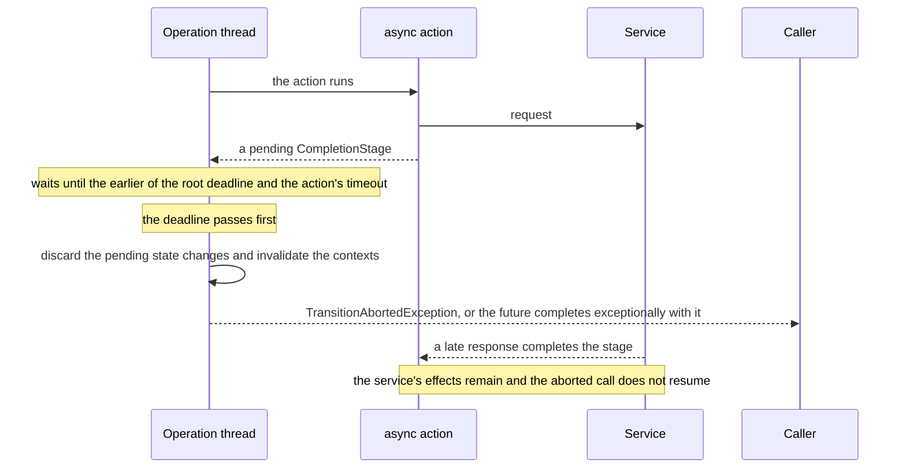

# Deadlines, cancellation and executors

## Contents

- [Deadline rules](#deadline-rules)
- [Timeout, cancellation and late completion](#timeout-cancellation-and-late-completion)
- [Contexts and completion callbacks](#contexts-and-completion-callbacks)
- [Executors and machine lifetime](#executors-and-machine-lifetime)
- [Test async behavior](#test-async-behavior)

## Deadline rules

A generated set with declared async actions or guards requires a positive default `Duration` as the first
builder argument. The runnable example uses five seconds. An optional per-machine override changes the
budget installed on that asynchronous machine:

```java
AsyncTicketMachines machines = AsyncTicketMachinesRuntime
        .builder(Duration.ofSeconds(10), new AsyncTicketActions(reviews))
        .asyncTimeout(AsyncTickets.class, Duration.ofSeconds(8))
        .build();
```

Close `machines` when its work is finished. The override is accepted only for an asynchronous machine in the
set; any other class throws `IllegalArgumentException`. A synchronous-only set such as `TicketMachines` has no
timeout builder argument and no `asyncTimeout(Machine.class, Duration)` method, even when you use a facade's `async(...)`
method to submit a synchronous operation.

Any positive duration is accepted. One of `Duration.ofNanos(Long.MAX_VALUE)` or more means no limit, for a
machine's budget and for an action's `@Timeout` alike.

| Setting | When its clock starts | What it bounds |
| --- | --- | --- |
| Set default or per-machine `asyncTimeout` | When a root operation begins execution, after executor queueing | Pending async waits in that root, its nested cascades and the sub-machine exits it runs |
| Action `@Timeout` | After the action method returns its stage | That action's pending wait, capped by the root's remaining deadline |
| Async guard | Uses the existing root deadline | That guard's pending wait; an action's `@Timeout` does not cover its guards |
| Service/client timeout | Defined by your service client | The service request according to that client's cancellation/timeout contract |


The effective action wait deadline is the earlier of the root deadline and the action-specific deadline.
If guards and other synchronous work have already consumed four seconds of an eight-second root budget, an
async action with `@Timeout(seconds = 5)` cannot get five additional seconds. The diagram illustrates this
with a stage returned at second four.

These settings are wait budgets, not a hard end-to-end execution timeout. They do not preempt synchronous
code, including blocking work inside a method that eventually returns a stage. The action-specific clock is
calculated after that return. A stage already completed when inspected can succeed even with zero remaining
wait time. There is no deadline check that interrupts setters, after-commit hooks or observers.

Cascades share the root's unit of work and deadline; entering a peer does not restart its machine-level
budget. Set defaults are installed only on asynchronous machines: those with declared async bindings, and those
whose calls can run an async edge implicitly, as the next paragraph explains. A synchronous-only root that cascades
to an async peer therefore has no root deadline supplied just by the set default. A timeout on
the peer action can still bound its wait, but an async guard on that path has no finite root budget. Choose
the entry point and timeout configuration deliberately when mixing synchronous and asynchronous machines.

The exit of a sub-machine shares the root's deadline too: it waits under the budget of the call's root, which is
the child machine's own when you called the child, and the exit edge's timeout can only shorten it. An exit runs
without any action of yours requesting it, and so do the edges it leads to: its failure routes, the exit that a
parent's terminal state selects one level up, and the exits of a sub-machine that the parent enters on the way.
Entering a bound state through the caller's own edge also starts its child's initial binding chain: a terminal
initial descendant selects its exit without an explicit cascade. The same rule covers those descendant exits,
including descendants started by an implicit edge. A registry therefore refuses a machine that declares no
`asyncTimeout` when any edge that its calls can run this way has an async action or guard:
`MachineRegistry.Builder.build()` throws `IllegalStateException` and names the edge.
A generated set installs its default on each such machine, and its `asyncTimeout(Machine.class, Duration)` accepts
one, so the set never builds a machine that the registry refuses. A cascade your action requests is explicit and
asks nothing of the kind.

Watch reactions are different: they execute after the triggering commit and start separate root
transactions with their own deadlines. The original operation waits for synchronous watch dispatch before
returning; its root wait budget does not impose one global deadline on the entire reaction chain.

## Timeout, cancellation and late completion

On an engine wait timeout, the operation throws `TransitionAbortedException`, or the failure that already poisoned
the call, pending graph-state changes
are discarded, and transaction-aware context operations become invalid. Through `machine.async`, that
exception completes the operation future exceptionally. Neither a recovery rule nor the declared `onFailure` route
is used for this timeout. The user's stage and the underlying service request are left running.
The engine waits through a callback registered on that stage with `handle`, which stays there until the stage
completes, as the JDK keeps every `handle` dependent; a wait that an interrupt or a pool's refusal ends leaves it
too. The engine remembers that callback, holding the stage weakly and by its identity alone, and a later wait for
the same stage, from any machine, waits on it instead of registering another. A stage that a single-flight cache
hands to every caller therefore carries one callback however many calls give up on it, plus one for each call that
was already waiting on it when the first gave up. Distinct stage objects are distinct stages: an action that returns
a new wrapper of a shared future on each call, such as `shared.thenApply(...)`, leaves on each wrapper one callback,
which the engine remembers too, until the shared future completes. A `CompletionStage` implementation of your own
keeps whatever its own `handle` keeps.


The same story as a sequence, for an action whose service answers after the wait gave up:



Three objects can be involved:

| What you stop or time out | Consequence |
| --- | --- |
| GraphMaquina's wait on an action or guard | Technical abort; no pending graph-state commit; the library does not cancel the user stage |
| The action's own stage is cancelled by its owner | Cancellation is treated as a technical action failure, not a handled business result |
| The outer operation future is cancelled or given a caller timeout | A call the executor has not started yet is skipped once the future is cancelled or completed, as `orTimeout` completes it; a timed `get(...)` completes nothing, so the call still runs. Once it started, no cancellation link stops it, so do not assume it prevented commit |

In particular, `pending.cancel(true)`, `pending.orTimeout(...)` or a timed `pending.get(...)` is not a transaction
rollback API. The operation may already be running, may continue running and may commit after the caller stops waiting.
Interrupting an operation thread while it is waiting causes a technical abort, which leaves the thread's interrupt
flag set, but GraphMaquina still does not cancel
the foreign stage. A `ForkJoinPool` that refuses to let its worker block for the wait, as one does when it cannot start
a spare worker in its place, causes a technical abort as well, whose cause is that pool's `RejectedExecutionException`,
unless a failed cascade has already poisoned the transaction, in which case the call ends in the failure that poisoned
it.

A late remote success can mean "the service processed the request, but the graph did not commit". Use a
stable request/idempotency key and a service-level deadline where needed. Reconcile uncertain remote results
before retrying an external side effect. GraphMaquina neither rolls back arbitrary field mutations made by
actions nor reverses HTTP calls, payments, messages or database writes performed outside its state setters.

## Contexts and completion callbacks

Capture the data required by the service while the action or guard is running. Prefer immutable values, as
`AsyncTicketActions` does with `String ticketId`, over passing a mutable entity or live context to a callback.


`ctx.peer(...)`, `ctx.cascade(...)`, `ctx.cascadeAll(...)`, `ctx.flow()`, context-derived peer views and every
operation of a context's flow, `get`, `keys`, `entity`, `trail`, `put` and `remove`, require both the original
operation thread and a live transaction. A wrong thread produces `WrongThreadException`; use after invalidation produces
`StaleContextException`; the staleness check comes before the thread check. After the root commits or aborts, its transaction-aware context is invalidated before
post-commit hooks run. Once invalidated, a context, its peer views and its flow let go of the call, so one retained
after the call keeps in memory nothing of the call but the entity and the input of the context's step, which `entity()`
and `input()` still answer, and, for a flow, also the root call's entity, with that entity's identity when the call
logs at `DEBUG`: it keeps a value of the flow only when that value is one of them. The flow a hook receives from its
`CommitContext` is checked the same way, against the thread running the hook and the hook's own run: it goes stale
once the hook returns or throws. The flow the caller receives once the call ended, in its outcome or its failure, is a
frozen copy without these checks.

Cascades also require that the commit has not begun and that no step is being rolled back. A retained action context
used for `cascade(...)` or `cascadeAll(...)` from a commit getter or setter, or from an identity's `equals` or
`hashCode` while a rollback calls it, throws `IllegalStateException` before it stages anything: the commit has already
fixed the changes it will write, and the rollback is undoing them. Reading peers or the flow does not stage another
hop, and a write to the flow from a commit getter or setter lands in the flow the call hands out.

Neither `thenApply` nor `thenApplyAsync` promises to run on that original operation thread. Even a callback
without the `Async` suffix may run on the service's completion thread. Do not hide a cascade or a write to the flow
in one of these callbacks. Read peers, write the flow or stage required cascades while on the operation thread;
after an external result, a separate facade invocation is a new transaction, not a continuation of the original
unit of work.

The context's simple entity/from/to/depth getters do not enforce these lifetime/thread checks. That does not
make the entity immutable or safe for concurrent access. Do not mutate the state property in an action or a
late callback; GraphMaquina owns graph-state writes during commit.

Both an operation with an input, such as [`screen(entity, verdict)`](graph-model.md#operations-and-internal-edges), and
`machine.async(() -> machine.screen(entity, verdict))` carry the value.
Input getters are simple data accessors like entity/from/to/depth; the library neither copies nor freezes
the value. Capture immutable data for asynchronous callbacks. Peer views, cascades and the flow still require the
original execution thread and a live transaction.

## Executors and machine lifetime

Each machine uses a virtual-thread-per-task executor by default. `machine.async(supplier)` submits the whole
supplier to that executor. It does not automatically create one transaction spanning several operations
inside the supplier: each facade operation starts its own root. Use `cascade` inside an action when multiple
machines must share one graph transaction.

A set can use an application-owned executor instead. For this example, import
`java.util.concurrent.Executors` and `java.util.concurrent.ExecutorService`:

```java
// the application owns operations: the try closes it after the machines
try (ExecutorService operations = Executors.newVirtualThreadPerTaskExecutor();
     AsyncTicketMachines machines = AsyncTicketMachinesRuntime
             .builder(Duration.ofSeconds(5), new AsyncTicketActions(reviews))
             .asyncExecutor(operations)
             .build()) {
    Outcome<Ticket, TicketState, TicketTransition> submitted = machines.tickets()
            .async(() -> machines.tickets().submit(ticket)).join();
    System.out.println(submitted.recordedState());
}
```

The example waits before closing. The executor is closed by the application's try-with-resources statement,
not by the machine set. With the defaults, closing a set closes its owned executors and waits for their
submitted work. An interrupt of the thread that closes the set, before or while it waits, reaches every owned
executor the set has not finished closing, not only the one it waits for: each interrupts the threads of its
operations, so a call waiting for a stage aborts as interrupted, and `close()` still waits for them to end, then
returns with the thread interrupted. Closing an owned executor from one of its own operations would wait for that
operation forever, so `close()` throws `IllegalStateException`, before it closes anything, on a thread that runs
such an operation, an asynchronous call or the supplier given to `async(...)`, whatever calls it there: an action, a
hook or a watch reaction of the call, a call a hook starts, or a dependent that completing the operation's future runs
on that thread. The set stays open; close it from another thread. With a custom executor, the caller owns shutdown
and must keep the machines and any service dependencies alive until operations finish. Closing the registry is not a
general cancellation barrier for synchronous calls or work submitted through a still-running custom executor. A
submission the executor refuses with `RejectedExecutionException`, as the default executor does once the set is
closed, yields an exceptionally completed future; any other
exception the executor's `execute` throws is thrown by `async(...)` on the caller's thread.

Avoid using the same small fixed executor for operation workers and service completions scheduled by
those operations. If every worker is blocked waiting for a service stage whose completion is queued behind
those workers, the executor can be starved. Keep service execution independent or provision an execution
model that does not block the resources its completions need. A custom direct executor such as `Runnable::run`
runs inline and removes the offloading behavior shown for the default executor.

A root that runs on a `ForkJoinPool` worker, such as one submitted through
`asyncExecutor(ForkJoinPool.commonPool())`, waits for its stage without running other tasks on its thread. If
the stage's own work is a task queued on that pool, another worker has to take it: an idle one, a spare the pool
starts, or one that frees up. While every other worker is busy, or blocked where the pool cannot see it, as on a
lock or a plain latch, the wait goes on, up to its timeout. When every other worker is blocked where the pool
sees it, as in `CompletableFuture`'s `get` or `join` or in another GraphMaquina wait, the pool starts a spare, if
its size allows.

A call submitted through `async(...)` is queued as a plain task, never as one of the asynchronous tasks that
`CompletableFuture`'s `get` and `join` run on a waiting `ForkJoinPool` worker, so a callback that waits there never
runs it on its own thread. While such a call is queued on the waiting worker, another worker has to take it, as for a
stage's task, and so has a `CompletableFuture` task queued behind it: a callback that waits for either waits, under no
timeout but its own, while every other worker is busy or blocked where the pool cannot see it. Two waits can still run
a queued call on the waiting thread, where the call fails with `ReentrantTransitionException`: a worker that joins a
`ForkJoinTask` may run a task queued by another worker that stole work from it, and waiting for a pool to quiesce,
through `ForkJoinTask.helpQuiesce()` or `ForkJoinPool.awaitQuiescence`, runs the pool's queued tasks on any thread.
Given `ForkJoinPool.commonPool()` while the common pool's parallelism is below two, a machine runs each call on a new
thread instead, as `CompletableFuture.supplyAsync` does with that pool on JDK 21. On JDK 25, `CompletableFuture`
raises the common pool's parallelism from 0 to 2 when its class is initialized, so a machine built after that runs
its calls on the pool. Start roots off `ForkJoinPool` workers, or give asynchronous work its own executor.

Multiple virtual threads do not serialize access to a shared entity. Two concurrent operations on the same
ticket need an application-level concurrency policy. The commit precheck detects some state conflicts; it
is not a lock or a compare-and-set transaction with your database. See
[concurrency](commit-and-persistence.md#concurrency-identity-and-persistence).

## Test async behavior

Use controllable futures rather than timing guesses. For each case below, build a fresh set and entity,
complete the service future deliberately, then inspect both the outcome/exception and the entity state.
For the action/`approved` cases, first let `submit` succeed so the ticket begins that check in `REVIEW`;
a fresh ticket starts in `OPEN`, where no edge carries `APPROVE`.

| Case | Service behavior | Expected observation |
| --- | --- | --- |
| Async guard passes | `canStart` completes `true` | `submit` returns `Applied`; state is `REVIEW` |
| Async guard rejects | `canStart` completes `false` | `submit` returns `Rejected` with kind `GUARD`; state stays `OPEN` |
| Action succeeds | `approved` completes `true` | `approve` returns `Applied`; state is `DONE` |
| Business decline | `approved` completes `false` | `approve` returns `Failed`; state is `FAILED` |
| Declared action exception | Stage fails with `IOException` | The `DECLINE` edge commits `FAILED` |
| Unexpected action exception | Stage fails with `IllegalStateException` | Technical abort; state remains `REVIEW` |
| Pending action exceeds wait budget | Leave its stage incomplete | `TransitionAbortedException`; state remains `REVIEW`; service stage is not cancelled |
| Service finishes after wait timeout | Complete that same stage later | No late graph-state commit |
| Guard stage throws | Fail `canStart` exceptionally | Technical abort; state stays `OPEN` |

`graphmaquina-test` has fixtures for these cases: `ControlledAsyncAction` and `ControlledAsyncGuard` let a test decide
when and how an asynchronous callback answers, and `AsyncAssertions.await` and `awaitFailure` wait for a stage within
the test's own budget. [Controlled asynchronous invocations](testing-samples.md#controlled-asynchronous-invocations)
shows them at work.

Also cover hook failures and concurrent-entity policy in the application. The repository's
[async runtime tests](../graphmaquina-core/src/test/java/io/github/graphmaquina/runtime/AsyncTest.java) and
[context lifetime tests](../graphmaquina-core/src/test/java/io/github/graphmaquina/runtime/SingleMachineTest.java)
provide focused examples of deadline and ownership behavior.

---

Next: [Machine sets, cascades and watches](coordination.md). Back to the [documentation index](README.md).
