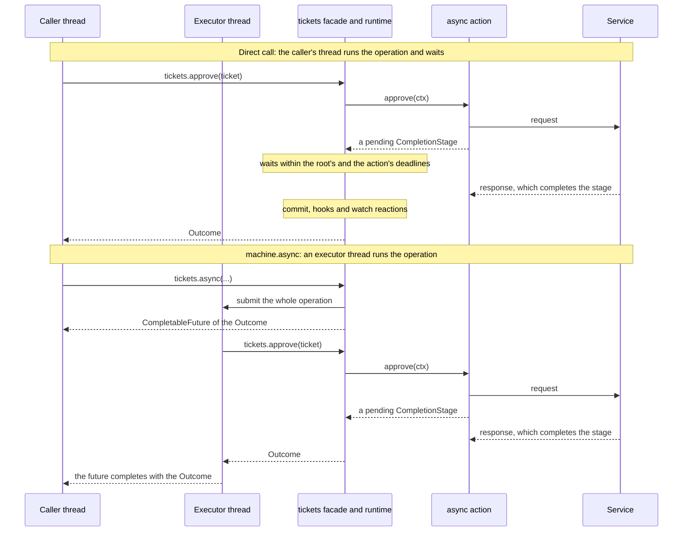

# Asynchronous work and timeouts

GraphMaquina supports asynchronous actions and guards while keeping each transition's execution and commit
ordered. There are two independent decisions: whether a binding returns a stage, and whether the caller
submits the whole operation through `machine.async(...)`.

This page chooses the calling style, builds a runnable async ticket and reads its future. The
[deadlines, cancellation and executors](async-deadlines.md) page continues it: how long a stage may be
awaited, what a timeout does to work still running, which context is safe in a callback, who owns the
executor, and how to test asynchronous behavior.

## Contents

- [Choose the calling style](#choose-the-calling-style)
- [Runnable async ticket example](#runnable-async-ticket-example)
- [Read the future and domain result](#read-the-future-and-domain-result)

## Choose the calling style

| Action/guard implementation | How you invoke the machine | What the caller experiences |
| --- | --- | --- |
| Returns `ActionOutcome` / `GuardResult` | `tickets.approve(ticket)` | Executes inline and returns an `Outcome` |
| Returns `CompletionStage<ActionOutcome>` / `CompletionStage<GuardResult>` | `tickets.approve(ticket)` | Invokes the binding inline, waits for its stage, then returns an `Outcome` |
| Either kind of binding | `tickets.async(() -> tickets.approve(ticket))` | Submits the whole operation to the configured executor and returns `CompletableFuture<Outcome<...>>` |

With the default executor, the last form runs the operation on a virtual thread, allowing the calling thread
to continue. A custom executor determines its own scheduling; a direct executor can execute inline. The whole
operation runs on the executor of the machine you called, the exit of a sub-machine it ends included, and the
binding of a sub-machine is checked when the operation starts running, not when it is submitted.


The two calling styles with an asynchronous action, step by step:



Returning a stage does not change the generated operation's return type: the facade still returns
`Outcome<E, S, T>`. The outer `CompletableFuture` comes from `machine.async(...)`. Calling `join()` immediately
on that future blocks the caller again; at an asynchronous application boundary, compose and return the
future instead of joining it on an event-loop thread.

Guards execute in order. Each async guard is awaited before the next guard or action runs. A guard rejection
stops the edge. An [eligibility check](eligibility.md#asynchronous-guards-and-the-deadline) awaits asynchronous
guards the same way, and runs no action. The action method itself runs on the operation thread up to the point where
it returns its stage. Any blocking I/O performed before that return still blocks the operation thread. Use a service API
that returns promptly, or an application-managed executor for genuinely blocking service code.

## Runnable async ticket example

This example adds a review service, which the asynchronous guard `canStart` and the asynchronous action `approve`
call, to the ticket domain. Reuse
`Ticket.java`, `TicketState.java` and `TicketTransition.java` from the
[quickstart](quickstart.md), with the same Gradle or Maven configuration and
dependencies. Add the following five files under `src/main/java/com/example/tickets/`. They can coexist with
the synchronous quickstart: a second machine over the same three types is its own graph.

The service contract returns stages; the example implementation controls their completion explicitly so
there is no external server, `Thread.sleep`, or scheduling guesswork.

### TicketReviewService.java

```java
package com.example.tickets;

import java.util.concurrent.CompletionStage;

public interface TicketReviewService {
    CompletionStage<Boolean> canStart(String ticketId);
    CompletionStage<Boolean> approved(String ticketId);
}
```

### AsyncTicketActions.java

```java
package com.example.tickets;

import io.github.graphmaquina.annotation.GraphAction;
import io.github.graphmaquina.annotation.GraphGuard;
import io.github.graphmaquina.api.ActionOutcome;
import io.github.graphmaquina.api.GuardContext;
import io.github.graphmaquina.api.GuardResult;
import io.github.graphmaquina.api.TransitionContext;
import java.util.Objects;
import java.util.concurrent.CompletionStage;

public final class AsyncTicketActions {
    private final TicketReviewService reviews;

    public AsyncTicketActions(TicketReviewService reviews) {
        this.reviews = Objects.requireNonNull(reviews);
    }

    @GraphGuard
    public CompletionStage<GuardResult> canStart(
            GuardContext<Ticket, TicketState, TicketTransition> ctx) {
        String ticketId = ctx.entity().getId();
        return reviews.canStart(ticketId).thenApply(allowed -> allowed
                ? GuardResult.pass()
                : GuardResult.reject("ticket is not eligible"));
    }

    @GraphAction
    public CompletionStage<ActionOutcome> approve(
            TransitionContext<Ticket, TicketState, TicketTransition> ctx) {
        String ticketId = ctx.entity().getId();
        return reviews.approved(ticketId).thenApply(approved -> approved
                ? ActionOutcome.ok()
                : ActionOutcome.failed("approval was declined"));
    }
}
```

Both methods capture the immutable identifier before calling the service. Their callbacks only translate a
service value; they do not use the transaction context or mutate the entity. Approval comes from the service
in this example, rather than the quickstart entity's `accepted` field.

### AsyncTickets.java

```java
package com.example.tickets;

import static com.example.tickets.TicketState.DONE;
import static com.example.tickets.TicketState.FAILED;
import static com.example.tickets.TicketState.OPEN;
import static com.example.tickets.TicketState.REVIEW;

import io.github.graphmaquina.annotation.GenerateGraphApi;
import io.github.graphmaquina.annotation.Timeout;
import io.github.graphmaquina.api.Machine;
import io.github.graphmaquina.api.Outcome;
import java.io.IOException;

@GenerateGraphApi
@AsyncTicketsGraph.Definition(
    initial = OPEN,
    terminals = {DONE, FAILED},
    state = TicketRefs.State.class,
    id = TicketRefs.Id.class)
@AsyncTicketsGraph.StatePolicy(state = OPEN, otherwise = "submit the ticket first")
@AsyncTicketsGraph.StatePolicy(state = REVIEW, otherwise = "approve or decline the ticket")
@AsyncTicketsGraph.Transition(id = TicketTransition.DECLINE, from = REVIEW, to = FAILED)
public interface AsyncTickets extends Machine<Ticket, TicketState, TicketTransition> {
    @AsyncTicketsGraph.Transition(
        id = TicketTransition.SUBMIT,
        from = OPEN,
        to = REVIEW,
        guards = AsyncTicketActionsRefs.CanStart.class)
    Outcome<Ticket, TicketState, TicketTransition> submit(Ticket ticket);

    // a declined review or IOException takes DECLINE; an action timeout aborts the call
    @AsyncTicketsGraph.Transition(
        id = TicketTransition.APPROVE,
        from = REVIEW,
        to = DONE,
        action = AsyncTicketActionsRefs.Approve.class,
        onFailure = TicketTransition.DECLINE,
        failsOn = IOException.class,
        timeout = @Timeout(seconds = 2))
    Outcome<Ticket, TicketState, TicketTransition> approve(Ticket ticket);
}
```

`canStart` uses the machine's root wait deadline. The `approve` action also has a two-second wait limit. A
service result of `false` becomes a handled failure; a stage completed exceptionally with `IOException` also
takes the `DECLINE` edge, resolved from `REVIEW`. A guard exception or an action wait timeout is a technical
abort, even though the action declares `onFailure`.

### AsyncTicketMachines.java

```java
package com.example.tickets;

import io.github.graphmaquina.annotation.StateGraphs;
import io.github.graphmaquina.api.Machines;

@StateGraphs
public interface AsyncTicketMachines extends Machines {
    AsyncTickets tickets();
}
```

### AsyncApp.java

```java
package com.example.tickets;

import io.github.graphmaquina.api.Outcome;
import io.github.graphmaquina.api.OutcomeStatus;
import java.time.Duration;
import java.util.concurrent.CompletableFuture;
import java.util.concurrent.CompletionStage;

public final class AsyncApp {
    private AsyncApp() { }

    public static void main(String[] args) {
        CompletableFuture<Boolean> approval = new CompletableFuture<>();
        TicketReviewService reviews = new TicketReviewService() {
            @Override
            public CompletionStage<Boolean> canStart(String ticketId) {
                return CompletableFuture.completedFuture(true);
            }

            @Override
            public CompletionStage<Boolean> approved(String ticketId) {
                return approval;
            }
        };

        try (AsyncTicketMachines machines = AsyncTicketMachinesRuntime
                .builder(Duration.ofSeconds(5), new AsyncTicketActions(reviews))
                .build()) {
            AsyncTickets tickets = machines.tickets();
            Ticket ticket = new Ticket("T-ASYNC", "Review the documentation", true);

            Outcome<Ticket, TicketState, TicketTransition> submitted =
                    tickets.async(() -> tickets.submit(ticket)).join();
            if (submitted.status() != OutcomeStatus.APPLIED) {
                throw new IllegalStateException("submit was not applied: " + submitted);
            }

            CompletableFuture<Outcome<Ticket, TicketState, TicketTransition>> pending =
                    tickets.async(() -> tickets.approve(ticket));
            System.out.println("Caller can do other work while approval is pending.");

            // In a real service, its client completes this stage when the response arrives.
            approval.complete(true);

            Outcome<Ticket, TicketState, TicketTransition> approved = pending.join();
            if (approved.status() != OutcomeStatus.APPLIED
                    || ticket.getState() != TicketState.DONE) {
                throw new IllegalStateException("approval was not applied: " + approved);
            }
            System.out.println("Async ticket -> " + ticket.getState());
        }
    }
}
```

This command-line demonstration joins each future so it can check each result; closing the set would itself
wait for the work submitted to its default executors. In Gradle, change the existing `application.mainClass` to `"com.example.tickets.AsyncApp"`,
then run `./gradlew clean run`. In Maven:

```bash
mvn clean compile
mvn -q dependency:build-classpath -Dmdep.outputFile=target/classpath.txt
java -cp "target/classes:$(cat target/classpath.txt)" com.example.tickets.AsyncApp
```

Expected application output:

```text
Caller can do other work while approval is pending.
Async ticket -> DONE
```

To explore another branch, complete `approval` with `false` instead of `true`: the operation then returns
`Outcome.Failed` and the ticket becomes `FAILED`, so update the demonstration's success assertion accordingly.
Use `approval.completeExceptionally(new java.io.IOException("service unavailable"))` to exercise `failsOn`.
An unexpected exception, such as `IllegalStateException`, completes the operation future exceptionally.

## Read the future and domain result

There are two layers of result. A future that completes normally does not imply `Outcome.Applied`:
`Rejected`, `Ignored` and a handled `Failed` are normal values too.


With the `tickets` and `ticket` from the example, this fragment reacts to completion without joining:

```java
CompletableFuture<Outcome<Ticket, TicketState, TicketTransition>> pending =
        tickets.async(() -> tickets.approve(ticket));

CompletableFuture<Void> handled = pending.thenAccept(
    (Outcome<Ticket, TicketState, TicketTransition> outcome) -> {
        switch (outcome.status()) {
            case APPLIED -> System.out.println("Committed: "
                    + outcome.requestedTransition().orElseThrow()
                    + " -> " + outcome.recordedState());
            case FAILED -> System.out.println("Handled decline at " + outcome.recordedState()
                    + outcome.explanation().map((String text) -> ": " + text).orElse(""));
            case REJECTED -> System.out.println("Not allowed: "
                    + outcome.explanation().orElseThrow());
            case IGNORED -> System.out.println("Unchanged: " + outcome.recordedState());
        }
    });

handled.whenComplete((Void unused, Throwable error) -> {
    if (error != null) {
        System.err.println("Operation or callback failed: " + error);
    }
});
```

Keep or return the relevant future to the caller. `join()` wraps an exceptional completion in
`CompletionException`; `get()` uses `ExecutionException` and can be interrupted. If the outer future itself
is cancelled, either method can throw `CancellationException`: the original on JDK 21, and on JDK 25 a new one
whose cause is the original. When the call ran and failed, the cause is
that call's `CallFailedException`, or an `Error`. The future fails even when that cause cannot be printed, because
its `getMessage()` or `toString()` throws: the `CompletionException`'s message is then
`<toString threw <exception class>>`, naming what printing threw, and `join()` throws it. `get()` throws what a
`CompletableFuture`'s `get()` throws for such a cause on the JDK it runs on: on JDK 21, what printing the cause
throws, as it builds its `ExecutionException` from the cause's string; on JDK 25, an `ExecutionException` caused by
it, whose message is empty and which carries what printing threw as a suppressed exception. Read the
`CallFailedException`'s `statesWritten()` and `journal()`, as [Handle a failed call](outcomes.md#handle-a-failed-call) shows,
before deciding whether to retry; an exceptional future is not proof that nothing happened. A request refused before
it started ran nothing: one an executor refused
(`RejectedExecutionException`), one with a null argument (`NullPointerException`, whose message names that parameter),
one for an identifier of another catalogue (`IllegalArgumentException`), and one made where no call may start
(`ReentrantTransitionException`, possible when the call runs on the thread of the callback that submitted it, through
an executor that runs tasks inline or a wait that runs a `ForkJoinPool`'s queued tasks). A null argument fails the
future only when the operation you submit receives it: `async(null)` itself, and a null argument of a low-level
`StateMachine`'s `async().execute(...)` or `async().reevaluate(...)`, throw their `NullPointerException` on the calling
thread before anything is submitted. A callback you attach can also fail independently of the machine operation.

Avoid a blanket `exceptionally(error -> ActionOutcome.failed(...))` inside an action unless every covered
exception truly means a business decline. It would also turn unexpected service/programming errors into a
normal failure route. Return `ActionOutcome.failed(reason)`, or `ActionOutcome.failed(kind, reason)`, for a known
business failure, and declare specific throwable types, in a recovery rule or in `failsOn`, when the graph is
intended to handle those action exceptions.

---

Next: [Deadlines, cancellation and executors](async-deadlines.md). Back to the [documentation index](README.md).
