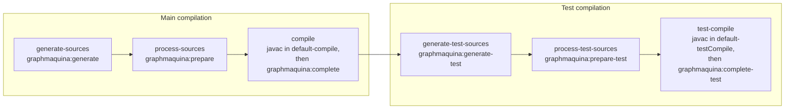

# The Maven adapter

Two plugins are required, and neither works without the other.

The repositories of [where the artifacts come from](typed-annotations-build.md#where-the-artifacts-come-from) are
assumed; `graphmaquina-core`, `graphmaquina-processor` and `graphmaquina-maven-plugin`, with the generator the plugin
depends on, must be resolvable, which for Central or a locally installed build means nothing further to declare.

```xml
<properties>
  <maven.compiler.release>21</maven.compiler.release>
  <lombok.version>1.18.48</lombok.version>
  <graphmaquina.version>2.0.1</graphmaquina.version>
</properties>

<dependencies>
  <dependency>
    <groupId>io.github.graphmaquina</groupId>
    <artifactId>graphmaquina-core</artifactId>
    <version>${graphmaquina.version}</version>
  </dependency>
  <dependency>
    <groupId>org.projectlombok</groupId>
    <artifactId>lombok</artifactId>
    <version>${lombok.version}</version>
    <scope>provided</scope>
  </dependency>
</dependencies>

<build>
  <plugins>
    <plugin>
      <groupId>org.apache.maven.plugins</groupId>
      <artifactId>maven-compiler-plugin</artifactId>
      <version>3.15.0</version>
      <configuration>
        <annotationProcessorPaths>
          <!-- Lombok first: the GraphMaquina processor reads the accessors Lombok generates. -->
          <path>
            <groupId>org.projectlombok</groupId>
            <artifactId>lombok</artifactId>
            <version>${lombok.version}</version>
          </path>
          <path>
            <groupId>io.github.graphmaquina</groupId>
            <artifactId>graphmaquina-processor</artifactId>
            <version>${graphmaquina.version}</version>
          </path>
        </annotationProcessorPaths>
      </configuration>
      <executions>
        <!-- Each compilation reads the manifest the generation that precedes it wrote. -->
        <execution>
          <id>default-compile</id>
          <configuration>
            <compilerArgs>
              <arg>-Agraphmaquina.annotationManifest=${project.build.directory}/graphmaquina/main/annotation-manifest.json</arg>
            </compilerArgs>
          </configuration>
        </execution>
        <execution>
          <id>default-testCompile</id>
          <configuration>
            <compilerArgs>
              <arg>-Agraphmaquina.annotationManifest=${project.build.directory}/graphmaquina/test/annotation-manifest.json</arg>
            </compilerArgs>
          </configuration>
        </execution>
      </executions>
    </plugin>
    <plugin>
      <groupId>io.github.graphmaquina</groupId>
      <artifactId>graphmaquina-maven-plugin</artifactId>
      <version>${graphmaquina.version}</version>
      <executions>
        <execution><id>sg-generate</id><phase>generate-sources</phase><goals><goal>generate</goal></goals></execution>
        <execution><id>sg-prepare</id><phase>process-sources</phase><goals><goal>prepare</goal></goals></execution>
        <execution><id>sg-complete</id><phase>compile</phase><goals><goal>complete</goal></goals></execution>
        <execution><id>sg-generate-test</id><phase>generate-test-sources</phase><goals><goal>generate-test</goal></goals></execution>
        <execution><id>sg-prepare-test</id><phase>process-test-sources</phase><goals><goal>prepare-test</goal></goals></execution>
        <execution><id>sg-complete-test</id><phase>test-compile</phase><goals><goal>complete-test</goal></goals></execution>
      </executions>
    </plugin>
  </plugins>
</build>
```

The release does not have to be written out when a parent already sets it — the Spring Boot parent, for
instance, derives `maven.compiler.release` from `java.version`, and the plugin resolves the setting the way
Maven resolves a parameter. The checks below read the compiler's configuration as `maven-compiler-plugin` 3.15.0
passes it to javac, the version this snippet pins. What matters is that the effective release is 21 or later. The test compilation
reads `<testRelease>`, `<testSource>` and `<testTarget>`, or their `maven.compiler.test*` properties, in place of
`<release>`, `<source>` and `<target>` wherever they are set, as `maven-compiler-plugin` does.

## Contents

- [The six goals](#the-six-goals)
- [The compiler execution the goals read](#the-compiler-execution-the-goals-read)
- [Outputs](#outputs)
- [Sources, release and encoding](#sources-release-and-encoding)
- [Configuration parameters](#configuration-parameters)
- [What the Maven adapter requires, and refuses](#what-the-maven-adapter-requires-and-refuses)

## The six goals

| Goal | Phase | What it does |
| --- | --- | --- |
| `generate` | `generate-sources` | checks the compiler configuration, runs the generator, adds `target/generated-sources/graphmaquina` as a compile source root |
| `prepare` | `process-sources` | retires the outputs the previous compilation owned, the published index among them, and dates the generated carrier past the newest file the class output held before that retirement; `maven-compiler-plugin` 3.15.0 recompiles without that date, since the carrier has no class file by then |
| `complete` | `compile` | publishes the index of what javac accepted and seals the inventory |
| `generate-test` | `generate-test-sources` | the same for the test source set, into `target/generated-test-sources/graphmaquina` |
| `prepare-test` | `process-test-sources` | the same for the test source set |
| `complete-test` | `test-compile` | the same for the test source set |

The goal prefix is `graphmaquina`, so a goal can also be invoked directly, for example
`mvn graphmaquina:generate`.

A goal does nothing, and says so at info level (`StateGraph skips <compilationId>: …`), for a compilation the build
switches off the way `maven-compiler-plugin` skips its own goal: `maven.main.skip` or `<skipMain>` for the three
main goals, `maven.test.skip` or `<skip>` for the three test goals. So does it for a compilation the default
lifecycle runs no execution of the compiler's goal for, as when `default-compile` is bound to the phase `none`, or
to a phase of another lifecycle such as `pre-site`, and nothing else compiles the main sources. Nothing is
generated, retired or published then. All six do nothing in a project packaged as `pom`, such as the parent of a
multi-module build whose modules inherit the executions.

The six goals across the default lifecycle's phases:



The observed order of a `mvn test-compile`; the plugin's own suite checks, from real Maven output, that each
GraphMaquina goal runs in this order around its compiler execution:

```
graphmaquina:generate (sg-generate)
graphmaquina:prepare (sg-prepare)
resources:resources
compiler:compile (default-compile)
graphmaquina:complete (sg-complete)
graphmaquina:generate-test (sg-generate-test)
graphmaquina:prepare-test (sg-prepare-test)
resources:testResources
compiler:testCompile (default-testCompile)
graphmaquina:complete-test (sg-complete-test)
```

Declaration order in the POM does not matter for `default-compile` and `default-testCompile`: Maven runs the
executions the lifecycle binds before those a POM adds to the same phase. An execution of the compiler a POM adds
itself, as below, runs among the others of its phase in the order their plugins are declared, so declare
`maven-compiler-plugin` before `graphmaquina-maven-plugin`: otherwise `complete` would run before that javac, and
`generate` refuses the build before anything is retired, naming both executions.

## The compiler execution the goals read

The checks and the request read the execution of the `compile` goal of `maven-compiler-plugin`, `testCompile` for
the test goals, that the default lifecycle runs and that compiles the vocabulary the generator writes, whatever its
id. An execution runs there when it is bound to a phase of the default lifecycle, the one the StateGraph goals run
in: the phase it declares, else the default phase of its goal, `compile` or `test-compile`. One bound to anything
else is never read: one bound to `none` never runs, and one bound to a phase of another lifecycle, such as
`pre-site` or `clean`, runs only when the build invokes that lifecycle, never between the preparation and the
completion. So a build may bind `default-compile` and `default-testCompile` to `none` and compile its Java sources
through executions of its own, as `kotlin-maven-plugin` asks a mixed Kotlin and Java build to do; the manifest
argument and every setting the adapter checks then belong to those executions. An execution compiles the vocabulary
unless its own `<compileSourceRoots>` leave out the directory the generator writes into; one that compiles another
source root into a multi-release jar, with `<multiReleaseOutput>` and roots of its own, runs untouched beside the
main compilation. When no execution of the goal runs, the compilation is skipped, as above. Two running executions
that both compile the vocabulary are refused, naming both: javac would compile it twice into one class output, and
the later run fails on the classes of the earlier one.

Every setting the goals read from that execution, or from the property the setting is bound to, is read as Maven
evaluates it for the compiler, through Maven's own evaluator of plugin parameters. An expression the effective model
leaves for that evaluator, such as `${session.executionRootDirectory}` or `${settings.localRepository}`, is completed
first, so an `<outputDirectory>` or `<compileSourceRoots>` spelled with one is checked, and passed to the generator,
as the compiler gets it. A value that is one expression naming an object Maven does not take for that setting, such
as `${project.file}` for a text, counts as unset, and an expression that cannot be completed yet stays as it is
written, as the [compiler arguments](#what-the-maven-adapter-requires-and-refuses) do.

## Outputs

| Path | Content |
| --- | --- |
| `target/generated-sources/graphmaquina` | the generated vocabulary of the main compilation |
| `target/generated-test-sources/graphmaquina` | the same for the test compilation |
| `target/graphmaquina/main/{request,annotation-manifest,owned-outputs,processor-inventory}.json` | the main cycle's request, manifest, sealed inventory and the processor's own inventory |
| `target/graphmaquina/main/annotation-manifest.pending.json` | the generation's recovery ownership; not a manifest javac may consume |
| `target/graphmaquina/main/owned-outputs.pending.json` | the pending inventory: what the preparation is retiring; left behind by a compilation javac rejects, and consumed by the next preparation |
| `target/graphmaquina/test/…` | the same for the test compilation |
| `target/classes/META-INF/graphmaquina/exports.json` | the published index, packaged into the jar |
| `target/classes/META-INF/graphmaquina/pending-exports.json` | the provisional index the processor writes during javac, which `complete` promotes to `exports.json` |

The compilation carrier, `io/github/graphmaquina/generated/bootstrap/GraphCompilation<digest>.java`, is
tool-internal: `complete` removes its class file, so the jar never carries it. This plugin configures no other
plugin, and `generate` adds `target/generated-sources/graphmaquina` to the compile source roots, which
`maven-source-plugin` and `maven-javadoc-plugin` read: the carrier's source lands in the sources jar and its page
in the javadoc unless their configuration leaves it out. In the `<configuration>` of `maven-javadoc-plugin`
3.12.0, either of these settings leaves it out, except that `sourceFileExcludes` is ignored when `<subpackages>`
is set:

```xml
<sourceFileExcludes>
  <sourceFileExclude>io/github/graphmaquina/generated/bootstrap/**</sourceFileExclude>
</sourceFileExcludes>
<!-- or -->
<excludePackageNames>io.github.graphmaquina.generated.bootstrap</excludePackageNames>
```

In the `<configuration>` of `maven-source-plugin` 3.4.0, this one does:

```xml
<excludes>
  <exclude>io/github/graphmaquina/generated/bootstrap/**</exclude>
</excludes>
```

## Sources, release and encoding

The source roots are the compiler's own `<compileSourceRoots>` when the execution declares them, a relative one
resolved against the directory Maven was started in, as `maven-compiler-plugin` resolves it, and the project's
otherwise; an empty `<compileSourceRoots/>` stands for the project's. A source root the execution does not narrow
is passed to the generator whole, but for the case below; one its `<includes>` or `<excludes>` narrow
(`<testIncludes>`, `<testExcludes>` or `<testIncrementalExcludes>` for the tests) is passed as the files they
select, with the patterns matched as the compiler's plexus-utils scanner matches them on the platform the build
runs on, `%ant[...]` and `%regex[...]` included, and without the files that scanner excludes by default, the list of
plexus-utils, which leaves out `._*` copies and the directories of version control systems among others. That
scanner spells a path with the file
separator of the platform, `/` or `\`, and rewrites the separators of a `%regex[...]` pattern for it: every pair of
backslashes becomes `/` where the separator is `/`, and every `/` becomes a pair of backslashes, an escaped
backslash, where it is `\`. So `/` and an escaped backslash stand for the separator on either platform, while an
expression that escapes a `/`, such as `fx\/drafts\/.*`, selects the drafts only where the separator is `/`.
Directories are entered as that scanner enters them: only when an include matches the directory and no exclude
does, or when an include could match a path below it. Where the separator is `/`, an include that starts with a
separator never can: it matches a path as if it had no leading separator, so `/fx/**` selects the sources under
`fx`, a directory it matches, while `/io/github/graphmaquina/generated/**` alone selects nothing, since the
scanner never enters `io`. Where the separator is `\`, as on Windows, plexus-utils also lets the scanner in for
such an include as if it had no leading separator, so `/io/github/graphmaquina/generated/**` selects the sources
under `io/github/graphmaquina/generated`. A directory that cannot be listed is read as an empty one, as that scanner
reads it.

The generator walks a whole root as Gradle walks a source directory, with Ant's shorter default list: it leaves
out every directory a default exclude names, with everything inside it. The compiler's scanner leaves out what is
inside a directory only when an exclude ending in `/**` names it, as one names each directory of a version control
system, so a root under which javac compiles a source inside a directory named like an excluded file, `old~` or
`.gitignore` for instance, is passed as the files the compiler selects, as a narrowed one is. So is a root that holds
a directory the generator's walk would open but cannot list: the walk would fail on it, while the compiler's scanner,
and so the files passed in its place, read it as an empty one. Under a root passed whole, a `.java` file inside an
`RCS`, `BitKeeper`, `ChangeSet`, `_darcs`, `.metadata`, `.arch-ids` or `.darcsrepo` directory, or one named
`-darcs-backup*`, is read by the generator although javac never compiles it. Symbolic links are followed, and a
link that leads back into a directory being walked is skipped.

The request also carries the release javac compiles at, `<release>`, else `<target>`, or their properties, with the
test settings for the test compilation. javac takes the last `--release` it is given, and `maven-compiler-plugin`
passes a release that is set ahead of the compiler arguments, so the last `--release` compiler argument, spelled
`--release N` or `--release=N`, wins over that release; without a release, the compiler passes `-source` and
`-target`, which javac refuses beside a `--release`. The request also carries the encoding javac reads the sources
in. The configured encoding is `<encoding>`, else `project.build.sourceEncoding`. A javac that compiles inside Maven
through the `javax.tools` API, as it does by default, reads the sources through a file manager
`maven-compiler-plugin` opens in the configured encoding, which wins over every `-encoding` compiler argument: the
encoding is the configured one, else the last `-encoding` compiler argument. A javac the compiler forks, as it does
when `<fork>` is true and when it compiles with a `jdk` toolchain, or runs inside Maven through
`com.sun.tools.javac.Main`, as it does when `<forceLegacyJavacApi>`, `<forceJavacCompilerUse>` or their
`maven.compiler.*` property is true, gets the configured encoding as an `-encoding` ahead of the compiler arguments
and takes the last one: the encoding is the last `-encoding` compiler argument, else the configured one. The
generator parses at that release, reads in that encoding and writes the generated sources in it; without an
encoding, it reads and writes UTF-8. The companions the annotation processor generates hold ASCII only, every other
character written as a `\uXXXX` escape, so javac writes them alike in any encoding. A javac that compiles inside
Maven through the `javax.tools` API still writes them in the last `-encoding` compiler argument and reads them back
in the configured encoding, so `generate` refuses an `-encoding` compiler argument that names another charset than
the configured one, as listed below.

## Configuration parameters

| Parameter | Property | Default |
| --- | --- | --- |
| `javaExecutable` | `graphmaquina.javaExecutable` | the `java` of the `jdk` toolchain selected for the build, else the `java` of the JVM running Maven; whichever it is must belong to a JDK 21 or later, the one javac compiles with |
| `compilationId` | `graphmaquina.compilationId` | `groupId:artifactId:main`, and `groupId:artifactId:test` for the test source set; a value that is set, as through `-Dgraphmaquina.compilationId`, applies to the main and the test compilation alike |

Both parameters can also be set in the `<configuration>` of one execution, which is how the main and the test
compilation get distinct identities of your choice. Each goal binds to its default phase, the one in the table of
[the six goals](#the-six-goals), so an execution may leave `<phase>` out. The goals are thread-safe, so a parallel
build (`mvn -T`) can run them, and the plugin requires Maven to run on Java 21 or later. The generator is a dependency of
the plugin, at the plugin's own version, which Maven resolves with the plugin from the plugin repositories. `mvn -X` logs the generator's command line, and anything the
generator writes to its error stream while it succeeds is logged as a warning.

## What the Maven adapter requires, and refuses

Every requirement below is checked by `generate`, and by `generate-test` for the test compilation, before anything
is written or retired, on the compiler execution [the goals read](#the-compiler-execution-the-goals-read), and every
failure names what to change.

### Lifecycle order

- **One execution compiling the vocabulary.** Two running executions of the compiler's goal that both compile the
  directory the generator writes into are refused, naming both.
- **javac between `prepare` and `complete`.** The compiling execution must run after every execution of `prepare`
  and before every execution of `complete` (`prepare-test` and `complete-test` for the tests), in the order Maven
  runs them: phase by phase, and within a phase the executions the lifecycle of the packaging binds, such as
  `default-compile`, first, then the others in the order their plugins are declared. An execution of the compiler
  a POM adds itself and binds to the phase of `complete` is refused when `graphmaquina-maven-plugin` is declared
  first, and one bound to a phase that runs before `prepare`, or to its phase with `maven-compiler-plugin` declared
  first, is refused too: the completion would find nothing javac compiled, after the preparation retired the
  previous outputs.

### Release, processor path and processor list

- **A release of 21 or later.** Resolved from the execution's configuration, the plugin's configuration,
  `maven.compiler.release`, `source`/`target` or their properties, a property given on the command line winning
  over one of the JVM, and that over one of the project. The test compilation is checked against its own test
  settings when they are set. When a release is set, the last `--release` compiler argument wins over it, as it
  does for javac, and is the one checked; the refusal then asks for that argument to change. Without a release,
  `source` and `target` must both be 21 or later: setting neither, or only one of them, is refused, because
  `maven-compiler-plugin` would then fall back to its own default for the other, which is below 21.
- **The annotation processor on the compiler's processor path.** Annotation processing switched off is refused:
  `-proc:none` as the last `-proc:` option javac gets, from `<proc>none</proc>`, `${maven.compiler.proc}=none`
  or a compiler argument. `maven-compiler-plugin` passes `<proc>` ahead of the compiler arguments, so a later
  `-proc:full` argument wins over it. Given a processor path, javac looks for processors there and not on the
  class path, so the processor must be where javac looks:
  - a `-processorpath` or `--processor-path` compiler argument, the last one given, must reach the processor's
    class through one of its entries, resolved where javac runs, the jars the `Class-Path` of a jar's manifest
    names, or the versioned entries a multi-release jar holds for the release the `release` file of javac's JDK
    declares, any of them when that file declares none. The argument is evaluated first, as the compiler arguments
    are (below): a value that evaluates to nothing is left out, so javac takes the argument after it as the path,
    and a value that still holds `${` after that, such as a property that a plugin bound to a later phase sets, is
    not checked;
  - otherwise `<annotationProcessorPaths>`, when it holds a path, must name
    `io.github.graphmaquina:graphmaquina-processor`; an empty `<annotationProcessorPaths/>` counts as absent, as
    it does for the compiler;
  - otherwise the resolved dependencies must carry the processor. javac 23 and later runs a processor found on
    the class path only when processing is requested, by `-proc:full` or `-proc:only` as the last `-proc:`
    option or by a `-processor` list, so with a javac whose JDK declares release 23 or later in its `release`
    file, a processor that is only a dependency is refused unless processing is requested.

  A `--processor-module-path` compiler argument is refused: javac rejects one beside a processor path, and
  without a processor path it looks for processors on that module path instead of the class path.
- **A processor list that names the processor.** Given a `-processor` list, javac runs only the processors it
  names, and of several lists it takes the last. The list javac gets is the last `-processor` compiler argument,
  else `<annotationProcessors>`, which `maven-compiler-plugin` passes as such a list ahead of the compiler
  arguments, even when it names nothing. A list that leaves out
  `io.github.graphmaquina.processor.StateGraphProcessor` is refused, and so is one holding a name that is not a
  valid qualified class name, which javac cannot load: an empty or blank one, one with spaces around it, or a
  value of `<annotationProcessors>` left empty, which reaches javac as `null`. javac splits the list on every
  comma and drops the empty names at its end, though an empty list is one empty name, and the check splits it
  the same way.
### Class output, sources and manifest

- **A compilation that writes its classes.** `-proc:only` as the last `-proc:` option, from
  `<proc>only</proc>`, `${maven.compiler.proc}=only` or a compiler argument, is refused, since javac would
  compile nothing, and so is `failOnError` set to false, since the build would go on past a compilation javac
  rejected: either way the preparation would have retired the previous outputs and the completion would find
  nothing to publish in their place.
- **Class files with their `SourceFile` attribute, where the completion reads them.** javac leaves the attribute
  out once it is given a `-g:` option, `-g:none` included, and none that lists `source`, whatever their order.
  `maven-compiler-plugin` passes `<debuglevel>`, or `maven.compiler.debuglevel`, as such an option while
  `<debug>` is on, as it is by default, so a `<debuglevel>` or `-g:` compiler arguments that leave `source` out
  are refused; `<debug>false</debug>` passes no `-g` option and is accepted, and a `-g:` option javac cannot read
  is left to javac. The classes must also go to the project's class output: an `<outputDirectory>` (for the main
  compilation also `maven.compiler.outputDirectory`) that names another directory, `<multiReleaseOutput>true`,
  and a last `-d` compiler argument that names another directory, resolved where javac runs, are refused; move the
  class output with `<outputDirectory>` or `<testOutputDirectory>` in the `<build>` of the POM instead.
- **Source roots that hold the generated directory.** `<compileSourceRoots>` that leave out the directory the
  generator writes into are refused, since they replace the project's source roots for javac.
- **A compilation of the whole module.** `useIncrementalCompilation` set to false, by
  `<useIncrementalCompilation>false</useIncrementalCompilation>` or
  `maven.compiler.useIncrementalCompilation=false`, is refused. `maven-compiler-plugin` would then hand javac
  only the sources whose class file is missing or older than the source, so over a previous build javac would
  compile the generated vocabulary without the unchanged hand-written sources, and the annotation processor would
  miss declarations the index publishes. At its default, `true`, the compiler recompiles the whole module
  whenever it compiles at all.
- **Includes and excludes that keep the carrier.** The compiler applies its `<includes>` and `<excludes>`
  (`<testIncludes>`, `<testExcludes>` and `<testIncrementalExcludes>` for the tests) to the generated source root
  too. Patterns that leave out the compilation carrier are refused, naming the exclude, or the include list; with
  includes, the remedy is `<include>io/github/graphmaquina/generated/**</include>`. An include that matches the
  carrier leaves it out all the same when the compiler's scanner never enters a directory above it, as
  `<include>/io/github/graphmaquina/generated/**</include>` does where the file separator is `/`, whose leading
  separator keeps the scanner out of `io` there; the refusal then also names that include and that directory. Where
  the separator is `\`, as on Windows, the scanner enters `io` for that include, and it is accepted. A main
  `<incrementalExcludes>` pattern that matches the carrier is refused as well: the compiler leaves what it matches
  out of its check for stale sources, and the carrier, which has no class file once a compilation completes, is what
  makes that check compile the module again after the preparation. Includes that hold only empty values, such as
  `<includes>,</includes>` or a lone `<include/>`, are refused too: Maven turns those values into null,
  `maven-compiler-plugin` then adds no default include, and the compiler would select no source at all.
- **The manifest argument, per execution.** Every `-Agraphmaquina.annotationManifest=` the two scopes declare
  must name the manifest of that execution's own work directory. A relative one is resolved where javac runs:
  against the directory Maven was started in when javac compiles inside Maven, so a module of a build started
  from its parent does not find it, and against the project directory when the compiler forks javac. A missing
  or divergent one is refused with the exact argument to declare.
### JDK, generated sources and encoding

- **The compiler and the generator on the same JDK.** javac's JDK is resolved as `maven-compiler-plugin`
  resolves it: the `<executable>` it forks; else, unless an `<executable>` configured without a fork makes it
  ignore toolchains, a `jdk` toolchain, the first one its `<jdkToolchain>` matches, the first of the build for an
  empty `<jdkToolchain/>`, or else the one selected for the build; else the JDK running Maven. Its home must be
  the home of the JDK the generator's `java` belongs to, the directory above the `bin` holding that `java` once
  symbolic links are followed. A launcher outside a JDK's `bin` directory, such as a wrapper script, has a home
  of its own and is refused, even when it starts the same JDK. A `<fork>` with neither an `<executable>` nor a
  toolchain makes the compiler look javac up itself, relative to the home of the JDK running Maven: at
  `bin/javac` on macOS, at `../sh/javac` on AIX and at `../bin/javac` elsewhere; then at `$JAVA_HOME/bin/javac`;
  and last as a plain `javac` from the `PATH`. The check still takes the JDK running Maven for javac's then. That
  is the forked javac's JDK when javac is found in that JDK's own `bin`, which only the macOS lookup tries, or at
  `$JAVA_HOME/bin/javac` with `JAVA_HOME` naming the JDK running Maven, as it does when `mvn` starts Maven
  through it; configure `<executable>` or a toolchain to have the check read the javac that runs.
- **A JDK 21 or later for the generator.** Its `java` must exist, have a `javac` beside it, and belong to a JDK
  whose `release` file, when it has one, declares 21 or later. On Windows, a `javaExecutable` whose name has no
  extension and names no file stands for the `.exe` beside it.
- **The processor's own generated-sources directory left where GraphMaquina owns it.** A configured
  `<generatedSourcesDirectory>` / `<generatedTestSourcesDirectory>` must match the request's, and so must the
  directory of a last `-s` compiler argument, resolved where javac runs.
- **One encoding for a javac inside Maven.** A javac that compiles inside Maven through the `javax.tools` API reads
  every source, those annotation processors generate included, in the configured encoding, `<encoding>` or
  `project.build.sourceEncoding`, but writes the sources an annotation processor generates in the last
  `-encoding` it is given. A last `-encoding` compiler argument that names another charset than the configured
  encoding is therefore refused, when this JVM supports both: javac would read those sources back in another
  charset than it wrote them in, which garbles the characters the two encode differently, or fails javac after
  the preparation, as it does for the StateGraph processor's ASCII sources written in UTF-16 and read back in
  UTF-8. An alias of the configured charset passes, and so does any `-encoding` for a javac the compiler forks or
  runs through `com.sun.tools.javac.Main`, which reads and writes in the last one.

### How the checks read paths and compiler arguments

Paths are compared once their symbolic links are resolved, as javac resolves the directories it writes into, so
naming the project through a link, as `mvn -f <link>/pom.xml` does, or a link inside a configured path, makes no
two names of one directory differ.

The checks read the compiler arguments as `maven-compiler-plugin` 3.15.0 passes them to javac: the entries of
the deprecated `<compilerArguments>` map, sorted by key, each key once with its last value, as Maven converts
that map; then `<compilerArgument>`; then the values of `<compilerArgs>`. The test compilation takes
`<testCompilerArguments>` and `<testCompilerArgument>` over the first two when they are set. Each argument is
evaluated as Maven evaluates a `String` parameter it hands the compiler, as far as that can be told when the checks
run: `${settings.localRepository}` or `${session.executionRootDirectory}` is completed, and `$$` becomes `$` in a
value that holds no `${…}`, or after the last `${…}` of one that does. An argument that is one expression naming an
object Maven does not take for a `String`, such as `${project.file}`, or that evaluates to an empty text, is left
out, as javac never gets it, and a `<compilerArguments>` value that does so leaves its key alone. An expression that
cannot be completed yet stays as it is written: one about the running goal or its plugin, or a property not set when
the checks run, which a plugin bound to a later phase may still set. A list parameter written as comma-separated
text, such as `<compilerArgs>-Xlint:all,-Werror</compilerArgs>`, is evaluated, then split on every comma, as Maven
splits it, each part evaluated again, and so are `<annotationProcessors>`, `<compileSourceRoots>` and every list of
patterns, for these checks and, for the roots and the patterns that select sources, for the sources passed to the
generator. `<annotationProcessors>` can therefore name its processors as text,
`<annotationProcessors>p.First,p.Second</annotationProcessors>`, or in one element that holds a comma list,
`<annotationProcessor>p.First,p.Second</annotationProcessor>`, as well as one name per element: javac gets the
names joined by commas and splits them on every comma again.

The processor-list check refuses only a list that leaves out the StateGraph processor or holds a name that is
not a valid qualified class name. Other mistakes in a processor list are javac's to report, such as a
well-formed name of a class that is on no processor path, a misspelt one for instance, a name of a class that is
no annotation processor, or a `-processor` argument with nothing after it: the compilation then fails after the
preparation, like any compilation javac rejects, and the next preparation cleans up after it from the pending
inventory it left.

---

Next: [Build troubleshooting and limits](build-troubleshooting.md). Back to the [documentation index](README.md).
