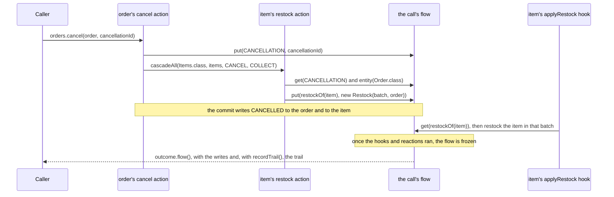

# The call's flow

Each call carries one flow: typed values that its steps and its post-commit hooks share, and the entity the call was
made for. When the root machine of the call was built with `recordTrail()`, the flow also lists what the call took,
each at the instant it took it, as [record the call's trail](#record-the-calls-trail) describes. It lives in memory for
that call alone: nothing of it is persisted, and the next call starts with an empty one. When the call ends, its
caller receives a frozen copy, as [read the flow after the call](#read-the-flow-after-the-call) shows. Every step of
the call reaches the same flow, whatever entity the step moves: the root's own step, each cascaded step and the exit
of each sub-machine, and so does the hook of every hop the call commits. A watch reaction is a call of its own, with
its own flow, and so is a call that a hook starts.

![The shop cancels an order of two items on a set that records its trail. The order's step puts the batch in the
flow and cascades CANCEL to the items, whose steps put their restocks; each write comes after its step's hop, and
the trail lists each hop with its instant. The commit writes the states, the hooks apply the restocks, and the
caller receives the flow frozen in the outcome. A failure route drops what its step took and wrote, while earlier
writes stay. When an item is PACKED, its element aborts and is dropped, the cascade aborts the call, nothing
commits, and the failure's flow keeps the other writes and ends its trail with Failed.](images/call-flow.svg)

The same cancellation as a sequence, for one item, with the shop's actions and hook:



An action reads and writes the flow through `ctx.flow()`, a `FlowContext`. A guard reads it through `ctx.flow()` too,
and gets a `FlowView`, without `put` or `remove`. A hook that takes a `CommitContext` reads and writes it through
`commit.flow()`, a `FlowContext`, once the call committed; a hook that takes the entity alone does not see it. A value
lives under a `FlowKey`, a name and a class: two keys with the same name and class read and write the same value.
Declare each key once, where every step that uses it can see it, as the shop does in
[ShopFlow.java](../graphmaquina-example/src/main/java/io/github/graphmaquina/example/ShopFlow.java):

```java
public final class ShopFlow {

    public static final FlowKey<String> CANCELLATION =
            FlowKey.visible("cancellation", String.class);

    private ShopFlow() { }

    public static FlowKey<Restock> restockOf(Item item) {
        return FlowKey.of("restock:" + item.id(), Restock.class);
    }
}
```

`restockOf` gives each item a key of its own, named after the item's identifier: every step of the call shares the
flow, so the restocks of two items under one key would replace each other. `Restock` is a record of the shop,
`Restock(String batch, Order order)`.

A key reports its `name()`, its `type()` and whether it is `visible()`. Visibility only decides whether a `TRACE` line
of a write prints the value, as [logs](logs.md#line-formats) say; it is not part of a key's equality, so
`FlowKey.of("batch", String.class)` and `FlowKey.visible("batch", String.class)` read and write the same value.
`FlowKey.of` and `FlowKey.visible` refuse a null or blank name and a primitive class token: write `Integer.class` for
`int`. A key takes a class token, as `input(Class)` does, so it cannot name a generic type such as `List<String>`; use
the raw class, `List.class`. `put` refuses a null key or value with `NullPointerException`, and a value that is not an
instance of the key's class with `ClassCastException`; `get` and `remove` refuse a null key. `get` answers the value of
the last write of the key, and `keys()` lists the keys that hold a value, in the order of the write that gave each its
current value.

A cascaded step and the exit of a sub-machine receive no `input()`. When they need a value the caller passed, the
action that received it copies it into the flow before it cascades. The shop's `Orders` facade declares
`cancel(Order order, String cancellationId)`, whose identifier names the batch the order's items go back to stock in.
The order's `cancel` action copies it into the flow for each item it cancels. The operation refuses a null
identifier before the call starts, so the action always finds one:

```java
@GraphAction
public ActionOutcome cancel(TransitionContext<Order, OrderStatus, OrderTransition> ctx) {
    ctx.flow().put(ShopFlow.CANCELLATION, ctx.input(String.class).orElseThrow());
    ctx.cascadeAll(Items.class, ctx.entity().items(), ItemTransition.CANCEL, CascadePolicy.COLLECT);
    return ActionOutcome.ok();
}
```

The item's `CANCEL` edge runs `restock`, which reads it. `ctx.entity()` is the item the step moves, and
`flow().entity()` the entity the root call was made for. Only the order's `cancel` cascades `CANCEL` to the items, so
the root is the order, and `flow().entity(Order.class)` casts it. That cast throws `ClassCastException` when the root
is of another class, and refuses a null or primitive class token as `input(Class)` does. `restock` leaves the item's
restock in the flow and changes no entity, for the reason the next paragraphs give:

```java
@GraphAction
public ActionOutcome restock(TransitionContext<Item, ItemStatus, ItemTransition> ctx) {
    String batch = ctx.flow().get(ShopFlow.CANCELLATION).orElseThrow();
    Order order = ctx.flow().entity(Order.class).orElseThrow();
    ctx.flow().put(ShopFlow.restockOf(ctx.entity()), new Restock(batch, order));
    return ActionOutcome.ok();
}
```

An action's write is undone with the step that made it. When a step fails with a failure its edge expects, one its
action returns or a throwable of a type the edge declares, the call drops every write made since that step took its hop,
its action's and those of the steps it cascaded to, and keeps what earlier steps wrote: the recovery action of its route
then writes anew, and without a route the step aborts with `UnhandledFailureException`. A `COLLECT` element whose abort
the cascade collects is dropped the same way, its writes with it, before the next element runs, unless an identity's
`equals` or `hashCode` throws while it is dropped, which stops the rollback and leaves what it had not undone. Once a
failed cascade poisoned the call, a step whose failure its edge expects is not dropped: it ends in the failure that
poisoned the call and keeps its writes, unless a `COLLECT` collects that failure and drops the whole element. No other
abort undoes a write: a call that aborts commits nothing, and the flow its failure hands out keeps what its steps wrote.
A hook writes after the commit, and nothing undoes its writes.

Values are stored by reference, never copied, and a rollback drops the write, not what was done to the object. An
action that puts a list, adds an element to it and then fails into its route leaves the recovery action without a
value under that key, while the list itself still holds the element. Treat stored values as immutable. Entities
behave the same way: what a step changes on its own entity through `ctx.entity()`, or on the root's through
`flow().entity(...)`, takes effect at once and is never undone, as
[commit, hooks and observers](commit-and-persistence.md#commit-hooks-and-observers) says of other entity fields. That is why the shop's
`restock` changes neither the item nor the order: its `COLLECT` cascade tries every item, then aborts the call if the
step of one of them aborted, and an item would then keep the batch of a cancellation that never committed. It
leaves the restock in the flow, and a hook applies it once the call commits, as
[set a field only when the call commits](#set-a-field-only-when-the-call-commits) shows.

The flow follows the rules of [contexts](async-deadlines.md#contexts-and-completion-callbacks). `ctx.flow()` and every operation of the
flow it returns, reads included, work only on the thread running the action or the guard, and only until the root
commits or aborts: elsewhere they throw `WrongThreadException`, afterwards `StaleContextException`. An asynchronous
action writes before it returns its stage, never in a callback of that stage. A write in a callback that runs on
another thread, such as the service's, throws `WrongThreadException` and stores nothing; the exception completes the stage exceptionally, so the call
aborts with it as its cause, unless a type the edge declares accepts it. The flow a hook receives works only on the
thread running the hook and only while it runs, as [after-commit hooks](commit-and-persistence.md#after-commit-hooks) describes.

Each write of an action is logged at `TRACE` as a `flow-put` or `flow-remove` line, and each write of a hook as a
`hook-flow-put` or `hook-flow-remove` line, which names the hook. Each prints the key as `name:Type`. A put with a
key made with `FlowKey.visible` also prints `=` and the value's `toString()`, whatever object it is: make a key visible
only for values you accept to see in your logs. A remove prints no value.

## Contents

- [Set a field only when the call commits](#set-a-field-only-when-the-call-commits)
- [Read the flow after the call](#read-the-flow-after-the-call)
- [Record the call's trail](#record-the-calls-trail)

## Set a field only when the call commits

What a step sets on an entity stays even when the call fails. To set a field only once its hop commits, the action
leaves the value in the flow, which a failure of its step undoes, and a post-commit hook assigns it. The shop's item
`CANCEL` edge declares `restock` as its action and `applyRestock`, another method of `ItemActions`, as its
`afterCommit` hook, which applies the restock that the item's step left:

```java
@GraphHook
public void applyRestock(Item item, CommitContext<ItemStatus, ItemTransition> commit) {
    Restock restock = commit.flow().get(ShopFlow.restockOf(item)).orElseThrow();
    item.restockedIn(restock.batch());
    restock.order().restocked(item);
}
```

Hooks run in the order of the committed hops, so the order lists its items in the order the cascade cancelled them.
When the step of an item aborts, for instance because the item is `PACKED` and has no `CANCEL` edge, the `COLLECT`
cascade aborts the call once it tried every item: nothing commits, no hook runs, and no item gets a batch, although
the flow the failure hands out holds the restock of every item whose step completed.
[OrderFlowTest](../graphmaquina-example/src/test/java/io/github/graphmaquina/example/OrderFlowTest.java) asserts the
cancellation that commits and the one that aborts. When an action fails after its put and its step takes a failure
route, the route drops the write, and the hook that runs for the recovering hop finds nothing. Had `restock` set the
batch on the item itself, the item would keep it in both cases.

A hook can also be a machine's default, declared once with `afterCommit` on `Definition`: it then runs for every hop
of the machine that commits, the hops of failure routes included. The DSL has no default hook; declare it on each
edge with `afterCommitWith`. An edge that declares its own hook replaces the default, as
[after-commit hooks](commit-and-persistence.md#after-commit-hooks) says, so that hook must assign the value too. Like any hook, it does not run
when an earlier hook of the call throws. The flow belongs to the call, not to the hop, so every hook of the call reads
the same values: that is why the shop gives each item's restock a key of its own, which that item's hook reads.

## Read the flow after the call

A call that returns freezes its flow once its hooks, its watch reactions and its automatic chains ran, and one that
fails freezes it as it stood when the call failed. The caller reads it as `flow()` on the outcome the call returns, or `flow()` on the
`CallFailedException` it throws. Both are a `FlowView`, which prints as `FrozenFlow[keys=...]`, its keys alone, and is read with `get`,
`keys()`, `entity()` and `trail()` as a guard reads it. For instance, a REST handler that cancels an order can answer
with the cancellation the call recorded, whether the call returned or failed:

```java
static Optional<String> cancellation(Orders orders, Order order, String cancellationId) {
    try {
        return orders.cancel(order, cancellationId).flow().get(ShopFlow.CANCELLATION);
    } catch (CallFailedException failure) {
        // the flow as it stood when the call failed
        return failure.flow().get(ShopFlow.CANCELLATION);
    }
}
```

The frozen flow is a copy that the caller may keep. It never changes and has no owner thread, so any thread can read
it, such as a JSON serializer's after the handler returned. It compares by value: two outcomes are equal only when
their flows hold equal values, an equal entity and equal trails. Its values are the very objects the steps put, never
copies, and its entity is the live one, so a change made to them later shows through it: treat stored values as
immutable. Nothing reaches the call's flow any more: the handles of its steps and hooks are stale once the call ended.

- An applied or failed outcome holds the values present once the hooks ran. After a failure route, they lack what the
  failed step wrote and hold what its recovery action wrote.
- Reading never creates the flow; a write does, a `put` or a `remove` of a step or a hook, and so does the start of a
  call that records its trail. Until the call's first write, `get` answers empty and `keys()` an empty set, while
  `entity()` already answers the root entity. A call that records no trail and whose steps and hooks wrote nothing
  hands out `FlowView.empty()`, without values and without the entity, which `entity()` of the outcome holds, so two
  such calls hand out equal flows. Without the trail, a rejected outcome is always `FlowView.empty()`: only its guards
  ran, and a guard cannot write. An `Ignored` outcome and the outcome a cascade returns to the action that ran it
  answer `FlowView.empty()` too, whatever the machine records: a cascade's flow belongs to its root call.
- A watch reaction is a call of its own: the outcome in `Reaction.Done` hands out the reaction's flow, and the
  failure of an aborted reaction its own, unless what aborted it was an owner lookup that threw, which carries no
  flow.
- A failure holds what the call wrote up to it, as [handle a failed call](outcomes.md#handle-a-failed-call) details.

## Record the call's trail

A machine records the trail of the calls it starts when its builder, `StateMachines.Builder`, is given
`recordTrail()`. For instance, a registry whose order machine records it:

```java
static MachineRegistry shop(
        GraphDefinition<Order, OrderStatus, OrderTransition> orderGraph,
        GraphDefinition<Item, ItemStatus, ItemTransition> itemGraph) {
    return MachineRegistry.builder()
            .add(StateMachines.from(orderGraph)
                    .state(Order::status, Order::setStatus)
                    .identity(Order::id)
                    .recordTrail())
            .add(StateMachines.from(itemGraph)
                    .state(Item::status, Item::setStatus)
                    .identity(Item::id))
            .build();
}
```

The machine of the root call decides for the whole call, as its `asyncTimeout` bounds the whole call. Cancelling an
order through this registry records the order's hop and the hop of each item its `cancel` action cascades to,
although the item machine was built without `recordTrail`, while a call started on an item records nothing, whatever
its steps reach. A watch reaction is a call of its own: its machine decides its trail, which `Reaction.Done` hands out
with the reaction's outcome, never in the trail of the call that triggered it.

The generated builder of a [machine set](coordination.md#build-and-manage-machine-sets) offers `recordTrail()` and
`recordTrail(InstantSource clock)` as well, and hands them to the `StateMachines.Builder` of every machine of the set.
Since the root machine decides and every machine of the set records, every call made through the set records its
trail, the peers it cascades to and the exits of sub-machines its steps run included, and so does each watch reaction,
whose machine is one of the set. The set has no variant for one of its machines: a registry built with
`StateMachines.Builder`, as above, chooses machine by machine. The shop's
[OrderFlowTest](../graphmaquina-example/src/test/java/io/github/graphmaquina/example/OrderFlowTest.java) builds its
set with `recordTrail()`, and reads in the trail of a cancellation the order's hop, then the hop of each item.

`flow().trail()` lists `FlowEntry` values, in the order the call took them, cascaded steps, the exits of sub-machines
and sub-machine starts included:

| Entry | When | What it holds |
| --- | --- | --- |
| `FlowEntry.Hop` | Each hop the call took | `hop()`, the hop's `TransitionRecord`, which in an outcome, and in an `AfterCommitException`, is the very instance its `records()` lists. On the hop of a failure route, `recovery()` holds what failed: the identifier of the transition whose step failed, the reason, the throwable if one failed the step, and the failure kind the outcome reports, if any: the one a returned failure named, or the one of the recovery rule whose type routed the throwable. |
| `FlowEntry.Start` | Each sub-machine the call started | `start()`, the start's `SubmachineStart`, which in an outcome, and in an `AfterCommitException`, is the very instance its `starts()` lists. |
| `FlowEntry.Rejected` | Last, when the call returns `Outcome.Rejected` | The root call's machine key and entity, the state, the identifier the caller asked for, or the one the watch selected in a reevaluation, whose call requests none, the `RejectionKind`, the reason and the guard that rejected, if one did. |
| `FlowEntry.Failed` | Last, when the call throws a `CallFailedException`, unless the clock throws as the call reads its instant | `failure()`, a `CallFailure` equal to the one the observers receive: the phase, `statesWritten()`, which says what the call wrote, and the exception. |

Each entry's `at()` is read on the root machine's clock. A hop's or a start's is read right after the call took
it, after the guards of its step and before its action runs, so an action reads its own hop in the trail. A
`Rejected` or `Failed` entry's is read when the call ended. For instance, a handler can turn the trail into lines for
its log or its response:

```java
static List<String> timeline(FlowView flow) {
    List<String> lines = new ArrayList<>();
    for (FlowEntry entry : flow.trail()) {
        String what = switch (entry) {
            // on a failure route's hop, recovery() holds what failed
            case FlowEntry.Hop hop -> hop.hop().entity() + " " + hop.hop().from() + " -"
                    + hop.hop().transition() + "-> " + hop.hop().to()
                    + hop.recovery()
                            .map((FlowEntry.Recovery recovery) ->
                                    " after " + recovery.failed() + " failed: " + recovery.reason())
                            .orElse("");
            case FlowEntry.Start start -> start.start().child() + " started in "
                    + start.start().initial();
            case FlowEntry.Rejected rejected -> "rejected " + rejected.transition() + ": "
                    + rejected.reason();
            case FlowEntry.Failed failed -> "failed in " + failed.failure().phase() + ": "
                    + failed.failure().error().getMessage();
        };
        lines.add(entry.at() + " " + what);
    }
    return lines;
}
```

The trail follows the rollbacks of the call:

- A failure route drops the hop of the step that failed, with the hops and starts of the steps it cascaded to, and
  its recovery hop carries the `Recovery`. A `COLLECT` element whose abort the cascade collects leaves no entry either.
- A failed call keeps what it took up to the failure, then its `Failed` entry, unless the clock threw as the call
  read that entry's instant, as below. An abort undoes nothing, but the engine rolls back the step of an
  `UnhandledFailureException` first, so its trail lacks that step's entries.
- A `reevaluate` that fails before it runs an edge, or an `advance` that fails while it reads the state, has the
  `Failed` entry alone, or no entry when the clock threw, beside the entity and no value.
- An `Error` ends the call without an entry and without a flow.
- An `Ignored` outcome and the outcome a cascade returns have no trail: both answer `FlowView.empty()`.

A step reads `ctx.flow().trail()` and a hook `commit.flow().trail()`, under the thread and lifetime checks of the
rest of the flow: a step reads what the call took so far, and a hook every hop and start the call committed. Each read
builds a new list, which does not follow later entries.

A call that records its trail creates its flow when its step starts, so it hands out a flow with the root entity and
the trail even when no step or hook wrote to it, a rejected call included. Two such outcomes are equal only when their
trails are, `at()` included.

`recordTrail()` reads `InstantSource.system()`. `recordTrail(InstantSource clock)` reads `clock` instead, on the thread
running the call, once per entry the call appends, an entry that a rollback later drops included: a test can pass
`InstantSource.fixed(...)`, a `Clock`, or a clock of its own that advances on each read, which then leaves a gap for
each dropped entry, such as the failed hop of a failure route. A clock that throws anything but an `Error`, a checked
exception included, fails the call, as an identity function that throws does: the entry it could not mark stays out of
the trail. When it throws while the call reads the instant of the `Failed` entry that ends a failed call, whatever
failed the call, the call's `CallFailedException` carries what it threw as suppressed, unless it threw that very
exception, and its trail ends without that entry; an `InterruptedException` suppressed there interrupts the thread
again. A clock that answers `null` counts as one that throws a `NullPointerException`. A call whose root machine was
built without `recordTrail` reads no clock and stores no time.

The trail records what the call took and how it ended; the [`TRACE` lines](logs.md) show each step on the way, its
guards and its action included. To assert the flow and its trail in a test, see
[the call's flow and its trail](testing-advanced.md#the-calls-flow-and-its-trail) in the testing guide.

A `FlowEntry.Failed` prints its failure's exception as that exception's `toString()` does, never that exception's
flow.

---

Next: [Inspect graphs and export diagrams](graph-inspection.md). Back to the [documentation index](README.md).
