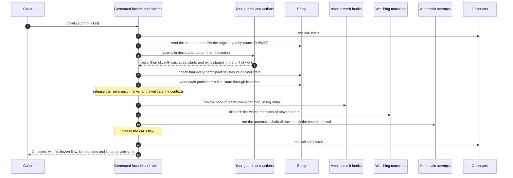

# Commit, hooks, observers and persistence

## Contents

- [Commit, hooks and observers](#commit-hooks-and-observers)
- [Concurrency, identity and persistence](#concurrency-identity-and-persistence)

## Commit, hooks and observers


Observers are told that the call starts before step 1. A call that completes tells them in step 9; one that throws tells
them before the exception leaves the call.

The runtime's normal root execution follows this sequence:

1. Read the effective entity state and resolve the single edge keyed by `(state, requested identifier)`.
2. Evaluate guards and run actions, including any nested cascades, the starts of the sub-machines whose state an
   edge enters and the exits of those that end, against a shared unit of work.
3. Begin the commit: verify that participating entities still have their expected original states.
4. Write each participating entity's final state through its setter.
5. Release the root reentrancy marker and invalidate transition contexts.
6. Run hooks for the committed hops, in log order.
7. Dispatch watch reactions for moved peers.
8. Run the [automatic chain](automatic-transitions.md#when-the-chain-runs) of each entity with a hop or a sub-machine
   start in the commit, in log order, unless its last hop there is a failure route that does not continue, or a call
   made on the same thread in steps 6 to 8, by a hook, a watch reaction or an earlier attempt, already committed a hop
   or a start of it: the deepest commit that moved an entity chains it. While its state has an automatic edge, one
   `advance` of it after another, each a call of its own, which `automaticSteps()` lists, as
   [records, journals and reactions](outcomes.md#records-journals-and-reactions) describes. A registry in which no
   state has an automatic edge, as it read when it was built, skips this step.
9. Freeze the call's flow, notify the observers that the call completed, and return its outcome, which carries the
   frozen flow.

The same sequence, for a call such as `tickets.submit(ticket)` that commits:



A rejected or ignored root does not commit state changes. A handled failure does commit its failure route.
External side effects performed by actions, and mutations to other entity fields, are not automatically undone
when the unit of work aborts. To set a field only once the call commits, an action can leave the value in the call's
flow and a hook can assign it, as [set a field only when the call commits](call-flow.md#set-a-field-only-when-the-call-commits)
shows. A call that [logs](logs.md) at `DEBUG` writes its `committed` and `started` lines
after step 5, and its `end` or `failed` line just before the observers learn how it ended. At `TRACE`, it also logs
the check of step 3, each setter of step 4 before it is called, each hook of step 6 before it runs and each write that
hook makes to the call's flow, and each owner lookup of step 7. Each attempt of step 8 is a call of its own, which
logs its own lines.

### After-commit hooks

Use a `@GraphHook` when code must run after GraphMaquina has written state. The quickstart prints every
committed hop from such a hook. The shop notifies its carrier after the shipping edge commits, and puts each
item it cancels back in stock once the item's `CANCEL` hop commits.

Hooks run synchronously on the operation's thread. Any throwable a hook throws that is not an `Error`, checked ones
included, becomes `AfterCommitException`: the state is already committed. Its `hook()` names the hook, `hop()` the
committed hop it ran for, `records()` every hop the call committed, `starts()` every sub-machine the call started,
and `flow()` the call's flow, with what the hooks wrote, the failing hook's writes before it threw included; a start
runs no hook. An `Error` propagates unchanged instead. Either
stops the remaining normal post-commit sequence, so do not assume later hooks, watch dispatch or automatic chains ran;
the observers are told the call failed. Make externally visible notifications idempotent and choose durable delivery separately if your
application needs it.

A hook sees the entity's committed final state. When a cascade stages multiple hops for one entity, the setter
writes its final destination once, while hooks still follow committed hop order.

For the endpoints, identifier, kind and terminality of that particular hop, and for the call's flow, add a
`CommitContext<S, T>` parameter, as the quickstart's hook does. The original entity-only signature remains supported:

```java
import io.github.graphmaquina.api.CommitContext;

@GraphHook
public void committed(Ticket ticket, CommitContext<TicketState, TicketTransition> commit) {
    System.out.println(commit.from() + " -" + commit.transition() + "-> " + commit.to()
            + " (" + commit.kind() + ")");
    if (commit.isTerminal()) {
        System.out.println("Workflow closed: " + ticket);
    }
}
```

`kind()` is `ACTION` or `MOVE`. `isTerminal()` describes the hop's destination and comes from
`Definition.terminals` (or the DSL's `terminal(...)` declarations). There is no need for a second terminal
flag on the state enum. In a multi-hop cascade, `commit.to()` can differ from the entity's final state. Hooks on
handled failure routes receive the recovering edge's context.

`flow()` is [the call's flow](call-flow.md), which every hook of the call shares: the hook reads what the steps of
the call put, and can put and remove values, which the later hooks of the call read. Nothing undoes those writes: the
call committed before its hooks run. The context can be retained, and its endpoints, identifier, kind and terminality
stay readable, but its flow works only while the hook runs and only on the thread running it: afterwards each operation
of the flow throws `StaleContextException`, and on another thread `WrongThreadException`. Once the hook returned or
threw, its flow no longer holds the call, so a retained context keeps none of the call's values in memory, only the
root entity, the hop's entity and its identity and, when the call logs at `DEBUG`, the root's identity. Each hook
gets a handle of its own on the flow, so a later hook cannot use the one an earlier hook kept. A hook that takes the
entity alone does not see the flow. A hook can start a new call: that call has a flow of its own, and once it returns,
the hook's flow still reads and writes the flow of the call that ran the hook. That call is a new root, which neither
`maxWatchChain` nor `maxAutomaticChain` counts: the watch reactions and the automatic attempts it triggers begin chains
of their own. Start it with the synchronous facade: a call that a hook starts on another thread, through `async()`,
even one the hook waits for with `join()`, is not nested in the post-commit, so the commit whose hook ran still chains
the entity from the state its own log left it in, its attempt reads the live state, and the chain can go on past a
failure route that stopped the other call's chain. A hook whose call runs that same hook again, directly or through
other calls, watch reactions and automatic attempts included, therefore recurs until the thread's stack overflows, each
call having committed before its hooks ran, as
[build and manage machine sets](coordination.md#build-and-manage-machine-sets) says of a `StackOverflowError`.

To call a contextual hook by hand, in a unit test, build its context with the five-argument constructor,
`new CommitContext<>(from, transition, to, kind, isTerminal)`. Its flow belongs to no call: it starts empty, has no
entity, works on any thread, though it is not synchronized, and never goes stale, so the test can put what the steps would have put, run the hook
and read back what it wrote. The six-argument constructor takes any `FlowContext` as the sixth argument, for a test
that needs a flow of its own. Two contexts are equal when their components are: the flow the runtime hands a hook is
equal only to itself, and two flows of the five-argument constructor are equal when they hold equal values.

The DSL takes the entity-only form through `afterCommit("committed", actions::committed)` and the contextual
one through `afterCommitWith("committed", (entity, commit) -> ...)`; an edge declares at most one hook. An
annotated context must use the machine's exact state and transition types. Other parameter shapes, non-void
returns and ambiguous symbols with both signatures marked are rejected.

Declare `afterCommit` on `Definition` to supply a default hook for every edge in that machine, whether it is
declared on a method or on the interface itself. An edge's explicit hook replaces the default; the two are
not composed, and there is no sentinel that switches the default off for one edge. Omitting the edge element,
or setting it to `{}`, inherits the default. `Definition.afterCommit` also accepts zero or one value;
multiple values are `SG607`.

The default applies to every committed hop, including explicit self-loops, failure routes, transitions
triggered by watches, automatic attempts and the exits of sub-machines — they are all real edges. It never runs for a rejected
request, whatever its kind, an `Ignored`, an abort or a rollback. A failure route uses its own effective hook,
not the hook of the edge that failed. Hooks still run per committed hop, so one entity can reach the default
more than once in a cascade.

### Observers

An observer sees every call of the set: each operation, each `reevaluate` and each `advance`, watch reactions and
automatic attempts included. A cascade
is part of the call that runs it. With the ticket set:

```java
TicketMachines machines = TicketMachinesRuntime.builder(new TicketActions())
        .observer(new MachineObserver() {
            @Override
            public void onCompleted(MachineCall call, Outcome<?, ?, ?> outcome, Duration elapsed) {
                System.out.println(call + ": " + outcome.code() + " -> " + outcome.recordedState()
                        + " in " + elapsed.toMillis() + " ms");
            }

            @Override
            public void onFailed(MachineCall call, CallFailure failure, Duration elapsed) {
                System.out.println(call + ": failed in " + failure.phase() + ", states "
                        + failure.statesWritten() + ": " + failure.error());
            }
        })
        .build();
```

Each call notifies `onStarted` once, then exactly one of `onCompleted` and `onFailed`, on the thread that runs it,
before the operation returns or throws. A request refused before it starts, such as one with a null argument,
notifies no observer. Nor does an eligibility check, `eligibility(entity, id)` on a `StateMachine`: a check is not a
call. An observer whose `onStarted` threw still receives its end event, and
`elapsed` runs from just before `onStarted` until just before that event. Observers belong to a registry: a machine
built standalone has none. `MachineCall` names the machine, the entity, the `request()` (a `CallRequest`: `EXECUTE`,
`REEVALUATE` or `ADVANCE`), the requested identifier (`transition()`, present only for an
`EXECUTE`) and the `origin()` (a `CallOrigin`: `APPLICATION`, `WATCH_REACTION` or `AUTOMATIC_STEP`, the last for an
`advance` of an automatic chain). Its `toString()` never prints the entity: it reads `<key> <ID>`, `<key> reevaluate`
or `<key> advance`, followed by ` (watch reaction)` for a reaction and ` (automatic step)` for an automatic attempt. The
same instance reaches every event of the call, and two calls are equal only when they are the same instance. A
reaction or an automatic attempt starts and ends inside the call whose commit triggered it, so events nest like a stack
on their thread. `onFailed` receives the very throwable the caller gets, with the phase the call was in and
how far it got in writing states; an `Error` is reported too, then propagates. The phase is one of `CallPhase`'s
`RESOLVE`, `GUARD`, `ACTION`, `COMMIT`, `HOOK`, `REACTIONS` and `AUTOMATIC_STEPS`. Only an `Error` reaches `onFailed`
in `REACTIONS`, one thrown by a reaction, or in `AUTOMATIC_STEPS`, one thrown by an automatic attempt or by the reads
a chain makes around its attempts, since any other throwable there becomes a `Reaction.Aborted` or an
`AutomaticStep.Aborted`; and one thrown by the `end` line of a call that committed, in `AUTOMATIC_STEPS`, or in
`REACTIONS` in a registry without automatic edges, which never enters `AUTOMATIC_STEPS`. So an observer reads
the call's flow as the caller does: `outcome.flow()` in `onCompleted`, and the `flow()` of the `CallFailedException` in `onFailed`, which
the call attached before it told the observers.

An observer watches without taking part. A throwable that is not an `Error` is logged as a warning through
`System.getLogger("io.github.graphmaquina")`, naming the observer, the callback and the call, never the entity, and changes neither the call nor the other observers; an `Error`
propagates. The warning is best effort: anything but an `Error` from its backend, a checked exception included, is
contained too, while an `Error` from it propagates unchanged. An `InterruptedException` that the observer or that
backend throws, once contained, interrupts the thread again. Either `Error`, the observer's own or its warning
backend's, voids for that call the promise of one `onStarted` and exactly one end event, and so does a
`StackOverflowError` or another `VirtualMachineError` that strikes again while the call tells its observers, as it
can when the call ended in one: telling them can need the stack or the memory that ran out, so they are told best
effort, and that `Error` propagates. That warning is the only record
logged on `io.github.graphmaquina` itself: the lines of each call, and of each eligibility check, go to its child
logger `io.github.graphmaquina.runtime`, as [debug a call](logs.md) describes. An observer cannot
start a transition on its own thread either: an operation or an eligibility check called from an observer throws
`ReentrantTransitionException`, which is contained. One submitted through `async(...)` runs on the executor's thread
as a call of its own, unless it runs on the observer's own thread, through an executor that runs tasks inline or a
wait that runs a `ForkJoinPool`'s queued tasks, in which case the returned future fails with that exception as its
cause. When a failure
must fail the call, write a hook, or a `Definition.afterCommit` default for every edge of a machine. Observers run on
the thread of every call, so keep them thread-safe and quick. Add as many as you need: they are notified in the order
they were added.

## Concurrency, identity and persistence

### Initialize and protect state

The entity owns its state. Initialize it in the constructor or field declaration, and persist it with your normal entity
mapping. A null root state ends the call in a `TransitionAbortedException` of phase `RESOLVE` whose cause is an
`UninitializedStateException`, and a cascaded peer's in one of phase `ACTION`, as does a sub-machine's, read when its
parent enters the bound state. A parent's, read to check the binding of a sub-machine, ends the call in one of phase
`RESOLVE` when the sub-machine is the root, and in one of phase `ACTION` inside a cascade or an exit. The runtime does not
silently replace a null state with the graph's initial state.

During a transition, only the runtime should call the state setter. The commit calls each entity's setter once,
with its last state, in the order the entity first appears in the call's log; that order decides what a
`CommitFailedException` lists in `applied()`, `failedEntity()` and `pending()`. It checks state again before commit to
catch action code or outside code that changed it unexpectedly. This check is not a lock: your application
must serialize conflicting operations, or provide an appropriate database locking/versioning strategy.
A sub-machine shows where the check stops. A call that ends a child its parent held commits the parent's exit, or
moved the parent itself, so the parent is in the commit, and the check catches a parent that another call moved
meanwhile. A call that moves the child to a
state that is not terminal leaves the parent out of the commit, and nothing notices that the parent moved.
Serialize the calls of a parent and its sub-machines as those of one aggregate.

The runtime does not roll back a setter that already ran if a subsequent setter throws.
`CommitFailedException` reports the entities whose setter returned (`applied()`), the one whose setter threw
(`failedEntity()`), which may or may not have been written, and those never tried (`pending()`); its
`statesWritten()` is `PARTIAL`, or `NONE` when the commit stopped before its first setter: the pre-commit check
refused it, or reading the states or grouping the log by entity threw. An `Error` a setter throws propagates as
itself instead, and an `InterruptedException` a setter throws interrupts the thread again. Keep state setters simple
and total for valid states; avoid remote calls, persistence flushes and unrelated business logic inside them.

### Stable identity

An identity is scoped by the machine key, which contains the entity, state and transition types. It must be
stable, non-null and suitable for identifying one domain entity. Using two different object instances with
the same machine identity in one unit of work ends the call in a `TransitionAbortedException` whose cause is an
`AmbiguousIdentityException`; this prevents silently
treating two representations of one row as separate entities.

An identity function that returns null raises `NullPointerException("identity of <key> returned null")`. At the root,
the call ends in a `TransitionAbortedException` of phase `RESOLVE`, `reading the entity threw …`, with that exception as
its cause and no `from()`; for a cascaded entity, the action receives the cascade's abort that carries it, which
poisons the call; a peer read throws it into the guard or action, and a watch's owner lookup reports it in
`Reaction.Aborted`. A machine
built standalone without `identity(...)` tells entities apart by reference; a registry requires an identity for every
machine.

When working with an ORM, load and reuse a consistent object instance for each identity within the operation.
Identity tracking does not provide database uniqueness enforcement or cross-process coordination.

### Framework and database boundaries

Create the set once at the lifecycle scope appropriate for your application and inject its action hosts with
existing repositories and services. Retrieve entities, invoke the facade, inspect the outcome and persist using
your application's transaction boundary.

GraphMaquina's after-commit means its in-memory state commit. It does not mean a surrounding database
transaction committed. If a message must follow a durable database commit, use your persistence framework's
transaction-completion facility or a transactional outbox rather than assuming the graph hook provides that
guarantee. Likewise, when the application throws its own error for an automatic step that failed after the call
committed, a transaction that rolls back on that error undoes in the database what the outcome reports as committed,
as [the application's transaction](automatic-transitions.md#the-applications-transaction) warns.

Executor-based calls do not automatically propagate thread-local transactions, security contexts or ORM
sessions. Arrange those boundaries on the execution thread. Async action callbacks must not use an entity or
persistence context concurrently without the application's own coordination.

A single `Definition.afterCommit` declaration covers every committed hop of the machine:

```java
@GenerateGraphApi
@DocumentsGraph.Definition(
    initial = DRAFT,
    terminals = ARCHIVED,
    state = DocumentRefs.Status.class,
    id = DocumentRefs.Id.class,
    // names the save hook below, run after every committed hop
    afterCommit = DocumentPersistenceRefs.Save.class)
@DocumentsGraph.StatePolicy(state = DRAFT, otherwise = "publish before archiving")
@DocumentsGraph.StatePolicy(state = PUBLISHED, otherwise = "archive next")
public interface Documents extends Machine<Document, DocumentStatus, DocumentChange> {
    @DocumentsGraph.Transition(id = DocumentChange.PUBLISH, from = DRAFT, to = PUBLISHED)
    Outcome<Document, DocumentStatus, DocumentChange> publish(Document document);

    @DocumentsGraph.Transition(id = DocumentChange.ARCHIVE, from = PUBLISHED, to = ARCHIVED)
    Outcome<Document, DocumentStatus, DocumentChange> archive(Document document);
}

public final class DocumentPersistence {
    private final java.util.function.Consumer<Document> save;

    public DocumentPersistence(java.util.function.Consumer<Document> save) {
        this.save = java.util.Objects.requireNonNull(save);
    }

    @GraphHook
    public void save(Document document) {
        save.accept(document);
    }
}
```

`Documents`, `Document`, `DocumentStatus`, `DocumentChange` and `DocumentPersistence` are public types and
belong in separate files, each with the usual annotation and API imports and `import static ...DocumentStatus.*`
for the state constants; `DocumentChange` is the enum `{ PUBLISH, ARCHIVE }`. `Document` exports `id` and
`status` the same way described under Properties and accessors.

Assemble `Documents` into a `@StateGraphs` set as the quickstart shows, and inject `DocumentPersistence` through
that set's generated builder, providing your repository's save operation. If an edge declares a replacement hook,
that hook must call the shared persistence method too when the application requires every transition to be saved.
This hook runs after GraphMaquina's in-memory commit; the application's database transaction still controls
durable commit and rollback.

---

Next: [Debug a call with logs](logs.md). Back to the [documentation index](README.md).
