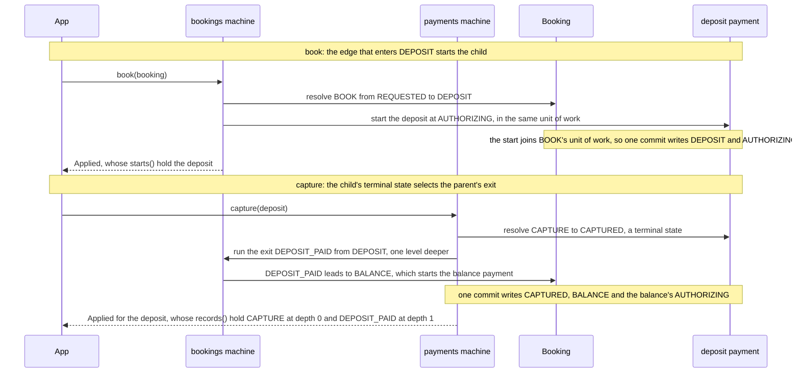

# Compose machines


A state can hold a whole machine of its own: its sub-machine, or child. The repository's billing example, in the
package `io.github.graphmaquina.example.billing`, binds one payment machine three times. A booking pays a deposit in
`DEPOSIT` and then a balance in `BALANCE`, and a subscription pays each renewal in `RENEWAL`. The payment machine knows
no parent: every binding is declared on the parent's side, so one machine can be bound in several states of several
machines. Three rules make the contract:

- An edge that enters a bound state starts the child at the initial state of the child's graph, in the same unit of
  work as that edge. Its `childOf` must answer a child then: an empty answer aborts the step that enters before its
  action runs, with a `TransitionAbortedException` such as `Booking/BookingStatus entered DEPOSIT with no
  Payment/PaymentStatus`, and the call commits nothing.
- A parent holds its child while it is in the bound state, or leaving it, and its `childOf` answers that very child.
  A call to a child is refused as `DETACHED` when a binding finds its parent but no parent holds it: the parent has
  left the state, or holds another child or none there. A child for which no binding finds a parent is a free machine
  and runs as usual.
- When a step of a bound child ends in one of its terminal states, that state selects the parent's exit. The exit runs
  in the same unit of work, one level below that step, and commits with the child. The binding is judged when the
  child's step begins: when the step ends, the exit runs unless the parent is in flight, or the step itself, through
  its action, moved the parent out of the bound state or entered it again. The parent's state and `childOf` are not
  read again, so replacing the parent's child during the child's own action does not cancel the exit; to keep it from
  running, move the parent out of the state, or restart it there, from that action.

## Contents

- [Declare a sub-machine](#declare-a-sub-machine)
- [Find the parent with a lookup](#find-the-parent-with-a-lookup)
- [Build the set](#build-the-set)
- [Enter and exit](#enter-and-exit)
- [Interrupt, detach and reserve](#interrupt-detach-and-reserve)
- [Reuse a machine](#reuse-a-machine)
- [Sub-machines over the same entity](#sub-machines-over-the-same-entity)
- [Asynchronous exits](#asynchronous-exits)
- [Diagrams, concurrency and tests](#diagrams-concurrency-and-tests)

## Declare a sub-machine

The child is an ordinary machine. `Payments` declares `AUTHORIZING` and three terminal states, `CAPTURED`, `DECLINED`
and `VOIDED`, and nothing in it names a booking or a subscription. The parent declares the pair with `@GraphPeers`, as
for a watch, and binds the child with the pair's generated `Submachine`. This is the whole `Bookings` interface, which
imports the `BookingStatus` constants statically:

```java
/**
 * The booking machine: {@code DEPOSIT} and {@code BALANCE} each hold a payment of {@link Payments},
 * the same machine bound twice. The terminal state each payment reaches selects the exit of its
 * state, and {@code CANCEL} interrupts either one. The processor generates BookingsRuntime.
 *
 * <p>Exits are declared on the interface, not on operations: an exit runs only when its payment
 * ends, so no operation may declare one.</p>
 */
@GenerateGraphApi
@GraphPeers(Payments.class)
@BookingsGraph.Definition(
    initial = REQUESTED,
    terminals = {CONFIRMED, CANCELLED},
    state = BookingRefs.Status.class,
    id = BookingRefs.Id.class)
@BookingsGraph.StatePolicy(state = REQUESTED, otherwise = "a booking is booked first")
@BookingsGraph.StatePolicy(state = DEPOSIT, otherwise = "the deposit payment decides")
@BookingsGraph.StatePolicy(state = BALANCE, otherwise = "the balance payment decides")
// the exit of a captured deposit; when holdRoom fails, NO_ROOM moves to CANCELLED
@BookingsGraph.Transition(
    id = BookingTransition.DEPOSIT_PAID,
    from = DEPOSIT,
    to = BALANCE,
    action = BookingActionsRefs.HoldRoom.class,
    onFailure = BookingTransition.NO_ROOM)
@BookingsGraph.Transition(id = BookingTransition.NO_ROOM, from = DEPOSIT, to = CANCELLED)
@BookingsGraph.Transition(id = BookingTransition.DEPOSIT_DECLINED, from = DEPOSIT, to = CANCELLED)
@BookingsGraph.Transition(id = BookingTransition.BALANCE_PAID, from = BALANCE, to = CONFIRMED)
@BookingsGraph.Transition(id = BookingTransition.BALANCE_DECLINED, from = BALANCE, to = CANCELLED)
@BookingsGraph.Transition(
    id = BookingTransition.PAYMENT_VOIDED,
    from = {DEPOSIT, BALANCE},
    to = CANCELLED)
@BookingsPayments.Submachine(
    state = DEPOSIT,
    child = BookingRefs.Deposit.class,
    parentLookup = BillingLookupsRefs.BookingOf.class,
    exits = {
        @BookingsPayments.Exit(
            on = PaymentStatus.CAPTURED,
            transition = BookingTransition.DEPOSIT_PAID),
        @BookingsPayments.Exit(
            on = PaymentStatus.DECLINED,
            transition = BookingTransition.DEPOSIT_DECLINED),
        @BookingsPayments.Exit(
            on = PaymentStatus.VOIDED,
            transition = BookingTransition.PAYMENT_VOIDED)})
@BookingsPayments.Submachine(
    state = BALANCE,
    child = BookingRefs.Balance.class,
    parentLookup = BillingLookupsRefs.BookingOf.class,
    exits = {
        @BookingsPayments.Exit(
            on = PaymentStatus.CAPTURED,
            transition = BookingTransition.BALANCE_PAID),
        @BookingsPayments.Exit(
            on = PaymentStatus.DECLINED,
            transition = BookingTransition.BALANCE_DECLINED),
        @BookingsPayments.Exit(
            on = PaymentStatus.VOIDED,
            transition = BookingTransition.PAYMENT_VOIDED)})
public interface Bookings extends Machine<Booking, BookingStatus, BookingTransition> {

    @BookingsGraph.Transition(id = BookingTransition.BOOK, from = REQUESTED, to = DEPOSIT)
    Outcome<Booking, BookingStatus, BookingTransition> book(Booking booking);

    @BookingsGraph.Transition(
        id = BookingTransition.CANCEL,
        from = {DEPOSIT, BALANCE},
        to = CANCELLED,
        action = BookingActionsRefs.Cancel.class)
    Outcome<Booking, BookingStatus, BookingTransition> cancel(Booking booking);
}
```

`Submachine` is repeatable, so one machine can bind the same child in several states, each binding with its own way to
the child and its own exits. Its elements, and those of `Exit`, take the enums of their side of the pair, so a state or
an identifier of the wrong machine is a javac error:

| Element | Meaning |
| --- | --- |
| `state` | The bound state of the parent. A terminal state holds no sub-machine, and another state holds at most one (`SG803`). |
| `child` | A property of the parent that returns `Optional` of the child's entity: `Booking.deposit()` and `Booking.balance()` return `Optional<Payment>`. |
| `parentLookup` | A `@GraphLookup` method that finds the parent of a child entity, described below. |
| `parent` | Instead of `parentLookup`, a property of the child that returns `Optional` of the parent's entity. A child over another entity than the parent's needs `child` and exactly one of `parent` or `parentLookup` (`SG806`). |
| `exits` | One `Exit(on, transition)` per terminal state of the child: the identifier of the parent that the terminal state selects, which needs an edge from the bound state (`SG801`, `SG802`). Two terminal states may select the same identifier, as `DECLINED` and `VOIDED` do in `Subscriptions` below. |

An identifier that an exit names runs from the bound state only when the child ends. No `onFailure`, recovery rule or
rule of that state's watch may name it from there, and no operation of the facade may execute it at all, since an
operation requests its identifier from whichever state the machine is in (`SG804`). The exits of `Bookings` are
therefore declared on the interface, and `book` and `cancel` are its only operations. From any other state, the same
identifier is an ordinary edge, unless a binding of that state maps it too. A machine's sub-machines never contain the
machine again (`SG805`). [Structural rules](graph-model.md#structural-rules) and
[graph and declaration diagnostics](diagnostics.md#graph-and-declaration-diagnostics) list every check.

## Find the parent with a lookup

A call to a payment has to know whether a parent holds it, so each binding needs the way back from the child.
`@GraphLookup` marks a method of signature `Optional<E> name(P child)`, static or instance, on any class. The
generator exports it as a symbol of that class's `Refs`, such as `BillingLookupsRefs.BookingOf`, which `parentLookup`
names. These are the two lookups of `BillingLookups`, which keeps the bookings and subscriptions it registered in two
maps by payment id, where an application would ask its repository:

```java
@GraphLookup
public Optional<Booking> bookingOf(Payment payment) {
    return Optional.ofNullable(bookings.get(payment.id()));
}

@GraphLookup
public Optional<Subscription> subscriptionOf(Payment payment) {
    return Optional.ofNullable(subscriptions.get(payment.id()));
}
```

An empty `Optional` means that this binding finds no parent. Lookups and the `child` and `parent` properties are
synchronous and run inside the call. One that returns `null` instead of an `Optional` aborts the call, so does one
that throws, with what it threw as the cause, and so does a parent or a child whose identity or state cannot be read;
`execute`, `reevaluate` or `eligibility` called from one of them throws `ReentrantTransitionException`, which aborts
the call too. An eligibility check that meets any of these fails with an `EligibilityCheckException` instead.

## Build the set

`BillingMachines` lists `Bookings`, `Subscriptions` and `Payments`, as `ShopMachines` lists the shop's machines. Its
generated builder takes the instance hosts of every machine, here the booking actions and the lookups:

```java
BillingLookups lookups = new BillingLookups();
BillingMachines billing = BillingMachinesRuntime
        .builder(Duration.ofSeconds(10), new BookingActions(desk), lookups)
        .build();
```

`desk` is the application's `RoomDesk`, the port that `holdRoom`, the action of `DEPOSIT_PAID`, asks for a room. The
first argument is the shared timeout of the set's asynchronous machines, which
[asynchronous exits](#asynchronous-exits) explains. The set builds the payment definition once and passes that one
instance to the payment machine and to the companions of both parents: `BookingsRuntime.graph(...)` and
`SubscriptionsRuntime.graph(...)` take the definition of each machine they bind before their hosts. A registry refuses
a parent whose child machine it does not hold, or holds built from another definition:
`MachineRegistry.Builder.build()` throws `IllegalStateException`. A generated set always registers the child with the
very definition its parents bind; the check matters when you assemble machines yourself, as with the
[programmatic DSL](dsl.md).

## Enter and exit

A booking holds its two payments, and `lookups.register(booking)` lets `bookingOf` find it from either one:

```java
Booking booking = new Booking("b1", new Payment("b1-deposit"), new Payment("b1-balance"));
lookups.register(booking);
Payment deposit = booking.deposit().orElseThrow();

Outcome<Booking, BookingStatus, BookingTransition> booked = billing.bookings().book(booking);
Outcome<Payment, PaymentStatus, PaymentTransition> depositPaid =
        billing.payments().capture(deposit);
```

`book` enters `DEPOSIT`, so its call also starts the deposit at `AUTHORIZING`. `booked.starts()` holds one
`SubmachineStart`: the payment machine and the deposit, the state the deposit had and the one it started in, and the
booking with its bound state `DEPOSIT`. The start is logged right after the edge that enters, before that edge's action
runs, so an action that cascades into the child finds it at its initial state. A start is no hop: it is not in
`records()`, and it runs no hook. A child whose initial state is terminal enters and exits in that same call.

The two calls as a sequence:



`capture` is a call of the payment machine. Its step ends in `CAPTURED`, a terminal state, so the call runs the
booking's exit `DEPOSIT_PAID` from `DEPOSIT`, one level deeper, with the exit's guards and action. `depositPaid` is the
payment's own outcome, an `Applied` that moved the payment to `CAPTURED`. Its `records()` hold the capture at depth 0
and `DEPOSIT_PAID` at depth 1, in log order, and its `starts()` hold the balance, because the exit entered `BALANCE`,
which binds a payment too. Capturing the balance then exits through `BALANCE_PAID` to `CONFIRMED`. The exits belong to
the calls that ran them: an observer sees three calls in all, the booking's `book` and the two captures. When an exit
leaves a parent in a terminal state that a binding of its own parent maps, the grandparent's exit runs next, one level
deeper. Each level counts for `maxCascadeDepth`. Entering a state whose child's initial state is itself bound starts the
grandchild too, and `starts()` lists it with its depth. A child that ends while its parent is still running the edge that entered the
state, as when that edge's action captures the payment, exits once that edge's step is over. That exit runs one level
below the edge's step, at the same depth as the capture, and counts for `maxCascadeDepth` at that depth.

In a definition assembled without the DSL, a child that reaches a terminal state its binding maps to no exit aborts
the call in `ACTION` (`the terminal <T> of <child machine key> has no exit in <node>`), and an exit identifier with no edge from the
bound state aborts it as a rejection inside the exit; the DSL and the annotations refuse both graphs.

An exit is an ordinary edge of the parent, so its failure routes apply as on any edge. When the desk answers that no
room is left, `holdRoom` fails: the booking takes the route `NO_ROOM` to `CANCELLED`, the whole call commits, and the
capture's outcome is still `Applied`. The payment stays `CAPTURED`, since the route moves the booking and not the
payment, and the balance is not started: the edge that would have entered `BALANCE` was rolled back with its start. An
exit that a guard rejects aborts the call with a `TransitionAbortedException` whose message includes
`rejected inside the exit of DEPOSIT by guard ...`, and one that fails with no route ends it in an
`UnhandledFailureException`. Either way nothing is written, the capture included. As with a cascade, what an action did
outside the machines, such as asking the desk for a room, is not undone.

## Interrupt, detach and reserve

A parent can leave a bound state by an edge of its own while the child is still running. `cancel` leaves `DEPOSIT` or
`BALANCE` for `CANCELLED`, and its action voids the payment of the state the booking leaves:

```java
@GraphAction
public ActionOutcome cancel(TransitionContext<Booking, BookingStatus, BookingTransition> ctx) {
    Booking booking = ctx.entity();
    Payment payment = ctx.from() == BookingStatus.DEPOSIT
            ? booking.deposit().orElseThrow()
            : booking.balance().orElseThrow();
    ctx.cascade(Payments.class, payment, PaymentTransition.VOID);
    return ActionOutcome.ok();
}
```

While the booking leaves the state, the binding still holds the payment, so the cascade runs. The booking is in flight,
so the voided payment runs no exit: `PAYMENT_VOIDED` does not run, and the booking ends in `CANCELLED` by its own edge.
An interruption whose action leaves the child alone leaves it in the state it had reached.

Once the booking is cancelled, its payments are detached. `billing.payments().capture(deposit)` then returns a
`Rejected` outcome with the code `DETACHED` and the reason `no parent holds it in DEPOSIT or BALANCE`, which names the
bound state of every binding that found the booking. No guard and no action runs, and the check comes before the edge is
looked up, so a detached child is refused as `DETACHED` even for an identifier it has no edge for. Inside a cascade the
refusal aborts the call, like any nested rejection. Entering a bound state again restarts its child at the initial
state, whatever state the child had reached: a subscription charges the same renewal payment in every period.

The exits are reserved. In the bound state, only the end of the child runs an identifier that an exit names: a request
for `DEPOSIT_PAID` from `DEPOSIT` by any other path, such as a cascade or `StateMachine.execute` on a registry you
assembled, is refused as `RESERVED_EXIT`, with the reason `DEPOSIT_PAID leaves DEPOSIT only when its sub-machine ends`,
and aborts the call inside a cascade. Inspection still lists the edge: `transitionsFrom(BookingStatus.DEPOSIT)` includes
`DEPOSIT_PAID`.

A child entity has one active parent at a time. When two bindings each find a parent that holds the child in its bound
state, or while leaving it, a call to the child aborts with an `AmbiguousParentException` as its cause. A parent that
leaves one bound state for another that binds the same child holds it only in the state it enters, whose entry has just
restarted the child, so the action of that edge can cascade into the child.

[`StateMachine.eligibility(entity, id)`](eligibility.md#sub-machines) asks the same questions without running the
edge: where `execute` would reject a
request as `DETACHED` or `RESERVED_EXIT`, it answers `Ineligible` with that kind and that reason, and it starts no
child and runs no exit. Where a call to the child would abort with an `AmbiguousParentException`, it throws an
`EligibilityCheckException` with that cause.

## Reuse a machine

Each binding of `Bookings` reaches its own payment, so the booking holds its deposit only in `DEPOSIT` and its balance
only in `BALANCE`. `Subscriptions` binds the same machine once more, with exits of its own:

```java
@GraphPeers(Payments.class)
@SubscriptionsPayments.Submachine(
    state = RENEWAL,
    child = SubscriptionRefs.Renewal.class,
    parentLookup = BillingLookupsRefs.SubscriptionOf.class,
    exits = {
        @SubscriptionsPayments.Exit(
            on = PaymentStatus.CAPTURED,
            transition = SubscriptionTransition.RENEWED),
        @SubscriptionsPayments.Exit(
            on = PaymentStatus.DECLINED,
            transition = SubscriptionTransition.LAPSE),
        @SubscriptionsPayments.Exit(
            on = PaymentStatus.VOIDED,
            transition = SubscriptionTransition.LAPSE)})
```

`DECLINED` and `VOIDED` both select `LAPSE`. The payment machine keeps one definition for all three bindings, and its
definition does not change by being bound.

## Sub-machines over the same entity

A child can also govern a second state of the parent's own entity. With annotations, such a `Submachine` names none of
`child`, `parent` or `parentLookup`. In the DSL, `submachine(state, child)` takes no lookup, since the child entity is
the parent itself. In `SameEntitySubmachineTest`, one of the billing tests, a stay keeps its own status and its payment
status in two fields, and a payment graph over `Stay` governs the second one:

```java
/** Built once: the payment machine must be built from the very definition the stay binds. */
static final GraphDefinition<Stay, PaymentStatus, PaymentTransition> PAYMENT_GRAPH =
        StateGraph.define(STAY_PAYMENTS)
        .initial(PaymentStatus.AUTHORIZING)
        .terminal(PaymentStatus.CAPTURED)
        .terminal(PaymentStatus.DECLINED)
        .terminal(PaymentStatus.VOIDED)
        .statePolicy(PaymentStatus.AUTHORIZING, "an authorization is captured, declined or voided")
        .transition(PaymentTransition.CAPTURE, PaymentStatus.AUTHORIZING, PaymentStatus.CAPTURED)
            .endTransition()
        .transition(PaymentTransition.DECLINE, PaymentStatus.AUTHORIZING, PaymentStatus.DECLINED)
            .endTransition()
        .transition(PaymentTransition.VOID, PaymentStatus.AUTHORIZING, PaymentStatus.VOIDED)
            .endTransition()
        .build();

static final GraphDefinition<Stay, StayStatus, StayTransition> STAY_GRAPH = StateGraph.define(STAYS)
        .initial(StayStatus.REQUESTED)
        .terminal(StayStatus.CONFIRMED)
        .terminal(StayStatus.CANCELLED)
        .statePolicy(StayStatus.REQUESTED, "a stay is booked first")
        .statePolicy(StayStatus.PAYING, "the payment decides")
        .transition(StayTransition.BOOK, StayStatus.REQUESTED, StayStatus.PAYING)
            .endTransition()
        .transition(StayTransition.CONFIRM, StayStatus.PAYING, StayStatus.CONFIRMED)
            .endTransition()
        .transition(StayTransition.CANCEL, StayStatus.PAYING, StayStatus.CANCELLED)
            .endTransition()
        .submachine(StayStatus.PAYING, PAYMENT_GRAPH)
        .exit(PaymentStatus.CAPTURED, StayTransition.CONFIRM)
        .exit(PaymentStatus.DECLINED, StayTransition.CANCEL)
        .exit(PaymentStatus.VOIDED, StayTransition.CANCEL)
        .endSubmachine()
        .build();
```

`STAYS` and `STAY_PAYMENTS` are two keys over `Stay`, with different state enums, so one registry holds both machines,
each with the state accessors of its own field:

```java
private static MachineRegistry registry() {
    return MachineRegistry.builder()
            .add(StateMachines.from(STAY_GRAPH)
                    .state(
                        (Stay stay) -> stay.status,
                        (Stay stay, StayStatus status) -> stay.status = status)
                    .identity((Stay stay) -> stay.id))
            .add(StateMachines.from(PAYMENT_GRAPH)
                    .state(
                        (Stay stay) -> stay.paymentStatus,
                        (Stay stay, PaymentStatus status) -> stay.paymentStatus = status)
                    .identity((Stay stay) -> stay.id))
            .build();
}
```

A capture through `registry.of(STAY_PAYMENTS)` moves the stay's payment status to `CAPTURED` and its own status to
`CONFIRMED` in one commit.

## Asynchronous exits

An exit waits under the deadline of the call that runs it: the budget of the machine whose call started the root, which
the exit edge's own timeout can only shorten. A machine whose calls can run an asynchronous edge implicitly, as an exit
or as an edge an exit leads to, therefore needs an `asyncTimeout` even when its own graph is synchronous. `holdRoom` is
asynchronous, so `Bookings` is an asynchronous machine, and so is `Payments`, since its `capture` runs `DEPOSIT_PAID`.
`Subscriptions` runs no asynchronous edge, directly or implicitly. The generated builder therefore takes the shared
timeout first and installs it on `Bookings` and `Payments` only. `asyncTimeout(Payments.class, Duration)` overrides the
payment machine's budget, and `asyncTimeout(Subscriptions.class, Duration)` throws `IllegalArgumentException`. Through
`billing.payments().async(...)`, the whole call runs on the payment machine's executor, the exit included, and the
binding is checked when the call starts running. [Deadline rules](async-deadlines.md#deadline-rules) has the whole rule, and the billing
test `AsyncExitTest` holds the exit open with a `ControlledAsyncAction`.

## Diagrams, concurrency and tests

`GraphvizExporter` draws each bound state as a cluster labelled with the state and the child machine, such as
`DEPOSIT: Payment/PaymentStatus`, which holds the child's own diagram.
[Inspect graphs and export diagrams](graph-inspection.md) says how each edge is drawn, and the core
tests pin a booking with one payment machine bound in two states in
[submachine-shared-child.dot](../graphmaquina-core/src/test/resources/golden/submachine-shared-child.dot).

A call that ends a child its parent held commits the parent's exit, or moved the parent itself, so the commit's check
of the original states covers the parent. A call that moves a child to a state that is not terminal leaves the parent
out of the commit, so serialize the calls of a parent and its sub-machines as those of one aggregate, as
[initialize and protect state](commit-and-persistence.md#initialize-and-protect-state) explains.

A parent and its child must be generated in the same compilation and held by the same `@StateGraphs` set:
a child outside the compilation is `SG608`, and a set that holds the parent but not its child is `SG806`. A
standalone machine built with `StateMachines.Builder.build()` refuses any sub-machine binding, since its registry
holds no other machine.

Assert bindings, starts and both refusals with the typed views of the testing guide's
[sub-machines](testing-advanced.md#sub-machines) section. The
[billing tests](../graphmaquina-example/src/test/java/io/github/graphmaquina/example/billing) run the flows of this
section: the starts and exits of a booking, the detached deposit of a cancelled booking, which a check of `capture`
also finds, the `NO_ROOM` route, a renewal that restarts its payment, the stay and the asynchronous exit.

---

Next: [Commit, hooks, observers and persistence](commit-and-persistence.md). Back to the [documentation index](README.md).
