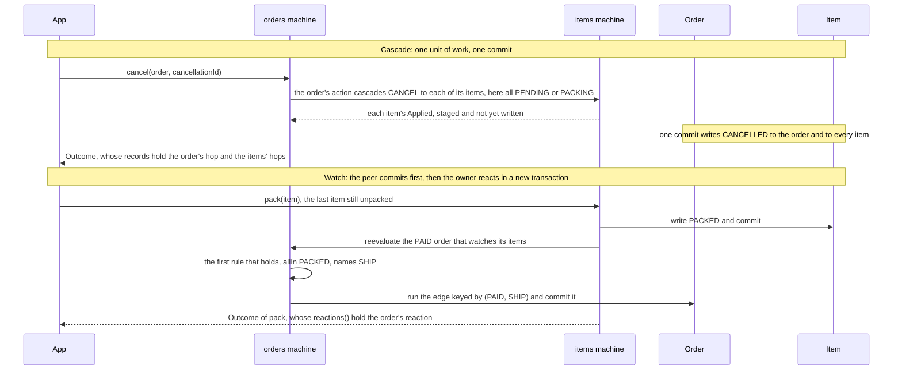

# Machine sets, cascades and watches

## Contents

- [Build and manage machine sets](#build-and-manage-machine-sets)
- [Read peers and cascade transitions](#read-peers-and-cascade-transitions)
- [Watch other machines](#watch-other-machines)

## Build and manage machine sets

Declare one top-level set interface extending `Machines`, with one no-argument accessor per machine. The
reference set is:

```java
@StateGraphs
public interface ShopMachines extends Machines {
    Orders orders();
    Items items();
}
```

The generated builder takes the instance binding hosts used by the machines. Its signature is generated from
the set's declarations; inspect the generated method or completion when dependencies change. It takes the hosts in
the order of the set's accessors, after the shared timeout when it has one, a host at the first accessor whose machine
uses it: `ShopMachines` above gets `builder(Duration, OrderActions, ItemActions)`. Within one machine, hosts come in
this order: the actions, guards and after-commit hooks of the edges the interface declares itself, then, watch by
watch, its conditions and its owner lookup, then those of the edges declared on operations, then the lookups of its
sub-machines. Reordering the accessors can therefore reorder its parameters, a source-incompatible change for every
caller of `builder(...)`. GraphMaquina
does not instantiate service classes or discover dependency-injection beans.

| Builder option | Purpose / default |
| --- | --- |
| `asyncTimeout(Machine.class, Duration)` | Override timeout for one asynchronous machine; generated only for a set that has one, as is the timeout argument of `builder(...)` |
| `asyncExecutor(Executor)` | Supply the executor used by `async` calls, where `ForkJoinPool.commonPool()` with a parallelism below two runs each call on a new thread instead; otherwise each machine owns a virtual-thread executor |
| `recordTrail()` | Record the [trail](call-flow.md#record-the-calls-trail) of every call of the set on `InstantSource.system()`; off by default |
| `recordTrail(InstantSource)` | Record that trail on the given clock instead |
| `maxCascadeDepth(int)` | Bound nested cascades and sub-machine exits; default `10`, minimum `1`, root depth is `0` |
| `maxWatchChain(int)` | Bound successive watch reactions; default `10`, minimum `1` |
| `observer(MachineObserver)` | Observe every call of the set; observers add up, notified in the order given |
| `build()` | Construct the registry and facades |

Each setting is checked where it is given: a `maxCascadeDepth` or `maxWatchChain` below `1` throws
`IllegalArgumentException`. The builder is single-use: once `build()` succeeds, every method throws
`IllegalStateException`.

Both limits count levels that run on the stack of the calling thread: each cascade, sub-machine exit and watch
reaction runs one level deeper, so that stack bounds them too. How many levels a stack holds depends on the JIT, on
the platform and on the frames of your own callbacks. As one measure, with an action that only cascades to the next
entity, on JDK 21.0.9 on macOS arm64, a thread of 1 MiB held about 300 to 450 cascade levels, and one of 8 MiB about
2,600 over the first calls of the JVM and about 30,000 once the JIT had optimized the engine's code. A call that goes deeper than its thread's stack meets a `StackOverflowError`, which reaches your actions
on its way up, as [cascade a transition](#cascade-a-transition) says, and otherwise ends the call; in a watch chain,
the root and the reactions before the one that overflowed have committed already. The registry and the thread are not
left unusable by it: later calls run as before. Keep the limits within what the stacks of your threads hold, or run
deep calls on threads with a larger stack.

Close the set with try-with-resources or your application's shutdown lifecycle. `close()` closes executors
owned by the set and waits for submitted operations to finish. An interrupt of the closing thread interrupts the
operations of every owned executor the set has not finished closing, and `close()` refuses to run on the thread of
one of those operations, as [executors and machine lifetime](async-deadlines.md#executors-and-machine-lifetime) says. An executor you
supply remains your responsibility. Avoid sharing a short-lived set across requests that outlive its scope.

For dependency injection, register the generated set as an application-managed component using your existing
`OrderActions` and `ItemActions` instances, then inject its facades into services. Arrange for `close()` at
shutdown. There is no required Spring dependency or GraphMaquina-specific container integration.

## Read peers and cascade transitions


Both mechanisms in the shop, as one sequence: an order's `CANCEL` cascades to its items, and an item's `PACK`
later lets a watching order ship.



Register interacting machines in the same set. Inside a guard or action, use the peer's facade class so
Java infers its entity and enum types:

```java
@GraphGuard
public GuardResult allItemsPacked(GuardContext<Order, OrderStatus, OrderTransition> ctx) {
    return ctx.peer(Items.class).allIn(ctx.entity().items(), ItemStatus.PACKED)
            ? GuardResult.pass()
            : GuardResult.reject("there are unpacked items");
}
```

This is a method from the shop's `OrderActions`. In a guard or an action, `PeerView.stateOf(peer)` reads pending
state from the current unit of work before falling back to the entity's getter. Calling the entity getter directly
during a cascade can therefore miss an uncommitted state change. The view a watch condition receives reads only the
entity's getter, since a watch runs outside any transaction. `PeerView.key()` names the peer machine. `stateOf` calls the
peer machine's identity function and, when the call holds no pending state for the peer, its getter, on the calling
thread; what either throws reaches the guard or action as it is.

| Peer helper | Empty collection | Nonempty collection |
| --- | --- | --- |
| `allIn(peers, state)` | `false` | Every peer must be in the state |
| `anyIn(peers, state)` | `false` | At least one peer must be in the state |
| `noneIn(peers, state)` | `true` | No peer may be in the state |

### Cascade a transition

Actions can change peers as part of their own unit of work:

```java
@GraphAction
public ActionOutcome cancel(TransitionContext<Order, OrderStatus, OrderTransition> ctx) {
    ctx.cascadeAll(Items.class, ctx.entity().items(), ItemTransition.CANCEL, CascadePolicy.COLLECT);
    return ActionOutcome.ok();
}
```

The cascade names `ItemTransition.CANCEL`, an identifier from the item's own catalogue, not the `CANCELLED`
state. javac refuses a constant of the order's catalogue here, and the engine resolves that identifier from
each item's current state: `PENDING` and `PACKING` both declare it, `PACKED` does not. The shop's own `cancel`
first copies a batch into the call's flow, for the action of the items' `CANCEL` edge, as
[the call's flow](call-flow.md) shows.

For one entity, use `ctx.cascade(Items.class, item, ItemTransition.CANCEL)`. Each facade-type form has an overload
that takes the peer's `MachineKey` instead: `ctx.peer(key)`, `ctx.cascade(key, peer, id)` and
`ctx.cascadeAll(key, peers, id, policy)`, and `peer(key)` on a guard's context. A machine built with the
[programmatic DSL](dsl.md) is reached by its key, unless its builder declared a facade type with `as(...)`.

A cascade resolves the peer's edge from its identifier and the peer's pending or current state, and runs its guards
and action. Its success stages a change; it
does not commit independently. The root commits after all required work succeeds. A nested request on an entity
that is already in flight is a cascade cycle whatever transition it asks for, even the one that entity is running,
and once the entity is no longer in flight the request is resolved from its pending state like any other.

| Policy | Behavior |
| --- | --- |
| `FAIL_FAST` | Run the elements in order. An unknown machine poisons the transaction before the first element runs; otherwise the first element whose transition throws, aborts, cycles or exceeds the depth limit poisons the transaction and propagates into the action. An element whose failure route is taken returns `Outcome.Failed`, and the cascade continues. |
| `COLLECT` | Try peers under savepoints and collect the transition aborts of the call; if any were collected, poison the transaction with a `CascadeException` that aggregates them and throw it into the action that cascaded. Any other failure stops it at once, and so does an element whose sub-machine binding check could not read a parent or a child, such as a parent whose state is null, an element whose step a nested cascade poisoned with a failure that is no failure of the call, or an identity whose `equals` or `hashCode` throws while a failed element is rolled back. |

`cascadeAll` returns an unmodifiable list with one `Outcome` per element, in the iteration order of the collection it
copied, each `Applied` or `Failed` as `cascade` returns it; with a registered machine, an empty collection returns an
empty list. It returns only when every element ended that way: `FAIL_FAST` throws at the first element that aborts,
and `COLLECT` throws its `CascadeException` after the last. Once a failure has poisoned the call, only `peer(...)`,
`cascade(...)` and `cascadeAll(...)` check the poison: a `PeerView` obtained before it still reads, `ctx.flow()` still
reads and writes, and the call still commits nothing.

`COLLECT` is not partial commit. A nested transition that is rejected, because no edge carries it, a guard rejected it
or a sub-machine refused it, is an abort rather than an ordinary root-level `Rejected` result. A handled domain
failure can select the child's declared failure route.
Any failure that leaves a cascade poisons the unit of work. A failure of the call itself, such as an abort in the peer's
step, a cycle or the depth limit, reaches your action as it is. The `TransitionAbortedException` Javadoc says where the
abort of a nested step goes. Anything else reaches your action as a `TransitionAbortedException` that names the cascade
and carries the failure as its cause: an engine exception that describes no call, such as an unknown machine or an
ambiguous identity, or a throwable other than an `Error` from a callback the engine does not wrap, such as an identity
function. An `Error` poisons through such an abort too, but reaches your action as itself, with any `Error` that
printing it threw as suppressed. A `VirtualMachineError`, such as a `StackOverflowError` or an `OutOfMemoryError`,
reaches your action at once, before that abort exists, since building it could need the stack or the memory that ran
out. If your action catches it and goes on, the engine records the poison on your action's step, once the stack has
unwound to it: as soon as your action reads a peer or cascades again, which then throws a
`PoisonedUnitOfWorkException`, and at the latest when it ends, unless an `Error` it throws as itself ends it, which
propagates. That poison is a `TransitionAbortedException` that names your action's step and carries no cause, and a
transaction that was poisoned before keeps its first poison. Catching an `Error` in your action
does not make the transaction safe to commit. Once the engine has your action's outcome, it throws the failure that
poisoned the transaction instead of applying it. It does the same for a failure of the call that your action throws or
completes its stage with, and, unless the action is a recovery action, for a throwable that its `failsOn` or one of its
recovery rules accepts, which an `Error`, a `CancellationException` or a `StateMachineException` never is; no failure
route is taken, and a recovery action's route was already taken. The engine's own aborts of the action step, for a null
outcome or stage or a wait that timed out, was interrupted or was refused, also end in the failure that poisoned the
transaction. Your action can still end the call in another failure, such as an abort that carries a throwable no
declared type accepts, or an `Error` it throws as itself. A cascade that names an unknown machine poisons too, by key or
by facade type, even over an empty collection. A refused argument poisons nothing: a null peer, a null element, which
`cascadeAll` refuses before any element runs, or an identifier from another machine's catalogue, and neither does a
cascade refused because the commit has begun or a step is being rolled back. A `VirtualMachineError`, such as a
`StackOverflowError`, that strikes while these checks run, while `cascadeAll` copies its collection or while a
cascade by facade type looks its machine up, poisons nothing either: the cascade has not started. `cascadeAll`
makes these checks before its first element runs: from then on, any failure that ends it poisons the unit of work,
a `VirtualMachineError` that strikes between two elements too. `cascadeAll` copies its
collection once, before any element runs, and never reads it again, so elements added or removed while the cascade runs
change neither which elements run nor their order; an exception or an `Error` the collection throws while it is copied
propagates as it is and poisons nothing, even when the machine is unknown. Use `ctx.cascade` instead of calling another
facade operation from inside an action: nested facade entry points on the action's own thread violate the runtime's
reentrancy rules. A call submitted through `async(...)` runs separately on the executor's thread, unless it runs on the
action's own thread, through an executor that runs tasks inline or a wait that runs a `ForkJoinPool`'s queued tasks,
as [executors and machine lifetime](async-deadlines.md#executors-and-machine-lifetime) lists, in which case the returned future fails
with a `CompletionException` whose cause is the `ReentrantTransitionException`.

No declared type accepts an `Error`, a `CancellationException` or a `StateMachineException`. For a throwable that a
declared type accepts and that an action other than a recovery action throws or completes with, the engine checks the
poison before it reads the throwable's message, for synchronous throws and exceptional completions of completed or
pending stages alike. Exceptional stage completions retain their original throwable through the wait, so the engine's
own reading of the message never comes first. The JDK may already have read that message, for example when `supplyAsync`
wrapped the throwable in a `CompletionException`. When the edge's action, other than a recovery action, throws or
completes with a throwable that no declared type accepts, a `CancellationException` included, and that is neither an
`Error` thrown as itself nor a failure of this call, the engine aborts the call with a message composed from that
throwable's string, which may read its message, whether or not the transaction is poisoned. A throwable that a recovery
action throws or completes with is never routed, whatever the recovery edge declares: an `Error` thrown as itself
propagates; the engine throws a failure of this call as itself or, when the transaction is poisoned, the failure that
poisoned the transaction; and on any other throwable the engine aborts the call with a message composed from the
recovery action's name and the original failure's reason, never from that throwable's string, whether or not the
transaction is poisoned. That abort carries the throwable as cause and holds as suppressed the throwable that selected
the failure route, when a throwable selected it and is not the same one.

`@GraphPeers` is for generating the vocabulary of a pair: the annotations that declare the owner's watches and
sub-machines over the peer. A runtime peer read or cascade alone does not require a pair that no watch or
sub-machine uses.

## Watch other machines

A watch reevaluates an owner after one of its peers changes state. It declares both directions of the
relationship: owner → peer collection, and peer → owner, through a property of the peer or a lookup.

The shop has orders and items. An order watches its items while it is `PAID`, and ships when all are `PACKED`.


This excerpt belongs on the shop's `Orders` interface, alongside its definition, policies and operations:

```java
@GraphPeers(Items.class)
// a PAID order requests SHIP once all its items are PACKED
@OrdersItems.Watch(
    state = PAID,
    peers = OrderRefs.Items.class,
    owner = ItemRefs.Order.class,
    rules = @OrdersItems.When(allIn = ItemStatus.PACKED, transition = OrderTransition.SHIP))
```

`OrdersItems` is generated from the pair. `transition` is an `OrderTransition`, the owner's own catalogue;
`allIn` is an `ItemStatus`, the peer's states. Mixing those enums is a javac type error. The rule executes the
edge keyed by `(PAID, SHIP)`, including its guard, action and hook — never another edge that also reaches
`SHIPPED`. That edge must exist from the watched state, or the build fails with `SG401`.

### Find the owner with a lookup

`owner` names a property of the peer that returns an `Optional` of the owner, empty for a peer without one, or the
owner itself. When the peer's entity has no such property, `ownerLookup` names a lookup instead: a method marked
`@GraphLookup`, of signature `Optional<Owner> name(Peer)`, static or instance, on any class, which the generator
exports as a symbol of that class's `Refs`, as it does for the
[lookup that finds the parent of a sub-machine](composition.md#find-the-parent-with-a-lookup). In the scenario of
[compose machines across modules and JARs](cross-module-composition.md#watch-the-machines-of-a-jar), a consumer's
orders watch the items of a producer's jar, whose `Item` cannot name an order. This lookup of the consumer's
`OrderLookups` reads a map of orders by item id, where an application would ask its repository, and the watch names
it:

```java
@GraphLookup
public Optional<Order> orderOf(Item item) {
    return Optional.ofNullable(orders.get(item.id()));
}
```

```java
@OrdersItems.Watch(
    state = PAID,
    peers = OrderRefs.Items.class,
    ownerLookup = OrderLookupsRefs.OrderOf.class,
    rules = @OrdersItems.When(allIn = ItemStatus.PACKED, transition = SHIP))
```

A watch declares exactly one of `owner` and `ownerLookup`, each with one value at most. Neither or both is `SG405`,
reported at the watch, and nothing else is then reported about either element; an empty array, such as `owner = {}`,
counts as none. Two values in one of them is `SG607`, and an exported lookup whose signature does not fit the watch,
such as one that takes the owner rather than the peer, is `SG505`.

A lookup returns only an `Optional`, whereas an `owner` property may return the owner itself: a lookup searches, and
not finding is an ordinary answer. An empty `Optional` means the peer has no owner, and no reaction follows for it. A
lookup that returns `null` is refused like an `owner` reader that does, as
[triggering and observing watches](#triggering-and-observing-watches) describes. Supply an instance of the class of an
instance lookup to the generated set builder, as for a condition below; a class that hosts both is supplied once.

### Ordered rules

A watch has one or more rules, and the first matching rule wins. Each rule uses exactly one of:

| Rule element | Condition |
| --- | --- |
| `allIn = ItemStatus.PACKED` | Nonempty peers, all in the given state |
| `anyIn = ItemStatus.CANCELLED` | At least one peer in the given state |
| `noneIn = ItemStatus.PACKING` | No peer in the given state; true for empty peers |
| `condition = OrderConditionsRefs.Ready.class` | A marked custom predicate |

Every rule also names the `transition` the owner executes when it holds.

Each built-in filter takes one peer state; it is not a set-membership expression. For a more complex
predicate, add a host such as this alongside the shop's classes:

```java
package io.github.graphmaquina.example.order;

import io.github.graphmaquina.annotation.GraphCondition;
import io.github.graphmaquina.api.PeerView;
import io.github.graphmaquina.example.item.Item;
import io.github.graphmaquina.example.item.ItemStatus;
import io.github.graphmaquina.example.item.ItemTransition;
import java.util.Collection;

public final class OrderConditions {
    @GraphCondition
    public boolean ready(
            Order owner,
            Collection<? extends Item> peers,
            PeerView<Item, ItemStatus, ItemTransition> view) {
        return view.allIn(peers, ItemStatus.PACKED);
    }
}
```

Replace the built-in rule with
`@OrdersItems.When(condition = OrderConditionsRefs.Ready.class, transition = OrderTransition.SHIP)`.
Regenerate and supply the new
`OrderConditions` instance to the resulting set builder. Custom conditions are synchronous predicates.

With this replacement in the reference shop, the generated builder becomes:

```java
ShopMachines shop = ShopMachinesRuntime
        .builder(
            Duration.ofSeconds(10),
            new OrderConditions(),
            new OrderActions(gateway, carrier),
            new ItemActions())
        .build();
```

Close this set as described in [machine lifecycle](#build-and-manage-machine-sets). Binding changes can change
the generated builder's parameter list and order; regenerate before updating the application's wiring.

A machine can have at most one watch per owner state. Multiple rules belong inside that watch. Declare only
pairs that a watch or a sub-machine uses; duplicate or unused `@GraphPeers` entries are errors.

### Triggering and observing watches

After a root commit, the runtime finds watched owners from peers whose final state differs from their original state.
Intermediate hops that return a peer to its original state do not trigger dispatch. It reevaluates an owner only if it
is currently in the watched state and deduplicates owners within that dispatch. Each reaction is a new root transaction.
A reaction failure does not roll back the peer commit that triggered it. A sub-machine start that moved its child from
another state counts as a move here, although a start is no hop.

The reactions run on the calling thread, after the triggering call's hooks and before `execute` or `reevaluate`
returns. Every owner lookup runs before any reaction, and the call's outcome lists them in `reactions()`: first the
`Reaction.Aborted` of each lookup that threw, then one reaction per owner, in the order each owner was first found. A `Reaction.Done` carries the reaction's own outcome, and
a `Reaction.Aborted` what ended it, as [records, journals and reactions](outcomes.md#records-journals-and-reactions)
details. An aborted reevaluation names the owner it reevaluated; an owner lookup that threw names the peer that moved.
Observers see each reaction as a call of its own, whose `MachineCall.reaction()` is true. A reaction that would exceed
the registry's `maxWatchChain` evaluates no rule and ends as a `Reaction.Aborted` whose cause is a
`WatchChainExceededException`.

The watch's `owner` reader or `ownerLookup` and its `peers` reader (`ownerOf` and `peersOf` in the DSL) and its
conditions run while the engine
evaluates the watch, before that root starts, and may not start a transition or an eligibility check on their own
thread: `execute`, `reevaluate` or `eligibility` called from one of them throws `ReentrantTransitionException`; a call
submitted through `async(...)` runs as a separate call on the executor's thread, unless it runs on the function's own
thread, through an executor that runs tasks inline or a wait that runs a `ForkJoinPool`'s queued tasks, in which case
the returned future fails with that exception as its cause. Inside a reevaluation, a refusal that one of these
functions lets through ends
the reevaluation in a `TransitionAbortedException` of phase `RESOLVE` that carries it: a reaction reports the abort as
`Reaction.Aborted` and a direct `reevaluate` throws it to its caller. An owner lookup runs before the reevaluation, so
its reaction carries the refusal itself. A `peers` reader that returns `null` instead of a collection, an `owner`
reader that returns `null`, whether it declares an `Optional` or the owner entity, or an `ownerLookup` that does, is
refused the same way, with a `NullPointerException` that says it returned null, and no condition runs over a `null`
collection.

Changing a collection or setting a field directly does not emit a transition event. If your application
changes relationships outside a peer transition, explicitly request reevaluation where appropriate:

```java
Outcome<Order, OrderStatus, OrderTransition> outcome = shop.orders().reevaluate(order);
```

A state that declares no watch produces `Outcome.Ignored` with `IgnoreReason.NO_WATCH`, and a watch whose rules all fail produces
`IgnoreReason.NO_RULE_MATCHED`. These are the only two ways an `Ignored` is produced. A matching rule can still be
rejected by the named edge's guards, or as `DETACHED` when the owner is a sub-machine whose parent does not hold it. Rules
are not polled on a timer, and creating or paying an owner does not
automatically mean all of its existing peers changed state.

The peer of a watch, like the child of a sub-machine, can come from a dependency, a jar or a directory of classes
whose artifact carries the export index its build published, as
[multiple modules and published JARs](installation.md#multiple-modules-and-published-jars) describes. A producer
that does not know the owner's entity cannot give the peer a property that returns it, so the watch finds its owner
with `ownerLookup`; `owner` still serves when the producer also publishes the owner's entity and the peer's entity
returns it. [Compose machines across modules and JARs](cross-module-composition.md) runs such a watch. A peer that is
a machine of a dependency whose artifact carries no export index, or one that does not list it or describes it
otherwise than its classes, or that passes `Machine` an enum, or reaches it only through a supertype, that the
classpath does not declare, is reported with `SG602`, naming that jar or directory whenever the generator can tell it;
any other peer that is neither a machine of the same compilation nor a machine of a dependency that its export index
describes is rejected with `SG608`.

---

Next: [Compose machines](composition.md). Back to the [documentation index](README.md).
