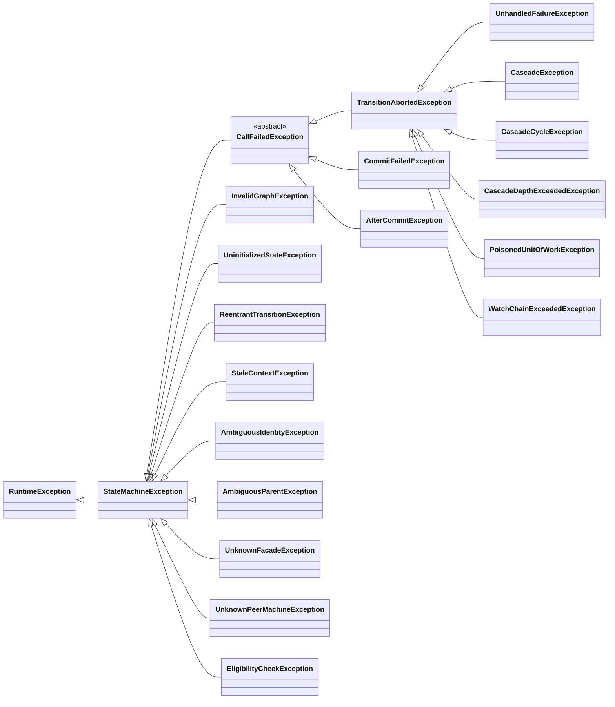

# Diagnostics and troubleshooting

Read the full compiler message, including the source location and member it identifies. A wrong enum type or
symbol category may be an ordinary javac error rather than an `SG` diagnostic: writing a state where an
identifier belongs, or a constant of another machine's catalogue, is refused by javac before any GraphMaquina
code runs. A mistyped generated symbol, such as `DocActionsRefs.Publsh.class`, is javac's alone to refuse too, as
`cannot find symbol` once annotation processing is over: the processor still reports every other problem of that
machine's declarations, but none about its graph as a whole, and generates no companion for it. A class another
annotation processor generates can still be named, such as an exception in `failsOn`, and so can a constant it
declares, such as the text of a policy, the reason of a rejection or the seconds of a timeout: the processor builds
that machine, and a set that holds it, in the round that brings the class, and a constant no round resolves is
javac's alone to refuse, like a mistyped symbol. javac refuses such a constant before any processor runs, as
`expression not allowed as annotation value`, in an annotation repeated without its container: list those
annotations in their container instead, such as `@DocsGraph.StatePolicies({...})`. The values of annotations
GraphMaquina does not own are left to javac, so an annotation of your own on a facade may even name the machine's
companion.

## Contents

- [Graph and declaration diagnostics](#graph-and-declaration-diagnostics)
- [Generation and typed binding diagnostics](#generation-and-typed-binding-diagnostics)
- [Runtime exceptions](#runtime-exceptions)
- [Common build problems](#common-build-problems)

## Graph and declaration diagnostics

| Code | Meaning / corrective action |
| --- | --- |
| `SG102` | Duplicate `(from, id)` key, or a state that declares two policies or rejects one identifier twice. Two edges that merely share endpoints are not a duplicate. |
| `SG103` | Blank reason on a policy or a rejection. A missing one does not compile with annotations, whose reason elements have no default, and is a `NullPointerException` in the DSL. |
| `SG105` | Duplicate guard: list each guard once per transition, and give the guards of one transition distinct names, which a rejection reports. A generated guard takes its member's simple name, so one transition cannot ask for two hosts' guards whose members share a name; a DSL guard takes the name given or, without one, its class's simple name. |
| `SG106` | DSL callback has no inferable name: provide the explicit name overload for a lambda. |
| `SG107` | Blank DSL callback or condition name: supply a nonblank label. |
| `SG201` | Missing or repeated DSL initial declaration. |
| `SG202` | A terminal declares an outgoing edge, including a self-loop, or a non-terminal declares none. |
| `SG203` | Unreachable state: add a real path from initial or remove the state. |
| `SG204` | Unauthorised cycle: list an intentional cycle's state in `allowsCycle`. One witness is reported per cyclic strongly connected component, deterministically, rather than one message per elementary cycle. |
| `SG205` | Unused cycle allowance: the named state belongs to no cycle. |
| `SG301` | Invalid failure route: `onFailure` or a recovery rule names this edge's own key, or no edge with that identifier leaves the same origin. Each origin of an identifier is checked on its own. |
| `SG302` | Forbidden throwable type in `failsOn` or in a recovery rule: `Throwable`, `Exception`, `RuntimeException`, an `Error`, a library exception, a `CancellationException` or one of its subtypes, or exactly `CompletionException` or `ExecutionException`, which the runtime unwraps before matching whenever they carry a cause. In the DSL, also a class that is not a `Throwable`, which only a raw type lets through. Use a specific foreign throwable type, usually an exception, or the type of the wrapped cause. |
| `SG303` | A recovery rule names a class that is not a failure kind. A failure kind is a named final class or record that implements `FailureKind` and is not an interface, an enum, a local or anonymous class, or a `Throwable`: declare one as `public record Unavailable() implements FailureKind { }`. |
| `SG304` | Ambiguous recovery rules: two rules of one edge name the same failure kind, or one throwable type is declared twice in a rule, in two rules, or in a rule and in the edge's `failsOn`. A type that only `failsOn` repeats is accepted. |
| `SG401` | A watch rule names an identifier with no edge from the watched state. |
| `SG402` | A terminal state declares a watch. |
| `SG403` | More than one watch on the same state. |
| `SG404` | A watch has no rules. In the DSL, also a `when(...)` that no `execute(...)` follows, and an `execute(...)` with no pending `when(...)`. |
| `SG502` | Invalid machine or set declaration, such as a machine interface that does not carry its generated `Definition`, an unsupported nested or local interface, a machine declared as a class that implements `Machine` instead of as an interface, or a set that is not an interface extending `Machines`. A machine, interface or class, that does not extend `Machine` is `SG601`, unless it is local. |
| `SG503` | Missing, incompatible or ambiguous public property accessor, ambiguous writer overloads included. |
| `SG504` | Invalid operation annotation or signature. An operation is `Outcome<E, S, T> operation(E)` or `operation(E, I)` and carries at least one `Transition` of its own vocabulary; an abstract method of the facade that carries neither a `Transition` nor a `Check` of it is refused. Zero, three or more parameters and a wrong entity or return type are rejected; operations with input also reject varargs and method type parameters. Also refused: a `Transition` or a `Check` on a default, static or private method of the facade; an abstract method the facade inherits from another interface, which its companion would not implement; a method that redeclares a `Machine` method or a public method of `Object` with vocabulary of its own, or with a result the companion cannot return; and an instance method of the facade, declared or inherited, abstract or default, with the signature of the companion's static `graph(...)`, which takes the definition of each machine it binds as a sub-machine, then one parameter per class with instance members the machine binds, or none. That last refusal is reported once the machine's declarations have no other error and none of its vocabulary is misplaced, since fixing one can change what `graph(...)` takes; an error of its graph as a whole, such as `SG202`, `SG203` or `SG701`, and a refused companion name (`SG603`, or `SG602` when a previous compilation left its companion) are reported beside it. |
| `SG505` | Exported method does not uniquely fit the action, guard, hook, condition or lookup role, including the default `afterCommit` binding on `Definition`. Also an instance member of a generic host, or of an inner class of a generic class, which generated code could only call raw (export it from a non-generic subclass marked `@GraphBindings`, or make it static), and a binding whose host or parameter types the companion's package cannot access. |
| `SG507` | Invalid transition elements: empty `from`, `onFailure`, `failsOn` or recovery rules without an action, or a timeout without an asynchronous action. In the DSL, also an edge never closed with `endTransition()`, and an edge that declares more than one action, `onFailure` or `timeout`. |
| `SG508` | Watch rule must choose exactly one supported predicate alternative. |
| `SG509` | Invalid peer-machine type, a peer whose entity is a parameterized type, a watched peer whose types the watcher's package cannot access, or a sub-machine whose entity, states or transitions its parent's package cannot access. |
| `SG510` | Invalid set accessor, duplicate/missing machine or missing watched peer in the set. Also an accessor the set inherits from another interface, two machines that write the same entity and state enum, a machine whose types the set's package cannot access, and an instance method of the set, declared or inherited, abstract or default, with the signature of the companion's static `builder(...)`, which takes the timeout shared by the set's asynchronous machines, when it has any, then every class with instance members its machines use. That last refusal is reported only once the set's accessors and machines have no other error, since fixing one can change what `builder(...)` takes. |
| `SG511` | Invalid timeout duration. In `@Timeout`, neither `seconds` nor `nanos` may be negative, `nanos` is at most 999 999 999 and the two may not both be zero; in the DSL, the `Duration` must be positive. |
| `SG512` | A `Check` names an identifier no operation of its facade executes: one that only edges declared on the facade itself use, such as a failure route or a cascade-only or watch-only edge, the exit of a sub-machine, or one without an edge. Name the identifier of one of the facade's operations. When a method of the facade declares a `Transition` of that identifier but is refused, as `SG504`, `SG703` or an error of one of its edges, only that refusal is reported. |
| `SG513` | A check does not repeat the parameters of the operation it checks. It is declared as `Eligibility<E, S, T> check(E)`, or as `check(E, I)` when that operation takes an input of type `I`, with the same entity and input types, without varargs or method type parameters. |
| `SG514` | Two checks name the same operation, or one method carries both a `Transition` and a `Check`. An operation has one check at most, declared on a method of its own. |
| `SG701` | A non-terminal state declares no rejection policy. A terminal state without one refuses every request with `terminal state <NAME> accepts no transitions`. |
| `SG702` | One `(from, transition)` key both declares an edge and rejects the identifier. |
| `SG703` | Two annotations of one method name different identifiers, or two methods claim the same identifier. A type-level `Transition` may add branches of an identifier a method owns while their keys stay disjoint. |
| `SG801` | A sub-machine's exits do not match the terminal states of its child: a terminal state of the child has no exit or more than one, or an exit is declared on a state that is not terminal in the child. Two terminal states may map to the same identifier. |
| `SG802` | A sub-machine's exit names an identifier with no edge from the state the sub-machine is bound to. |
| `SG803` | A terminal state holds a sub-machine, or one state holds more than one. |
| `SG804` | An identifier that a sub-machine's exit names is also named, from the state the sub-machine is bound to, by an edge's `onFailure` or recovery rule, or by a rule of that state's watch. The same identifier from another state is not an exit. With annotations, an operation of the facade may not execute an exit either: it requests its identifier from whichever state the machine is in, the bound state included. |
| `SG805` | A machine's sub-machines contain the machine again, directly or through their own sub-machines. The DSL compares machine keys along the chain of child definitions, so it takes a second definition of the machine's own key, and prints one shortest path. The processor follows the sub-machines each child declares in turn, and reports one shortest path at the binding it starts with, on every machine of the cycle. |
| `SG806` | A sub-machine declared with annotations does not declare the ways between its entities that it needs: a child over another entity than the parent's needs `child` and exactly one of `parent` or `parentLookup`, and a child over the parent's own entity takes none of the three. Also a set that holds a machine but not the machine bound to one of its states, which the set could not build, whether the parent was generated by this compilation or comes from a dependency jar. |

## Generation and typed binding diagnostics

| Code | Meaning / corrective action |
| --- | --- |
| `SG599` | The processor could not write a generated source, provisional export index or processor inventory. Inspect the named type/path and underlying error; correct the output path, permissions, available space or reported file collision, then rerun the full generation/compilation lifecycle. See [processor output failures](build-troubleshooting.md#processor-output-failures-sg599). |
| `SG601` | Bootstrap declaration cannot be resolved, is ambiguous or contradicts another declaration. `Machine<E, S, T>` must resolve to a concrete entity type and **two distinct enums**, one for states and one for transition identifiers. Also a facade, interface or class, that does not extend `Machine`, such as `interface Tickets extends Runnable`, unless it is local, which is `SG502`, a facade that declares type parameters, a parameterized entity type, such as `Ticket<String>` or an inner class of a parameterized class, such as `Store<String>.Doc`, a facade or enum the vocabulary's package cannot access, a marker whose annotation type is not on the generator's classpath, and an original source javac cannot parse at the compilation's release. |
| `SG602` | A manifest, an inventory or an export index is missing, incompatible, stale or malformed, or written in a schema this version does not read, or the export indexes of two classpath entries describe one machine. Any of these files, or the request, is malformed when it holds a number whose exponent is out of range, such as `1e99999999999`, or escapes in a string or a name a surrogate that is not half of a pair, such as `\ud800`, which no UTF-8 file can hold, and a manifest is also malformed when its processor inventory is no path, such as one holding a NUL character, or when an owned source it lists is not a relative path to a Java source: one that no path can spell, such as one holding a NUL character, one that is absolute or has a root, one with a `..` segment, one that names the directory itself, such as `.`, or one that is no `.java` file, such as `x`. A dependency, a jar or a directory of classes, that carries no export index, as an assembly step that drops `META-INF/graphmaquina` leaves it, or whose index does not list a machine or a generated symbol its classes carry, because it is stale or another build's, as an assembly step that overwrites `META-INF/graphmaquina` leaves it, is reported naming that jar or directory: by the generator at a machine that declares such a machine a peer with `@GraphPeers`, before it publishes anything, and otherwise where a set holds such a machine or a declaration binds such a symbol; a peer for which the generator can name no such jar or directory is reported as a machine no export index it reads lists. Either way, package the index its StateGraph build publishes with its classes, or rebuild the dependency through the complete lifecycle. A machine that the export indexes of two different jars or directories on the classpath both describe, as two versions or two copies of one producer, is refused by the generator before it publishes anything, naming both entries in classpath order: keep one artifact of its producer on the classpath; an entry the classpath lists twice is read once and is no such duplicate. So is a machine of the compilation that the export index of a jar or directory on the classpath describes too, anchored at the machine and naming that entry: keep one declaration of the machine. Run the full generation/compilation lifecycle with aligned versions; a work directory whose manifest or ownership inventory is malformed, or written in a schema this version does not read, needs one `clean`. Also a machine javac compiled implicitly, from the source path, which the processor never saw, reported where the index or a set names it: pass every source of the compilation to javac. A companion of a previous compilation that nothing retired is reported too: run the lifecycle, or clean. Completion reports a class output without the `SourceFile` attribute: compile with javac's default debug setting, with `-g`, or with a `-g:` list that includes `source`. The generator also refuses a source encoding that names no charset of the JVM it runs under: name one that JVM supports, such as `UTF-8`. |
| `SG603` | Generated output or export collision, a name generated code cannot write, or an output path the generator may not use. Two names normalize to the same PascalCase spelling; a generated type already exists as an original source, in a file at the same path below its source root as the generated file below the generated one, or in another file, which javac would report as a duplicate class, as a class of the classpath, or as a file of the generated directory the previous generation did not own; an original file or type differs from a generated one, or two generated types or two symbol types of one container differ from one another, only in case where the volume does not tell names apart; an existing type takes a companion's name; a type, member type or constant in the scope of a generated file takes over a name that file writes, such as a type of its package named `io`, `java` or like a `java.lang` type; or one canonical name names two types, because a class of the unnamed package is named like a package: two machines, one of the package and one nested in the class, which a manifest names by that name alone, or two types in a class file of the unnamed package that the generator has to tell apart, such as two of its supertypes, which it cannot do by their canonical name. The diagnostic names both sides; rename one of them and its references. The generator's steps also refuse an inventory entry that is not a file under its output root, such as a blank one, one that no path can spell, as with a NUL character, or one that is absolute, has a root, names the root itself or leads out of it, and a binary that is no `.class` file or a source that is no `.java` file; an inventory entry whose file they would remove through a symbolic link inside its output root that leads out of it; and a generated source that would be written through such a link. Remove the link; clean a build whose inventory holds such an entry. |
| `SG604` | Invalid or contradictory export/role, or a host its generated references container cannot access, such as a private nested class, or cannot name at all: a marker written in a local or anonymous class, on the class or on one of its members. There, as javac reads it, an annotation named like a marker means a member type of a class around it first, such as one inherited from a supertype, and is then no marker; one inside a class whose supertype the generator cannot resolve is let through. Also a static method exported through a `@GraphBindings` host that hides it, which the generator could not tell because a parameter is a type variable. Check markers and exported signatures. |
| `SG605` | Symbol has no valid original member, or belongs to the wrong host/role. Use the correct generated reference. |
| `SG606` | Graph vocabulary or the vocabulary of a pair belongs to another machine or pair, or sits where no machine reads it: on anything but a `@GenerateGraphApi` interface and its abstract methods. On a default, static or private method of its own facade it is `SG504`. |
| `SG607` | Too many values in an optional singleton element such as `action`, `onFailure`, `timeout`, `afterCommit`, `When.condition`, `When.allIn`, `When.anyIn` or `When.noneIn`, which hold one state each, or the `child`, `parent` or `parentLookup` of a `Submachine`. `recoveries` is no such element: it holds any number of rules, and several rules are never several fallbacks. |
| `SG608` | Invalid or duplicated peer, a peer that no watch or sub-machine of the machine uses, a watch or a sub-machine of a peer the machine does not declare, a peer that is neither a `@GenerateGraphApi` machine of this compilation, nor one the export index of a dependency describes, nor a class of the classpath marked `@GenerateGraphApi` (that one is `SG602`), or a peer whose types the owner's package cannot name. |

## Runtime exceptions

Every exception the library defines extends `StateMachineException`, an unchecked exception; misuse also raises JDK
exceptions such as `NullPointerException`, `IllegalArgumentException`, `IllegalStateException` and
`WrongThreadException`. The failures of a call
extend `CallFailedException`, which reports the call's `phase()`, `statesWritten()`, `journal()` and `flow()`: they
are `TransitionAbortedException`, `CommitFailedException` and `AfterCommitException`. `UnhandledFailureException`,
`CascadeException`, `CascadeCycleException`, `CascadeDepthExceededException`, `PoisonedUnitOfWorkException` and
`WatchChainExceededException` are `TransitionAbortedException`s, whose `details()` also report the machine key, the
entity, the action and the cascade path.

| Exception | What to investigate |
| --- | --- |
| `UninitializedStateException` | Entity state was null. Initialize or correctly hydrate it before calling the machine. A null root state arrives as the cause of an abort in `RESOLVE`; a peer's, reached by a cascade, as the cause of an abort in `ACTION`, and so does a sub-machine's, read when its parent enters the bound state. A parent's, read to check the binding of a sub-machine, arrives as the cause of an abort in `RESOLVE` when the sub-machine is the root and in `ACTION` inside a cascade or an exit. A peer's state read through a `PeerView`, such as `ctx.peer(Items.class).stateOf(item)`, throws it into the guard or action that read it, and a watch's owner lookup reports it in `Reaction.Aborted`. |
| `TransitionAbortedException` | A technical failure aborted execution; inspect cause, path and action journal. Its `from()`, `transition()` and `to()` are `Optional`. An abort raised before the entity's state was read, because its identity or its state could not be read, reports no state and no destination. One raised before any edge was resolved reports no destination, and one raised before any identifier was read, such as a watch chain over its limit, reports neither identifier nor destination. Its `phase()` is `RESOLVE`, `GUARD` or `ACTION`, and its `statesWritten()` is `NONE`. |
| `UnhandledFailureException` | The action returned a failure, or threw a type that its `failsOn` or one of its recovery rules declares; no recovery rule took it, and its edge has no `onFailure` route. Any other throwable aborts the call with a `TransitionAbortedException` whose cause it is, except an `Error` thrown as itself, which propagates, and a failure of the call itself, which the engine throws as itself or, when the transaction is poisoned, as the failure that poisoned it. The step was rolled back first, so its `flow()` lacks what that step and the steps it cascaded to wrote. |
| `CascadeException` | Thrown into the action by `cascadeAll` under `CascadePolicy.COLLECT`, after its last element ran, when the transitions of some elements aborted; it poisons the transaction. Inspect `errors()`, in element order, and the journal. |
| `CascadeCycleException` | A nested request reached an entity that is already in flight. It reports the in-flight and requested identifiers. |
| `CascadeDepthExceededException` | Nested work exceeded the configured cascade depth, which `maxDepth()` reports. |
| `WatchChainExceededException` | A watch chain exceeded its limit, which `maxChain()` reports; inspect reaction cycles. Neither `execute` nor `reevaluate` throws it to its caller: it arrives as the cause of a `Reaction.Aborted`, of phase `RESOLVE`, and the observers hear of it as a failed call. |
| `AmbiguousIdentityException` | Different instances represented one machine identity in the same unit of work. Raised by an action's cascade, or by the start of a sub-machine whose `childOf` answers an instance with the identity of another one already in the call, it arrives as the cause of that call's abort. A sub-machine whose `childOf` answers another instance with the identity of the child being called raises it too, and so does one whose `parentOf` answers another instance with the identity of a parent already in the call. |
| `AmbiguousParentException` | A sub-machine's entity was held by two bindings at once: two parents, each in its bound node or leaving it. A parent that leaves one bound node for another that binds the same child is not two: it holds the child only in the node it enters. It names the child machine and both parent machines and nodes. It arrives as the cause of the call's abort, of phase `RESOLVE` for the root's own step and `ACTION` inside a cascade or an exit. |
| `ReentrantTransitionException` | A guard, an action, a state accessor, an identity function, a sub-machine's `childOf` or `parentOf`, or a watch's owner lookup, peer lookup or condition, or an observer, called `execute`, `reevaluate` or `eligibility`; so did a guard, a state accessor, an identity function, or a `childOf` or `parentOf` that an eligibility check runs. An action moves peers through `ctx.cascade(...)`; hooks may start transitions and checks; observers and the other callbacks may not on their own thread. Inside a call it arrives as the cause of the call's failure: an abort when a guard, an action, a state getter, an identity function, a sub-machine's `childOf` or `parentOf`, or a reevaluation's peers reader or condition throws it, and a `CommitFailedException` when a setter, or the getter during the commit's check, does. Inside a check it arrives as the cause of its `EligibilityCheckException`. An owner lookup's is what its `Reaction.Aborted` carries, and an observer's is contained. |
| `PoisonedUnitOfWorkException` | A context's `peer`, `cascade` or `cascadeAll` was called after a failed cascade poisoned the transaction; `original()` is that failure. When the action lets this exception through, or the engine has the action's outcome, while the transaction is poisoned, the engine throws the failure that poisoned the transaction; the `PoisonedUnitOfWorkException` Javadoc says what else can end the call. |
| `StaleContextException` | A context or context-derived view was used after invalidation, or the flow of a hook after that hook returned or threw. Used by a guard or an action of another call, it arrives as the cause of that call's abort. |
| `java.lang.WrongThreadException` | Context peer/cascade/flow access, a derived peer view, or an operation of a context's flow or of a hook's flow was used from another thread; it can appear as the cause of an abort or of an `AfterCommitException`. |
| `UnknownFacadeException` / `UnknownPeerMachineException` | The requested peer was not registered in the set/registry. Thrown by a guard or an action, it arrives as the cause of that call's abort. `MachineRegistry.of(key)` throws `UnknownPeerMachineException` too, outside any call. |
| `CommitFailedException` | Phase `COMMIT`: the commit stopped before its first setter, because the pre-commit check failed or reading the states or grouping the log by entity threw (`NONE` written), or a setter threw (`PARTIAL`); inspect `applied()`, `failedEntity()` and `pending()` before retrying. |
| `AfterCommitException` | A hook threw: phase `HOOK`, every state written; `hop()`, `records()` and `starts()` say what. |
| `EligibilityCheckException` | An eligibility check could not answer: reading the entity's identity or state failed, a sub-machine's binding check failed, or a guard threw, returned null, or returned a stage that was null, failed or answered null, or whose wait timed out against the machine's `asyncTimeout`, counted from the start of the check, was interrupted, or was refused by the thread's `ForkJoinPool`. Its cause is what the application threw, unwrapped from `CompletionException` and `ExecutionException`, or the engine's own exception: `UninitializedStateException`, a `NullPointerException` for an identity that returned null, `AmbiguousParentException`, `AmbiguousIdentityException`, `TimeoutException`, `InterruptedException`, after which the thread is still interrupted, or `RejectedExecutionException`; there is none when a guard returned null as a verdict or as a stage, when a stage answered null, or when a `parentOf` or a `childOf` returned null. It is no `CallFailedException`: a check is not a call, so it has no call, phase, states written, journal or flow. Its message reads `eligibility of <ID> for <key>#<identity> <FROM> could not be decided: <reason>`, with the key alone when the identity could not be read and `?` for a state not read. An `Error` propagates as itself. |
| `InvalidGraphException` | Programmatic DSL definition failed validation; inspect `problems()`, each a code and a message, or `codes()`. |

A refused request is not an exception. `Rejected` with `RejectionKind.NO_TRANSITION` is the ordinary answer
when no edge carries the requested identifier from the entity's current state. These are not HTTP status
codes either: map rejected transitions, business failures and technical failures to your application's own
API contract.

Every `CallFailedException` reports `call()`, `phase()`, `statesWritten()`, `journal()` and `flow()`. Besides that,
each exception exposes what identifies its cause:

| Exception | Accessors |
| --- | --- |
| `TransitionAbortedException` and its subtypes | `key()`, `entity()`, `from()`, `transition()`, `to()`, `action()`, `cascadePath()`, and `details()`, an `AbortDetails` whose `describeEdge()` prints `FROM -ID-> TO` |
| `UnhandledFailureException` | `reason()`, the reason of the failure no route took |
| `CascadeException` | `errors()`, the aborts of the elements, in element order |
| `CascadeCycleException` | `route()`, `inFlightTransition()`, `requestedTransition()` |
| `CascadeDepthExceededException` / `WatchChainExceededException` | `maxDepth()` / `maxChain()` |
| `PoisonedUnitOfWorkException` | `original()`, the failure that poisoned the transaction |
| `CommitFailedException` | `applied()`, `failedEntity()`, `pending()` |
| `AfterCommitException` | `hook()`, `hop()`, `records()`, `starts()` |
| `AmbiguousIdentityException` | `key()`, `id()`, `first()`, `second()` |
| `AmbiguousParentException` | `child()`, `parents()`, `nodes()` |
| `UnknownFacadeException` / `UnknownPeerMachineException` | `requested()`, `registered()` |
| `EligibilityCheckException` | `key()`, `entity()`, `transition()`, and the `Optional`s `from()` and `guard()` |
| `ReentrantTransitionException`, `StaleContextException`, `UninitializedStateException` | `key()`, `entity()` |
| `InvalidGraphException` | `problems()`, each an `InvalidGraphException.Problem` with its `code()` and `message()`, and `codes()` |

An abort describes one step. The aborts raised for the caller of a cascade or a peer read describe the cascading
caller's own step, so their `key()`, `entity()`, `from()`, `transition()` and `to()` are the action's, not the peer's:
a cycle, the depth limit, the abort that names a failed cascade (`the cascade to <key> failed: …`, raised when the
failure is not one of the call's own), `COLLECT`'s `CascadeException` and a `PoisonedUnitOfWorkException`. An abort of
the peer's own step, such as a rejection inside the cascade, reaches the action as it is and describes the peer's step.
An abort raised because a terminal state maps to no exit, or because the exit would run deeper than `maxCascadeDepth`,
describes the step that ended: the child's step whose terminal state selected the exit or, when the child already
stood in a terminal state as its parent entered the bound state, the step that entered it. An abort of the exit's own
step, such as a rejection inside the exit, describes the parent's exit step. In `AbortDetails`, `transition()` is the identifier of the step the abort describes, which can be a cascaded
identifier, a recovery, an exit or the identifier a watch selected rather than the call's own; `action()` is empty for
a guard, a rejection, the watch-chain limit and an abort raised for the caller of a cascade or a peer read; and
`cascadePath()` lists the entities in flight, outermost first, as `key#identity`. A call failure's message names states
and identifiers by `name()` and entities as `key#identity`, never through an entity's `toString()`. `InvalidGraphException`
lists `problems()`, and `codes()`, by code, then origin state, then identifier, and its message reads
`the graph <key> has <n> problem(s):` followed by one `[code] message` line per problem.

A throwable from application code that the engine does not classify where it happens, such as an identity's
`hashCode` that throws while the log is rolled back, ends the call in a `TransitionAbortedException` of the current
phase, `the engine could not go on: …`, with that throwable as cause.

A peer read stages nothing, so `ctx.peer(...)` with a key or a facade the registry does not hold throws
`UnknownPeerMachineException` or `UnknownFacadeException` into the guard or action without poisoning the call: an action
that catches it can still commit. A cascade to an unknown machine does poison the call.

## Common build problems

| Symptom | Remedy |
| --- | --- |
| `TicketsGraph` / `TicketRefs` cannot be found | Run generation before javac; check processor participation and original source roots. |
| Gradle plugin cannot resolve | Declare the repository that holds it in `pluginManagement.repositories`: `mavenCentral()`, or the internal repository that serves your GraphMaquina artifacts. |
| Core resolves but Maven plugin does not | Configure `<pluginRepositories>` as well as `<repositories>` for an internal repository. |
| Processor reports no manifest | Use the Gradle plugin or add Maven's per-execution manifest arguments and six goals. |
| A Lombok accessor is missing | Put Lombok first on the processor path, or provide a public handwritten accessor. |
| A newly renamed symbol still appears | Run the normal lifecycle, check whether generation succeeded, and inspect the original declaration and ownership diagnostics. |
| Generation task skips | That source set does not declare `graphmaquina-processor` on its annotation-processor configuration. |
| Async graph cannot be built | Supply a positive default timeout through the generated set builder. |
| Watch never triggers | Check relationship accessors, owner state, first-match rules, the named edge's guards and whether a peer transition actually committed. |
| Strict lint reports unclaimed third-party annotations | javac's `processing` lint, which `-Xlint:all` turns on, warns, in a compilation that runs annotation processors, about the annotations of its sources that no processor claims, the platform's own such as `@Override` aside, and `-Werror` turns the warning into an error. GraphMaquina's processor claims only GraphMaquina's own annotations; it is not a wildcard processor for Spring, Jakarta or test annotations, such as JUnit's `@Test` in a test compilation it runs in. It does not claim `javax.annotation.processing.Generated` either, so another tool's `@Generated` that no processor claims gets that warning too; GraphMaquina's companions carry its own `@GeneratedCompanion` instead. Turn the lint off for that compilation with `-Xlint:-processing`, or `-processing` in its `-Xlint:` list, as the [Maven POM](installation.md#pomxml) does for its test compilation. |
| Strict lint reports, in generated code, an auxiliary class accessed from outside its own source file | A host, or the class it is nested in, is declared in a source file named after another type, and generated code, such as the host's references container, names it from another file. javac's `auxiliaryclass` lint, which `-Xlint:all` turns on, warns about that, and `-Werror` turns the warning into an error. Give that class a file of its own, or turn the lint off with `-Xlint:-auxiliaryclass`. |

For a reproducible issue, include JDK/build-tool versions, relevant build configuration, the minimal graph and
binding declarations, the full diagnostic and whether the problem occurs on a clean build. Report issues at
[GitHub Issues](https://github.com/graphmaquina/graphmaquina/issues).

---

Next: [Testing GraphMaquina machines](testing.md). Back to the [documentation index](README.md).
