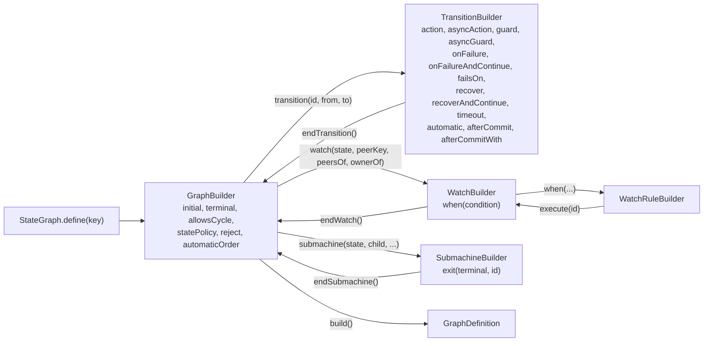

# Programmatic DSL

The typed annotation API is the main application workflow. The core artifact also includes a Java DSL under
`io.github.graphmaquina.dsl`, which constructs a `GraphDefinition` at runtime, and a runtime API under
`io.github.graphmaquina.runtime` that builds machines and registries from it. Graph validation happens when
`build()` runs, rather than during javac. The DSL entry point is `StateGraph.define(key)`.

## Contents

- [A complete example](#a-complete-example)
- [Declare a graph](#declare-a-graph)
- [Watches and sub-machines](#watches-and-sub-machines)
- [Build machines and a registry](#build-machines-and-a-registry)

## A complete example

The following utility can be added to the ticket quickstart package. It creates an alternative programmatic
definition using the same entity and enums, without using its generated facade:

```java
package com.example.tickets;

import io.github.graphmaquina.api.ActionOutcome;
import io.github.graphmaquina.api.GraphDefinition;
import io.github.graphmaquina.api.GuardResult;
import io.github.graphmaquina.api.MachineKey;
import io.github.graphmaquina.api.Outcome;
import io.github.graphmaquina.dsl.StateGraph;
import io.github.graphmaquina.runtime.MachineRegistry;
import io.github.graphmaquina.runtime.StateMachines;

public final class ProgrammaticTickets {
    private ProgrammaticTickets() { }

    public static Outcome<Ticket, TicketState, TicketTransition> run(Ticket ticket) {
        MachineKey<Ticket, TicketState, TicketTransition> key =
                MachineKey.of(Ticket.class, TicketState.class, TicketTransition.class);
        GraphDefinition<Ticket, TicketState, TicketTransition> graph = StateGraph.define(key)
                .initial(TicketState.OPEN)
                .terminal(TicketState.DONE)
                .terminal(TicketState.FAILED)
                .allowsCycle(TicketState.OPEN)
                .statePolicy(TicketState.OPEN, "submit the ticket first")
                .statePolicy(TicketState.REVIEW, "approve, reject or decline the ticket")
                .reject(TicketState.OPEN, TicketTransition.APPROVE, "approval requires review")
                .transition(TicketTransition.SUBMIT, TicketState.OPEN, TicketState.REVIEW)
                    .guard("hasTitle", ctx -> ctx.entity().getTitle().isBlank()
                            ? GuardResult.reject("a ticket needs a title") : GuardResult.pass())
                    .endTransition()
                .transition(TicketTransition.APPROVE, TicketState.REVIEW, TicketState.DONE)
                    .action("approve", ctx -> ctx.entity().isAccepted()
                            ? ActionOutcome.ok() : ActionOutcome.failed("approval declined"))
                    // a failed approval takes DECLINE, from REVIEW to FAILED
                    .onFailure(TicketTransition.DECLINE)
                    .endTransition()
                .transition(TicketTransition.DECLINE, TicketState.REVIEW, TicketState.FAILED)
                    .endTransition()
                .transition(TicketTransition.REJECT, TicketState.REVIEW, TicketState.OPEN)
                    .endTransition()
                .build();

        try (MachineRegistry registry = MachineRegistry.builder()
                .add(StateMachines.from(graph)
                        .state(Ticket::getState, Ticket::setState)
                        .identity(Ticket::getId))
                .build()) {
            registry.of(key).execute(ticket, TicketTransition.SUBMIT);
            return registry.of(key).execute(ticket, TicketTransition.APPROVE);
        }
    }
}
```

The definition differs from the quickstart's on purpose: `SUBMIT` has no `register` action, the acceptance check moved to `APPROVE`'s action,
`DECLINE` leaves `REVIEW` as `APPROVE`'s `onFailure` instead of leaving `OPEN` as `SUBMIT`'s, and there is no
self-loop, auto-approval or commit hook. Add them through the DSL when that behavior is required.

## Declare a graph

Each call returns the stage the next call continues from:



Each edge is keyed by its origin and its identifier: `transition(id, from, to)` opens one edge and `endTransition()`
closes it. Every builder method refuses a state, an identifier or a child terminal of another enum, which only raw
types can pass, with `IllegalArgumentException`.
`action` takes a `TransitionAction`, whose `process(ctx)` returns an `ActionOutcome`, and `guard` a
`TransitionGuard`, whose `test(ctx)` returns a `GuardResult`; `asyncAction` and `asyncGuard` take an
`AsyncTransitionAction` and an `AsyncTransitionGuard`, which return a `CompletionStage` of the same results. All four
are functional interfaces, so a lambda or a method reference fits. `timeout(duration)` bounds an asynchronous action's
wait. `recover(kind, id)` names the
recovery for a returned failure of that kind; `recover(kind, id, type)` and `recover(kind, id, types)` also route a
throwable whose most specific declared type is one of the rule's. `onFailure(id)` names the fallback for every other
returned failure and for a throwable whose most specific declared type is one of the edge's `failsOn`. Recovery
identifiers resolve from the failing edge's origin. `recoverAndContinue`, with the overloads of `recover`, and
`onFailureAndContinue(id)`, which is the edge's `onFailure`, declare routes that let the entity's automatic chain go on
from the recovery state. `automatic()` marks the edge as one the machine takes on its own, and the graph's
`automaticOrder(state, ids)` orders the automatic edges of a state that has two or more, as
[automatic transitions](automatic-transitions.md) explains. `afterCommit(name, hook)` takes a hook of the entity alone
and `afterCommitWith(name, hook)` one that also takes the `CommitContext`; an edge declares at most one hook, and a
second throws `IllegalStateException` at once. `statePolicy` and `reject` word the answers a node gives. A state has
exactly the edges you declare.

A guard or an action is named by the name given or, without one, by the simple name of its class. A lambda, a
method reference or an anonymous class has no such name, so it needs the overload that takes one: `build()` reports
`SG106` without it, and `SG107` for a blank name. `build()` refuses a second guard of one name on an edge with
`SG105`, as it refuses the same guard declared twice. An edge left open, or one that declares more than one action,
`onFailure` or `timeout`, or a second `automatic()`, fails `build()` with `SG507`; a missing or repeated `initial`
is `SG201`. A null argument is refused at once with a `NullPointerException`. An edge's stage refuses every further
call with `IllegalStateException` once `endTransition()` closed it, and once `build()` has run, even a `build()` that
failed, every stage refuses further declarations, and a second `build()`, the same way.

`build()` first reports what an edge, the initial state or a watch gets wrong on its own, and duplicate keys. The
structural checks, policies, terminal states, reachability, cycles, failure routes, watch targets and the bindings of
sub-machines from `SG801` to `SG804`, run only once none of those remain; `SG805` is checked in any case. A definition that fails
throws `InvalidGraphException`, whose `problems()` hold each code and message. [Diagnostics](diagnostics.md) lists
every code.

`GraphDefinition` is an interface, and the records a definition hands out, such as `TransitionSpec`, `StatePolicy`,
`RecoveryRule`, `WatchSpec` and `SubmachineSpec`, have public constructors that validate each record on its own: a
`TransitionSpec` refuses `onFailure`, `failsOn` or recovery rules without an action, and a timeout without an
asynchronous action, with `IllegalArgumentException`. A definition assembled from them by hand gets none of the graph
checks `build()` runs, such as reachability, cycles or failure routes, so the DSL or the annotations are the way to a
validated graph. Such a definition implements `automaticFrom(state)` itself: the runtime asks only it for the automatic
edges of a state, so it must list exactly the edges leaving that state that are marked `automatic`. The records'
constructors check what they can: an outcome's `Rejected` needs a non-blank reason and a guard name only for `GUARD`, a
`Failed` a non-blank reason and a valid failure kind, a `CallFailure` a phase that matches its `statesWritten`, a
`MachineCall` an identifier of its own catalogue, one for an `EXECUTE` and none for any other request, a reaction only
for a `REEVALUATE` and an automatic step only for an `ADVANCE`, a `TransitionSpec` a positive timeout, a `WatchSpec` at
least one rule, and named references a non-blank name. The outcome constructors without `starts`, `failureKind` or
`flow` report none and give `FlowView.empty()`. A hand-built `TransitionSpec` whose `failsOn` holds an interface type
can make the order of its entries change the route, which the DSL and the annotations never allow. The `TransitionSpec`
constructor without `recoveryRules`, `automatic` and `onFailureContinues` declares no rule and neither flag, and a
`SubmachineSpec` copies its exits, in order, into an unmodifiable map and refuses a null terminal or identifier with
`NullPointerException`. The `dsl` package also holds the outline records and `MachineOutlineValidator` that the DSL and
the annotation processor share to check a graph by names; building a graph does not need them.
`MachineOutlineValidator.validate(outline)` returns the problems sorted by code, origin state and identifier, and the
outline records refuse empty or repeated states, repeated identifiers and unknown names with `IllegalArgumentException`.

## Watches and sub-machines

`watch(state, peerKey, peersOf, ownerOf)` declares the watch of a state: `peersOf` returns the owner's peers and
`ownerOf` the owner of a peer, as an `Optional`. `when(name, condition)` opens a rule on a `WatchCondition`, whose
`test(owner, peers, view)` decides, and `when(namedCondition)` on a `NamedCondition`, a condition paired with its name.
`WatchCondition.allIn(state)`, `anyIn(state)` and `noneIn(state)` build the three built-in ones, named `allIn PACKED` and
so on. A rule's `execute(id)` names the owner's identifier it runs, and `endWatch()` returns to the graph without
closing the stage: a stage you kept a reference to still adds rules until `build()`. A `when` that no
`execute` follows, or a watch without rules, is `SG404`, and two watches on one state are `SG403`.
[Watch other machines](coordination.md#watch-other-machines) explains when a watch runs.

`submachine(state, child, childOf, parentOf)` binds another machine to a state: `child` is that machine's own
`GraphDefinition`, `childOf` returns the child entity of a parent and `parentOf` the parent of a child, both as an
`Optional`. An edge that enters `state` while `childOf` answers empty aborts its step before the action runs, as
[compose machines](composition.md) says. `submachine(state, child)` binds a machine over the same entity, whose
lookups return the entity itself. `exit(terminal, id)` maps a terminal state of the child to an identifier of the
parent, its exit, and `endSubmachine()` returns to the graph, again without closing the stage. `build()` checks the bindings (`SG801` to `SG805`), and
the definition's `submachine(state)` returns the binding of a state. A registry that holds the parent must hold the
child's machine too, built from that very definition: otherwise `MachineRegistry.Builder.build()` throws
`IllegalStateException`, and so does a standalone `build()`, whose registry holds no other machine.

## Build machines and a registry

`StateMachines.from(definition)` returns a single-use builder of one machine:

| Method | What it sets |
| --- | --- |
| `state(getter, setter)` | How the machine reads and writes the entity's state; the setter must not throw |
| `identity(function)` | The entity's identity within a unit of work; mandatory within a registry |
| `asyncTimeout(duration)` | The wait budget of every root call the machine starts, mandatory for a machine with asynchronous edges |
| `asyncExecutor(executor)` | The executor that runs the calls submitted through `async(...)`; a new virtual thread per call by default |
| `recordTrail()`, `recordTrail(clock)` | Records [the call's trail](call-flow.md#record-the-calls-trail) of every root call the machine starts |
| `as(facade)` | The facade type that identifies the machine in `peer(Class)` and `cascade(Class, ...)` |
| `build()` | A standalone `StateMachine`, in an internal registry of its own |

`MachineRegistry.builder()` gathers several machines: `add(builder)` adds one, `maxCascadeDepth(n)`,
`maxWatchChain(n)` and `maxAutomaticChain(n)` bound cascades, watch chains and automatic chains (10 each by default,
and at least 1), `observer(observer)` adds an
[observer](commit-and-persistence.md#observers), and `build()` checks every machine before it builds any.
`registry.of(key)` returns a machine and `keys()` lists them. Every machine whose calls can run an edge implicitly
must also declare `asyncTimeout(...)` when that edge is asynchronous, including a child's binding exit and a terminal
initial descendant's exit started by the caller's own entry, as [deadline rules](async-deadlines.md#deadline-rules)
explains.

Both builders are single-use and not thread-safe: once a `build()` succeeds, every further call throws
`IllegalStateException`, while a `build()` that fails consumes nothing, so the build can be fixed and run again.
Their methods refuse a null argument with `NullPointerException`.
`build()` also throws `IllegalStateException` for a machine without `state(getter, setter)`, for a machine without
`identity(...)` within a registry, for a watch whose peer the registry does not hold, and for one facade type given
to two machines of a registry, which only raw types can pass since `as(...)` takes a facade of the machine's own
key; a second `as(...)` and an
`add` of a key already in the registry throw it at once. A standalone machine reaches only its own key and facade as
peers and refuses a watch on another machine.

A `StateMachine` exposes `execute(entity, id)`, `execute(entity, id, input)`, `reevaluate(entity)`,
`advance(entity)`, `eligibility(entity, id)` and `eligibility(entity, id, input)`, `transitionsFrom(state)`,
`definition()` and `key()`, plus `async()`, an `AsyncStateMachine` whose
`execute(entity, id)`, `execute(entity, id, input)`, `reevaluate(entity)` and `advance(entity)` return a
`CompletableFuture`, and
`supplyAsync(call)`, which runs any call on the machine's executor. The interfaces' default
`execute(entity, id, input)` refuses an input: `StateMachine`'s throws `UnsupportedOperationException`, and
`AsyncStateMachine`'s returns a future failed with it; the machines the runtime builds accept one. The two
`eligibility` methods of `StateMachine` are defaults as well, and throw `UnsupportedOperationException`; the machines
the runtime builds implement them and return an `Eligibility`. A check runs the admission of `execute` without
running the edge: `Eligible`, or `Ineligible` with the reason, the `RejectionKind` and the guard that `execute` would
reject with. It answers for any identifier of the catalogue, as `execute` does, writes no state, runs no action, hook
or watch reaction, and notifies no observer. A generated
application facade intentionally presents the domain operations instead. Close the registry when its work is done:
that closes the default executors it owns. A standalone machine's internal registry cannot be closed, so its default
executor never is; give it an `asyncExecutor` you close yourself when it runs calls through `async(...)`.

---

Next: [Automatic transitions](automatic-transitions.md). Back to the [documentation index](README.md).
