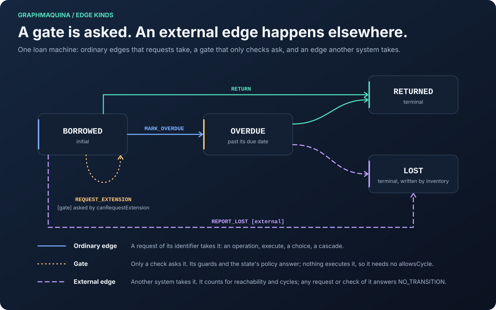

# Gates and external edges

Most edges are taken: a request of their identifier runs their guards, their action, and moves the entity. Two kinds of
edge are never taken by the machine itself. A gate is a self-loop that only a check asks: its guards answer a permission
question, such as whether a loan may be extended, and nothing ever executes it. An external edge is one another system
takes: the machine knows the state it leads to, so that state counts as reachable, but no request of the machine moves
an entity along it.



## Contents

- [A gate: ask a permission without moving](#a-gate-ask-a-permission-without-moving)
- [An external edge: a move another system makes](#an-external-edge-a-move-another-system-makes)
- [The rules the build checks](#the-rules-the-build-checks)
- [Write them with the DSL](#write-them-with-the-dsl)
- [Diagrams, snapshots and tests](#diagrams-snapshots-and-tests)

## A gate: ask a permission without moving

A borrower asks whether their loan could be extended. The answer depends on the due date and on the reservations of the
book, which guards already know how to read. Before gates, the question needed an edge that moved nowhere: a self-loop
with `allowsCycle` on its state and an operation that the application had to be careful never to call. A gate is that
self-loop without the risk: its guards and its state's policy answer a check exactly as they would for any edge, and
every request of its identifier is answered as if the state had no edge for it.

The [loan facade](../graphmaquina-example/src/main/java/io/github/graphmaquina/example/loan/Loans.java) declares the
gate on the interface, with `gate = true`, and a check for it:

```java
@LoansGraph.Transition(id = REQUEST_EXTENSION, from = BORROWED, to = BORROWED, gate = true,
        guards = {LoanGuardsRefs.BeforeDue.class, LoanGuardsRefs.NoWaitingReader.class,
                LoanGuardsRefs.NotHeldForCourse.class})
```

```java
@LoansGraph.Check(id = REQUEST_EXTENSION)
Eligibility<Loan, LoanStatus, LoanTransition> canRequestExtension(Loan loan);
```

A gate's check needs no operation to repeat: it takes the entity and, when its guards read one, an input of any type.
What a gate answers, and to whom:

- **Checks ask it.** A facade `Check`, `eligibility(entity, id)` of the state machine and of the facade's selector, and
  a [choice](choices.md) that checks, with a `ChoiceEligibility` result, run its guards and the state's policy, as
  [eligibility checks](eligibility.md) run any edge.
- **Requests never take it.** An operation cannot declare it, the selector's `execute(entity, id)` refuses its
  identifier, and `execute`, a choice that runs or a cascade that names it from its state is answered `NO_TRANSITION`,
  with the reason of the state's policy, as for an identifier the state does not declare. It never commits, so it writes
  no state, runs no hook and chains nothing.
- **It is no cycle and no exit.** A gate needs no `allowsCycle`, and it does not count as an edge leaving a state that
  is not terminal: a state whose only edges are gates is still `SG202`.

## An external edge: a move another system makes

The library's inventory system declares a book lost and writes `LOST` on the loan itself. Before external edges, `LOST`
was unreachable for the machine, which the build refuses as `SG203`, so the graph needed an edge the application had to
promise never to call. An external edge says what happens: the entity reaches `LOST`, but not through this machine. The
[loan facade](../graphmaquina-example/src/main/java/io/github/graphmaquina/example/loan/Loans.java) declares it from
both states a loan can be lost in:

```java
@LoansGraph.Transition(id = REPORT_LOST, from = {BORROWED, OVERDUE}, to = LOST, external = true)
```

An external edge counts for the structure as any edge does: the state it enters is reachable, it is an edge leaving its
origin for `SG202`, and it takes part in cycles, so a cycle through it needs `allowsCycle`. This machine never takes it:
a request or a check of its identifier from its origin is answered `NO_TRANSITION`, with the reason of the state's
policy. Once the other system wrote the new state, every call of the machine reads it like any other: a loan read as
`LOST` refuses a return with the reason of the policy its closed states share.

## The rules the build checks

The DSL reports these when the graph is built and the processor when the facade compiles, with the same codes:

- `SG111`: a gate is a self-loop that declares guards at most: no action, `onFailure`, recovery rule or hook of its own,
  and it is neither automatic nor external. A machine's default hook never applies to it.
- `SG112`: an external edge leads to another state and declares nothing else: no guard, action, `onFailure`, recovery
  rule or hook, and it is neither automatic nor a gate.
- `SG113`: every edge of one identifier is of one kind: ordinary, gate or external.
- `SG114`: no failure route, sub-machine exit or watch rule names a gate or an external edge, since the machine would
  have to take it.
- `SG517`: the facade reaches neither kind otherwise: no operation for a gate or an external identifier, no check for an
  external one, no gate among the candidates of a choice that runs, and no external identifier among those of any
  choice.
- `SG507`: one edge declares `gate()` or `external()` twice.

A gate on a terminal state is an edge leaving a terminal state, `SG202`. [Diagnostics](diagnostics.md) lists every code.

## Write them with the DSL

`gate()` and `external()` mark the edge they follow. The
[loan's DSL test](../graphmaquina-example/src/test/java/io/github/graphmaquina/example/loan/LoanDslTest.java) declares
the annotated graph again and finds the same structure:

```java
static GraphDefinition<Loan, LoanStatus, LoanTransition> graph(LoanGuards guards) {
    List<Class<? extends Throwable>> unavailable = List.of(ReservationsUnavailable.class);
    return StateGraph.define(MachineKey.of(Loan.class, LoanStatus.class, LoanTransition.class))
            .initial(BORROWED).terminal(RETURNED).terminal(LOST)
            .statePolicy(BORROWED, Loans.BORROWED_POLICY)
            .statePolicy(OVERDUE, Loans.OVERDUE_POLICY)
            .statePolicy(RETURNED, Loans.CLOSED_POLICY)
            .statePolicy(LOST, Loans.CLOSED_POLICY)
            .transition(REQUEST_EXTENSION, BORROWED, BORROWED).gate()
                .guard("beforeDue", guards::beforeDue)
                .guard("noWaitingReader", guards::noWaitingReader, unavailable)
                .guard("notHeldForCourse", guards::notHeldForCourse, unavailable)
                .endTransition()
            .transition(MARK_OVERDUE, BORROWED, OVERDUE).guard("pastDue", guards::pastDue).endTransition()
            .transition(RETURN, BORROWED, RETURNED).endTransition()
            .transition(RETURN, OVERDUE, RETURNED).endTransition()
            .transition(REPORT_LOST, BORROWED, LOST).external().endTransition()
            .transition(REPORT_LOST, OVERDUE, LOST).external().endTransition()
            .build();
}
```

The third argument of `guard` lists the failures a guard propagates, which [guard evidence](guard-evidence.md) explains.

## Diagrams, snapshots and tests

`TransitionSpec.gate()` and `TransitionSpec.external()` mark the two kinds in a definition, which lists them with every
other edge, and `transitionsFrom(state)` names their identifiers too. The DOT export draws a gate as a dotted arrow
whose label starts with `[gate]` and an external edge as a dashed arrow whose label starts with `[external]`, as
[graph inspection](graph-inspection.md) shows. A structural snapshot records `/transitions/<from>/<id>/gate` and
`/transitions/<from>/<id>/external` only on an edge of that kind, and `TransitionAssert.isGate()` and `isExternal()` pin
the kind in a test, as [testing](testing.md) lists.

---

Next: [Programmatic DSL](dsl.md). Back to the [documentation index](README.md).
