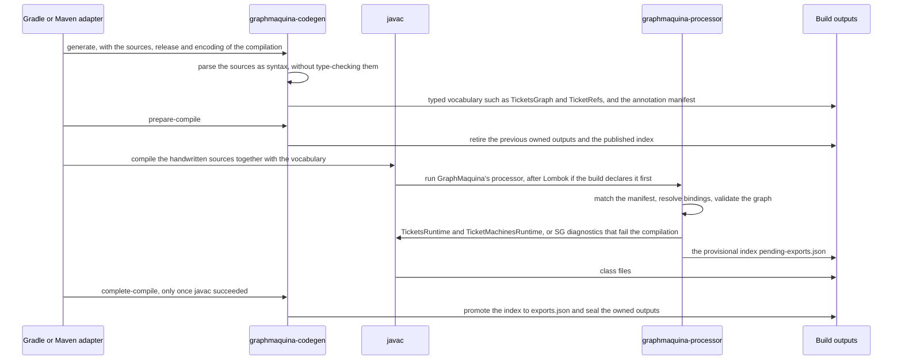

# Code generation and IDE setup

A machine's source refers to annotations and symbols that GraphMaquina generates from that same source. This page
explains how the first build gets there, which files each step writes, and how to work with them in an IDE.

## Contents

- [How your flow annotations are generated](#how-your-flow-annotations-are-generated)
- [Generation lifecycle and IDE setup](#generation-lifecycle-and-ide-setup)

## How your flow annotations are generated

You write the machine interface; GraphMaquina generates its annotation types before compiling your
application. The generator writes `TicketsGraph` from the name and type parameters of `Tickets`. You do not
need an already compiled `Tickets` class or an existing `TicketsGraph` to start.

There are three kinds of API:

| API | Who supplies it? | When is it available? |
| --- | --- | --- |
| `@GenerateGraphApi`, `@StateGraphs`, `@GraphProperty`, `@GraphAction`, `@GraphGuard`, `@GraphHook` and the other [markers](graph-model.md#handwritten-markers), `Machine`, `Machines` | The `graphmaquina-core` dependency | As soon as dependencies resolve |
| `TicketsGraph.Definition`, `TicketsGraph.Transition`, `TicketsGraph.StatePolicy`, `TicketRefs`, `TicketActionsRefs` | The pre-compilation generator, from your declarations | After the generation task/phase, before application compilation |
| `TicketsRuntime`, `TicketMachinesRuntime` | The annotation processor, from the validated flow | During application compilation |


The generator creates the annotation types; you choose the flow by using those annotations. It does not
infer transitions from action method bodies, and it never invents a transition identifier from a name. For
example, `Machine<Ticket, TicketState, TicketTransition>` tells it that `initial`, `from` and `to` must use
`TicketState` and that `id` and `onFailure` must use `TicketTransition`. Your
`@TicketsGraph.Transition(id = ..., from = ..., to = ...)` declaration then specifies an actual edge.

### Start with a minimal machine

First configure the [Gradle plugin](installation.md#configure-gradle) or the [Maven lifecycle](installation.md#configure-maven), including
the annotation processor. Create `TicketState`, `TicketTransition`, `Ticket` and `TicketActions` from the
[quickstart](quickstart.md). Then create
`src/main/java/com/example/tickets/Tickets.java` with this initial content:

```java
package com.example.tickets;

import io.github.graphmaquina.annotation.GenerateGraphApi;
import io.github.graphmaquina.api.Machine;

@GenerateGraphApi
public interface Tickets extends Machine<Ticket, TicketState, TicketTransition> {
}
```

This is enough to generate the annotation vocabulary. It is not yet a complete, valid flow: the definition,
policies and operations are added in the next step. The entity and both enums must be resolvable, and source
files must contain valid Java syntax.

From the application directory, run just generation with your chosen build tool:

```bash
# Gradle: generate vocabulary without compiling the application
./gradlew generateStateGraphApi

# Maven: execute the configured generate-sources phase without compiling the application
mvn generate-sources
```

With the quickstart's marked entity and action members, these files now exist in the same Java package as
their handwritten declarations:

| File | Gradle | Maven |
| --- | --- | --- |
| `TicketsGraph.java` | `build/generated/sources/graphmaquina/main/com/example/tickets/` | `target/generated-sources/graphmaquina/com/example/tickets/` |
| `TicketRefs.java` | Same directory | Same directory |
| `TicketActionsRefs.java` | Same directory | Same directory |

`TicketsGraph.java` contains the nested annotations `Definition`, `StatePolicy`, `Transition` and `Reject`,
with `StatePolicies`, `Transitions` and `Rejects` as their repeatable containers, `Recovery`, which is
written only inside a `Transition`, `Check`, which is written on a method, and `AutomaticOrder`, with
`AutomaticOrders` as its repeatable container. `TicketRefs` contains
symbols for `@GraphProperty` members; `TicketActionsRefs` contains symbols for marked actions, guards and
hooks. Generation alone does not produce `TicketsRuntime` or `TicketMachinesRuntime`.

Refresh the IDE's build model if needed. You can now replace the minimal `Tickets.java` with the
[complete flow declaration](quickstart.md#ticketsjava), using `@TicketsGraph.Definition`, `@TicketsGraph.StatePolicy` and
`@TicketsGraph.Transition`. Add `TicketMachines.java` and `App.java` from the quickstart, then build and run:

```bash
# Gradle: generation, compilation and execution
./gradlew run

# Maven: generation and compilation; then run App with the java command of the installation page
mvn compile
```

During this build, the processor validates the flow and generates the `Runtime` implementations. javac also
compiles those generated implementations and application code that references them in the same invocation.

### You can also write the complete flow immediately

The initial generation-only step is optional: it is useful when you want the generated annotations available
in the editor before writing the flow. You may instead create all seven complete quickstart files at once,
including references to `TicketsGraph`, `TicketRefs` and `TicketMachinesRuntime`, and run the normal build.

This works on a clean checkout because reading Java syntax and checking Java types are separate operations:

1. The generator reads the original `.java` files as syntax. It uses the library markers, machine type
   parameters and marked members to create the vocabulary. References to the not-yet-generated annotations
   do not require those annotation classes to exist at this stage.
2. The build adapter adds the generated source directory to the compilation and supplies the generated
   manifest to the processor.
3. javac type-checks the handwritten sources together with the generated vocabulary. The processor
   validates your graph and emits its implementations. Compilation errors are reported at this stage if
   the flow or its bindings are invalid.

The build generates from source before attempting application compilation. A clean checkout does not need a
first compilation that fails, placeholder annotations, or a previously built JAR of your own machine. After
changing machine names, state or transition enums, or exported members, run the same build again to
regenerate the API.

An editor may underline missing generated types before the first generation. Use the commands above and
[refresh the generated roots](#ide-workflow); plain `javac` or an IDE build that bypasses the configured adapter
does not perform the required pre-generation step.

## Generation lifecycle and IDE setup

GraphMaquina uses pre-compilation generation, because the annotations and symbols used by your source must
exist before javac can type-check that source:

```text
generate -> prepare-compile -> javac (Lombok if used, then GraphMaquina) -> complete-compile
```



The source-reading step uses `JavacTask.parse()` with annotation processing disabled; it does not type-check
the original application or require its generated annotation classes. It parses the original sources at the
compilation's release and in its source encoding, which the build adapters pass in the request, and it writes
the generated sources in that encoding too. It resolves the headers and exported members needed for
generation, then emits vocabulary plus a manifest. The processor verifies that the manifest matches the
declarations javac accepted, resolves bindings, checks the graph and emits facades, in ASCII only: every other
character of a name or a text is written as a `\uXXXX` escape, so javac writes them alike in any encoding.
Completion publishes the validated export index and records ownership of generated outputs.

### Generated files

| Content | Gradle | Maven |
| --- | --- | --- |
| Main vocabulary / symbols | `build/generated/sources/graphmaquina/main` | `target/generated-sources/graphmaquina` |
| Test vocabulary / symbols | `build/generated/sources/graphmaquina/test` | `target/generated-test-sources/graphmaquina` |
| Main processor-generated facades | `build/generated/sources/annotationProcessor/java/main`, the compile task's default | `target/generated-sources/annotations`, which the Maven plugin requires |
| Test processor-generated facades | `build/generated/sources/annotationProcessor/java/test` | `target/generated-test-sources/test-annotations`, which the Maven plugin requires |
| Main work directory | `build/graphmaquina/main` | `target/graphmaquina/main` |
| Test work directory | `build/graphmaquina/test` | `target/graphmaquina/test` |
| Published main export index | `build/classes/java/main/META-INF/graphmaquina/exports.json` | `target/classes/META-INF/graphmaquina/exports.json` |

Besides the vocabulary, the generated root holds one compilation carrier,
`io/github/graphmaquina/generated/bootstrap/GraphCompilation<digest>.java`, a tool-internal type that tells the
processor which compilation it belongs to; it is emitted even when no machine is left. Work directories contain
`request.json`, `annotation-manifest.json`, ownership inventories and processor inventory. A failed generation can leave `annotation-manifest.pending.json` for ownership recovery; this is
not a manifest javac should consume.

Do not hand-edit, commit or copy these generated outputs into `src/main/java`. Preserve the export index when
packaging a producer JAR. Normal rebuilds retire owned outputs for renamed or deleted declarations without
requiring `clean`; handwritten files in output locations are not silently adopted as generated files.

Gradle adds generated vocabulary to the source set's java sources as a source directory set of its own, so
source archives and IDE imports can see it; the source set's include and exclude patterns do not filter it, and
the sources jar and javadoc of the source set leave out the compilation carrier. The plugin disables
incremental compilation on the compile task of every source set so partial javac output does not conflict with
complete ownership inventories. Gradle task up-to-date checks and configuration-cache support are separate;
unchanged builds can still skip work.

### IDE workflow

1. Import the project through its Gradle or Maven model, using the intended Java 21 JDK.
2. For a minimal machine still being written, run `./gradlew generateStateGraphApi` or `mvn generate-sources`
   to create vocabulary first. Once the flow is complete, run `./gradlew compileJava` or `mvn compile` to
   validate it and create runtime implementations.
3. Refresh the build model so generated source roots are visible.
4. After renaming graph declarations or bindings, run the normal build to regenerate references and retire old
   outputs. Fix handwritten references to the renamed symbols as required by javac.

An IDE's plain javac invocation is insufficient if it bypasses the pre-generation adapter: the processor then
finds no `-Agraphmaquina.annotationManifest` option and fails the compilation with `SG602`, "this compilation names
no annotation manifest". Delegate builds to
the configured build tool or run that lifecycle explicitly. Do not fix missing generated symbols by creating
empty source files with those names.

The Gradle plugin's tests check that the generated vocabulary is a source root of its source set, the form an IDE
import reads. IntelliJ IDEA 2026.2.3 was checked once on the quickstart's Gradle project after a build, through the IDE's MCP
server. The import registered `build/generated/sources/graphmaquina/main` as a source root and
`build/generated/sources/annotationProcessor/java/main` as a generated source root. References to `TicketsGraph`,
`TicketRefs` and `TicketMachinesRuntime` resolved to their declarations in those files, and a reference to a
`TicketRefs` member that does not exist was flagged as unresolved.

Renaming the binding method `register` to `enroll` with the IDE's rename refactoring changed the method and edited
two generated files in place, the Javadoc link in `TicketActionsRefs` and the call in `TicketsRuntime`, but kept the
generated class `TicketActionsRefs.Register` and the `action = TicketActionsRefs.Register.class` that names it. The next
build regenerated the reference as `TicketActionsRefs.Enroll`, and javac, then the IDE, reported `Register` as missing
until the annotation named `Enroll`. Code completion and an IDE import of the Maven configuration have not been
exercised.

---

Next: [Graphs, annotations and bindings](graph-model.md). Back to the [documentation index](README.md).
