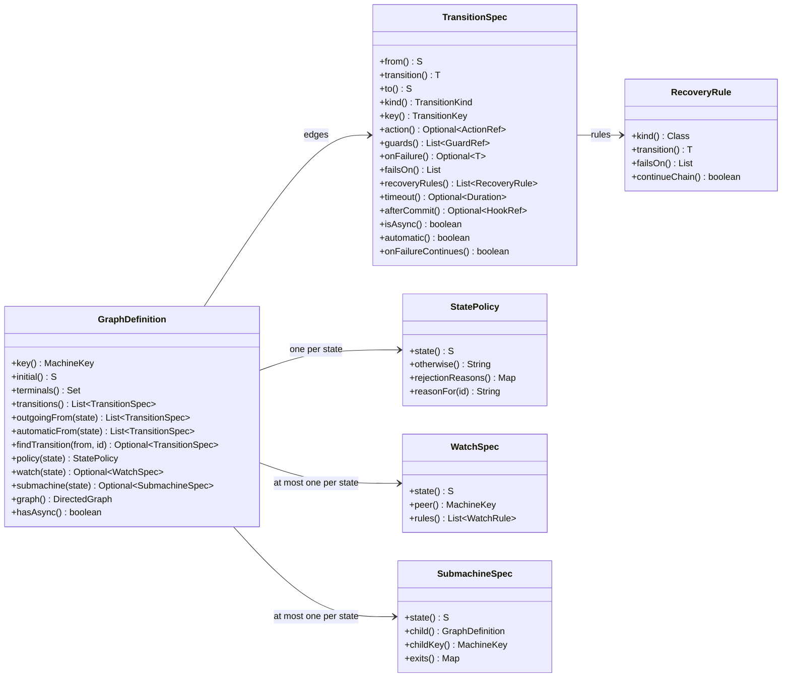

# Inspect graphs and export diagrams

Every machine carries its definition as data: the states, the declared edges with everything each one declares,
the policies, watches and sub-machine bindings. This page reads that data, queries its topology and exports it as
a Graphviz diagram. None of it runs a guard, an action, a hook or a sub-machine's lookup.

## Contents

- [Read a definition](#read-a-definition)
- [A definition without collaborators](#a-definition-without-collaborators)
- [Query the topology](#query-the-topology)
- [Export Graphviz DOT](#export-graphviz-dot)
- [Export from the command line](#export-from-the-command-line)
- [Diagrams and contracts in tests](#diagrams-and-contracts-in-tests)

## Read a definition

Every facade exposes its definition:

```java
GraphDefinition<Ticket, TicketState, TicketTransition> graph = tickets.definition();
System.out.println(graph);
System.out.println(tickets.transitionsFrom(TicketState.REVIEW));
System.out.println(graph.outgoingFrom(TicketState.REVIEW));
System.out.println(graph.findTransition(TicketState.REVIEW, TicketTransition.APPROVE));
System.out.println(graph.policy(TicketState.OPEN).reasonFor(TicketTransition.APPROVE));
```

`toString()` prints the machine's key and its counts, such as `Ticket/TicketState[4 states, 6 transitions]`.
`transitionsFrom` returns the identifiers declared from a state, `outgoingFrom` the `TransitionSpec`s themselves,
`transitions()` every declared edge, ordered by origin, then identifier, then destination, `automaticFrom` the
automatic edges that leave a state, in the order an advance tries them, and `findTransition` the
single spec keyed by `(from, id)`, as an `Optional` that is empty when no edge is declared. `key()`, `initial()`,
`terminals()` and `hasAsync()`, true when some edge is asynchronous, describe the machine as a whole.



A `TransitionSpec` is one edge: its endpoints and identifier, its `kind()`, `ACTION` or `MOVE`, its `key()`, the
`TransitionKey` `(from, transition)`, which prints as `FROM/TRANSITION`, the `ActionRef` and `GuardRef`s that name its
action and guards, its `onFailure`, `failsOn`, `recoveryRules()`, `timeout` and `afterCommit` hook, and `isAsync()`,
true when the action or any guard is asynchronous. `automatic()` says the graph declares the edge
[automatic](automatic-transitions.md), and `onFailureContinues()` that its `onFailure` route continues the chain of
automatic attempts; so does a `RecoveryRule` whose `continueChain()` is true. `policy(state)` is never null: a
`StatePolicy` holds the state's `otherwise` reason and its `rejectionReasons()` per identifier, and `reasonFor(id)`
picks the one a request gets. `watch(state)` returns the state's `WatchSpec`, with the peer machine's key and its
ordered `WatchRule`s, each a named condition and the identifier it executes, and `submachine(state)` the
`SubmachineSpec` that binds a child, with its `child()` definition, `childKey()` and `exits()`.

An `ActionRef` and a `GuardRef` are either `Sync` or `Async` records, with their `name()` and `isAsync()`; a `HookRef`
is a named hook that takes the entity and its `CommitContext`, which `run(entity, context)` calls, and
`HookRef.of(name, consumer)` adapts a hook that takes the entity alone.

## A definition without collaborators

`TicketsRuntime.graph(new TicketActions())` needs the collaborators the machine calls, and a companion whose machine
binds sub-machines also takes the definition of each of them. To read, test or draw the graph without any of them,
every machine's companion also declares `structure()`:

```java
GraphDefinition<Ticket, TicketState, TicketTransition> structure = TicketsRuntime.structure();
```

`structure()` makes the very declarations `graph(...)` makes and takes nothing. It reads the definition of each
machine it binds as a sub-machine from the `structure()` of that machine's companion, once, as `graph(...)` binds the
one definition it is given. It binds no collaborator: an action, guard, hook or lookup that calls an instance member of
a class throws `IllegalStateException` when it runs, naming that class and the companion, as in
`com.example.tickets.TicketsRuntime.structure() binds no com.example.tickets.TicketActions: build a machine from
com.example.tickets.TicketsRuntime.graph(...)`. A static member, a property read, such as a watch's peers or a
sub-machine's child, and a built-in watch condition run as they do in `graph(...)`. Building, reading or exporting the
definition runs none of them, so `structure()` answers every query on this page and draws exactly as `graph(...)` does.
Build the machines you run from `graph(...)` or from the generated set. An instance method of the facade, declared or
inherited, named `structure` and taking no parameter, would clash with this static method and is refused as
[`SG504`](diagnostics.md).

## Query the topology

`graph()` returns the `DirectedGraph<S, T>`, which keeps every declared state as a node and every edge as a
labelled edge, parallel edges included, and offers `nodes()`, `edges()`, `outgoing(state)` and `incoming(state)`.
Its `topology()` is a `Graph<S>` that collapses parallel edges into one successor and answers structural
questions:

| Query | Answer |
| --- | --- |
| `successors(state)` | The states one declared edge away |
| `reachableFrom(state)` | The states some path reaches; the origin itself only when a cycle returns to it |
| `shortestPath(from, to)` | One shortest path, as the list of its states, or empty when there is none |
| `cycles()` | Every elementary cycle, each starting at its earliest declared state and without repeating it at the end |
| `inducedSubgraph(states)` | The graph restricted to those states |

A query on a state the graph does not hold throws `IllegalArgumentException`. `outgoing` and `incoming` return edges in
declaration order, and two `DirectedEdge`s are equal only when their origin, label and destination all are.
`Graph.nodes()` returns the nodes in declared order and `edges()` the set of `GraphEdge(from, to)`. `Graph.of(nodes, edges)` and
`DirectedGraph.of(nodes, edges)` build graphs of your own, from `GraphEdge` and `DirectedEdge` records: `Graph.of`
keeps the nodes in declared order with repeats collapsed, both throw `NullPointerException` for a null node and
`IllegalArgumentException` for an endpoint outside the nodes, and `DirectedGraph.of` also refuses a repeated node or a
repeated identical edge. `StrongComponents.find(graph)` returns their strongly
connected components, in the order of their first declared node, with `cycleWitness(graph, component)` naming one
cycle of a component; these are what the build uses to report an unauthorised cycle. The
[testing guide](testing.md#what-each-entry-point-checks) asserts on the same queries through
`assertThat(definition).topology()`.

## Export Graphviz DOT

To export [Graphviz DOT](https://graphviz.org/doc/info/lang.html) from an existing ticket facade:

```java
import io.github.graphmaquina.export.GraphView;
import io.github.graphmaquina.export.GraphvizExporter;

String diagram = GraphvizExporter.render(GraphView.of(tickets.definition()));
System.out.println(diagram);
```

This is a fragment: put the imports at file scope and the statements inside a method. Export does not run
transitions or evaluate guards, and there is no detail mode: the exporter draws the declared edges and no
other, because an edge nobody declared does not exist.

The export is deterministic DOT text with LF line endings, drawn with the [default theme](#change-the-colors). The
diagram reads left to right under a title, the machine's name in bold at the top left. States are rounded boxes, the
initial state has an incoming arrow from a solid dot, and a terminal state is a solid box with a double outline.
Watches appear as notes connected by dashed lines.

Each edge label puts the identifier in bold on its first line. Below it, one per line in the theme's `muted` color, come
`[auto]` when the edge is automatic, or `[auto n]` when its state declares an order among two or more automatic
edges, with `n` counted from 1 in that order, then the action name, `[async]` when the action or any guard is
asynchronous, `[if guard, …]`, one `[recover Kind -> ID]` per recovery rule in declaration order, `[onFailure ID]`
and any watch label. An automatic edge's arrow and identifier are drawn in the theme's `automatic` color. A route
that continues the chain ends its line with `continues`, as in `[recover Kind -> ID continues]` and
`[onFailure ID continues]`. `Kind` is the failure kind's binary name without its package, such as
`PublicationFailures$Unavailable`. The throwable types of `failsOn` and of the rules are not drawn, and a rule adds no
arrow. Parallel edges appear as separate arrows with different labels, and a self-loop is an arrow back to its own
node. A node's rejection policy is rendered as that node's `tooltip` — never as an arrow, because a refusal is an
answer the node gives and not a transition. State names and labels are escaped, and every declared state remains
visible even when no edge touches it. Edge labels and titles are Graphviz
[HTML-like labels](https://graphviz.org/doc/info/shapes.html#html), in which `&`, `<`, `>` and `"` are written as
entities, so `[recover Kind -> ID]` reads `[recover Kind -&gt; ID]` in the DOT text.

A state that holds a sub-machine is drawn as a cluster, a rounded, tinted region titled with the state and the child
machine, such as `DEPOSIT: Payment/PaymentStatus` with the state in bold, which holds the child's own diagram and has
the state's policy as its tooltip.
An edge into the state points at the child's initial state, or, when that state holds a sub-machine too, at that
one's initial state, and so on down. An exit is drawn once from each terminal state of the child that selects it,
without clipping at its source, and any other edge leaving the state, like the state's watch note, starts at the
cluster's border. A self-loop on the bound state that is not an exit is the exception: both its ends lie in the cluster, so
it is drawn unclipped from the cluster's invisible anchor to the child's initial state. The
DOT then sets `compound=true` and clips the arrows that cross a cluster's border with `lhead` and `ltail`. A graph
that binds no sub-machine has no cluster.

The shop's order machine exports as:

```text
digraph "Order/OrderStatus" {
    graph [rankdir=LR, bgcolor="#ffffff", pad="0.3", nodesep="0.45", ranksep="0.7", fontname=Helvetica, fontsize=12, fontcolor="#1b1f3a", labelloc=t, labeljust=l, label=<<b>Order/OrderStatus</b>>];
    node [shape=box, style="rounded,filled", color="#1b1f3a", fillcolor="#ffffff", fontcolor="#1b1f3a", fontname=Helvetica, fontsize=12, penwidth=1.2, margin="0.18,0.06"];
    edge [color="#4f5677", fontcolor="#1b1f3a", fontname=Helvetica, fontsize=10, penwidth=1.1, arrowsize=0.7];
    initial [shape=point, width=0.14, height=0.14, fillcolor="#1b1f3a", label=""];
    n0 [label="NEW", tooltip="otherwise: cannot ship without payment"];
    n1 [label="PAID", tooltip="otherwise: money was charged: requires a refund"];
    n2 [label="PAYMENT_DECLINED", tooltip="otherwise: go back to NEW to retry the charge"];
    n3 [label="SHIPPED", peripheries=2, fillcolor="#1b1f3a", fontcolor="#ffffff", tooltip="otherwise: a shipment cannot be undone"];
    n4 [label="CANCELLED", peripheries=2, fillcolor="#1b1f3a", fontcolor="#ffffff", tooltip="otherwise: cancelled is final"];
    initial -> n0;
    n0 -> n1 [label=<<b>PAY</b><br align="left"/><font color="#4f5677">pay<br align="left"/>[async]<br align="left"/>[if retryBudgetLeft]<br align="left"/>[onFailure PAYMENT_DECLINED]<br align="left"/></font>>];
    n0 -> n4 [label=<<b>CANCEL</b><br align="left"/><font color="#4f5677">cancel<br align="left"/></font>>];
    n0 -> n2 [label=<<b>PAYMENT_DECLINED</b>>];
    n1 -> n3 [label=<<b>SHIP</b><br align="left"/><font color="#4f5677">ship<br align="left"/>[if allItemsPacked]<br align="left"/>[watches Item: allIn PACKED]<br align="left"/></font>>];
    n2 -> n0 [label=<<b>RETRY</b><br align="left"/><font color="#4f5677">[if retryBudgetLeft]<br align="left"/></font>>];
    n2 -> n4 [label=<<b>CANCEL</b><br align="left"/><font color="#4f5677">cancel<br align="left"/></font>>];
    watch0 [shape=note, style=filled, color="#a85a00", fillcolor="#fff6e5", fontcolor="#a85a00", label="watches Item"];
    n1 -> watch0 [style=dashed, arrowhead=none, color="#a85a00"];
}
```

Save the result as UTF-8 in `tickets.dot`, then use an installed [Graphviz](https://graphviz.org/download/)
to render an image:

```sh
dot -Tsvg tickets.dot -o tickets.svg
dot -Tpng tickets.dot -o tickets.png
```

The Java exporter needs no external library or native executable. Image rendering is a separate step. To have the
build write these files for every machine instead, see [Export from the command line](#export-from-the-command-line).
The text is set in Helvetica, a font Graphviz knows by name: it sizes each box with Helvetica's widths even in a build
without a font library, such as a browser-based renderer, and writes the font of SVG text as `Helvetica,sans-Serif`, so
a viewer without Helvetica shows its own sans-serif font, Arial on Windows.
`GraphView.of(definition)` is a public record of what the exporter draws, as text: `name()`, `initial()`,
`terminals()`, `states()`, `transitions()`, `policies()`, `watches()` and `submachines()`, so a renderer of your own
can read the same data, and its public constructors build a view by hand. States come in node order, edges in definition order, rules and exits in declaration order,
with one policy per state, and each `SubmachineView` carries the child's whole `GraphView`. A `TransitionView` holds the
edge's endpoints, identifier, kind, action, guards, whether it is asynchronous, its `onFailure`, its rendered watch rule
and its recovery rules, whether it is `automatic`, its `automaticPosition` in the order of its state when that
state declares one, and whether its `onFailure` route continues (`failureContinues`); a `RecoveryView` the failure
kind and the `failsOn` types as binary names, the recovery identifier and whether the rule `continues`; a `PolicyView` the state, its `otherwise` reason and its rejections rendered as `ID: reason`; and a
`WatchView` the state, the simple name of the peer's entity class and the rendered rules. The DOT text starts with
`digraph "<name>"` and the `graph`, `node` and `edge` statements that hold the layout, `rankdir=LR` among it, the
title, the fonts and the colors every element shares. Inside a cluster, node ids carry the prefix `s<j>_`, one per nesting level, where
`j` counts the view's bound states in node order. An edge that a watch rule executes gets
`[watches <peer entity>: <condition names>]` in its label, and the note reads `watches <peer entity>`. A
`SubmachineView` holds the bound state, the child's `GraphView` and its `exits`, each child terminal mapped to the
parent identifier it selects, in the given order.

You can also build a definition directly through `TicketsRuntime.graph(new TicketActions())` without constructing a
running set, or through [`TicketsRuntime.structure()`](#a-definition-without-collaborators) without any collaborator.

### Change the colors

`GraphvizExporter.render(view)` draws with `GraphvizTheme.defaults()`, the light palette of graphmaquina.dev. A theme
is nine colors, one per role. Pass your own to `render(view, theme)`:

```java
import io.github.graphmaquina.export.GraphView;
import io.github.graphmaquina.export.GraphvizExporter;
import io.github.graphmaquina.export.GraphvizTheme;

GraphvizTheme dark = GraphvizTheme.defaults()
        .withCanvas("#1b1f3a")
        .withInk("#f3f4fb")
        .withMuted("#b8bedb")
        .withStateFill("#222747")
        .withAutomatic("#8bb6ff")
        .withClusterFill("#242a4b")
        .withClusterBorder("#3a416a")
        .withWatch("#ffcf8a")
        .withWatchFill("#2b2a45");
String diagram = GraphvizExporter.render(GraphView.of(tickets.definition()), dark);
```

This is a fragment, like the one above. Each `with` method returns a copy with that one role changed, so change only
the roles you need. A color is `#RRGGBB` or `#RRGGBBAA` in hexadecimal, in either case; an alpha of `00` makes the
role transparent, such as `withCanvas("#ffffff00")` for a diagram with no background. Any other value throws
`IllegalArgumentException` naming the role, and `null` throws `NullPointerException`.

| Role | Default | What it colors |
|------|---------|----------------|
| `canvas` | `#ffffff` | the background |
| `ink` | `#1b1f3a` | state names and outlines, the initial dot, the fill of terminal states, edge identifiers and titles |
| `muted` | `#4f5677` | the arrows of edges that are not automatic and the initial arrow, the text under an edge identifier, and the child machine in a sub-machine's title |
| `stateFill` | `#ffffff` | the body of a state that is not terminal, and the names written on terminal states |
| `automatic` | `#2457d6` | the arrow and identifier of an automatic edge |
| `clusterFill` | `#f5f6fb` | the body of the region that holds a sub-machine |
| `clusterBorder` | `#d4d8ea` | the outline of that region |
| `watch` | `#a85a00` | the outline and text of a watch note, and its dashed line |
| `watchFill` | `#fff6e5` | the body of a watch note |

A terminal state is filled with `ink` and written in `stateFill`, the reverse of the other states, so keep `stateFill`
opaque: a transparent one would hide the names of terminal states. The double outline marks a terminal state even
where the colors do not.
A theme changes colors only: the states, edges, labels, fonts, sizes and layout are the same in every theme.
[Export from the command line](#export-from-the-command-line) and `GraphGoldens` always draw with the defaults.

## Export from the command line

Both build adapters write the diagram of every machine a compilation declares, with no code of yours: they compile
the source set, draw each machine through its companion's [`structure()`](#a-definition-without-collaborators) and write
one DOT file per machine, holding exactly what `GraphvizExporter.render(GraphView.of(...))` returns for it.

With Gradle:

```sh
./gradlew exportStateGraphDot
./gradlew exportTestStateGraphDot
```

`exportStateGraphDot` exports the machines of `main`, `exportTestStateGraphDot` those of `test`, and
`export<SourceSet>StateGraphDot` those of any other source set. Each task runs after the compilation of its source set
and writes into `build/graphmaquina/<sourceSet>/dot`, which its `outputDirectory` property moves. A source set that
declares no StateGraph processor skips its task, as it skips its generation, and the task is up to date while its
inputs, the source set's runtime classpath and its compiled classes among them, and its output directory do not
change.

With Maven:

```sh
mvn graphmaquina:export-dot
mvn graphmaquina:export-dot-test
```

`export-dot` exports the machines of the main compilation into `target/graphmaquina/main/dot`, and `export-dot-test`
those of the test compilation into `target/graphmaquina/test/dot`. Neither goal is bound to a phase: each forks the
default lifecycle up to `compile`, or `test-compile`, so the goal alone generates, compiles and completes that
compilation first, and there is no need to run `compile` before it. Each does nothing where the
[other goals](build-maven.md#the-eight-goals) do nothing, and for a compilation that publishes no StateGraph index.
Maven resolves the `graphmaquina:` prefix only in a project that declares the plugin. In a multi-module build where
some modules do not declare it, run the goal from the parent by the plugin's coordinates,
`mvn io.github.graphmaquina:graphmaquina-maven-plugin:<version>:export-dot`: every module resolves them, and each
module whose compilation publishes no index is skipped.

What every export writes:

- One file per machine of the compilation, named after the qualified name of its facade, such as
  `com.example.tickets.Tickets.dot`, in UTF-8 with LF line endings. The path of each file written is printed.
- The directory belongs to the export: before writing, it removes the `.dot` files directly in it, so a machine you
  renamed or removed leaves no diagram behind. Nothing else there is touched.
- A machine bound as a sub-machine is drawn as a cluster in its parent's diagram, a machine of another module or jar
  included, and has a file of its own in the export of the compilation that declares it.
- Only machines declared with `@GenerateGraphApi` have a companion, so only they are exported. Draw a graph built with
  the [programmatic DSL](dsl.md) with `GraphvizExporter` in code, as above; a set has no graph of its own.
- Every diagram is drawn with the default theme; the build takes no colors. To draw with
  [other colors](#change-the-colors), call `GraphvizExporter.render(view, theme)` in code.

The machines are loaded by the generator, in a JVM of its own, over the runtime classpath of the compilation, and
drawn with the `graphmaquina-core` that classpath holds. Loading a companion initializes it and the enums its graph
names; no action, guard, hook or lookup runs. A companion that cannot be loaded or drawn, such as one whose machine's
enum throws while it initializes, fails the export, naming the machine and the cause, and nothing is written. Then
render the files you need:

```sh
dot -Tsvg build/graphmaquina/main/dot/com.example.tickets.Tickets.dot -o tickets.svg
```

## Diagrams and contracts in tests

Use typed assertions on `GraphDefinition` and its `TransitionSpec`s, or `GraphSnapshots` with `.graph`
resources, for structural contracts. Validate behavior through real operations, outcomes, reactions and
observed entity states. A graphical export is never an oracle for machine logic. `GraphGoldens` with `.dot`
resources checks visual output only; keep those tests separate from contract and behavior tests. The
[testing guide](testing.md#goldens-and-structural-snapshots) describes both APIs and their Gradle and
Maven update configuration.

[The illustrated ticket workflow](images/ticket-workflow.svg) summarizes the quickstart's edges. The
exporter produces its own labels from the definition. The repository keeps exact expected exports in
[the example's golden diagrams](../graphmaquina-example/src/test/resources/golden).

The illustrations in this guide are maintained separately from the Graphviz exporter. Their accessible SVG
sources, with a table of what each one shows, are in [docs/images](images/README.md).

---

Next: [Diagnostics and troubleshooting](diagnostics.md). Back to the [documentation index](README.md).
