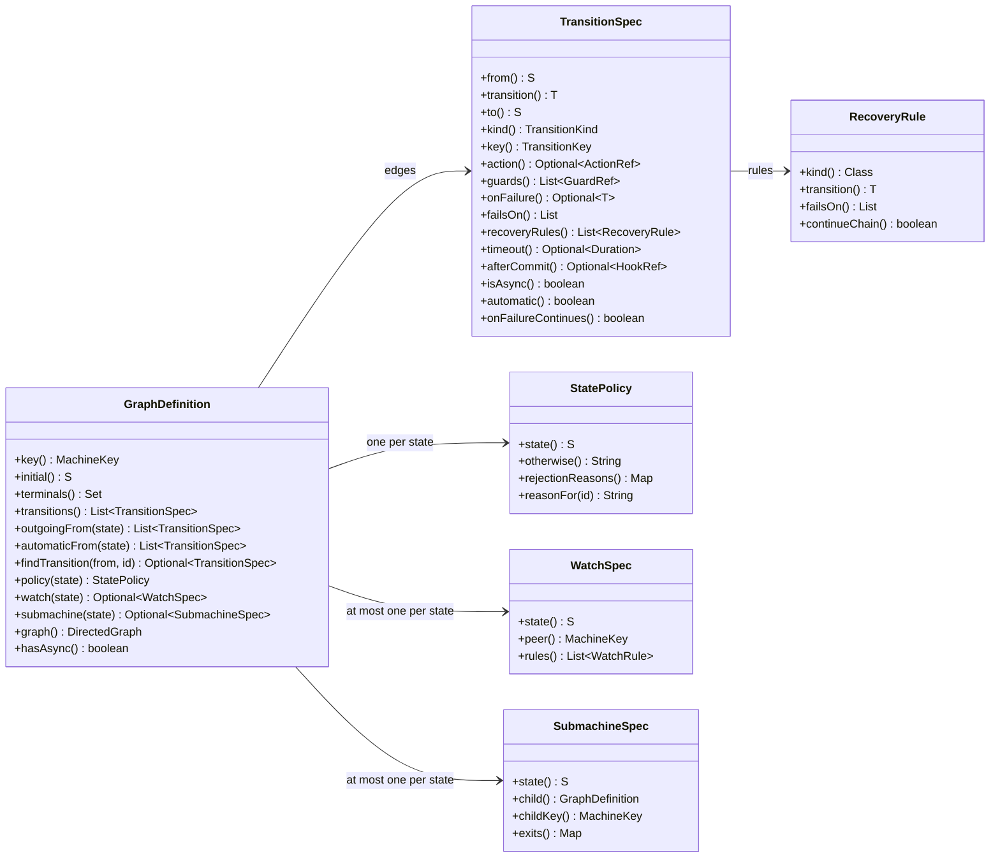

# Inspect graphs and export diagrams

Every machine carries its definition as data: the states, the declared edges with everything each one declares,
the policies, watches and sub-machine bindings. This page reads that data, queries its topology and exports it as
a Graphviz diagram. None of it runs a guard, an action, a hook or a sub-machine's lookup.

## Contents

- [Read a definition](#read-a-definition)
- [Query the topology](#query-the-topology)
- [Export Graphviz DOT](#export-graphviz-dot)
- [Diagrams and contracts in tests](#diagrams-and-contracts-in-tests)

## Read a definition

Every facade exposes its definition:

```java
GraphDefinition<Ticket, TicketState, TicketTransition> graph = tickets.definition();
System.out.println(graph);
System.out.println(tickets.transitionsFrom(TicketState.REVIEW));
System.out.println(graph.outgoingFrom(TicketState.REVIEW));
System.out.println(graph.findTransition(TicketState.REVIEW, TicketTransition.APPROVE));
System.out.println(graph.policy(TicketState.OPEN).reasonFor(TicketTransition.APPROVE));
```

`toString()` prints the machine's key and its counts, such as `Ticket/TicketState[4 states, 6 transitions]`.
`transitionsFrom` returns the identifiers declared from a state, `outgoingFrom` the `TransitionSpec`s themselves,
`transitions()` every declared edge, ordered by origin, then identifier, then destination, `automaticFrom` the
automatic edges that leave a state, in the order an advance tries them, and `findTransition` the
single spec keyed by `(from, id)`, as an `Optional` that is empty when no edge is declared. `key()`, `initial()`,
`terminals()` and `hasAsync()`, true when some edge is asynchronous, describe the machine as a whole.



A `TransitionSpec` is one edge: its endpoints and identifier, its `kind()`, `ACTION` or `MOVE`, its `key()`, the
`TransitionKey` `(from, transition)`, which prints as `FROM/TRANSITION`, the `ActionRef` and `GuardRef`s that name its
action and guards, its `onFailure`, `failsOn`, `recoveryRules()`, `timeout` and `afterCommit` hook, and `isAsync()`,
true when the action or any guard is asynchronous. `automatic()` says the graph declares the edge
[automatic](automatic-transitions.md), and `onFailureContinues()` that its `onFailure` route continues the chain of
automatic attempts; so does a `RecoveryRule` whose `continueChain()` is true. `policy(state)` is never null: a
`StatePolicy` holds the state's `otherwise` reason and its `rejectionReasons()` per identifier, and `reasonFor(id)`
picks the one a request gets. `watch(state)` returns the state's `WatchSpec`, with the peer machine's key and its
ordered `WatchRule`s, each a named condition and the identifier it executes, and `submachine(state)` the
`SubmachineSpec` that binds a child, with its `child()` definition, `childKey()` and `exits()`.

An `ActionRef` and a `GuardRef` are either `Sync` or `Async` records, with their `name()` and `isAsync()`; a `HookRef`
is a named hook that takes the entity and its `CommitContext`, which `run(entity, context)` calls, and
`HookRef.of(name, consumer)` adapts a hook that takes the entity alone.

## Query the topology

`graph()` returns the `DirectedGraph<S, T>`, which keeps every declared state as a node and every edge as a
labelled edge, parallel edges included, and offers `nodes()`, `edges()`, `outgoing(state)` and `incoming(state)`.
Its `topology()` is a `Graph<S>` that collapses parallel edges into one successor and answers structural
questions:

| Query | Answer |
| --- | --- |
| `successors(state)` | The states one declared edge away |
| `reachableFrom(state)` | The states some path reaches; the origin itself only when a cycle returns to it |
| `shortestPath(from, to)` | One shortest path, as the list of its states, or empty when there is none |
| `cycles()` | Every elementary cycle, each starting at its earliest declared state and without repeating it at the end |
| `inducedSubgraph(states)` | The graph restricted to those states |

A query on a state the graph does not hold throws `IllegalArgumentException`. `outgoing` and `incoming` return edges in
declaration order, and two `DirectedEdge`s are equal only when their origin, label and destination all are.
`Graph.nodes()` returns the nodes in declared order and `edges()` the set of `GraphEdge(from, to)`. `Graph.of(nodes, edges)` and
`DirectedGraph.of(nodes, edges)` build graphs of your own, from `GraphEdge` and `DirectedEdge` records: `Graph.of`
keeps the nodes in declared order with repeats collapsed, both throw `NullPointerException` for a null node and
`IllegalArgumentException` for an endpoint outside the nodes, and `DirectedGraph.of` also refuses a repeated node or a
repeated identical edge. `StrongComponents.find(graph)` returns their strongly
connected components, in the order of their first declared node, with `cycleWitness(graph, component)` naming one
cycle of a component; these are what the build uses to report an unauthorised cycle. The
[testing guide](testing.md#what-each-entry-point-checks) asserts on the same queries through
`assertThat(definition).topology()`.

## Export Graphviz DOT

To export [Graphviz DOT](https://graphviz.org/doc/info/lang.html) from an existing ticket facade:

```java
import io.github.graphmaquina.export.GraphView;
import io.github.graphmaquina.export.GraphvizExporter;

String diagram = GraphvizExporter.render(GraphView.of(tickets.definition()));
System.out.println(diagram);
```

This is a fragment: put the imports at file scope and the statements inside a method. Export does not run
transitions or evaluate guards, and there is no detail mode: the exporter draws the declared edges and no
other, because an edge nobody declared does not exist.

The export is deterministic DOT text with LF line endings. Each edge label begins with its identifier,
followed by `[auto]` when the edge is automatic, or `[auto n]` when its state declares an order among two or more
automatic edges, with `n` counted from 1 in that order, then the action name, `[async]` when the action or any guard
is asynchronous, `[if guard, …]`, one `[recover Kind -> ID]` per recovery rule in
declaration order, `[onFailure ID]` and any watch label. A route that continues the chain ends its fragment with
`continues`, as in `[recover Kind -> ID continues]` and `[onFailure ID continues]`. `Kind` is the failure kind's binary name without its
package, such as `PublicationFailures$Unavailable`. The throwable types of `failsOn` and of the rules are not
drawn, and a rule adds no arrow. Parallel edges appear as separate arrows with different labels, and a
self-loop is an arrow back to its own node. The initial state has an incoming arrow from a point, terminal
states have double outlines, and watches appear as notes connected by dashed lines. A node's rejection policy
is rendered as that node's `tooltip` — never as an arrow, because a refusal is an answer the node gives and
not a transition. State names and labels are escaped, and every declared state remains visible even when no
edge touches it.

A state that holds a sub-machine is drawn as a cluster labelled with the state and the child machine, such as
`DEPOSIT: Payment/PaymentStatus`, which holds the child's own diagram and has the state's policy as its tooltip.
An edge into the state points at the child's initial state, or, when that state holds a sub-machine too, at that
one's initial state, and so on down. An exit is drawn once from each terminal state of the child that selects it,
without clipping at its source, and any other edge leaving the state, like the state's watch note, starts at the
cluster's border. A self-loop on the bound state that is not an exit is the exception: both its ends lie in the cluster, so
it is drawn unclipped from the cluster's invisible anchor to the child's initial state. The
DOT then sets `compound=true` and clips the arrows that cross a cluster's border with `lhead` and `ltail`. A graph
that binds no sub-machine has no cluster.

The shop's order machine exports as:

```text
digraph "Order/OrderStatus" {
    rankdir=LR;
    initial [shape=point, label=""];
    n0 [label="NEW", shape=ellipse, tooltip="otherwise: cannot ship without payment"];
    n1 [label="PAID", shape=ellipse, tooltip="otherwise: money was charged: requires a refund"];
    n2 [label="PAYMENT_DECLINED", shape=ellipse, tooltip="otherwise: go back to NEW to retry the charge"];
    n3 [label="SHIPPED", shape=doublecircle, tooltip="otherwise: a shipment cannot be undone"];
    n4 [label="CANCELLED", shape=doublecircle, tooltip="otherwise: cancelled is final"];
    initial -> n0;
    n0 -> n1 [label="PAY pay [async] [if retryBudgetLeft] [onFailure PAYMENT_DECLINED]"];
    n0 -> n4 [label="CANCEL cancel"];
    n0 -> n2 [label="PAYMENT_DECLINED"];
    n1 -> n3 [label="SHIP ship [if allItemsPacked] [watches Item: allIn PACKED]"];
    n2 -> n0 [label="RETRY [if retryBudgetLeft]"];
    n2 -> n4 [label="CANCEL cancel"];
    watch0 [shape=note, label="watches Item"];
    n1 -> watch0 [style=dashed, arrowhead=none];
}
```

Save the result as UTF-8 in `tickets.dot`, then use an installed [Graphviz](https://graphviz.org/download/)
to render an image:

```sh
dot -Tsvg tickets.dot -o tickets.svg
dot -Tpng tickets.dot -o tickets.png
```

The Java exporter needs no external library or native executable. Image rendering is a separate step.
`GraphView.of(definition)` is a public record of what the exporter draws, as text: `name()`, `initial()`,
`terminals()`, `states()`, `transitions()`, `policies()`, `watches()` and `submachines()`, so a renderer of your own
can read the same data, and its public constructors build a view by hand. States come in node order, edges in definition order, rules and exits in declaration order,
with one policy per state, and each `SubmachineView` carries the child's whole `GraphView`. A `TransitionView` holds the
edge's endpoints, identifier, kind, action, guards, whether it is asynchronous, its `onFailure`, its rendered watch rule
and its recovery rules, whether it is `automatic`, its `automaticPosition` in the order of its state when that
state declares one, and whether its `onFailure` route continues (`failureContinues`); a `RecoveryView` the failure
kind and the `failsOn` types as binary names, the recovery identifier and whether the rule `continues`; a `PolicyView` the state, its `otherwise` reason and its rejections rendered as `ID: reason`; and a
`WatchView` the state, the simple name of the peer's entity class and the rendered rules. The DOT text starts with
`digraph "<name>"` and `rankdir=LR`. Inside a cluster, node ids carry the prefix `s<j>_`, one per nesting level, where
`j` counts the view's bound states in node order. An edge that a watch rule executes gets
`[watches <peer entity>: <condition names>]` in its label, and the note reads `watches <peer entity>`. A
`SubmachineView` holds the bound state, the child's `GraphView` and its `exits`, each child terminal mapped to the
parent identifier it selects, in the given order.

You can also build a definition directly through `TicketsRuntime.graph(new TicketActions())` without constructing a
running set.

## Diagrams and contracts in tests

Use typed assertions on `GraphDefinition` and its `TransitionSpec`s, or `GraphSnapshots` with `.graph`
resources, for structural contracts. Validate behavior through real operations, outcomes, reactions and
observed entity states. A graphical export is never an oracle for machine logic. `GraphGoldens` with `.dot`
resources checks visual output only; keep those tests separate from contract and behavior tests. The
[testing guide](testing.md#goldens-and-structural-snapshots) describes both APIs and their Gradle and
Maven update configuration.

[The illustrated ticket workflow](images/ticket-workflow.svg) summarizes the quickstart's edges. The
exporter produces its own labels from the definition. The repository keeps exact expected exports in
[the example's golden diagrams](../graphmaquina-example/src/test/resources/golden).

The illustrations in this guide are maintained separately from the Graphviz exporter. Their accessible SVG
sources, with a table of what each one shows, are in [docs/images](images/README.md).

---

Next: [Diagnostics and troubleshooting](diagnostics.md). Back to the [documentation index](README.md).
