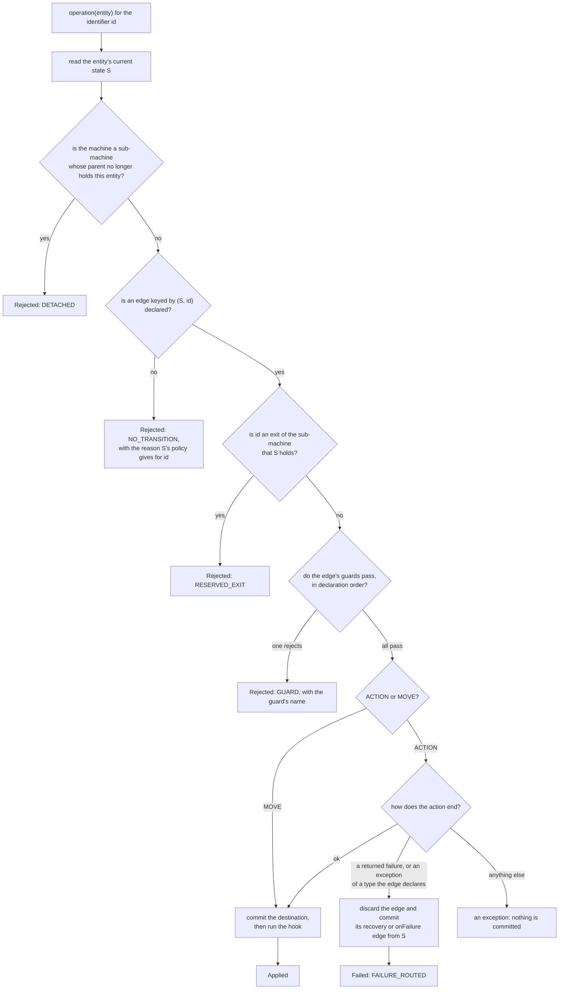

# Graphs, annotations and bindings

This page explains the model every machine shares: a graph of identified edges, the checks that refuse a request,
the structural rules the build enforces, and the annotations, generated names and method signatures that bind your
code to the graph.

## Contents

- [Understand the graph](#understand-the-graph)
- [Annotation and binding reference](#annotation-and-binding-reference)

## Understand the graph

A machine is a directed graph. Its nodes are the constants of the state enum `S`, and its edges are the
transitions you declare. An edge is a triple:

```text
(from: S, transition: T, to: S)
```

`T` is the machine's own enum of transition identifiers, written by you and distinct from `S`. An edge is
uniquely keyed by `(from, transition)`: from one state, one identifier selects exactly one edge. Two
declarations of the same key are `SG102`, even when their guards differ; there is no priority and no
first-guard-wins.

Only declared transitions become edges. The ticket machine of the [quickstart](quickstart.md) expresses its whole
intent in six edges:

| From | Identifier | To | Kind |
| --- | --- | --- | --- |
| `OPEN` | `SUBMIT` | `REVIEW` | `ACTION` `register`, guard `hasTitle`, `onFailure = DECLINE` |
| `OPEN` | `DECLINE` | `FAILED` | `MOVE`, declared on the type: the failure route, no facade method |
| `REVIEW` | `APPROVE` | `DONE` | `ACTION` `approve` |
| `REVIEW` | `AUTO_APPROVE` | `DONE` | `ACTION` `autoApprove` |
| `REVIEW` | `RETOUCH` | `REVIEW` | `ACTION` `retouch`, a self-loop |
| `REVIEW` | `REJECT` | `OPEN` | `MOVE` |

Every edge is `ACTION` or `MOVE`, and that is the whole of `TransitionKind`: whether the edge runs an action
before it commits. Both are real edges that change the entity's state and run the effective hook: the edge's own
`afterCommit` or, without one, the default hook the machine's `Definition` declares, as
[after-commit hooks](commit-and-persistence.md#after-commit-hooks) explains.

Each request goes through the same checks, in this order, and stops at the first that refuses it:



A rejection runs nothing after the check that refused it and writes no state. [Actions, guards and failure
routes](actions-and-failures.md) explains which failures an edge handles, and [handle transition
outcomes](outcomes.md) what each result carries.

### Identity, not destination

An operation names a transition, never a target state. `machines.tickets().approve(ticket)` compiles to
`stateMachine.execute(ticket, TicketTransition.APPROVE)`, and the engine resolves `(current state, APPROVE)`
once. If the resolution finds no edge, the request is refused. The engine never looks for another edge that
happens to reach the same place.

This is what makes `APPROVE` and `AUTO_APPROVE` two different things even though both end in `DONE`:

```java
Outcome<Ticket, TicketState, TicketTransition> outcome = tickets.autoApprove(ticket);
// Applied, to = DONE, and TicketActions.autoApprove ran. approve's action did not.
```

The same identifier may leave several states, with different destinations if the domain says so; the current
state disambiguates. The shop's `Items` machine declares one `CANCEL` from `PENDING` and from `PACKING`, both
reaching `CANCELLED`, and the order's cancellation cascade asks for `ItemTransition.CANCEL` rather than for
the `CANCELLED` state:

```java
ctx.cascadeAll(Items.class, ctx.entity().items(), ItemTransition.CANCEL, CascadePolicy.COLLECT);
```

`onFailure`, watch rules and cascades all name identifiers for the same reason. A route is the edge you named,
resolved from the origin that needs it.

### Absence, self-loops and reevaluation

Three situations are distinct, and each has its own observable result.

| Situation | What the engine does | Outcome |
| --- | --- | --- |
| No edge is keyed by `(current, requested)` | Nothing runs. No guard, no action, no state write. | `Rejected` with `RejectionKind.NO_TRANSITION`; a sub-machine whose parent does not hold it is `DETACHED` first |
| An explicit self-loop `A --T--> A` is requested | The edge runs like any other: guards, action, commit, hook. | `Applied`, with `recordedState() == A` |
| `reevaluate(entity)` finds no watch, or no rule that holds | Nothing runs. | `Ignored`, with `IgnoreReason.NO_WATCH` or `NO_RULE_MATCHED` |

A self-loop is an ordinary edge that ends where it started. It needs `allowsCycle` on that state, it may be
the only exit of a non-terminal state, and it is forbidden on a terminal.

`Ignored` is reserved for reevaluation.

### Guards and the reason a request is refused

A guard belongs to an edge that exists. It runs after the edge is resolved and before its action, in
declaration order, stopping at the first rejection:

```java
assertThat(orders.retry(order)).isRejected().isRejectedByGuardNamed("retryBudgetLeft");
```

A refusal for lack of an edge is a different kind, and carries no guard:

```java
assertThat(orders.ship(order)).isRejected()
        .hasReason("cannot ship without payment")
        .hasNoTransition();
```

`RejectionKind` is what tells the two apart. `Rejected` reports the entity, the origin, the identifier that
was requested, the reason and — for `GUARD` only — the name of the guard. It reports no destination: the
same identifier reaches different states from different origins, so there is no single `to` to name.

### Policies: every node answers

Rejections are answers a node gives, not edges. Every state carries a `StatePolicy<S, T>` with a non-blank
`otherwise` reason, and optionally a non-blank reason per identifier:

```java
@TicketsGraph.StatePolicy(state=TicketState.OPEN, otherwise="submit the ticket first")
@TicketsGraph.Reject(from=TicketState.OPEN, transition=TicketTransition.APPROVE,
    reason="approval requires review")
```

`Reject` overrides `otherwise` for one identifier from one state. Declaring both an edge and a rejection for
the same `(from, transition)` is `SG702`; a state with no policy is `SG701`. A terminal that declares none
gets the stable text `terminal state <NAME> accepts no transitions`, which an explicit `StatePolicy`
replaces.

You declare what a state can do, and its policy words the answer for everything else.

### Structural rules

- Every state must be reachable from `initial` through declared edges.
- A terminal has no outgoing edge at all, including a self-loop. A non-terminal must have at least one,
  which may be a self-loop.
- Every cycle must pass through at least one state listed in `allowsCycle`, and an allowance for a state that
  belongs to no cycle is rejected too. A self-loop is a cycle.
- An `onFailure` identifier, and the recovery identifier of every recovery rule, must name a different edge that
  exists from the failing edge's own origin. Such an edge may legitimately reach the same destination as the edge
  it recovers, because identity, not destination, tells them apart.
- Every watch rule must name an identifier with an edge from the watched state. A terminal cannot watch.
- A state that holds a sub-machine maps each terminal state of the child, and no other state, to exactly one exit:
  an identifier with an edge from that state that no `onFailure`, recovery rule or watch rule of that state names,
  and, with annotations, that no operation of the facade executes. A terminal state holds no sub-machine, another
  state holds at most one, and a machine's sub-machines never contain the machine again.

Unauthorised cycles are reported as one witness per cyclic strongly connected component rather than one message per
elementary cycle, so a component that holds many cycles yields one message, and the witnesses are deterministic.

For example, the ticket machine permits `OPEN → REVIEW → OPEN` and the `RETOUCH` self-loop by listing both
states in `allowsCycle`. The shop permits `NEW → PAYMENT_DECLINED → NEW` with `allowsCycle = PAYMENT_DECLINED`.
Guards still decide when another lap is permitted; the allowance only says the loop is intentional.

### Operations and internal edges

A public operation has this shape:

```java
Outcome<Ticket, TicketState, TicketTransition> approve(Ticket ticket);
```

It carries one or more `Transition` annotations from its own generated vocabulary, all with the same `id`. One
annotation may list several origins in `from`, as the shop's `cancel(order, cancellationId)` does for `NEW` and
`PAYMENT_DECLINED`, and several annotations with the same `id` add further branches. Two methods cannot claim the
same identifier, and a method's annotations cannot name different identifiers: `SG703` reports both mistakes. A
type-level `Transition` may add further branches of an identifier a method owns as long as the keys stay disjoint;
a branch whose `(from, id)` key is already declared is a duplicate key, `SG102`.

A `Transition` on the interface itself declares an edge with no facade method. It is how failure routes,
cascade-only and watch-only edges are declared: `DECLINE` in the quickstart and `PAYMENT_DECLINED` in the
shop are exactly that. Omitting `action` makes the edge a `MOVE`.

A typed facade exposes no generic selector: the application's entry points are the operations you declared,
plus what every facade inherits from `Machine`: `reevaluate(entity)` for [watches](coordination.md#watch-other-machines),
`async(call)` to run a call on the machine's executor, as [asynchronous work](async.md) shows, and the structural
`definition()` and `transitionsFrom(state)`.

An operation may accept a second argument: `Outcome<Entity, Status, Change> screen(Entity entity, Verdict verdict)`.
Guards and actions read it through `ctx.input(Verdict.class)`, which returns `Optional<Verdict>`. This lets
a guard decide from a fact the caller has already obtained without storing a temporary argument on the
entity or calling a service from the guard. Use an immutable record for related input fields; a Java file
has only one public top-level type, so it gets its own file:

```java
// Verdict.java
public record Verdict(boolean eligible) { }
```

A declaration like this belongs on the machine interface, beside its other operations — the same place as
`approve` in the quickstart's `Tickets.java` — and its guard belongs on the bindings host, beside its other
guards, the same place as `hasTitle` in `TicketActions.java`. The snippet below declares its own screening
vocabulary rather than the ticket one; adapt the graph annotation and the `Refs` class — following the
naming rule under [Generated names](#generated-names) — and the states and identifiers to your own machine:

```java
@ScreeningGraph.Transition(id = Change.SCREEN, from = NEW, to = SCREENED,
        guards = RulesRefs.Eligible.class)
Outcome<Entity, Status, Change> screen(Entity entity, Verdict verdict);
```

```java
@GraphGuard
public static GuardResult eligible(GuardContext<Entity, Status, Change> ctx) {
    return ctx.input(Verdict.class)
            .map(verdict -> verdict.eligible() ? GuardResult.pass() : GuardResult.reject("ineligible"))
            .orElseGet(() -> GuardResult.reject("missing verdict"));
}
```

`transitionsFrom(state)` returns the identifiers declared from a state. It is structural inspection: it runs
no guard and promises nothing about a particular entity. To see where those identifiers lead, read
`definition().outgoingFrom(state)`, and for one edge, `definition().findTransition(from, id)`.

## Annotation and binding reference

### Handwritten markers

Import these from `io.github.graphmaquina.annotation`:

| Annotation | Place it on | Purpose |
| --- | --- | --- |
| `@GenerateGraphApi` | Top-level `Machine<E, S, T>` interface | Generate its typed graph vocabulary |
| `@StateGraphs` | Top-level interface extending `Machines` | Generate a set and builder for its machine accessors |
| `@GraphProperty` | Entity field or getter | Export a property symbol |
| `@GraphAction` | Action method | Export an action binding |
| `@GraphGuard` | Guard method | Export a guard binding |
| `@GraphHook` | Hook method | Export an after-commit binding |
| `@GraphCondition` | Watch-condition method | Export a custom watch predicate |
| `@GraphLookup` | Parent-lookup method | Export the lookup that finds the parent of a sub-machine's entity |
| `@GraphBindings` | Concrete binding host | Export inherited marked members through this concrete host |
| `@GraphPeers` | Machine interface that watches or binds other machines | Request typed vocabulary for its declared owner/peer pairs |
| `@Timeout` | Nested annotation element | Express seconds and nanoseconds for an asynchronous action timeout |

Markers identify exports; marking a method alone does not attach it to a transition. Reference its generated
symbol from the graph declaration.

### Generated names

| Handwritten declaration | Generated API |
| --- | --- |
| `Tickets extends Machine<Ticket, TicketState, TicketTransition>` | `TicketsGraph.Definition`, `.StatePolicy`, `.StatePolicies`, `.Transition`, `.Transitions`, `.Recovery`, `.Reject`, `.Rejects` |
| Property `Ticket.state` | `TicketRefs.State.class` |
| Marked method `TicketActions.hasTitle` | `TicketActionsRefs.HasTitle.class` |
| `@GraphPeers(Items.class)` on `Orders` | `OrdersItems.Watch`, `.Watches`, `.When`, `.Submachine`, `.Submachines` and `.Exit`, in the owner's package |
| Machine `Tickets` | `TicketsRuntime`, including `KEY`, graph construction and facade implementation |
| Set `TicketMachines` | `TicketMachinesRuntime`, including the generated builder |

`KEY` is a `MachineKey<E, S, T>`: entity class, state enum and transition enum. `MachineKey.of(entity, states,
transitions)` builds one for the [programmatic DSL](dsl.md); it refuses a primitive entity class, a state or
transition class that is not an enum, and one enum used for both, with `IllegalArgumentException`. Its equality and hash include
all three, and a registry refuses two machines that write the same entity and state enum through different
transition catalogues.

Generated type names use PascalCase with no underscores. Underscores and nesting dots separate words:
`_id` → `Id`, `has_title` → `HasTitle`, and `Outer.Inner` → `OuterInnerRefs`. Existing internal case and
uppercase acronyms are preserved: `hasTitle` → `HasTitle`, `URL` → `URL`. `Graph` and `Refs` retain their roles.
Original Java declarations and invocation names remain unchanged. If normalization merges two names, generation
fails with `SG603` naming both sources: `id` / `_id` and `authorize` / `Authorize` conflict within one references
container. A conflict with the container itself also fails; there are no underscore escapes or opaque suffixes.
Names that cannot produce a valid nonempty Java identifier are rejected. Two generated names that differ only in
case, such as the symbols `ApproveId` / `ApproveID` of the members `approveId` / `approveID`, the containers
`OuterInnerRefs` / `OuterinnerRefs` of the hosts `Outer.Inner` / `Outerinner` or the companions `LibraryRuntime` /
`LIBRARYRuntime` of the sets `Library` / `LIBRARY`, fail with `SG603` where a volume that holds their files does not
tell names apart by case, since it would keep one file of the two.

A generated symbol is a compile-time reference. It is not an action instance, a dependency-injection bean or
a reflective lookup. The facade calls the selected declaration directly, preserving the marked overload.

### Generated graph annotation elements

In this table, `S` is the machine's state enum, `T` its transition enum and `P` a property symbol class.

| Annotation | Target | Required elements | Optional elements |
| --- | --- | --- | --- |
| `Definition` | type | `initial: S`, `state: P`, `id: P` | `terminals: S[]`, `allowsCycle: S[]`, `afterCommit: HookSymbol` |
| `StatePolicy` | type | `state: S`, `otherwise: String` | None |
| `Transition` | type, method | `id: T`, `from: S[]`, `to: S` | `action`, `guards`, `onFailure: T`, `failsOn`, `recoveries: Recovery[]`, `timeout`, `afterCommit` |
| `Recovery` | none, nested in `Transition.recoveries` | `kind: Class<? extends FailureKind>`, `transition: T` | `failsOn` |
| `Reject` | type | `from: S`, `transition: T`, `reason: String` | None |

`StatePolicy`, `Transition` and `Reject` are repeatable, through the generated `StatePolicies`, `Transitions` and
`Rejects` containers. `from` must contain at least one state. Guard arrays execute in declaration order. `failsOn` takes
throwable class literals. An absent `action` makes the edge a `MOVE`; `onFailure`, `failsOn`, `recoveries` and
`timeout` require an action, and `timeout` requires an asynchronous one.

The processor reads and validates `recoveries`, including their failure kinds, throwable types and recovery
transitions. Generated companions emit one typed `recover(...)` call per rule in declaration order, so annotated
facades route failures through those rules just as graphs built directly with the DSL do.

Java annotations do not have nullable elements, so the API represents optional single values as arrays.
`onFailure`, `timeout`, `afterCommit`, `Transition.action`, custom `When.condition`, and the `child`, `parent` and
`parentLookup` of a `Submachine` accept zero or one value. Use the single-value syntax, for example
`onFailure = TicketTransition.DECLINE`, or omit the element. Multiple values are `SG607`.

### Properties and accessors

For a field marked `@GraphProperty`, the processor looks for public instance readers in this order:
`property()`, `getProperty()`, `isProperty()`. It searches for state writers as `setProperty(value)` and then
`property(value)`. A field marker does not grant access to the field and does not generate an accessor.

A marker on a getter selects that getter directly. Its logical property name follows JavaBeans
normalization: `getState()` exports `state`, `items()` exports `items`, `getURL()` exports `URL`, and a reader named
`Total()` exports `total`.

| Property use | Required shape |
| --- | --- |
| `Definition.state` | Public instance reader returning the machine's state enum; compatible public instance writer |
| `Definition.id` | Public instance reader returning an identity value; values must be non-null at runtime |
| `Watch.peers` | Owner reader returning `Collection<? extends PeerEntity>` or a subtype, such as `List<PeerEntity>`; a raw collection is refused |
| `Watch.owner` | Peer reader returning `Optional<OwnerEntity>` or an owner entity, never `null` |
| `Submachine.child` | Parent reader returning `Optional<ChildEntity>` |
| `Submachine.parent` | Child reader returning `Optional<ParentEntity>` |

Use `Optional.empty()` for a peer with no owner: an `owner` reader that returns the owner entity itself declares that
every peer has one. Keep relationship accessors consistent and never return null: a `peers` reader, an `owner`
reader, whichever type it declares, and any other `Optional` reader that returns `null` are refused, as
[triggering and observing watches](coordination.md#triggering-and-observing-watches) and
[finding the parent with a lookup](composition.md#find-the-parent-with-a-lookup) say. If the setter overloads are ambiguous, the
processor reports the ambiguity instead of choosing based on declaration order.

### Method signatures

Public methods must match the role where the graph uses them. `E/S/T` refer to the owner entity, state and
transition types; `P/Q/U` refer to the peer's: the watched machine's for a condition, the sub-machine's for a lookup.

| Marker | Supported signature |
| --- | --- |
| `@GraphAction` | `ActionOutcome method(TransitionContext<E, S, T> ctx)` |
| `@GraphAction`, async | `CompletionStage<ActionOutcome> method(TransitionContext<E, S, T> ctx)` |
| `@GraphGuard` | `GuardResult method(GuardContext<E, S, T> ctx)` |
| `@GraphGuard`, async | `CompletionStage<GuardResult> method(GuardContext<E, S, T> ctx)` |
| `@GraphHook` | `void method(E entity)` or `void method(E entity, CommitContext<S, T> context)` |
| `@GraphCondition` | `boolean method(E owner, Collection<? extends P> peers, PeerView<P, Q, U> view)` |
| `@GraphLookup` | `Optional<E> method(P child)` |

An asynchronous binding may declare a subtype of the stage, such as `CompletableFuture<ActionOutcome>`. A raw
`CompletionStage` is no asynchronous result: an action or a guard that returns one is refused where it is
declared (`SG604`).

Static bindings are called statically. Instance bindings become constructor/builder dependencies. For example,
using three instance members of `OrderActions` adds one `OrderActions` dependency, not three instances. A class
used only through static members needs no builder argument.

To expose inherited marked members under a concrete host, use `@GraphBindings` on that host. The processor
checks the inherited signature with the concrete generic arguments substituted. Only what the host inherits is
exported through it, since a static binding is called through the host: a static method of an interface only through
the interface's own symbol, and a static method that the host or a superclass between hides with a method of the same
name and parameter types not at all, the hiding method being exported in its place when it is marked. Generated output and JAR
exports are checked for collisions; do not manually create classes in generated namespaces or edit symbols.

---

Next: [Actions, guards and failure routes](actions-and-failures.md). Back to the [documentation index](README.md).
