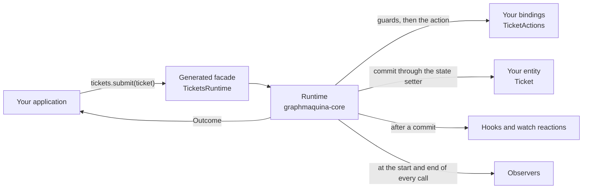

# GraphMaquina

Typed, graph-based state machines for Java 21. Declare the transitions your domain allows as identified
edges, give every state a reason for refusing the rest, and let the build validate the whole graph before the
application runs.

GraphMaquina combines a pre-compilation code generator, a javac annotation processor and an in-process runtime.
Your application calls a generated, typed facade. Actions, guards, hooks, properties and watched states are
bound through Java symbols rather than string names.

This guide documents the latest GraphMaquina version, the API this repository builds; Maven Central publishes the
modules of each release. The examples read the version
from a `graphmaquinaVersion` Gradle property or a `graphmaquina.version` Maven property, set once per build, so
no coordinate repeats it.

The [quickstart](quickstart.md) has complete, runnable files. Most later examples extend it or quote the
repository's example module, whose shop and billing domains the guide uses. The
[documentation index](README.md) lists every page and maps tasks to the page that covers them.

## Contents

- [What GraphMaquina provides](#what-graphmaquina-provides)
- [Visual guide](#visual-guide)
- [Requirements and artifacts](#requirements-and-artifacts)
- [Publication and verification status](#publication-and-verification-status)
- [License](#license)

## What GraphMaquina provides

| Capability | How it works |
| --- | --- |
| A graph of identified transitions | You declare edges `(from, transition, to)`. An identifier selects the edge, so parallel edges and self-loops are ordinary declarations. |
| Compile-time structural validation | Checks include reachability, terminal states, intentional cycles, duplicate `(from, id)` keys, failure routes, watch rules and sub-machine bindings. |
| Typed operations | A machine interface exposes domain operations such as `submit(ticket)` or `pay(order)`, returning `Outcome<E, S, T>`. |
| Explicit bindings | Generated `Refs` classes identify marked methods and properties; the processor checks their roles and signatures. |
| Synchronous and asynchronous actions | Actions and guards may return values or `CompletionStage` results. The runtime waits under configured deadlines. |
| Coordinated state changes | Cascades share a unit of work; entity state setters run after the root transition succeeds or selects a handled failure route. |
| Declared watches | After a peer commits, a matching owner can be reevaluated and execute the identifier the first matching rule names. |
| Sub-machines | A state can hold another machine. Entering the state starts the child at its initial state, a call to a child whose parent does not hold it there is rejected, and the step that ends the child runs the parent's exit in the same unit of work. See [compose machines](composition.md). |
| Reasoned refusals | Every node carries a policy: a request refused because no edge leaves the current state under its identifier gets the reason that state's policy gives. |
| Eligibility checks | A facade can declare a check of an operation, and a `StateMachine` checks any identifier: the check runs the operation's admission, its guards included, without its action, and answers whether the operation would be admitted for an entity now, or with the reason it would be refused. See [check an operation before you call it](eligibility.md). |
| Inspectable execution | Outcomes carry transition records, watch reactions, the sub-machines a call started and the call's flow; technical aborts carry diagnostic details where applicable. |
| Call logs | Each call can log its start, the hops and sub-machine starts it committed, and how it ended, at `DEBUG`, and each step it took, at `TRACE`, through `System.Logger`; off by default. An eligibility check logs its start and its verdict, or its failure, at `DEBUG`, and its step at `TRACE`, under lines of its own. See [debug a call](logs.md). |
| The call's flow | Actions put typed values in a flow that every step of the same call reads, guards, cascaded steps and the exits of sub-machines included, along with the entity the call was made for. A failure route drops the writes of the step that failed. Post-commit hooks that take a `CommitContext` read and write it too, so a value can reach the entity only once the call commits. With `recordTrail`, the flow also lists the hops and sub-machine starts the call took, each with the instant it took it, and, when the call is rejected or throws, how it ended. The caller receives it frozen, in the outcome or in the call's failure. See [the call's flow](call-flow.md). |
| Graph inspection | Read the declared edges from the definition or export a deterministic Graphviz state diagram, which draws each sub-machine inside the state it is bound to. |

GraphMaquina manages state transitions in objects you supply. It does not provide a database, entity locking,
a durable job queue, HTTP endpoints or distributed transactions. See
[persistence and concurrency](commit-and-persistence.md#concurrency-identity-and-persistence)
for the responsibilities that remain with your application.

The build and runtime have separate jobs:

At runtime, one call travels through these parts, all in your process:

## Visual guide

Follow the pictures for an overview, then use the linked sections for declarations, commands and complete
examples. Each illustration is an SVG: open it to inspect labels at full size.

| Question | Diagram | Read next |
| --- | --- | --- |
| What does GraphMaquina do? | [Typed graphs, predictable transitions](images/graphmaquina-overview.svg) | [What GraphMaquina provides](#what-graphmaquina-provides) |
| What runs at build time, and what at runtime? | [From declarations to a running machine](images/build-pipeline.svg) | [Generation lifecycle](generation.md#generation-lifecycle-and-ide-setup) |
| How can my source use annotations that do not exist yet? | [Source → vocabulary → compilation](images/annotation-bootstrap.svg) | [First generation](generation.md#how-your-flow-annotations-are-generated) |
| Which transitions are permitted? | [The ticket graph](images/ticket-workflow.svg) | [Understand the graph](graph-model.md#understand-the-graph) |
| Why did an operation apply, reject or fail? | [Edge selection and outcomes](images/operation-decisions.svg) | [Outcomes](outcomes.md) |
| Which thread waits for my service? | [Direct call and async submission](images/async-execution.svg) | [Calling styles](async.md#choose-the-calling-style) |
| How much time is left for an action? | [Root and action deadline timeline](images/async-deadlines.svg) | [Deadline rules](async-deadlines.md#deadline-rules) |
| What happens if the service finishes too late? | [Timeout and late completion](images/async-late-completion.svg) | [Cancellation](async-deadlines.md#timeout-cancellation-and-late-completion) |
| What can I safely use in a callback? | [Context and thread boundary](images/async-context-boundary.svg) | [Context ownership](async-deadlines.md#contexts-and-completion-callbacks) |
| Does a completed future mean the operation succeeded? | [Future result branches](images/async-future-results.svg) | [Result handling](async.md#read-the-future-and-domain-result) |
| Do both machines commit together? | [Cascade versus watch](images/cascade-vs-watch.svg) | [Machine coordination](coordination.md#read-peers-and-cascade-transitions) |
| When does an owner react to its peers? | [Watch reactions](images/watch-reactions.svg) | [Watch other machines](coordination.md#watch-other-machines) |
| How does a state hold a whole machine? | [Sub-machine binding](images/submachine-binding.svg) | [Compose machines](composition.md) |
| When do hooks and reactions run? | [Commit lifecycle](images/commit-lifecycle.svg) | [Commit and hooks](commit-and-persistence.md#commit-hooks-and-observers) |
| What does a call share between its steps, and what does its caller get back? | [One call's flow](images/call-flow.svg) | [The call's flow](call-flow.md) |

## Requirements and artifacts

- JDK 21 or later, including `javac`, for generation and compilation. Use Java 21 as the baseline unless
  your application deliberately targets a newer release.
- The repository uses Gradle 9.2.1 through its wrapper. This is the verified Gradle version; the project
  does not declare a broader tested compatibility matrix.
- Maven consumers need Maven and a Java 21 JDK, and Maven itself must run on Java 21 or later. The
  [complete Maven configuration](installation.md#configure-maven) uses maven-compiler-plugin 3.15.0, matching the
  repository's integration fixtures.
- Lombok is optional for consumer entities and action classes. The quickstart uses handwritten accessors.
  If you use Lombok, place its annotation processor before GraphMaquina's.
- Keep the runtime, generator, processor and adapter on the same GraphMaquina version. The generator, the processor
  and every producer whose exports a module reads must be exactly the same version: a mismatch fails with `SG602`.

| Module | Coordinates / plugin ID | Add it to |
| --- | --- | --- |
| Runtime and public annotations | `io.github.graphmaquina:graphmaquina-core` | Application dependencies |
| Pre-compilation generator | `io.github.graphmaquina:graphmaquina-codegen` | Build tooling; the Gradle plugin resolves it, and the Maven plugin and the processor depend on it |
| Annotation processor | `io.github.graphmaquina:graphmaquina-processor` | javac annotation-processor path |
| Typed testing assertions and probes | `io.github.graphmaquina:graphmaquina-test` | Test dependencies |
| Gradle plugin | plugin ID `io.github.graphmaquina` | Gradle `plugins` block |
| Maven plugin | `io.github.graphmaquina:graphmaquina-maven-plugin` | Maven build plugins |
| Reference application | `graphmaquina-example` | Source and tests in this repository; not an application dependency |

Every coordinate takes the same version, set once as the `graphmaquinaVersion` Gradle property or the
`graphmaquina.version` Maven property; the examples read it from there.

The generator and processor are build-time tools. Do not add them as application runtime dependencies.
Application imports begin with `io.github.graphmaquina`.

## Publication and verification status

GraphMaquina publishes to Maven Central under the verified namespace `io.github.graphmaquina`. A release
contains the runtime, generator, processor, testing module, Maven plugin, Gradle plugin and Gradle plugin
marker; [installation](installation.md) shows the coordinates. Browse the
[published artifacts](https://repo.maven.apache.org/maven2/io/github/graphmaquina/) or the
[core artifact on Maven Central](https://central.sonatype.com/artifact/io.github.graphmaquina/graphmaquina-core).
MVNRepository is an independent index; appearing in its search results is not required for Maven or Gradle
resolution. Sonatype does not control its update schedule; see the
[official explanation](https://central.sonatype.org/faq/mvnrepository/).

The repository's build checks that the examples of these pages still compile and run:

| Check | What it verifies |
| --- | --- |
| Quickstart | [ReadmeQuickstartTest](../graphmaquina-test/src/test/java/consumer/ReadmeQuickstartTest.java) copies the Gradle scripts of [installation](installation.md#configure-gradle), pointed at artifacts the build stages locally, and the Ticket sources and test of the [quickstart](quickstart.md) into an external Gradle project, compiles them with strict lint, runs `App`, checks that the output contains `All ticket scenarios passed.` and checks the `TicketsTest` report. It does not run the Maven configuration. |
| Guide fragments | [GuideOutcomeFragmentsTest](../graphmaquina-test/src/test/java/consumer/GuideOutcomeFragmentsTest.java) compiles the Java blocks of [outcomes](outcomes.md), of [recovery rules](actions-and-failures.md#recover-by-failure-kind-and-exception-type), of [composition](composition.md) and of [the call's flow](call-flow.md), plus the async completion callback and the observer example, against the staged core jar. |
| Quotes of the example module | [GuideCopiesTest](../graphmaquina-example/src/test/java/io/github/graphmaquina/example/GuideCopiesTest.java) checks that the testing pages quote the shop's tests verbatim, that [the call's flow](call-flow.md) quotes the shop's code, and that [composition](composition.md) quotes `SameEntitySubmachineTest`. |
| Testing samples | [TestingGuideFragmentsTest](../graphmaquina-test/src/test/java/consumer/TestingGuideFragmentsTest.java) compiles and runs the samples of [the recovery, sub-machine and flow testing page](testing-advanced.md) against the staged core and test jars. |
| Maven quickstart | The [Maven configuration](installation.md#configure-maven) and the quickstart's sources were built with `mvn clean verify` and `App` was run, once by hand, with Maven 3.9.12 on JDK 21, against artifacts built from this repository. No automated check covers it. |
| Async example | [The runnable async ticket](async.md#runnable-async-ticket-example) was built and `AsyncApp` was run, once by hand, through Gradle and through Maven against artifacts built from this repository, and printed the output documented below it. No automated check covers it. |
| IDE import | IntelliJ IDEA 2026.2.3 imported the quickstart's Gradle project once, headless and then in a running IDE queried through its MCP server: it registered the generated vocabulary as a source root and the processor's output as a generated source root, resolved references into both, and renamed a binding method as [the IDE workflow](generation.md#ide-workflow) describes. Code completion was not exercised. No automated check covers it. |

## License

GraphMaquina is licensed under Apache License 2.0. See [LICENSE](../LICENSE) and [NOTICE](../NOTICE).

The code emitted into a consuming project by this project's generator and annotation processor belongs to
that project. The repository's license notice states that its license does not extend to that generated output.

---

Next: [Install and configure the build](installation.md). Back to the [documentation index](README.md).
