# GraphMaquina

[](https://central.sonatype.com/artifact/io.github.graphmaquina/graphmaquina-core)

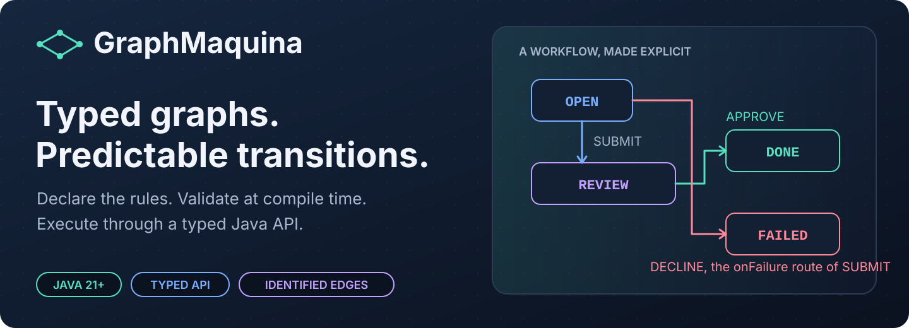

Typed, graph-based state machines for Java 21. Declare the transitions your domain allows as identified
edges, give every state a reason for refusing the rest, and let the build validate the whole graph before the
application runs.

GraphMaquina combines a pre-compilation code generator, a javac annotation processor and an in-process runtime.
Your application calls a generated, typed facade. Actions, guards, hooks, properties and watched states are
bound through Java symbols rather than string names.

This guide documents the API this repository builds. The examples never name a version: they read one from a
`graphmaquinaVersion` Gradle property or a `graphmaquina.version` Maven property, set once per build. Install
that version from a checkout into your local Maven repository first — [configure Gradle](#configure-gradle)
opens with the one command that does it, and [configure Maven](#configure-maven) uses the same one — then set
the property to the version you installed. `mavenCentral()` stays in both builds for third-party
dependencies, JUnit among them, not for GraphMaquina itself.

This README is the developer guide for the current implementation. The quickstart has complete, runnable
files. Later examples are extensions or fragments of the repository's shop example.

## Contents

- [What GraphMaquina provides](#what-graphmaquina-provides)
- [Visual guide](#visual-guide)
- [Requirements and artifacts](#requirements-and-artifacts)
- [How your flow annotations are generated](#how-your-flow-annotations-are-generated)
- [Publication and verification status](#publication-and-verification-status)
- [Configure Gradle](#configure-gradle)
- [Configure Maven](#configure-maven)
- [Quickstart: a complete ticket machine](#quickstart-a-complete-ticket-machine)
- [Understand the graph](#understand-the-graph)
- [Annotation and binding reference](#annotation-and-binding-reference)
- [Actions, guards and failure routes](#actions-guards-and-failure-routes)
- [Handle transition outcomes](#handle-transition-outcomes)
- [Asynchronous work and timeouts](#asynchronous-work-and-timeouts)
- [Build and manage machine sets](#build-and-manage-machine-sets)
- [Read peers and cascade transitions](#read-peers-and-cascade-transitions)
- [Watch other machines](#watch-other-machines)
- [Commit, hooks and observers](#commit-hooks-and-observers)
- [Concurrency, identity and persistence](#concurrency-identity-and-persistence)
- [Inspect graphs and export diagrams](#inspect-graphs-and-export-diagrams)
- [Test your machines](#test-your-machines)
- [Generation lifecycle and IDE setup](#generation-lifecycle-and-ide-setup)
- [Multiple modules and published JARs](#multiple-modules-and-published-jars)
- [Programmatic DSL](#programmatic-dsl)
- [Diagnostics and troubleshooting](#diagnostics-and-troubleshooting)
- [Known limitations](#known-limitations)
- [Build, verify and release this repository](#build-verify-and-release-this-repository)
- [Migrating from 1.x](migration-2.0.md)
- [Component benchmarks](../benchmarks/README.md) — graph-only harness and the V/E cost evidence; the 1.x figures are
  historical
- [Further reference](#further-reference)
- [License](#license)

## What GraphMaquina provides

| Capability | How it works |
| --- | --- |
| A graph of identified transitions | You declare edges `(from, transition, to)`. An identifier selects the edge, so parallel edges and self-loops are ordinary declarations. |
| Compile-time structural validation | Checks include reachability, terminal states, intentional cycles, duplicate `(from, id)` keys, failure routes and watch rules. |
| Typed operations | A machine interface exposes domain operations such as `submit(ticket)` or `pay(order)`, returning `Outcome<E, S, T>`. |
| Explicit bindings | Generated `Refs` classes identify marked methods and properties; the processor checks their roles and signatures. |
| Synchronous and asynchronous actions | Actions and guards may return values or `CompletionStage` results. The runtime waits under configured deadlines. |
| Coordinated state changes | Cascades share a unit of work; entity state setters run after the root transition succeeds or selects a handled failure route. |
| Declared watches | After a peer commits, a matching owner can be reevaluated and execute the identifier the first matching rule names. |
| Reasoned refusals | Every node carries a policy, so a request with no edge gets an explanation instead of a fabricated transition. |
| Inspectable execution | Outcomes carry transition records and watch reactions; technical aborts carry diagnostic details where applicable. |
| Graph inspection | Read the declared edges from the definition or export a deterministic Graphviz state diagram. |

GraphMaquina manages state transitions in objects you supply. It does not provide a database, entity locking,
a durable job queue, HTTP endpoints or distributed transactions. See
[persistence and concurrency](#concurrency-identity-and-persistence)
for the responsibilities that remain with your application.

The build and runtime have separate jobs:

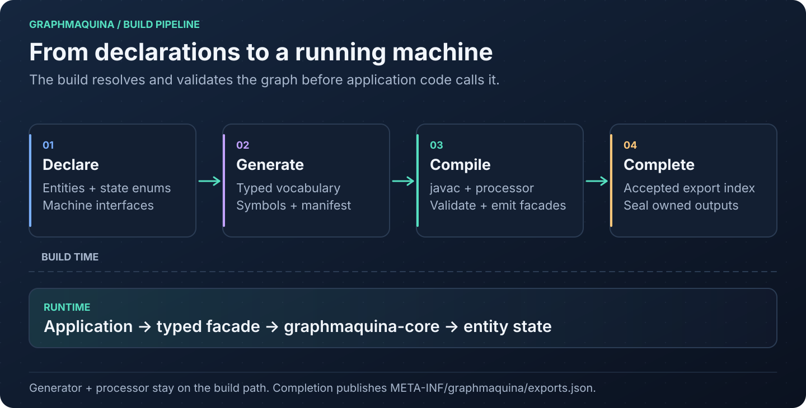

## Visual guide

Follow the pictures for an overview, then use the linked sections for declarations, commands and complete
examples. Each illustration is an SVG: open it to inspect labels at full size.

| Question | Diagram | Read next |
| --- | --- | --- |
| How can my source use annotations that do not exist yet? | [Source → vocabulary → compilation](images/annotation-bootstrap.svg) | [First generation](#how-your-flow-annotations-are-generated) |
| Which transitions are permitted? | [The ticket graph](images/ticket-workflow.svg) | [Understand the graph](#understand-the-graph) |
| Why did an operation apply, reject or fail? | [Edge selection and outcomes](images/operation-decisions.svg) | [Outcomes](#handle-transition-outcomes) |
| Which thread waits for my service? | [Direct call and async submission](images/async-execution.svg) | [Calling styles](#choose-the-calling-style) |
| How much time is left for an action? | [Root and action deadline timeline](images/async-deadlines.svg) | [Deadline rules](#deadline-rules) |
| What happens if the service finishes too late? | [Timeout and late completion](images/async-late-completion.svg) | [Cancellation](#timeout-cancellation-and-late-completion) |
| What can I safely use in a callback? | [Context and thread boundary](images/async-context-boundary.svg) | [Context ownership](#contexts-and-completion-callbacks) |
| Does a completed future mean the operation succeeded? | [Future result branches](images/async-future-results.svg) | [Result handling](#read-the-future-and-domain-result) |
| Do both machines commit together? | [Cascade versus watch](images/cascade-vs-watch.svg) | [Machine coordination](#read-peers-and-cascade-transitions) |
| When do hooks and reactions run? | [Commit lifecycle](images/commit-lifecycle.svg) | [Commit and hooks](#commit-hooks-and-observers) |

## Requirements and artifacts

- JDK 21 or later, including `javac`, for generation and compilation. Use Java 21 as the baseline unless
  your application deliberately targets a newer release.
- The repository uses Gradle 9.2.1 through its wrapper. This is the verified Gradle version; the project
  does not declare a broader tested compatibility matrix.
- Maven consumers need Maven and a Java 21 JDK. The complete configuration below uses
  maven-compiler-plugin 3.15.0, matching the repository's integration fixtures.
- Lombok is optional for consumer entities and action classes. The quickstart uses handwritten accessors.
  If you use Lombok, place its annotation processor before GraphMaquina's.
- Keep the runtime, generator, processor and adapter on the same GraphMaquina version.

| Module | Coordinates / plugin ID | Add it to |
| --- | --- | --- |
| Runtime and public annotations | `io.github.graphmaquina:graphmaquina-core` | Application dependencies |
| Pre-compilation generator | `io.github.graphmaquina:graphmaquina-codegen` | Build tooling; resolved by the adapter |
| Annotation processor | `io.github.graphmaquina:graphmaquina-processor` | javac annotation-processor path |
| Typed testing assertions and probes | `io.github.graphmaquina:graphmaquina-test` | Test dependencies |
| Gradle plugin | plugin ID `io.github.graphmaquina` | Gradle `plugins` block |
| Maven plugin | `io.github.graphmaquina:graphmaquina-maven-plugin` | Maven build plugins |
| Reference application | `graphmaquina-example` | Source and tests in this repository; not an application dependency |

Every coordinate takes the version you installed, set once as the `graphmaquinaVersion` Gradle property or
the `graphmaquina.version` Maven property; the examples below read it from there.

The generator and processor are build-time tools. Do not add them as application runtime dependencies.
Application imports begin with `io.github.graphmaquina`.

## How your flow annotations are generated

You write the machine interface; GraphMaquina generates its annotation types before compiling your
application. The generator writes `TicketsGraph` from the name and type parameters of `Tickets`. You do not
need an already compiled `Tickets` class or an existing `TicketsGraph` to start.

There are three kinds of API:

| API | Who supplies it? | When is it available? |
| --- | --- | --- |
| `@GenerateGraphApi`, `@GraphProperty`, `@GraphAction`, `@GraphGuard`, `@StateGraphs`, `Machine` | The `graphmaquina-core` dependency | As soon as dependencies resolve |
| `TicketsGraph.Definition`, `TicketsGraph.Transition`, `TicketsGraph.StatePolicy`, `TicketRefs`, `TicketActionsRefs` | The pre-compilation generator, from your declarations | After the generation task/phase, before application compilation |
| `TicketsRuntime`, `TicketMachinesRuntime` | The annotation processor, from the validated flow | During application compilation |

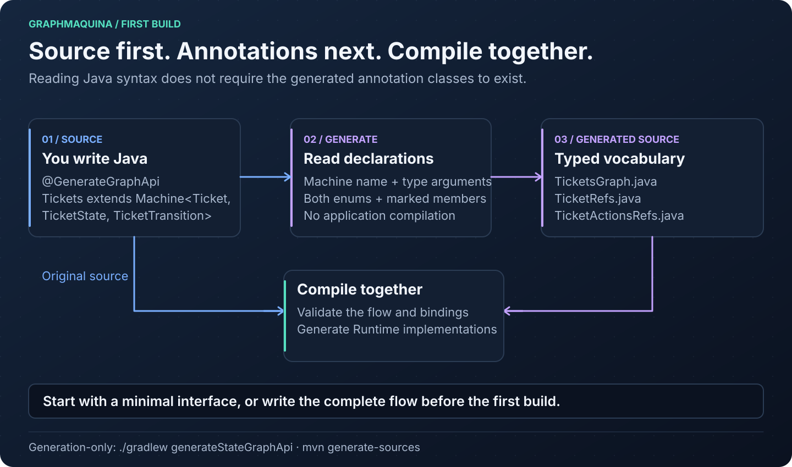

The generator creates the annotation types; you choose the flow by using those annotations. It does not
infer transitions from action method bodies, and it never invents a transition identifier from a name. For
example, `Machine<Ticket, TicketState, TicketTransition>` tells it that `initial`, `from` and `to` must use
`TicketState` and that `id` and `onFailure` must use `TicketTransition`. Your
`@TicketsGraph.Transition(id = ..., from = ..., to = ...)` declaration then specifies an actual edge.

### Start with a minimal machine

First configure the [Gradle plugin](#configure-gradle) or the [Maven lifecycle](#configure-maven), including
the annotation processor. Create `TicketState`, `TicketTransition`, `Ticket` and `TicketActions` from the
[quickstart](#quickstart-a-complete-ticket-machine). Then create
`src/main/java/com/example/tickets/Tickets.java` with this initial content:

```java
package com.example.tickets;

import io.github.graphmaquina.annotation.GenerateGraphApi;
import io.github.graphmaquina.api.Machine;

@GenerateGraphApi
public interface Tickets extends Machine<Ticket, TicketState, TicketTransition> {
}
```

This is enough to generate the annotation vocabulary. It is not yet a complete, valid flow: the definition,
policies and operations are added in the next step. The entity and both enums must be resolvable, and source
files must contain valid Java syntax.

From the application directory, run just generation with your chosen build tool:

```bash
# Gradle: generate vocabulary without compiling the application
./gradlew generateStateGraphApi

# Maven: execute the configured generate-sources phase without compiling the application
mvn generate-sources
```

With the quickstart's marked entity and action members, these files now exist in the same Java package as
their handwritten declarations:

| File | Gradle | Maven |
| --- | --- | --- |
| `TicketsGraph.java` | `build/generated/sources/graphmaquina/main/com/example/tickets/` | `target/generated-sources/graphmaquina/com/example/tickets/` |
| `TicketRefs.java` | Same directory | Same directory |
| `TicketActionsRefs.java` | Same directory | Same directory |

`TicketsGraph.java` contains the nested annotations `Definition`, `StatePolicy`, `Transition` and `Reject`,
with `StatePolicies`, `Transitions` and `Rejects` as their repeatable containers. `TicketRefs` contains
symbols for `@GraphProperty` members; `TicketActionsRefs` contains symbols for marked actions, guards and
hooks. Generation alone does not produce `TicketsRuntime` or `TicketMachinesRuntime`.

Refresh the IDE's build model if needed. You can now replace the minimal `Tickets.java` with the
[complete flow declaration](#ticketsjava), using `@TicketsGraph.Definition`, `@TicketsGraph.StatePolicy` and
`@TicketsGraph.Transition`. Add `TicketMachines.java` and `App.java` from the quickstart, then build and run:

```bash
# Gradle: generation, compilation and execution
./gradlew run

# Maven: generation and compilation; then use the quickstart's Java command to run App
mvn compile
```

During this build, the processor validates the flow and generates the `Runtime` implementations. javac also
compiles those generated implementations and application code that references them in the same invocation.

### You can also write the complete flow immediately

The initial generation-only step is optional: it is useful when you want the generated annotations available
in the editor before writing the flow. You may instead create all seven complete quickstart files at once,
including references to `TicketsGraph`, `TicketRefs` and `TicketMachinesRuntime`, and run the normal build.

This works on a clean checkout because reading Java syntax and checking Java types are separate operations:

1. The generator reads the original `.java` files as syntax. It uses the library markers, machine type
   parameters and marked members to create the vocabulary. References to the not-yet-generated annotations
   do not require those annotation classes to exist at this stage.
2. The build adapter adds the generated source directory to the compilation and supplies the generated
   manifest to the processor.
3. javac type-checks the handwritten sources together with the generated vocabulary. The processor
   validates your graph and emits its implementations. Compilation errors are reported at this stage if
   the flow or its bindings are invalid.

The build generates from source before attempting application compilation. A clean checkout does not need a
first compilation that fails, placeholder annotations, or a previously built JAR of your own machine. After
changing machine names, state or transition enums, or exported members, run the same build again to
regenerate the API.

An editor may underline missing generated types before the first generation. Use the commands above and
[refresh the generated roots](#ide-workflow); plain `javac` or an IDE build that bypasses the configured adapter
does not perform the required pre-generation step.

## Publication and verification status

GraphMaquina publishes to Maven Central under the verified namespace `io.github.graphmaquina`. A release
contains the runtime, generator, processor, testing module, Maven plugin, Gradle plugin and Gradle plugin
marker. The API documented here is the one this repository builds, so follow the guide against a build of
your own: [configure Gradle](#configure-gradle) opens with the command that installs it locally, and [typed
assertions, probes and graph snapshots](#typed-assertions-probes-and-graph-snapshots) describes the testing
module the same way.

| Check | Current development result |
| --- | --- |
| Automated library/build suites | `./gradlew test` runs the root build's ordinary suites; `./gradlew build` also runs `:graphmaquina-test:publishedArtifactTest` through `check`. The included Gradle adapter requires `:graphmaquina-gradle-plugin:test` explicitly. See [verification commands](#build-verify-and-release-this-repository). |
| README quickstart | [ReadmeQuickstartTest](../graphmaquina-test/src/test/java/consumer/ReadmeQuickstartTest.java) compiles the literal Gradle and Ticket sources with strict lint, runs `App` and checks `TicketsTest` against locally staged Maven artifacts. This JUnit consumer check covers local Gradle, not Maven execution or released artifacts. |
| Async guide | Migrated with the rest of this guide, then compiled and run through Gradle against locally staged artifacts: `AsyncApp` printed the output documented below it. It is not covered by an automated consumer check and was not re-run through Maven; the behaviour-check count reported for the 1.x async guide is historical. |
| Remaining acceptance work | Manual IntelliJ acceptance, a rerun of the async guide through both build tools, and full strict-lint acceptance of the external payments demo remain pending. |

Browse the [published artifacts](https://repo.maven.apache.org/maven2/io/github/graphmaquina/) or the
[core artifact on Maven Central](https://central.sonatype.com/artifact/io.github.graphmaquina/graphmaquina-core).
MVNRepository is an independent index; appearing in its search results is not required for Maven or Gradle
resolution. Sonatype does not control its update schedule; see the
[official explanation](https://central.sonatype.org/faq/mvnrepository/).

The signing identity is `Hugo G <60438622+0xhug0@users.noreply.github.com>`. The public fingerprint is:

```text
851F 7594 9D70 884A C95A AB56 455A D78F 0EC0 B9F1
```

This fingerprint and the public key allow consumers to verify signatures; they do not permit signing a
release. Private signing material is stored in 1Password. See [release signing](release-signing.md)
for verification commands and maintainer setup. Publishing a release does not resolve the
[known limitations](#known-limitations).

## Configure Gradle

The following files build and run the [ticket quickstart](#quickstart-a-complete-ticket-machine). Create a
separate application directory, `tickets-demo`, and put these files at its root.

First install GraphMaquina into your local Maven repository, from a checkout of this repository — a
different directory from `tickets-demo`. Choose any version string; it is the one every file below reads
from a single property:

```bash
./gradlew -PgraphmaquinaVersion=x.y.z \
    :graphmaquina-core:publishToMavenLocal \
    :graphmaquina-codegen:publishToMavenLocal \
    :graphmaquina-processor:publishToMavenLocal \
    :graphmaquina-test:publishToMavenLocal \
    :graphmaquina-gradle-plugin:publishToMavenLocal
```

That writes the runtime, the generator, the processor, the testing module, the Gradle plugin and the plugin
marker under `~/.m2/repository`. Gradle does not read that directory unless a build asks it to, which is why
`settings.gradle.kts` below declares `mavenLocal()`; Maven reads it as its own local repository and needs no
declaration at all.

### gradle.properties

```properties
graphmaquinaVersion=x.y.z
```

Use the version you installed above. The two scripts below read it from here, so no coordinate repeats
it.

### settings.gradle.kts

```kotlin
pluginManagement {
    repositories {
        mavenCentral()
        mavenLocal()
        gradlePluginPortal()
    }
    plugins {
        id("io.github.graphmaquina") version providers.gradleProperty("graphmaquinaVersion").get()
    }
}

dependencyResolutionManagement {
    repositories {
        mavenCentral()
        mavenLocal()
    }
}

rootProject.name = "tickets-demo"
```

A `plugins` block in a build script cannot interpolate a version, so the plugin request carries it here and
the build script applies the plugin by ID alone. `gradlePluginPortal()` is included for other plugins; this
guide does not require a separate GraphMaquina publication to the Gradle Plugin Portal.

### build.gradle.kts

```kotlin
plugins {
    java
    application
    id("io.github.graphmaquina")
}

group = "com.example"
version = "1.0.0"

java {
    toolchain {
        languageVersion = JavaLanguageVersion.of(21)
    }
}

val graphmaquinaVersion: String = providers.gradleProperty("graphmaquinaVersion").get()

dependencies {
    implementation("io.github.graphmaquina:graphmaquina-core:$graphmaquinaVersion")
    annotationProcessor("io.github.graphmaquina:graphmaquina-processor:$graphmaquinaVersion")
}

application {
    mainClass = "com.example.tickets.App"
}

tasks.withType<JavaCompile>().configureEach {
    options.release = 21
    options.compilerArgs.addAll(listOf("-Xlint:all,-serial", "-Werror"))
}
```

The GraphMaquina plugin reacts to the Java plugin; it does not apply Java itself. The `application` plugin is
used here only to provide `run` and a distribution containing runtime dependencies.

From the application directory, use an installed Gradle 9.2.1 to create a wrapper, or invoke the wrapper from
your GraphMaquina checkout with `-p` pointing to this directory:

```bash
gradle wrapper --gradle-version 9.2.1
./gradlew clean run
./gradlew build
./gradlew installDist
```

### Add Lombok when you need it

Add these dependency declarations before the GraphMaquina processor declaration:

```kotlin
compileOnly("org.projectlombok:lombok:1.18.48")
annotationProcessor("org.projectlombok:lombok:1.18.48")
annotationProcessor("io.github.graphmaquina:graphmaquina-processor:$graphmaquinaVersion")
```

Do not duplicate the GraphMaquina entry already present in the build. Lombok supplies accessors; it does not
replace GraphMaquina's generator or annotation processor.

### Source sets and generator selection

Generation participates in a source set only when that source set declares the GraphMaquina processor. Main
uses `annotationProcessor`; test uses `testAnnotationProcessor`. Tests that only call already generated main
facades normally do not need their own processor.

For graph declarations under `src/test/java`, add to the same `dependencies` block:

```kotlin
testAnnotationProcessor("io.github.graphmaquina:graphmaquina-processor:$graphmaquinaVersion")
```

If test entities use Lombok, add its test compile-only and annotation-processor dependencies, preserving order.

| Task | Purpose |
| --- | --- |
| `generateStateGraphApi` | Generate the main source set vocabulary |
| `generateTestStateGraphApi` | Generate test vocabulary if test participates |
| `generate<SourceSet>StateGraphApi` | Generate vocabulary for a custom source set |
| `compileJava` / `compileTestJava` | Run generation and the verified compilation lifecycle for participating scopes |

The plugin resolves the generator version matching its own version. Advanced overrides use:

```kotlin
graphmaquina {
    generatorVersion.set("x.y.z")  // the version you installed from a checkout
}
```

An explicit dependency on `graphmaquinaGenerator` replaces the default dependency. The repository example uses
this to run the sibling codegen project. Use matching versions for every GraphMaquina artifact.

## Configure Maven

This is a complete alternative build for the same ticket source files. Save it as `pom.xml` in
`tickets-demo`. It includes all six lifecycle executions and distinct main/test manifest arguments.
Run the same [install command](#configure-gradle) first: Maven reads `~/.m2/repository` as its local
repository, so it resolves what that command wrote with no repository declaration in this POM. Every
GraphMaquina artifact comes from the single version the `graphmaquina.version` property sets. For an
internal repository, configure both dependency and plugin repositories as shown in
[the build guide](typed-annotations-build.md#where-the-artifacts-come-from).

### pom.xml

```xml
<?xml version="1.0" encoding="UTF-8"?>
<project xmlns="http://maven.apache.org/POM/4.0.0"
         xmlns:xsi="http://www.w3.org/2001/XMLSchema-instance"
         xsi:schemaLocation="http://maven.apache.org/POM/4.0.0 https://maven.apache.org/xsd/maven-4.0.0.xsd">
  <modelVersion>4.0.0</modelVersion>
  <groupId>com.example</groupId>
  <artifactId>tickets-demo</artifactId>
  <version>1.0.0</version>

  <properties>
    <project.build.sourceEncoding>UTF-8</project.build.sourceEncoding>
    <maven.compiler.release>21</maven.compiler.release>
    <!-- the version you installed from a checkout -->
    <graphmaquina.version>x.y.z</graphmaquina.version>
  </properties>

  <dependencies>
    <dependency>
      <groupId>io.github.graphmaquina</groupId>
      <artifactId>graphmaquina-core</artifactId>
      <version>${graphmaquina.version}</version>
    </dependency>
  </dependencies>

  <build>
    <plugins>
      <plugin>
        <groupId>org.apache.maven.plugins</groupId>
        <artifactId>maven-compiler-plugin</artifactId>
        <version>3.15.0</version>
        <configuration>
          <release>${maven.compiler.release}</release>
          <annotationProcessorPaths>
            <path>
              <groupId>io.github.graphmaquina</groupId>
              <artifactId>graphmaquina-processor</artifactId>
              <version>${graphmaquina.version}</version>
            </path>
          </annotationProcessorPaths>
        </configuration>
        <executions>
          <execution>
            <id>default-compile</id>
            <configuration>
              <compilerArgs>
                <arg>-Agraphmaquina.annotationManifest=${project.build.directory}/graphmaquina/main/annotation-manifest.json</arg>
                <arg>-Xlint:all,-serial</arg>
                <arg>-Werror</arg>
              </compilerArgs>
            </configuration>
          </execution>
          <execution>
            <id>default-testCompile</id>
            <configuration>
              <compilerArgs>
                <arg>-Agraphmaquina.annotationManifest=${project.build.directory}/graphmaquina/test/annotation-manifest.json</arg>
                <arg>-Xlint:all,-serial</arg>
                <arg>-Werror</arg>
              </compilerArgs>
            </configuration>
          </execution>
        </executions>
      </plugin>
      <plugin>
        <groupId>io.github.graphmaquina</groupId>
        <artifactId>graphmaquina-maven-plugin</artifactId>
        <version>${graphmaquina.version}</version>
        <executions>
          <execution>
            <id>graphmaquina-generate</id>
            <phase>generate-sources</phase>
            <goals><goal>generate</goal></goals>
          </execution>
          <execution>
            <id>graphmaquina-prepare</id>
            <phase>process-sources</phase>
            <goals><goal>prepare</goal></goals>
          </execution>
          <execution>
            <id>graphmaquina-complete</id>
            <phase>compile</phase>
            <goals><goal>complete</goal></goals>
          </execution>
          <execution>
            <id>graphmaquina-generate-test</id>
            <phase>generate-test-sources</phase>
            <goals><goal>generate-test</goal></goals>
          </execution>
          <execution>
            <id>graphmaquina-prepare-test</id>
            <phase>process-test-sources</phase>
            <goals><goal>prepare-test</goal></goals>
          </execution>
          <execution>
            <id>graphmaquina-complete-test</id>
            <phase>test-compile</phase>
            <goals><goal>complete-test</goal></goals>
          </execution>
        </executions>
      </plugin>
    </plugins>
  </build>
</project>
```

Run from the application directory:

```bash
mvn --version
mvn clean verify
```

To run the quickstart after Maven has resolved the library and compiled the application, let Maven write the
dependency classpath and put the compiled classes in front of it:

```bash
mvn -q dependency:build-classpath -Dmdep.outputFile=target/classpath.txt
java -cp "target/classes:$(cat target/classpath.txt)" com.example.tickets.App
```

The generated file holds absolute paths into your local repository, wherever that is; on Windows, use `;` as
the Java classpath separator.

For Lombok, add `org.projectlombok:lombok:1.18.48` as a `provided` dependency and place its `<path>` before the
GraphMaquina processor's `<path>`. Unlike a Spring Boot parent, this standalone POM does not supply dependency
versions implicitly.

### Maven lifecycle and constraints

| Goal | Phase | Responsibility |
| --- | --- | --- |
| `generate` | `generate-sources` | Generate vocabulary and add the main generated source root |
| `prepare` | `process-sources` | Retire previous owned compilation outputs |
| `complete` | `compile`, after javac | Publish accepted exports and seal ownership |
| `generate-test` | `generate-test-sources` | Generate test vocabulary |
| `prepare-test` | `process-test-sources` | Prepare test compilation |
| `complete-test` | `test-compile`, after test javac | Publish test exports and seal ownership |

Merely declaring the plugin does not activate these goals. Use the executions above. Invoking
`compiler:compile` directly skips the required preceding lifecycle; use `mvn compile`, `mvn test-compile` or
`mvn verify` instead.

The adapter validates the effective Java release, processor path, manifest paths and JDK alignment. It rejects
`-proc:none` or `-proc:only` as the last `-proc:` option javac gets, whether from `proc` or from a compiler
argument, `failOnError=false`, `useIncrementalCompilation=false`, missing processor configuration, a
`-processor` list or `<annotationProcessors>` that leaves out
`io.github.graphmaquina.processor.StateGraphProcessor` or holds a name that is not a valid qualified class name,
a processor path compiler argument that does not reach the processor, unless it still holds a `${` once the check
evaluates it, a `--processor-module-path`, a processor that is only a dependency when javac 23 or later is not asked
to process, debug settings that leave out the `SourceFile` attribute, classes or processor sources sent elsewhere
than the project keeps them, as `<outputDirectory>`, `<multiReleaseOutput>`, `-d` or `-s` can,
`<compileSourceRoots>` without the generated directory, divergent main/test manifests, compiler includes or
excludes, incremental excludes included, that leave out the compilation carrier the generator emits, and includes
that hold only empty values. A compilation the build switches off is skipped instead: `maven.main.skip` or
`<skipMain>` makes the three main goals log that and do nothing, `maven.test.skip` or `<skip>` the three test goals,
and a project packaged as `pom` skips all six. Run the normal lifecycle when generating graphs.

| Optional property | Meaning |
| --- | --- |
| `graphmaquina.javaExecutable` | Explicit `java` executable for generation. It must belong to a JDK 21 or later, the one javac compiles with: the two are compared by JDK home after symbolic links are followed, so a wrapper launcher outside that JDK's `bin` directory is refused. On Windows, a name without an extension that names no file stands for the `.exe` beside it |
| `graphmaquina.compilationId` | Override compilation identity; defaults distinguish artifact and main/test scope |

See the [Maven adapter reference](typed-annotations-build.md#maven) for toolchains and custom compiler paths.

## Quickstart: a complete ticket machine

Create the following seven files under `src/main/java/com/example/tickets/`. They are shared by the Gradle and
Maven configurations above and require no Lombok, framework or external service. You can write all seven files
before the first build; [the generation walkthrough](#how-your-flow-annotations-are-generated) explains why
the references to generated annotations are valid in this workflow.

A ticket is submitted for review, and submission registers it with the review board. A board that will not
take the ticket is a declared domain failure, so the ticket lands in `FAILED`. Once in review it can be
approved by a person, auto-approved by a rule, retouched in place, or rejected back to `OPEN`.

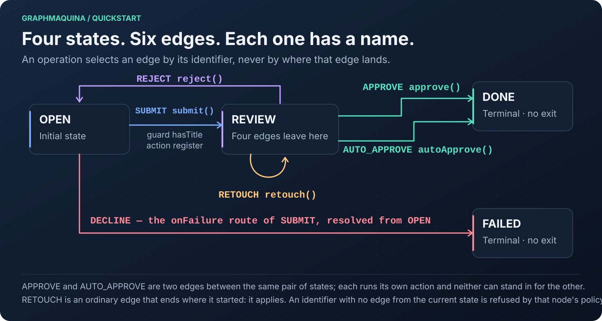

### TicketState.java

```java
package com.example.tickets;

public enum TicketState {
    OPEN, REVIEW, DONE, FAILED
}
```

### TicketTransition.java

```java
package com.example.tickets;

public enum TicketTransition {
    SUBMIT, APPROVE, AUTO_APPROVE, RETOUCH, REJECT, DECLINE
}
```

Two enums, never one. `TicketState` names where a ticket can be; `TicketTransition` names the edges it can
take. You write both: GraphMaquina derives no identifier from an action name, a method name or a destination.

### Ticket.java

```java
package com.example.tickets;

import io.github.graphmaquina.annotation.GraphProperty;
import java.util.Objects;

public final class Ticket {
    @GraphProperty
    private final String id;

    @GraphProperty
    private TicketState state = TicketState.OPEN;

    private final String title;
    private final boolean accepted;

    public Ticket(String id, String title, boolean accepted) {
        this.id = Objects.requireNonNull(id);
        this.title = Objects.requireNonNull(title);
        this.accepted = accepted;
    }

    public String getId() { return id; }
    public TicketState getState() { return state; }
    public String getTitle() { return title; }
    public boolean isAccepted() { return accepted; }

    public void setState(TicketState state) {
        this.state = Objects.requireNonNull(state);
    }
}
```

The state starts initialized. `initial = OPEN` describes the graph; it does not initialize new entities.
The runtime calls the state setter during commit. Action code must not call it.

### TicketActions.java

```java
package com.example.tickets;

import io.github.graphmaquina.annotation.GraphAction;
import io.github.graphmaquina.annotation.GraphGuard;
import io.github.graphmaquina.annotation.GraphHook;
import io.github.graphmaquina.api.ActionOutcome;
import io.github.graphmaquina.api.CommitContext;
import io.github.graphmaquina.api.GuardContext;
import io.github.graphmaquina.api.GuardResult;
import io.github.graphmaquina.api.TransitionContext;
import java.util.ArrayList;
import java.util.List;

public final class TicketActions {
    private final List<String> decisions = new ArrayList<>();

    /** Which action actually ran, in order. Two edges to DONE never stand in for each other. */
    public List<String> decisions() {
        return List.copyOf(decisions);
    }

    @GraphGuard
    public GuardResult hasTitle(GuardContext<Ticket, TicketState, TicketTransition> ctx) {
        return ctx.entity().getTitle().isBlank()
                ? GuardResult.reject("a ticket needs a title")
                : GuardResult.pass();
    }

    @GraphAction
    public ActionOutcome register(TransitionContext<Ticket, TicketState, TicketTransition> ctx) {
        return ctx.entity().isAccepted()
                ? ActionOutcome.ok()
                : ActionOutcome.failed("the review board declined the ticket");
    }

    @GraphAction
    public ActionOutcome approve(TransitionContext<Ticket, TicketState, TicketTransition> ctx) {
        decisions.add("approve " + ctx.entity().getId());
        return ActionOutcome.ok();
    }

    @GraphAction
    public ActionOutcome autoApprove(TransitionContext<Ticket, TicketState, TicketTransition> ctx) {
        decisions.add("autoApprove " + ctx.entity().getId());
        return ActionOutcome.ok();
    }

    @GraphAction
    public ActionOutcome retouch(TransitionContext<Ticket, TicketState, TicketTransition> ctx) {
        decisions.add("retouch " + ctx.entity().getId());
        return ActionOutcome.ok();
    }

    @GraphHook
    public void committed(Ticket ticket, CommitContext<TicketState, TicketTransition> commit) {
        System.out.println("Committed " + ticket.getId() + ": " + commit.from()
                + " -" + commit.transition() + "-> " + commit.to());
    }
}
```

### Tickets.java

```java
package com.example.tickets;

import io.github.graphmaquina.annotation.GenerateGraphApi;
import io.github.graphmaquina.api.Machine;
import io.github.graphmaquina.api.Outcome;

@GenerateGraphApi
@TicketsGraph.Definition(initial=TicketState.OPEN,
    terminals={TicketState.DONE, TicketState.FAILED},
    allowsCycle={TicketState.OPEN, TicketState.REVIEW},
    state=TicketRefs.State.class, id=TicketRefs.Id.class,
    afterCommit=TicketActionsRefs.Committed.class)
@TicketsGraph.StatePolicy(state=TicketState.OPEN, otherwise="submit the ticket first")
@TicketsGraph.StatePolicy(state=TicketState.REVIEW, otherwise="approve, reject or retouch the ticket")
@TicketsGraph.Reject(from=TicketState.OPEN, transition=TicketTransition.APPROVE,
    reason="approval requires review")
@TicketsGraph.Transition(id=TicketTransition.DECLINE, from=TicketState.OPEN, to=TicketState.FAILED)
public interface Tickets extends Machine<Ticket,TicketState,TicketTransition> {

    @TicketsGraph.Transition(id=TicketTransition.SUBMIT, from=TicketState.OPEN,
        to=TicketState.REVIEW, action=TicketActionsRefs.Register.class,
        guards=TicketActionsRefs.HasTitle.class, onFailure=TicketTransition.DECLINE)
    Outcome<Ticket,TicketState,TicketTransition> submit(Ticket ticket);

    @TicketsGraph.Transition(id=TicketTransition.APPROVE, from=TicketState.REVIEW,
        to=TicketState.DONE, action=TicketActionsRefs.Approve.class)
    Outcome<Ticket,TicketState,TicketTransition> approve(Ticket ticket);

    @TicketsGraph.Transition(id=TicketTransition.AUTO_APPROVE, from=TicketState.REVIEW,
        to=TicketState.DONE, action=TicketActionsRefs.AutoApprove.class)
    Outcome<Ticket,TicketState,TicketTransition> autoApprove(Ticket ticket);

    @TicketsGraph.Transition(id=TicketTransition.RETOUCH, from=TicketState.REVIEW,
        to=TicketState.REVIEW, action=TicketActionsRefs.Retouch.class)
    Outcome<Ticket,TicketState,TicketTransition> retouch(Ticket ticket);

    @TicketsGraph.Transition(id=TicketTransition.REJECT, from=TicketState.REVIEW, to=TicketState.OPEN)
    Outcome<Ticket,TicketState,TicketTransition> reject(Ticket ticket);
}
```

`APPROVE` and `AUTO_APPROVE` are two edges between the same pair of states, each with its own action. They
are parallel edges, not duplicates: `approve(ticket)` can never run `autoApprove`'s action, and no
deduplication by destination collapses them. `RETOUCH` is a self-loop, an ordinary edge that happens to end
where it started, and `REJECT` closes the `OPEN → REVIEW → OPEN` loop, so both states appear in
`allowsCycle`. `DECLINE` has no method of its own: it is the route `SUBMIT` names in `onFailure`, and it is
resolved from `SUBMIT`'s origin.

`TicketsGraph`, `TicketRefs` and `TicketActionsRefs` do not exist in handwritten source. The generator writes
them before javac compiles this interface, using `@GenerateGraphApi`, `Machine<Ticket, TicketState, TicketTransition>`
and the marked members. See [the first-generation walkthrough](#how-your-flow-annotations-are-generated) for the
minimal-interface and complete-source workflows. Do not create placeholder versions of these classes.

### TicketMachines.java

```java
package com.example.tickets;

import io.github.graphmaquina.annotation.StateGraphs;
import io.github.graphmaquina.api.Machines;

@StateGraphs
public interface TicketMachines extends Machines {
    Tickets tickets();
}
```

The processor generates `TicketsRuntime` and `TicketMachinesRuntime`. The set owns the runtime machines
and closes their default executors together.

### App.java

```java
package com.example.tickets;

import io.github.graphmaquina.api.Outcome;
import io.github.graphmaquina.api.OutcomeCode;
import io.github.graphmaquina.api.OutcomeStatus;
import java.util.List;
import java.util.Optional;

public final class App {
    private App() { }

    public static void main(String[] args) {
        TicketActions actions = new TicketActions();
        try (TicketMachines machines = TicketMachinesRuntime.builder(actions).build()) {
            Tickets tickets = machines.tickets();

            Ticket accepted = new Ticket("T-1", "Document the workflow", true);
            require(tickets.submit(accepted).status() == OutcomeStatus.APPLIED, "submit should apply");
            require(tickets.approve(accepted).status() == OutcomeStatus.APPLIED, "approve should apply");
            require(accepted.getState() == TicketState.DONE, "an approved ticket should be DONE");

            Ticket untitled = new Ticket("T-2", "", true);
            require(tickets.submit(untitled).code() == OutcomeCode.GUARD_REJECTED, "blank title should reject");
            require(untitled.getState() == TicketState.OPEN, "a rejected ticket should remain OPEN");

            Ticket refused = new Ticket("T-3", "Await the board", false);
            Outcome<Ticket, TicketState, TicketTransition> declined = tickets.submit(refused);
            require(declined.code() == OutcomeCode.FAILURE_ROUTED
                    && declined.explanation().equals(Optional.of("the review board declined the ticket")),
                    "a decline should be handled");
            require(refused.getState() == TicketState.FAILED, "the failure route should commit FAILED");

            Ticket fresh = new Ticket("T-4", "Not submitted yet", true);
            Outcome<Ticket, TicketState, TicketTransition> refusal = tickets.approve(fresh);
            require(refusal.code() == OutcomeCode.NO_TRANSITION
                    && refusal.explanation().equals(Optional.of("approval requires review")),
                    "APPROVE leaves no edge from OPEN");

            Ticket revised = new Ticket("T-5", "Revise the wording", true);
            tickets.submit(revised);
            require(tickets.retouch(revised).status() == OutcomeStatus.APPLIED, "a self-loop should apply");
            require(revised.getState() == TicketState.REVIEW, "a self-loop ends where it started");
            require(tickets.reject(revised).status() == OutcomeStatus.APPLIED, "reject should apply");
            require(revised.getState() == TicketState.OPEN, "reject returns the ticket to OPEN");

            Ticket automatic = new Ticket("T-6", "Trivial typo fix", true);
            tickets.submit(automatic);
            require(tickets.autoApprove(automatic).status() == OutcomeStatus.APPLIED, "autoApprove should apply");
            require(actions.decisions().equals(List.of(
                    "approve T-1", "retouch T-5", "autoApprove T-6")),
                    "each operation runs its own action: " + actions.decisions());
            System.out.println("All ticket scenarios passed.");
        }
    }

    private static void require(boolean condition, String message) {
        if (!condition) {
            throw new IllegalStateException(message);
        }
    }
}
```

Expected application output:

```text
Committed T-1: OPEN -SUBMIT-> REVIEW
Committed T-1: REVIEW -APPROVE-> DONE
Committed T-3: OPEN -DECLINE-> FAILED
Committed T-5: OPEN -SUBMIT-> REVIEW
Committed T-5: REVIEW -RETOUCH-> REVIEW
Committed T-5: REVIEW -REJECT-> OPEN
Committed T-6: OPEN -SUBMIT-> REVIEW
Committed T-6: REVIEW -AUTO_APPROVE-> DONE
All ticket scenarios passed.
```

One `afterCommit` on `Definition` is the default hook of every edge, so each committed hop prints itself,
including the self-loop and the failure route. Nothing prints for `T-2`, whose guard rejected, or for `T-4`,
whose request had no edge: neither committed anything. The program checks an applied edge, a guard rejection,
a handled failure, a request with no edge, a self-loop, a cycle and two parallel edges. It does not rely on
Java assertions being enabled.

## Understand the graph

A machine is a directed graph. Its nodes are the constants of the state enum `S`, and its edges are the
transitions you declare. An edge is a triple:

```text
(from: S, transition: T, to: S)
```

`T` is the machine's own enum of transition identifiers, written by you and distinct from `S`. An edge is
uniquely keyed by `(from, transition)`: from one state, one identifier selects exactly one edge. Two
declarations of the same key are `SG102`, even when their guards differ; there is no priority and no
first-guard-wins.

Only declared transitions become edges. The ticket machine above expresses its whole intent in six edges:

| From | Identifier | To | Kind |
| --- | --- | --- | --- |
| `OPEN` | `SUBMIT` | `REVIEW` | `ACTION` `register`, guard `hasTitle`, `onFailure = DECLINE` |
| `OPEN` | `DECLINE` | `FAILED` | `MOVE`, declared on the type: the failure route, no facade method |
| `REVIEW` | `APPROVE` | `DONE` | `ACTION` `approve` |
| `REVIEW` | `AUTO_APPROVE` | `DONE` | `ACTION` `autoApprove` |
| `REVIEW` | `RETOUCH` | `REVIEW` | `ACTION` `retouch`, a self-loop |
| `REVIEW` | `REJECT` | `OPEN` | `MOVE` |

Every edge is `ACTION` or `MOVE`, and that is the whole of `TransitionKind`: whether the edge runs an action
before it commits. Both are real edges that change the entity's state and run the effective hook.

### Identity, not destination

An operation names a transition, never a target state. `machines.tickets().approve(ticket)` compiles to
`stateMachine.execute(ticket, TicketTransition.APPROVE)`, and the engine resolves `(current state, APPROVE)`
once. If the resolution finds no edge, the request is refused. The engine never looks for another edge that
happens to reach the same place.

This is what makes `APPROVE` and `AUTO_APPROVE` two different things even though both end in `DONE`:

```java
Outcome<Ticket, TicketState, TicketTransition> outcome = tickets.autoApprove(ticket);
// Applied, to = DONE, and TicketActions.autoApprove ran. approve's action did not.
```

The same identifier may leave several states, with different destinations if the domain says so; the current
state disambiguates. The shop's `Items` machine declares one `CANCEL` from `PENDING` and from `PACKING`, both
reaching `CANCELLED`, and the order's cancellation cascade asks for `ItemTransition.CANCEL` rather than for
the `CANCELLED` state:

```java
ctx.cascadeAll(Items.class, ctx.entity().items(), ItemTransition.CANCEL, CascadePolicy.COLLECT);
```

`onFailure`, watch rules and cascades all name identifiers for the same reason. A route is the edge you named,
resolved from the origin that needs it.

### Absence, self-loops and reevaluation

Three situations stay separate here, and each has its own
observable result.

| Situation | What the engine does | Outcome |
| --- | --- | --- |
| No edge is keyed by `(current, requested)` | Nothing runs. No guard, no action, no state write. | `Rejected` with `RejectionKind.NO_TRANSITION` |
| An explicit self-loop `A --T--> A` is requested | The edge runs like any other: guards, action, commit, hook. | `Applied`, with `recordedState() == A` |
| `reevaluate(entity)` finds no watch, or no rule that holds | Nothing runs. | `Ignored`, with `IgnoreReason.NO_WATCH` or `NO_RULE_MATCHED` |

A self-loop is an ordinary edge that ends where it started. It needs `allowsCycle` on that state, it may be
the only exit of a non-terminal state, and it is forbidden on a terminal. Requesting a transition while the
entity already sits in that transition's destination is not special in any way: either an edge is keyed by
`(current, requested)` and it runs, or none is and the request is refused.

`Ignored` is reserved for reevaluation. There is no implicit staying, and no operation is silently ignored
because the entity is already somewhere convenient. If the intent is to do nothing, do not call the
operation.

### Guards and the reason a request is refused

A guard belongs to an edge that exists. It runs after the edge is resolved and before its action, in
declaration order, stopping at the first rejection:

```java
assertThat(orders.retry(order)).isRejected().isRejectedByGuardNamed("retryBudgetLeft");
```

A refusal for lack of an edge is a different kind, and carries no guard:

```java
assertThat(orders.ship(order)).isRejected()
        .hasReason("cannot ship without payment")
        .hasNoTransition();
```

`RejectionKind` is what tells the two apart. `Rejected` reports the entity, the origin, the identifier that
was requested, the reason and — for `GUARD` only — the name of the guard. It reports no destination: the
same identifier reaches different states from different origins, so there is no single `to` to name.

### Policies: every node answers

Rejections are answers a node gives, not edges. Every state carries a `StatePolicy<S, T>` with a non-blank
`otherwise` reason, and optionally a non-blank reason per identifier:

```java
@TicketsGraph.StatePolicy(state=TicketState.OPEN, otherwise="submit the ticket first")
@TicketsGraph.Reject(from=TicketState.OPEN, transition=TicketTransition.APPROVE,
    reason="approval requires review")
```

`Reject` overrides `otherwise` for one identifier from one state. Declaring both an edge and a rejection for
the same `(from, transition)` is `SG702`; a state with no policy is `SG701`. A terminal that declares none
gets the stable text `terminal state <NAME> accepts no transitions`, which an explicit `StatePolicy`
replaces.

A policy is not a universe of destinations that must be "closed". You never enumerate what a state cannot do.
You declare what it can do, and the policy words the answer for everything else.

### Structural rules

- Every state must be reachable from `initial` through declared edges.
- A terminal has no outgoing edge at all, including a self-loop. A non-terminal must have at least one,
  which may be a self-loop.
- Every cycle must pass through at least one state listed in `allowsCycle`, and an allowance for a state that
  belongs to no cycle is rejected too. A self-loop is a cycle.
- An `onFailure` identifier must name a different edge that exists from the failing edge's own origin. It may
  legitimately reach the same destination as the edge it recovers, because identity, not destination, tells
  them apart.
- Every watch rule must name an identifier with an edge from the watched state. A terminal cannot watch.

Unauthorised cycles are reported as one witness per cyclic strongly connected component rather than one
message per elementary cycle. The rule about what is accepted is unchanged; the number of messages is
deliberately smaller, and the witnesses are deterministic.

For example, the ticket machine permits `OPEN → REVIEW → OPEN` and the `RETOUCH` self-loop by listing both
states in `allowsCycle`. The shop permits `NEW → PAYMENT_DECLINED → NEW` with `allowsCycle = PAYMENT_DECLINED`.
Guards still decide when another lap is permitted; the allowance only says the loop is intentional.

### Operations and internal edges

A public operation has this shape:

```java
Outcome<Ticket, TicketState, TicketTransition> approve(Ticket ticket);
```

It carries one or more `Transition` annotations from its own generated vocabulary, all with the same `id`.
Several annotations let one identifier open branches from different origins — that is how the shop's
`cancel(order)` covers `NEW` and `PAYMENT_DECLINED` in a single method. Two methods cannot claim the same
identifier, and a type-level `Transition` may add further branches of an identifier a method owns as long as
the keys stay disjoint; `SG703` reports both mistakes.

A `Transition` on the interface itself declares an edge with no facade method. It is how failure routes,
cascade-only and watch-only edges are declared: `DECLINE` in the quickstart and `PAYMENT_DECLINED` in the
shop are exactly that. Omitting `action` makes the edge a `MOVE`.

A typed facade intentionally exposes no generic selector by destination. The application's entry points are
the operations you declared, plus `reevaluate`.

An operation may accept a second argument: `Outcome<Entity, Status, Change> screen(Entity entity, Verdict verdict)`.
Guards and actions read it through `ctx.input(Verdict.class)`, which returns `Optional<Verdict>`. This lets
a guard decide from a fact the caller has already obtained without storing a temporary argument on the
entity or calling a service from the guard. Use an immutable record for related input fields; a Java file
has only one public top-level type, so it gets its own file:

```java
// Verdict.java
public record Verdict(boolean eligible) { }
```

A declaration like this belongs on the machine interface, beside its other operations — the same place as
`approve` in this quickstart's `Tickets.java` — and its guard belongs on the bindings host, beside its other
guards, the same place as `hasTitle` in `TicketActions.java`. The snippet below declares its own screening
vocabulary rather than the ticket one; adapt the graph annotation and the `Refs` class — following the
naming rule under [Generated names](#generated-names) — and the states and identifiers to your own machine:

```java
@ScreeningGraph.Transition(id = Change.SCREEN, from = NEW, to = SCREENED,
        guards = RulesRefs.Eligible.class)
Outcome<Entity, Status, Change> screen(Entity entity, Verdict verdict);
```

```java
@GraphGuard
public static GuardResult eligible(GuardContext<Entity, Status, Change> ctx) {
    return ctx.input(Verdict.class)
            .map(verdict -> verdict.eligible() ? GuardResult.pass() : GuardResult.reject("ineligible"))
            .orElseGet(() -> GuardResult.reject("missing verdict"));
}
```

`transitionsFrom(state)` returns the identifiers declared from a state. It is structural inspection: it runs
no guard and promises nothing about a particular entity. To see where those identifiers lead, read
`definition().outgoingFrom(state)`, and for one edge, `definition().findTransition(from, id)`.

Upgrading an application written against the 1.x transition matrix is a separate document:
[migrating to 2.0](migration-2.0.md) maps every retired contract to its replacement.

## Annotation and binding reference

### Handwritten markers

Import these from `io.github.graphmaquina.annotation`:

| Annotation | Place it on | Purpose |
| --- | --- | --- |
| `@GenerateGraphApi` | Top-level `Machine<E, S, T>` interface | Generate its typed graph vocabulary |
| `@StateGraphs` | Top-level interface extending `Machines` | Generate a set and builder for its machine accessors |
| `@GraphProperty` | Entity field or getter | Export a property symbol |
| `@GraphAction` | Action method | Export an action binding |
| `@GraphGuard` | Guard method | Export a guard binding |
| `@GraphHook` | Hook method | Export an after-commit binding |
| `@GraphCondition` | Watch-condition method | Export a custom watch predicate |
| `@GraphBindings` | Concrete binding host | Export inherited marked members through this concrete host |
| `@GraphPeers` | Watching machine interface | Request typed vocabulary for its declared owner/peer pairs |
| `@Timeout` | Nested annotation element | Express seconds and nanoseconds for an asynchronous action timeout |

Markers identify exports; marking a method alone does not attach it to a transition. Reference its generated
symbol from the graph declaration.

### Generated names

| Handwritten declaration | Generated API |
| --- | --- |
| `Tickets extends Machine<Ticket, TicketState, TicketTransition>` | `TicketsGraph.Definition`, `.StatePolicy`, `.StatePolicies`, `.Transition`, `.Transitions`, `.Reject`, `.Rejects` |
| Property `Ticket.state` | `TicketRefs.State.class` |
| Marked method `TicketActions.hasTitle` | `TicketActionsRefs.HasTitle.class` |
| `@GraphPeers(Items.class)` on `Orders` | `OrdersItems.Watch`, `.Watches` and `.When`, in the owner's package |
| Machine `Tickets` | `TicketsRuntime`, including `KEY`, graph construction and facade implementation |
| Set `TicketMachines` | `TicketMachinesRuntime`, including the generated builder |

`KEY` is a `MachineKey<E, S, T>`: entity class, state enum and transition enum. Its equality and hash include
all three, and a registry refuses two machines that write the same entity and state enum through different
transition catalogues.

Generated type names use PascalCase with no underscores. Underscores and nesting dots separate words:
`_id` → `Id`, `has_title` → `HasTitle`, and `Outer.Inner` → `OuterInnerRefs`. Existing internal case and
uppercase acronyms are preserved: `hasTitle` → `HasTitle`, `URL` → `URL`. `Graph` and `Refs` retain their roles.
Original Java declarations and invocation names remain unchanged. If normalization merges two names, generation
fails with `SG603` naming both sources: `id` / `_id` and `authorize` / `Authorize` conflict within one references
container. A conflict with the container itself also fails; there are no underscore escapes or opaque suffixes.
Names that cannot produce a valid nonempty Java identifier are rejected.

A generated symbol is a compile-time reference. It is not an action instance, a dependency-injection bean or
a reflective lookup. The facade calls the selected declaration directly, preserving the marked overload.

### Generated graph annotation elements

In this table, `S` is the machine's state enum, `T` its transition enum and `P` a property symbol class.

| Annotation | Target | Required elements | Optional elements |
| --- | --- | --- | --- |
| `Definition` | type | `initial: S`, `state: P`, `id: P` | `terminals: S[]`, `allowsCycle: S[]`, `afterCommit: HookSymbol` |
| `StatePolicy` | type | `state: S`, `otherwise: String` | None |
| `Transition` | type, method | `id: T`, `from: S[]`, `to: S` | `action`, `guards`, `onFailure: T`, `failsOn`, `timeout`, `afterCommit` |
| `Reject` | type | `from: S`, `transition: T`, `reason: String` | None |

`StatePolicy`, `Transition` and `Reject` are repeatable, through the generated `StatePolicies`, `Transitions` and
`Rejects` containers. `from` must contain at least one state. Guard arrays execute in declaration order. `failsOn` takes
throwable class literals. An absent `action` makes the edge a `MOVE`; `onFailure`, `failsOn` and `timeout` require an
action, and `timeout` requires an asynchronous one.

Java annotations do not have nullable elements, so the API represents optional single values as arrays.
`onFailure`, `timeout`, `afterCommit`, `Transition.action` and custom `When.condition` accept zero or one value.
Use the single-value syntax, for example `onFailure = TicketTransition.DECLINE`, or omit the element. Multiple
values are `SG607`.

### Properties and accessors

For a field marked `@GraphProperty`, the processor looks for public instance readers in this order:
`property()`, `getProperty()`, `isProperty()`. It searches for state writers as `setProperty(value)` and then
`property(value)`. A field marker does not grant access to the field and does not generate an accessor.

A marker on a getter selects that getter directly. Its logical property name follows JavaBeans
normalization: `getState()` exports `state`, `items()` exports `items`, and `getURL()` exports `URL`.

| Property use | Required shape |
| --- | --- |
| `Definition.state` | Public instance reader returning the machine's state enum; compatible public instance writer |
| `Definition.id` | Public instance reader returning an identity value; values must be non-null at runtime |
| `Watch.peers` | Owner reader returning `Collection<? extends PeerEntity>` |
| `Watch.owner` | Peer reader returning `Optional<OwnerEntity>` or an owner entity |

Use `Optional.empty()` for a peer with no owner. Keep relationship accessors consistent and return non-null
collections. If the setter overloads are ambiguous, the processor reports the ambiguity instead of choosing
based on declaration order.

### Method signatures

Public methods must match the role where the graph uses them. `E/S/T` refer to the owner entity, state and
transition types; `P/Q/U` refer to the peer's.

| Marker | Supported signature |
| --- | --- |
| `@GraphAction` | `ActionOutcome method(TransitionContext<E, S, T> ctx)` |
| `@GraphAction`, async | `CompletionStage<ActionOutcome> method(TransitionContext<E, S, T> ctx)` |
| `@GraphGuard` | `GuardResult method(GuardContext<E, S, T> ctx)` |
| `@GraphGuard`, async | `CompletionStage<GuardResult> method(GuardContext<E, S, T> ctx)` |
| `@GraphHook` | `void method(E entity)` or `void method(E entity, CommitContext<S, T> context)` |
| `@GraphCondition` | `boolean method(E owner, Collection<? extends P> peers, PeerView<P, Q, U> view)` |

Static bindings are called statically. Instance bindings become constructor/builder dependencies. For example,
using three instance members of `OrderActions` adds one `OrderActions` dependency, not three instances. A class
used only through static members needs no builder argument.

To expose inherited marked members under a concrete host, use `@GraphBindings` on that host. The processor
checks the inherited signature with the concrete generic arguments substituted. Generated output and JAR
exports are checked for collisions; do not manually create classes in generated namespaces or edit symbols.

## Actions, guards and failure routes

The ticket quickstart shows synchronous actions and a guard. Actions receive `TransitionContext<E, S, T>`:

| Method | Meaning |
| --- | --- |
| `entity()` | The object supplied by the caller |
| `transition()` | The identifier that selected this edge |
| `from()` / `to()` | The endpoints of the edge being executed |
| `depth()` | `0` for the root, increasing through cascades |
| `peer(...)` | Read another registered machine through a `PeerView` |
| `cascade(...)` | Request a peer transition, by identifier, within this unit of work |
| `cascadeAll(...)` | Apply a cascade to a collection using the selected policy |
| `input()` / `input(Class)` | The operation's second argument, if the caller passed one |

Guards receive `GuardContext<E, S, T>`, which exposes the entity, the identifier, both endpoints, read-only
peer access and the same `input` accessors. It has no cascade API. Return `GuardResult.pass()` or
`GuardResult.reject("reason")`; do not return null. A rejecting guard stops the edge before its action runs
and produces `Rejected` with `RejectionKind.GUARD` and the guard's name. Guard code should be free of
mutations and external side effects.

Without an input, or when the caller passes null, the optional is empty. A value of an incompatible class
throws `ClassCastException`; absence and a wrong type are different conditions. Primitive operation
arguments are boxed; read them with wrapper tokens such as `Integer.class`. Class tokens cannot validate
erased generic arguments. Input operations do not support method type parameters or varargs.

The same input reaches the transition's guards, action and handled failure action. Cascades, watch reactions
and reevaluation have no input of their own and receive an empty optional. A shared guard must handle that
absence. Hooks, observers and transition records retain their existing contracts.

### Domain failures

An action returns `ActionOutcome.ok()`, `ActionOutcome.failed("reason")`, or `ActionOutcome.failed(kind, "reason")`
with a failure kind, a final class or record that implements `FailureKind`. A failed action is a handled business
result when a recovery rule of the edge declares its failure kind, which selects that rule's recovery identifier, or
else when the edge names an `onFailure` identifier, which takes every other returned failure and keeps its kind in
`Outcome.Failed.failureKind()`. Without either, the runtime throws `UnhandledFailureException` and does not commit the
planned state changes.

A failure route is an ordinary edge, declared from the origin of the edge that may fail. In the quickstart:

```java
@TicketsGraph.Transition(id=TicketTransition.DECLINE, from=TicketState.OPEN, to=TicketState.FAILED)
```

When `register` fails, the runtime discards the `SUBMIT` edge's pending changes, resolves `DECLINE` from
`OPEN` — the origin, never the destination it was heading for — and commits it. It returns `Outcome.Failed`,
whose `transition()` is `SUBMIT`, whose `hasTarget` was `REVIEW`, whose `failureTransition()` is `DECLINE`
and whose `movedTo()` is `FAILED`.

`onFailure` names an identifier, so a route may legitimately reach the same destination as the edge it
recovers: identity, not the destination, distinguishes them. Naming the failing edge's own key is `SG301`, as
is naming an identifier that has no edge from that origin.

The failure route can itself be an action. Its guards are bypassed when entered as failure handling, and its
own failure route is not chained. A failure or exception from that route aborts. Hooks apply to the edge that
actually committed, so the failing edge's hook does not run and the route's effective hook does.

### Map specific exceptions to a domain failure

This declaration is an excerpt from the shop's `Orders` machine:

```java
@OrdersGraph.Transition(id = OrderTransition.PAY, from = NEW, to = PAID,
    action = OrderActionsRefs.Charge.class,
    guards = OrderActionsRefs.RetryBudgetLeft.class,
    onFailure = OrderTransition.PAYMENT_DECLINED, failsOn = IOException.class,
    timeout = @Timeout(seconds = 5))
Outcome<Order, OrderStatus, OrderTransition> pay(Order order);
```

`OrderTransition.PAYMENT_DECLINED` is an identifier that happens to share its spelling with the state
`OrderStatus.PAYMENT_DECLINED`. They are two enums, so javac keeps them apart, and the edge it names is
declared on the interface itself:

```java
@OrdersGraph.Transition(id = OrderTransition.PAYMENT_DECLINED, from = NEW, to = PAYMENT_DECLINED)
```

The corresponding async action calls a gateway and returns a stage. An exceptional completion with a matching
`IOException` uses the declared failure route. The runtime unwraps a `CompletionException` or
`ExecutionException` that carries a cause before classifying that cause. It unwraps exactly those two classes:
an exception of a subclass of either is classified as itself, not through its cause. It also classifies a
checked exception that an action throws like any other, whether the method declares it, so that an action
declared `throws IOException` with `failsOn = IOException.class` takes the failure route, or throws it without
declaring it, as Kotlin or `@SneakyThrows` code can. A guard, a hook, a watch condition, a state or identity
accessor, or a watch's peers or owner reader may declare a checked exception too: the generated companion
compiles, and the exception is handled as the same exception thrown undeclared would be. `failsOn` applies to
action failures; a guard exception is a technical abort. A library exception, a `StateMachineException`, that a guard
or action throws or completes its stage with, bare or wrapped in one of those two classes, is never matched against
`failsOn`, whatever the edge lists: it aborts the call and becomes its cause, so a failure of another call never
passes for a failure of this one. A failure of the call itself, which a failed cascade throws into the action, is the
exception: it ends the call with the failure that poisoned it. An `Error` is never routed either: thrown as itself it
propagates unchanged, and one that completes a stage, or that one of those two classes carries, aborts.

`failsOn` cannot be a blanket `Throwable`, `Exception` or `RuntimeException`, an `Error`, a library engine exception, or
a `CancellationException` or one of its subtypes, which are never domain failures; nor `CompletionException` or
`ExecutionException` themselves, which are unwrapped before matching whenever they carry a cause, so declare the type of
their cause. All of these are `SG302`. Declare specific foreign throwable types, usually exceptions. Timeout,
interruption and cancellation are not a substitute for a returned domain failure. `@Timeout` is valid only for
asynchronous actions.

The full action implementation is in
[OrderActions.java](../graphmaquina-example/src/main/java/io/github/graphmaquina/example/order/OrderActions.java).

## Handle transition outcomes

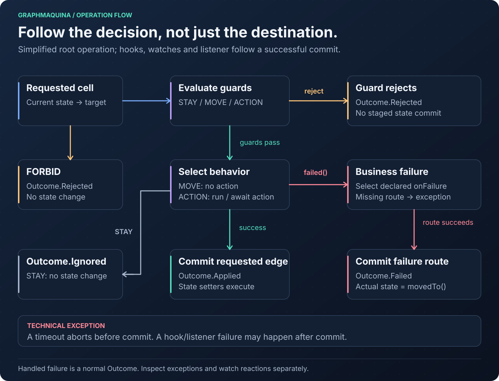

`Outcome<E, S, T>` is a sealed interface with four variants. Every outcome classifies itself, so a caller that
only needs to know what happened and why reads it without narrowing:

| Variant | `status()` | `code()` | `explanation()` | State written? |
| --- | --- | --- | --- | --- |
| `Applied` | `APPLIED` | `APPLIED` | empty | Yes, the resolved edge committed |
| `Rejected` | `REJECTED` | `NO_TRANSITION`, or `GUARD_REJECTED` | the policy's reason, or the guard's | No |
| `Failed` | `FAILED` | `FAILURE_ROUTED` | the reason the action returned; empty when `failsOn` routed a throwable | Yes, the failure route committed |
| `Ignored` | `IGNORED` | `NO_WATCH`, or `NO_RULE_MATCHED` | empty | No |

A cascade returns `Applied` or `Failed` to the action that called `cascade(...)`; a rejection inside it aborts the
root instead. Both are provisional there: their hops are written only if the root commits.

Every outcome also has `entity()`, `from()`, `recordedState()`, `requestedTransition()`, `records()` and
`reactions()`. `recordedState()` is `to` for `Applied`, `movedTo` for `Failed` and `from` for the other two.
`requestedTransition()` is empty only for `Ignored`, which selected no edge at all. [Records, journals and
reactions](#records-journals-and-reactions) describes what `records()` and `reactions()` return.

Read the classification with its limits in mind:

- `recordedState()` is what the call recorded, not a read of the entity. An after-commit hook, a watch reaction
  or a later call can move the entity again; read the entity when you need its live state.
- `FAILED` does not mean that nothing happened: the failure route committed and the entity is at `movedTo`.
- `explanation()` holds the reasons the graph declares: a policy's reason, a guard's, or the reason an action
  returned with `ActionOutcome.failed(...)`. The only text the library writes there is the fixed reason of a
  terminal state that declares no policy, such as `terminal state DONE accepts no transitions`. When `failsOn`
  routes an exception, the failure's reason is composed from that exception and may carry internal details; it
  stays in `Failed.reason()` and `Failed.cause()`.
- A commit here is GraphMaquina writing states through the setters. A JPA or other transaction around the call
  commits later and can still fail.
- The constant names of `OutcomeStatus` and `OutcomeCode` are stable identifiers, safe to persist or send.

This method can be added to the quickstart's `App`:

```java
static String describe(Outcome<Ticket, TicketState, TicketTransition> outcome) {
    return outcome.code() + " at " + outcome.recordedState()
            + outcome.explanation().map((String text) -> ": " + text).orElse("");
}
```

### Map an outcome to a response

A web layer copies the classification into a type it owns, so its contract does not change when the library
does. The HTTP mapping below is one application's policy, not the library's; another application may just as well
answer `409` for every rejection and every handled failure:

```java
record TransitionResponse(String id, OutcomeStatus status, OutcomeCode code, TicketState from,
                          TicketState state, TicketTransition transition, String explanation) {

    static TransitionResponse of(String id, Outcome<Ticket, TicketState, TicketTransition> outcome) {
        return new TransitionResponse(id, outcome.status(), outcome.code(), outcome.from(),
                outcome.recordedState(), outcome.requestedTransition().orElse(null),
                outcome.explanation().orElse(null));
    }
}

static int httpStatus(OutcomeCode code) {
    return switch (code) {
        case APPLIED, FAILURE_ROUTED, NO_WATCH, NO_RULE_MATCHED -> 200;
        case NO_TRANSITION -> 409;
        case GUARD_REJECTED -> 422;
    };
}
```

The `switch` has no `default`: it is exhaustive, so a code added by a future release fails the build instead of
falling through. Do not serialize the `Outcome` itself: it holds the entity, a `Throwable` and reactions with
their own entities.

### Read what only one variant carries

The sealed variants remain available when a caller needs what only one of them carries: the rejecting guard,
the recovery identifier, the requested destination of a failure or its cause. `asApplied()`, `asRejected()`,
`asFailed()` and `asIgnored()` return the outcome as that variant, with the outcome's type arguments, or empty:

```java
Optional<String> guard = outcome.asRejected().flatMap(Outcome.Rejected::guard);
Optional<TicketTransition> recovery = outcome.asFailed().map(Outcome.Failed::failureTransition);
```

A `switch` over the variants reads all of them at once:

```java
static String detail(Outcome<Ticket, TicketState, TicketTransition> outcome) {
    return switch (outcome) {
        case Outcome.Applied<Ticket, TicketState, TicketTransition> applied ->
                applied.transition() + " moved to " + applied.to();
        case Outcome.Rejected<Ticket, TicketState, TicketTransition> rejected ->
                "Refused " + rejected.transition() + " by " + rejected.guard().orElse("the state's policy");
        case Outcome.Failed<Ticket, TicketState, TicketTransition> failed ->
                failed.failureTransition() + " moved to " + failed.movedTo() + ": " + failed.reason();
        case Outcome.Ignored<Ticket, TicketState, TicketTransition> ignored ->
                "Unchanged at " + ignored.recordedState() + " (" + ignored.reason() + ")";
    };
}
```

Technical failures throw instead of becoming a fifth outcome. An abort (`TransitionAbortedException`), a commit
failure (`CommitFailedException`) and a failing hook (`AfterCommitException`) share the supertype
`CallFailedException`. It says as values which call failed (`call()`), where it was (`phase()`), how far it got
in writing states (`statesWritten()`) and which actions ran (`journal()`). A hook fails after state was already
written. [Handle a failed call](#handle-a-failed-call) shows how to read them.

### Records, journals and reactions

- `TransitionRecord` describes a planned-and-committed hop: machine key, entity, source, transition
  identifier, destination, kind, action label and cascade depth. Two actions that share a name and endpoints
  stay distinguishable because the identifier is part of the record.
- `records()` and `reactions()` answer on every outcome. A root `Applied` or `Failed` returns the
  transaction's records and the reactions of its commit; `Rejected`, `Ignored` and a nested `cascade` result
  return empty lists, the last because it is provisional and has no independent root commit or reaction list.
- A failed call's journal uses `ActionRecord` and `ActionStatus` (`OK`, `FAILED`, `THREW`; never `RUNNING` once the
  call failed) to report actions that actually ran. A journal is execution evidence, not an undo log for external
  side effects.
- A watch produces `Reaction.Done`, carrying its own outcome, or `Reaction.Aborted`, carrying its exception. Inspect
  reactions even when the root operation succeeded. `Reaction.Aborted` can also report a hook failure after the reaction
  itself committed; it is not proof that the reaction left state unchanged. A reevaluation that failed carries its
  `CallFailedException`, whose `statesWritten()` says whether the reaction wrote anything. An owner lookup fails before
  any reevaluation, so the reaction carries what it threw: a `RuntimeException` as it is, and a checked exception or any
  other throwable that is neither a `RuntimeException` nor an `Error`, wrapped in `UndeclaredThrowableException`. An
  `Error` is not caught: it propagates to the caller whose commit triggered the reaction.

### Handle a failed call

A call that does not return an outcome throws an `Error` or one of three `CallFailedException`s, always one of that
very call. A request refused before the call starts is not a call failure: a null argument throws
`NullPointerException`, an identifier of another catalogue `IllegalArgumentException`, and a call made where
no call may start `ReentrantTransitionException`. Read what happened from its values, not from its message:

| Type | `phase()` | `statesWritten()` |
| --- | --- | --- |
| `TransitionAbortedException` and its subclasses | `RESOLVE`, `GUARD` or `ACTION` | `NONE` |
| `CommitFailedException` | `COMMIT` | `NONE`, or `PARTIAL` when a setter threw |
| `AfterCommitException` | `HOOK` | `ALL` |

`call()` is the call that failed, the same `MachineCall` an observer received, and `journal()` lists the actions that
ran. Any other exception involved is the cause, a failure of another call included. With
`import io.github.graphmaquina.error.CallFailedException;`, this method can be added to the quickstart's `App`:

```java
static String describe(CallFailedException failure) {
    String written = switch (failure.statesWritten()) {
        case NONE -> "no state was written";
        case PARTIAL -> "some states were written";
        case ALL -> "every state was written";
    };
    String actions = failure.journal().isEmpty() ? "no action ran" : failure.journal().size() + " action(s) ran";
    return failure.call() + " failed in " + failure.phase() + ": " + written + ", " + actions;
}
```

`statesWritten()` describes the setters only: a JPA or other transaction around the call commits or rolls back later,
on its own. Neither the phase nor `statesWritten()` decides a retry by itself. `NONE` with an action in the journal
that called a payment service means the payment may have happened although no state moved. Retry only what your
actions make idempotent, and reconcile the rest.

## Asynchronous work and timeouts

GraphMaquina supports asynchronous actions and guards while keeping each transition's execution and commit
ordered. There are two independent decisions: whether a binding returns a stage, and whether the caller
submits the whole operation through `machine.async(...)`.

Read the subsections in this order:

- [Choose the calling style](#choose-the-calling-style).
- [Build a runnable async ticket](#runnable-async-ticket-example).
- [Read the future and domain result](#read-the-future-and-domain-result).
- [Configure deadlines](#deadline-rules).
- [Handle timeout and cancellation](#timeout-cancellation-and-late-completion).
- [Use contexts safely](#contexts-and-completion-callbacks).
- [Manage executors and machine lifetime](#executors-and-machine-lifetime).
- [Test async behavior](#test-async-behavior).

### Choose the calling style

| Action/guard implementation | How you invoke the machine | What the caller experiences |
| --- | --- | --- |
| Returns `ActionOutcome` / `GuardResult` | `tickets.complete(ticket)` | Executes inline and returns an `Outcome` |
| Returns `CompletionStage<ActionOutcome>` / `CompletionStage<GuardResult>` | `tickets.complete(ticket)` | Invokes the binding inline, waits for its stage, then returns an `Outcome` |
| Either kind of binding | `tickets.async(() -> tickets.complete(ticket))` | Submits the whole operation to the configured executor and returns `CompletableFuture<Outcome<...>>` |

With the default executor, the last form runs the operation on a virtual thread, allowing the calling thread
to continue. A custom executor determines its own scheduling; a direct executor can execute inline.

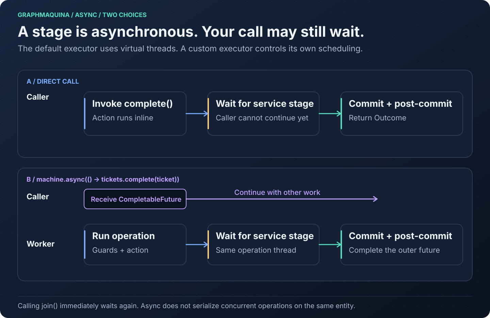

Returning a stage does not change the generated operation's return type: the facade still returns
`Outcome<E, S, T>`. The outer `CompletableFuture` comes from `machine.async(...)`. Calling `join()` immediately
on that future blocks the caller again; at an asynchronous application boundary, compose and return the
future instead of joining it on an event-loop thread.

Guards execute in order. Each async guard is awaited before the next guard or action runs. A guard rejection
stops the edge. The action method itself runs on the operation thread up to the point where it returns its
stage. Any blocking I/O performed before that return still blocks the operation thread. Use a service API
that returns promptly, or an application-managed executor for genuinely blocking service code.

### Runnable async ticket example

This example adds an asynchronous eligibility check and approval service to the ticket domain. Reuse
`Ticket.java`, `TicketState.java` and `TicketTransition.java` from the
[quickstart](#quickstart-a-complete-ticket-machine), with the same Gradle or Maven configuration and
dependencies. Add the following five files under `src/main/java/com/example/tickets/`. They can coexist with
the synchronous quickstart: a second machine over the same three types is its own graph.

The service contract returns stages; the example implementation controls their completion explicitly so
there is no external server, `Thread.sleep`, or scheduling guesswork.

#### TicketReviewService.java

```java
package com.example.tickets;

import java.util.concurrent.CompletionStage;

public interface TicketReviewService {
    CompletionStage<Boolean> canStart(String ticketId);
    CompletionStage<Boolean> approved(String ticketId);
}
```

#### AsyncTicketActions.java

```java
package com.example.tickets;

import io.github.graphmaquina.annotation.GraphAction;
import io.github.graphmaquina.annotation.GraphGuard;
import io.github.graphmaquina.api.ActionOutcome;
import io.github.graphmaquina.api.GuardContext;
import io.github.graphmaquina.api.GuardResult;
import io.github.graphmaquina.api.TransitionContext;
import java.util.Objects;
import java.util.concurrent.CompletionStage;

public final class AsyncTicketActions {
    private final TicketReviewService reviews;

    public AsyncTicketActions(TicketReviewService reviews) {
        this.reviews = Objects.requireNonNull(reviews);
    }

    @GraphGuard
    public CompletionStage<GuardResult> canStart(GuardContext<Ticket, TicketState, TicketTransition> ctx) {
        String ticketId = ctx.entity().getId();
        return reviews.canStart(ticketId).thenApply(allowed -> allowed
                ? GuardResult.pass()
                : GuardResult.reject("ticket is not eligible"));
    }

    @GraphAction
    public CompletionStage<ActionOutcome> approve(TransitionContext<Ticket, TicketState, TicketTransition> ctx) {
        String ticketId = ctx.entity().getId();
        return reviews.approved(ticketId).thenApply(approved -> approved
                ? ActionOutcome.ok()
                : ActionOutcome.failed("approval was declined"));
    }
}
```

Both methods capture the immutable identifier before calling the service. Their callbacks only translate a
service value; they do not use the transaction context or mutate the entity. Approval comes from the service
in this example, rather than the quickstart entity's `approved` field.

#### AsyncTickets.java

```java
package com.example.tickets;

import static com.example.tickets.TicketState.DONE;
import static com.example.tickets.TicketState.FAILED;
import static com.example.tickets.TicketState.OPEN;
import static com.example.tickets.TicketState.REVIEW;

import io.github.graphmaquina.annotation.GenerateGraphApi;
import io.github.graphmaquina.annotation.Timeout;
import io.github.graphmaquina.api.Machine;
import io.github.graphmaquina.api.Outcome;
import java.io.IOException;

@GenerateGraphApi
@AsyncTicketsGraph.Definition(initial = OPEN, terminals = {DONE, FAILED},
        state = TicketRefs.State.class, id = TicketRefs.Id.class)
@AsyncTicketsGraph.StatePolicy(state = OPEN, otherwise = "submit the ticket first")
@AsyncTicketsGraph.StatePolicy(state = REVIEW, otherwise = "approve or decline the ticket")
@AsyncTicketsGraph.Transition(id = TicketTransition.DECLINE, from = REVIEW, to = FAILED)
public interface AsyncTickets extends Machine<Ticket, TicketState, TicketTransition> {
    @AsyncTicketsGraph.Transition(id = TicketTransition.SUBMIT, from = OPEN, to = REVIEW,
            guards = AsyncTicketActionsRefs.CanStart.class)
    Outcome<Ticket, TicketState, TicketTransition> submit(Ticket ticket);

    @AsyncTicketsGraph.Transition(id = TicketTransition.APPROVE, from = REVIEW, to = DONE,
            action = AsyncTicketActionsRefs.Approve.class,
            onFailure = TicketTransition.DECLINE,
            failsOn = IOException.class,
            timeout = @Timeout(seconds = 2))
    Outcome<Ticket, TicketState, TicketTransition> approve(Ticket ticket);
}
```

`canStart` uses the machine's root wait deadline. The `approve` action also has a two-second wait limit. A
service result of `false` becomes a handled failure; a stage completed exceptionally with `IOException` also
takes the `DECLINE` edge, resolved from `REVIEW`. A guard exception or an action wait timeout is a technical
abort, even though the action declares `onFailure`.

#### AsyncTicketMachines.java

```java
package com.example.tickets;

import io.github.graphmaquina.annotation.StateGraphs;
import io.github.graphmaquina.api.Machines;

@StateGraphs
public interface AsyncTicketMachines extends Machines {
    AsyncTickets tickets();
}
```

#### AsyncApp.java

```java
package com.example.tickets;

import io.github.graphmaquina.api.Outcome;
import io.github.graphmaquina.api.OutcomeStatus;
import java.time.Duration;
import java.util.concurrent.CompletableFuture;
import java.util.concurrent.CompletionStage;

public final class AsyncApp {
    private AsyncApp() { }

    public static void main(String[] args) {
        CompletableFuture<Boolean> approval = new CompletableFuture<>();
        TicketReviewService reviews = new TicketReviewService() {
            @Override
            public CompletionStage<Boolean> canStart(String ticketId) {
                return CompletableFuture.completedFuture(true);
            }

            @Override
            public CompletionStage<Boolean> approved(String ticketId) {
                return approval;
            }
        };

        try (AsyncTicketMachines machines = AsyncTicketMachinesRuntime.builder(
                Duration.ofSeconds(5), new AsyncTicketActions(reviews)).build()) {
            AsyncTickets tickets = machines.tickets();
            Ticket ticket = new Ticket("T-ASYNC", "Review the documentation", true);

            Outcome<Ticket, TicketState, TicketTransition> submitted =
                    tickets.async(() -> tickets.submit(ticket)).join();
            if (submitted.status() != OutcomeStatus.APPLIED) {
                throw new IllegalStateException("submit was not applied: " + submitted);
            }

            CompletableFuture<Outcome<Ticket, TicketState, TicketTransition>> pending =
                    tickets.async(() -> tickets.approve(ticket));
            System.out.println("Caller can do other work while approval is pending.");

            // In a real service, its client completes this stage when the response arrives.
            approval.complete(true);

            Outcome<Ticket, TicketState, TicketTransition> approved = pending.join();
            if (approved.status() != OutcomeStatus.APPLIED
                    || ticket.getState() != TicketState.DONE) {
                throw new IllegalStateException("approval was not applied: " + approved);
            }
            System.out.println("Async ticket -> " + ticket.getState());
        }
    }
}
```

This command-line demonstration deliberately joins before exiting so the machine set remains alive for all
submitted work. In Gradle, change the existing `application.mainClass` to `"com.example.tickets.AsyncApp"`,
then run `./gradlew clean run`. In Maven:

```bash
mvn clean compile
mvn -q dependency:build-classpath -Dmdep.outputFile=target/classpath.txt
java -cp "target/classes:$(cat target/classpath.txt)" com.example.tickets.AsyncApp
```

Expected application output:

```text
Caller can do other work while approval is pending.
Async ticket -> DONE
```

To explore another branch, complete `approval` with `false` instead of `true`: the operation then returns
`Outcome.Failed` and the ticket becomes `FAILED`, so update the demonstration's success assertion accordingly.
Use `approval.completeExceptionally(new java.io.IOException("service unavailable"))` to exercise `failsOn`.
An unexpected exception, such as `IllegalStateException`, completes the operation future exceptionally.

### Read the future and domain result

There are two layers of result. A future that completes normally does not imply `Outcome.Applied`:
`Rejected`, `Ignored` and a handled `Failed` are normal values too.

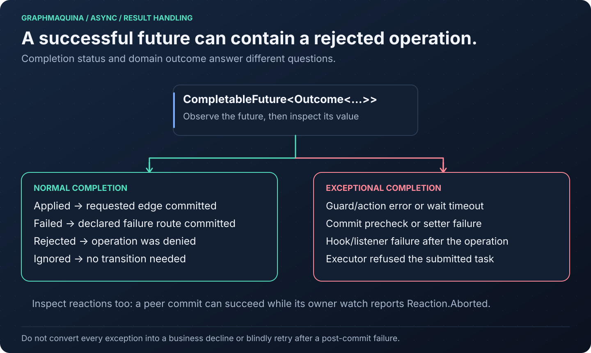

With the `tickets` and `ticket` from the example, this fragment reacts to completion without joining:

```java
CompletableFuture<Outcome<Ticket, TicketState, TicketTransition>> pending =
        tickets.async(() -> tickets.approve(ticket));

CompletableFuture<Void> handled = pending.thenAccept((Outcome<Ticket, TicketState, TicketTransition> outcome) -> {
    switch (outcome.status()) {
        case APPLIED -> System.out.println("Committed: " + outcome.requestedTransition().orElseThrow()
                + " -> " + outcome.recordedState());
        case FAILED -> System.out.println("Handled decline at " + outcome.recordedState()
                + outcome.explanation().map((String text) -> ": " + text).orElse(""));
        case REJECTED -> System.out.println("Not allowed: " + outcome.explanation().orElseThrow());
        case IGNORED -> System.out.println("Unchanged: " + outcome.recordedState());
    }
});

handled.whenComplete((Void unused, Throwable error) -> {
    if (error != null) {
        System.err.println("Operation or callback failed: " + error);
    }
});
```

Keep or return the relevant future to the caller. `join()` wraps an exceptional completion in
`CompletionException`; `get()` uses `ExecutionException` and can be interrupted. If the outer future itself
is cancelled, either method can throw `CancellationException` directly. When the call ran and failed, the cause is
that call's `CallFailedException`, or an `Error`. Read the `CallFailedException`'s `statesWritten()` and `journal()`,
as [Handle a failed call](#handle-a-failed-call) shows, before deciding whether to retry; an exceptional future is not
proof that nothing happened. A request refused before it started ran nothing: one an executor refused
(`RejectedExecutionException`), one for an identifier of another catalogue (`IllegalArgumentException`), and one made
where no call may start (`ReentrantTransitionException`, possible with an executor that runs tasks inline). A callback
you attach can also fail independently of the machine operation.

Avoid a blanket `exceptionally(error -> ActionOutcome.failed(...))` inside an action unless every covered
exception truly means a business decline. It would also turn unexpected service/programming errors into a
normal failure route. Return `ActionOutcome.failed(reason)` for known business failure and use specific
`failsOn` types when the graph is intended to handle those action exceptions.

### Deadline rules

A generated set with declared async actions or guards requires a positive default `Duration` as the first
builder argument. The runnable example uses five seconds. An optional per-machine override changes the
budget installed on that asynchronous machine:

```java
AsyncTicketMachines machines = AsyncTicketMachinesRuntime.builder(
        Duration.ofSeconds(10), new AsyncTicketActions(reviews))
        .asyncTimeout(AsyncTickets.class, Duration.ofSeconds(8))
        .build();
```

Close `machines` when its work is finished. The override is accepted only for an asynchronous machine in the
set; any other class throws `IllegalArgumentException`. A synchronous-only set such as `TicketMachines` has no
timeout builder argument, even when you use its `async(...)` method to submit a synchronous operation.

Any positive duration is accepted. One of `Duration.ofNanos(Long.MAX_VALUE)` or more means no limit, for a
machine's budget and for an action's `@Timeout` alike.

| Setting | When its clock starts | What it bounds |
| --- | --- | --- |
| Set default or per-machine `asyncTimeout` | When a root operation begins execution, after executor queueing | Pending async waits in that root and its nested cascades |
| Action `@Timeout` | After the action method returns its stage | That action's pending wait, capped by the root's remaining deadline |
| Async guard | Uses the existing root deadline | That guard's pending wait; an action's `@Timeout` does not cover its guards |
| Service/client timeout | Defined by your service client | The service request according to that client's cancellation/timeout contract |

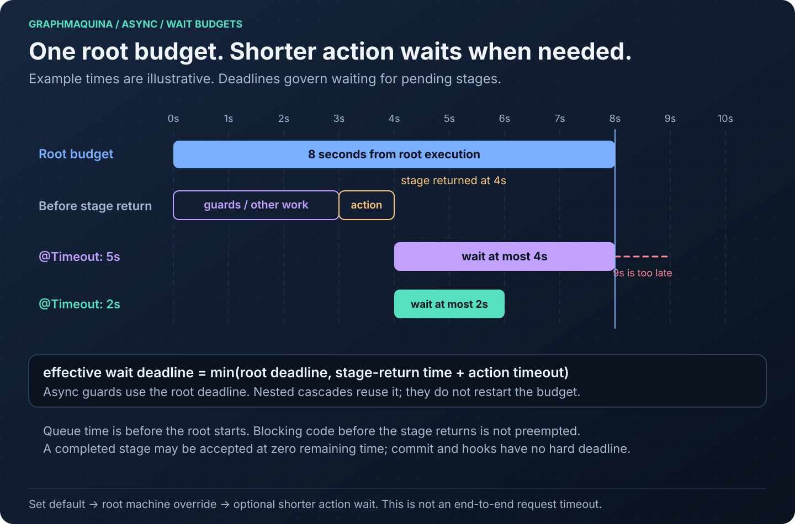

The effective action wait deadline is the earlier of the root deadline and the action-specific deadline.
If guards and other synchronous work have already consumed four seconds of an eight-second root budget, an
async action with `@Timeout(seconds = 5)` cannot get five additional seconds. The diagram illustrates this
with a stage returned at second four.

These settings are wait budgets, not a hard end-to-end execution timeout. They do not preempt synchronous
code, including blocking work inside a method that eventually returns a stage. The action-specific clock is
calculated after that return. A stage already completed when inspected can succeed even with zero remaining
wait time. There is no deadline check that interrupts setters, after-commit hooks or observers.

Cascades share the root's unit of work and deadline; entering a peer does not restart its machine-level
budget. Set defaults are installed only on machines with declared async bindings. A synchronous-only root
that cascades to an async peer therefore has no root deadline supplied just by the set default. A timeout on
the peer action can still bound its wait, but an async guard on that path has no finite root budget. Choose
the entry point and timeout configuration deliberately when mixing synchronous and asynchronous machines.

Watch reactions are different: they execute after the triggering commit and start separate root
transactions with their own deadlines. The original operation waits for synchronous watch dispatch before
returning; its root wait budget does not impose one global deadline on the entire reaction chain.

### Timeout, cancellation and late completion

On an engine wait timeout, the operation throws `TransitionAbortedException`, pending graph-state changes
are discarded, and transaction-aware context operations become invalid. Through `machine.async`, that
exception completes the operation future exceptionally. The declared `onFailure` route is not used for this
timeout. The user's stage and the underlying service request are left running.

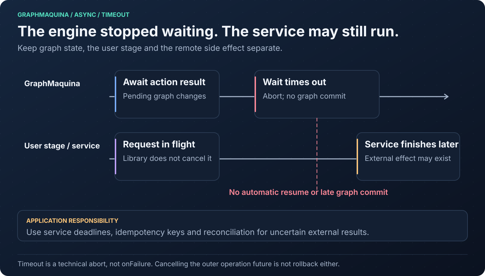

Three objects can be involved:

| What you stop or time out | Consequence |
| --- | --- |
| GraphMaquina's wait on an action or guard | Technical abort; no pending graph-state commit; the library does not cancel the user stage |
| The action's own stage is cancelled by its owner | Cancellation is treated as a technical action failure, not a handled business result |
| The outer operation future is cancelled or given a caller timeout | No cancellation link stops the running operation; do not assume it prevented commit |

In particular, `pending.cancel(true)`, `pending.orTimeout(...)` or a timed `pending.get(...)` is not a
transaction rollback API. The operation may already be running, may continue running and may commit after
the caller stops waiting. Interrupting an operation thread while it is waiting causes a technical abort,
but GraphMaquina still does not cancel the foreign stage. A `ForkJoinPool` that refuses to let its worker block
for the wait, as one does when it cannot start a spare worker in its place, causes a technical abort as well,
whose cause is that pool's `RejectedExecutionException`.

A late remote success can mean "the service processed the request, but the graph did not commit". Use a
stable request/idempotency key and a service-level deadline where needed. Reconcile uncertain remote results
before retrying an external side effect. GraphMaquina neither rolls back arbitrary field mutations made by
actions nor reverses HTTP calls, payments, messages or database writes performed outside its state setters.

### Contexts and completion callbacks

Capture the data required by the service while the action or guard is running. Prefer immutable values, as
`AsyncTicketActions` does with `String ticketId`, over passing a mutable entity or live context to a callback.

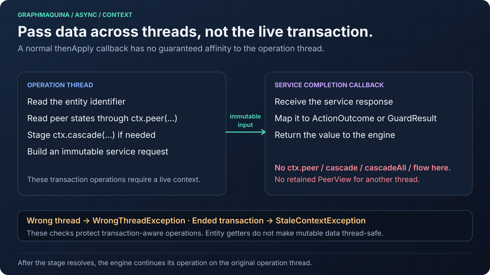

`ctx.peer(...)`, `ctx.cascade(...)`, `ctx.cascadeAll(...)` and context-derived peer views require both the
original operation thread and a live transaction. A wrong thread produces `WrongThreadException`; use after
invalidation produces `StaleContextException`. After the root commits or aborts, its transaction-aware
context is invalidated before post-commit hooks run.

Neither `thenApply` nor `thenApplyAsync` promises to run on that original operation thread. Even a callback
without the `Async` suffix may run on the service's completion thread. Do not hide a cascade in one of these
callbacks. Read peers or stage required cascades while on the operation thread; after an external result, a
separate facade invocation is a new transaction, not a continuation of the original unit of work.

The context's simple entity/from/to/depth getters do not enforce these lifetime/thread checks. That does not
make the entity immutable or safe for concurrent access. Do not mutate the state property in an action or a
late callback; GraphMaquina owns graph-state writes during commit.

Both `screen(entity, verdict)` and `machine.async(() -> machine.screen(entity, verdict))` carry the value.
Input getters are simple data accessors like entity/from/to/depth; the library neither copies nor freezes
the value. Capture immutable data for asynchronous callbacks. Peer views and cascades still require the
original execution thread and a live transaction.

### Executors and machine lifetime

Each machine uses a virtual-thread-per-task executor by default. `machine.async(supplier)` submits the whole
supplier to that executor. It does not automatically create one transaction spanning several operations
inside the supplier: each facade operation starts its own root. Use `cascade` inside an action when multiple
machines must share one graph transaction.

A set can use an application-owned executor instead. For this example, import
`java.util.concurrent.Executors` and `java.util.concurrent.ExecutorService`:

```java
try (ExecutorService operations = Executors.newVirtualThreadPerTaskExecutor();
     AsyncTicketMachines machines = AsyncTicketMachinesRuntime.builder(
             Duration.ofSeconds(5), new AsyncTicketActions(reviews))
             .asyncExecutor(operations)
             .build()) {
    Outcome<Ticket, TicketState, TicketTransition> submitted = machines.tickets()
            .async(() -> machines.tickets().submit(ticket)).join();
    System.out.println(submitted.recordedState());
}
```

The example waits before closing. The executor is closed by the application's try-with-resources statement,
not by the machine set. With the defaults, closing a set closes its owned executors and waits for their
submitted work. With a custom executor, the caller owns shutdown and must keep the machines and any service
dependencies alive until operations finish. Closing the registry is not a general cancellation barrier for
synchronous calls or work submitted through a still-running custom executor. A rejected submission yields an
exceptionally completed future.

Avoid using the same small fixed executor for operation workers and service completions scheduled by
those operations. If every worker is blocked waiting for a service stage whose completion is queued behind
those workers, the executor can be starved. Keep service execution independent or provision an execution
model that does not block the resources its completions need. A custom direct executor such as `Runnable::run`
runs inline and removes the offloading behavior shown for the default executor.

A root that runs on a `ForkJoinPool` worker, such as one submitted through
`asyncExecutor(ForkJoinPool.commonPool())`, waits for its stage without running other tasks on its thread. If
the stage's own work is a task queued on that pool, another worker has to take it: an idle one, a spare the pool
starts, or one that frees up. While every other worker is busy, or blocked where the pool cannot see it, as on a
lock or a plain latch, the wait goes on, up to its timeout. When every other worker is blocked where the pool
sees it, as in `CompletableFuture`'s `get` or `join` or in another GraphMaquina wait, the pool starts a spare, if
its size allows. Start roots off `ForkJoinPool` workers, or give asynchronous work its own executor.

Multiple virtual threads do not serialize access to a shared entity. Two concurrent operations on the same
ticket need an application-level concurrency policy. The commit precheck detects some state conflicts; it
is not a lock or a compare-and-set transaction with your database. See
[concurrency](#concurrency-identity-and-persistence).

### Test async behavior

Use controllable futures rather than timing guesses. For each case below, build a fresh set and entity,
complete the service future deliberately, then inspect both the outcome/exception and the entity state.
For the action/`approved` cases, first let `submit` succeed so the ticket begins that check in `REVIEW`;
a fresh ticket starts in `OPEN`, where no edge carries `APPROVE`.

| Case | Service behavior | Expected observation |
| --- | --- | --- |
| Async guard passes | `canStart` completes `true` | `submit` returns `Applied`; state is `REVIEW` |
| Async guard rejects | `canStart` completes `false` | `submit` returns `Rejected` with kind `GUARD`; state stays `OPEN` |
| Action succeeds | `approved` completes `true` | `approve` returns `Applied`; state is `DONE` |
| Business decline | `approved` completes `false` | `approve` returns `Failed`; state is `FAILED` |
| Declared action exception | Stage fails with `IOException` | The `DECLINE` edge commits `FAILED` |
| Unexpected action exception | Stage fails with `IllegalStateException` | Technical abort; state remains `REVIEW` |
| Pending action exceeds wait budget | Leave its stage incomplete | `TransitionAbortedException`; state remains `REVIEW`; service stage is not cancelled |
| Service finishes after wait timeout | Complete that same stage later | No late graph-state commit |
| Guard stage throws | Fail `canStart` exceptionally | Technical abort; state stays `OPEN`; action is not called |

Also cover hook failures and concurrent-entity policy in the application. The repository's
[async runtime tests](../graphmaquina-core/src/test/java/io/github/graphmaquina/runtime/AsyncTest.java) and
[context lifetime tests](../graphmaquina-core/src/test/java/io/github/graphmaquina/runtime/SingleMachineTest.java)
provide focused examples of deadline and ownership behavior.

## Build and manage machine sets

Declare one top-level set interface extending `Machines`, with one no-argument accessor per machine. The
reference set is:

```java
@StateGraphs
public interface ShopMachines extends Machines {
    Orders orders();
    Items items();
}
```

The generated builder takes the instance binding hosts used by the machines. Its signature is generated from
the set's declarations; inspect the generated method or completion when dependencies change. GraphMaquina does
not instantiate service classes or discover dependency-injection beans.

| Builder option | Purpose / default |
| --- | --- |
| `asyncTimeout(Machine.class, Duration)` | Override timeout for one asynchronous machine |
| `asyncExecutor(Executor)` | Supply the executor used by `async` calls; otherwise each machine owns a virtual-thread executor |
| `maxCascadeDepth(int)` | Bound nested cascades; default `10`, minimum `1`, root depth is `0` |
| `maxWatchChain(int)` | Bound successive watch reactions; default `10`, minimum `1` |
| `observer(MachineObserver)` | Observe every call of the set; observers add up, notified in the order given |
| `build()` | Construct the registry and facades |

Each setting is checked where it is given: a `maxCascadeDepth` or `maxWatchChain` below `1` throws
`IllegalArgumentException`. The builder is single-use: once `build()` succeeds, every method throws
`IllegalStateException`.

Close the set with try-with-resources or your application's shutdown lifecycle. `close()` closes executors
owned by the set and waits for submitted operations to finish. An executor you supply remains your
responsibility. Avoid sharing a short-lived set across requests that outlive its scope.

For dependency injection, register the generated set as an application-managed component using your existing
`OrderActions` and `ItemActions` instances, then inject its facades into services. Arrange for `close()` at
shutdown. There is no required Spring dependency or GraphMaquina-specific container integration.

## Read peers and cascade transitions

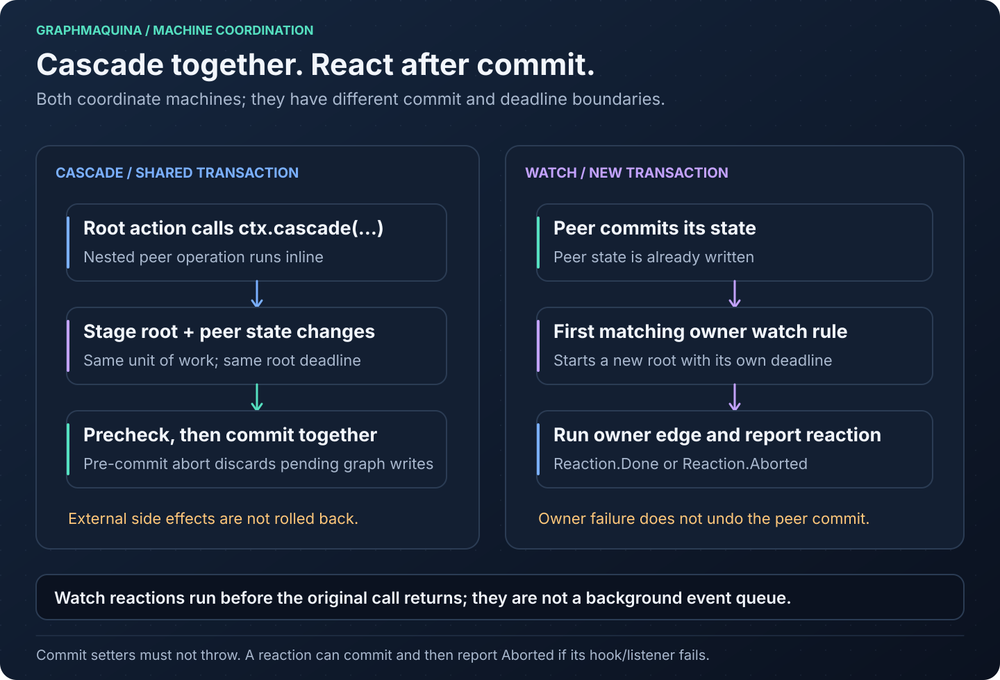

Register interacting machines in the same set. Inside a guard or action, use the peer's facade class so
Java infers its entity and enum types:

```java
@GraphGuard
public GuardResult allItemsPacked(GuardContext<Order, OrderStatus, OrderTransition> ctx) {
    return ctx.peer(Items.class).allIn(ctx.entity().items(), ItemStatus.PACKED)
            ? GuardResult.pass()
            : GuardResult.reject("there are unpacked items");
}
```

This is a method from the shop's `OrderActions`. `PeerView.stateOf(peer)` reads pending state from the current
unit of work before falling back to the entity's getter. Calling the entity getter directly during a cascade
can therefore miss an uncommitted state change.

| Peer helper | Empty collection | Nonempty collection |
| --- | --- | --- |
| `allIn(peers, state)` | `false` | Every peer must be in the state |
| `anyIn(peers, state)` | `false` | At least one peer must be in the state |
| `noneIn(peers, state)` | `true` | No peer may be in the state |

### Cascade a transition

Actions can change peers as part of their own unit of work:

```java
@GraphAction
public ActionOutcome cancel(TransitionContext<Order, OrderStatus, OrderTransition> ctx) {
    ctx.cascadeAll(Items.class, ctx.entity().items(), ItemTransition.CANCEL,
            CascadePolicy.COLLECT);
    return ActionOutcome.ok();
}
```

The cascade names `ItemTransition.CANCEL`, an identifier from the item's own catalogue, not the `CANCELLED`
state. javac refuses a constant of the order's catalogue here, and the engine resolves that identifier from
each item's current state: `PENDING` and `PACKING` both declare it, `PACKED` does not.

For one entity, use `ctx.cascade(Items.class, item, ItemTransition.CANCEL)`. Machine-key overloads also exist
for lower-level integrations.

A cascade resolves the peer's edge by identity and runs its guards and action. Its success stages a change; it
does not commit independently. The root commits after all required work succeeds. There is no convergence by
destination: a nested request on an entity that is already in flight is a cascade cycle even when it asks for
the transition that entity is running, and once the entity is no longer in flight the request is resolved
from its pending state like any other.

| Policy | Behavior |
| --- | --- |
| `FAIL_FAST` | Stop when a cascade fails. |
| `COLLECT` | Try peers under savepoints, aggregate the transition aborts of the call, then abort the whole root if any were collected. Any other failure stops it at once, and so does an element whose step a nested cascade poisoned with a failure that is no failure of the call. |

`COLLECT` is not partial commit. A nested transition that no edge carries, or that a guard rejected, is an abort rather
than an ordinary root-level `Rejected` result. A handled domain failure can select the child's declared failure route.
Any failure that leaves a cascade poisons the unit of work. A failure of the call itself, such as an abort in the peer's
step, a cycle or the depth limit, reaches your action as it is. Anything else reaches it as a
`TransitionAbortedException` that names the cascade and carries the failure as its cause: an engine exception that
describes no call, such as an unknown machine or an ambiguous identity, or a throwable other than an `Error` from a
callback the engine does not wrap, such as an identity function. An `Error` poisons through such an abort too, but
reaches your action as itself. Catching it in your action does not make the transaction safe to commit. When the action
then returns, throws a throwable its `failsOn` lists, or lets a failure of the call through, the root throws the failure
that poisoned it, commits nothing and runs no failure route. A cascade that names an unknown machine poisons too, by key
or by facade type, even over an empty collection. A refused argument poisons nothing: a null peer, a null element, which
`cascadeAll` refuses before any element runs, or an identifier from another machine's catalogue. `cascadeAll` copies its
collection once, before any element runs, and never reads it again, so elements added or removed while the cascade runs
change neither which elements run nor their order; an exception or an `Error` the collection throws while it is copied
propagates as it is and poisons nothing, even when the machine is unknown. Use `ctx.cascade` instead of calling another
facade operation from inside an action: nested facade entry points on the action's own thread violate the runtime's
reentrancy rules. A call submitted through `async(...)` runs separately on the executor's thread, unless that executor
runs tasks inline, in which case the returned future fails with the `ReentrantTransitionException`.

`@GraphPeers` is for generating watch vocabulary. A runtime peer read or cascade alone does not require an
unused watch-pair declaration.

## Watch other machines

A watch reevaluates an owner after one of its peers changes state. It declares both directions of the
relationship: owner → peer collection and peer → optional owner.

The shop has orders and items. An order watches its items while it is `PAID`, and ships when all are `PACKED`.

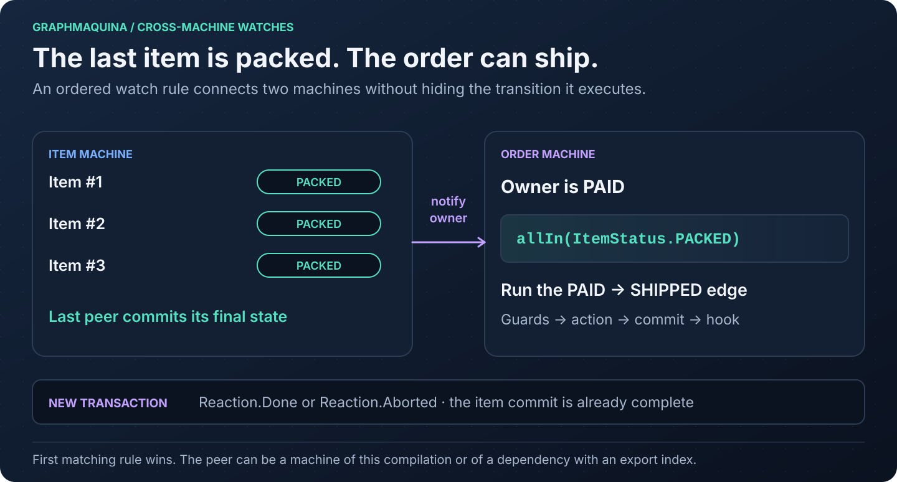

This excerpt belongs on the shop's `Orders` interface, alongside its definition, policies and operations:

```java
@GraphPeers(Items.class)
@OrdersItems.Watch(
        state = PAID,
        peers = OrderRefs.Items.class,
        owner = ItemRefs.Order.class,
        rules = @OrdersItems.When(allIn = ItemStatus.PACKED, transition = OrderTransition.SHIP))
```

`OrdersItems` is generated from the pair. `transition` is an `OrderTransition`, the owner's own catalogue;
`allIn` is an `ItemStatus`, the peer's states. Mixing those enums is a javac type error. The rule executes the
edge keyed by `(PAID, SHIP)`, including its guard, action and hook — never another edge that also reaches
`SHIPPED`. That edge must exist from the watched state, or the build fails with `SG401`.

### Ordered rules

A watch has one or more rules, and the first matching rule wins. Each rule uses exactly one of:

| Rule element | Condition |
| --- | --- |
| `allIn = ItemStatus.PACKED` | Nonempty peers, all in the given state |
| `anyIn = ItemStatus.CANCELLED` | At least one peer in the given state |
| `noneIn = ItemStatus.PACKING` | No peer in the given state; true for empty peers |
| `condition = OrderConditionsRefs.Ready.class` | A marked custom predicate |

Every rule also names the `transition` the owner executes when it holds.

Each built-in filter takes one peer state; it is not a set-membership expression. For a more complex
predicate, add a host such as this alongside the shop's classes:

```java
package io.github.graphmaquina.example.order;

import io.github.graphmaquina.annotation.GraphCondition;
import io.github.graphmaquina.api.PeerView;
import io.github.graphmaquina.example.item.Item;
import io.github.graphmaquina.example.item.ItemStatus;
import java.util.Collection;

public final class OrderConditions {
    @GraphCondition
    public boolean ready(Order owner, Collection<? extends Item> peers,
                         PeerView<Item, ItemStatus, ItemTransition> view) {
        return !peers.isEmpty() && view.allIn(peers, ItemStatus.PACKED);
    }
}
```

Replace the built-in rule with
`@OrdersItems.When(condition = OrderConditionsRefs.Ready.class, transition = OrderTransition.SHIP)`.
Regenerate and supply the new
`OrderConditions` instance to the resulting set builder. Custom conditions are synchronous predicates.

With this replacement in the reference shop, the generated builder becomes:

```java
ShopMachines shop = ShopMachinesRuntime.builder(
        Duration.ofSeconds(10), new OrderConditions(), new OrderActions(gateway, carrier), new ItemActions())
        .build();
```

Close this set as described in [machine lifecycle](#build-and-manage-machine-sets). Binding changes can change
the generated builder's parameter list and order; regenerate before updating the application's wiring.

A machine can have at most one watch per owner state. Multiple rules belong inside that watch. Declare only
pairs that are actually watched; duplicate or unused `@GraphPeers` entries are errors.

### Triggering and observing watches

After a root commit, the runtime finds watched owners from peers whose final state differs from their original state.
Intermediate hops that return a peer to its original state do not trigger dispatch. It reevaluates an owner only if it
is currently in the watched state and deduplicates owners within that dispatch. Each reaction is a new root transaction.
A reaction failure does not roll back the peer commit that triggered it.

The watch's `owner` and `peers` readers (`ownerOf` and `peersOf` in the DSL) and its conditions run while the engine
evaluates the watch, before that root starts, and may not start a transition on their own thread: `execute` or
`reevaluate` called from one of them throws `ReentrantTransitionException`; a call submitted through `async(...)` runs
as a separate call on the executor's thread, unless that executor runs tasks inline, in which case the returned future
fails with that exception as its cause. Inside a reevaluation, a refusal that one of these functions lets through ends
the reevaluation in a `TransitionAbortedException` of phase `RESOLVE` that carries it: a reaction reports the abort as
`Reaction.Aborted` and a direct `reevaluate` throws it to its caller. An owner lookup runs before the reevaluation, so
its reaction carries the refusal itself.

Changing a collection or setting a field directly does not emit a transition event. If your application
changes relationships outside a peer transition, explicitly request reevaluation where appropriate:

```java
Outcome<Order, OrderStatus, OrderTransition> outcome = shop.orders().reevaluate(order);
```

No watch produces `Outcome.Ignored` with `IgnoreReason.NO_WATCH`, and a watch whose rules all fail produces
`IgnoreReason.NO_RULE_MATCHED`. These are the only two ways an `Ignored` is produced. A matching rule can still be
rejected by the named edge's guards. Rules are not polled on a timer, and creating or paying an owner does not
automatically mean all of its existing peers changed state.

Cross-JAR watches are not supported yet. The owner and peer APIs must be generated in the same compilation.
A peer in another module or dependency JAR is rejected with `SG608`. Track the enhancement in
[issue #1](https://github.com/graphmaquina/graphmaquina/issues/1).

## Commit, hooks and observers


Observers are told that the call starts before step 1. A call that completes tells them in step 8; one that throws tells
them before the exception leaves the call.

The runtime's normal root execution follows this sequence:

1. Read the effective entity state and resolve the single edge keyed by `(state, requested identifier)`.
2. Evaluate guards and run actions, including any nested cascades, against a shared unit of work.
3. Before commit, verify that participating entities still have their expected original states.
4. Write each participating entity's final state through its setter.
5. Invalidate transition contexts and release the root reentrancy marker.
6. Run hooks for the committed hops, in log order.
7. Dispatch watch reactions for moved peers.
8. Notify the observers that the call completed, and return its outcome.

A rejected or ignored root does not commit state changes. A handled failure does commit its failure route.
External side effects performed by actions, and mutations to other entity fields, are not automatically undone
when the unit of work aborts.

### After-commit hooks

Use a `@GraphHook` when code must run after GraphMaquina has written state. The quickstart prints every
committed hop from such a hook. The shop notifies its carrier after the shipping edge commits.

Hooks run synchronously on the operation's thread. Any throwable a hook throws that is not an `Error`, checked ones
included, becomes `AfterCommitException`: the state is already committed. Its `hook()` names the hook, `hop()` the
committed hop it ran for, and `records()` every hop the call committed. An `Error` propagates unchanged instead. Either
stops the remaining normal post-commit sequence, so do not assume later hooks or watch dispatch ran; the observers are
told the call failed. Make externally visible notifications idempotent and choose durable delivery separately if your
application needs it.

A hook sees the entity's committed final state. When a cascade stages multiple hops for one entity, the setter
writes its final destination once, while hooks still follow committed hop order.

For the endpoints, identifier, kind and terminality of that particular hop, add a `CommitContext<S, T>`
parameter, as the quickstart's hook does. The original entity-only signature remains supported:

```java
import io.github.graphmaquina.api.CommitContext;

@GraphHook
public void committed(Ticket ticket, CommitContext<TicketState, TicketTransition> commit) {
    System.out.println(commit.from() + " -" + commit.transition() + "-> " + commit.to()
            + " (" + commit.kind() + ")");
    if (commit.isTerminal()) {
        System.out.println("Workflow closed: " + ticket);
    }
}
```

`kind()` is `ACTION` or `MOVE`. `isTerminal()` describes the hop's destination and comes from
`Definition.terminals` (or the DSL's `terminal(...)` declarations). There is no need for a second terminal
flag on the state enum. The context is immutable and can be retained; it has no transaction operations. In a
multi-hop cascade, `commit.to()` can differ from the entity's final state. Hooks on handled failure routes
receive the recovering edge's context.

The DSL takes the entity-only form through `afterCommit("committed", actions::committed)` and the contextual
one through `afterCommitWith("committed", (entity, commit) -> ...)`; an edge declares at most one hook. An
annotated context must use the machine's exact state and transition types. Other parameter shapes, non-void
returns and ambiguous symbols with both signatures marked are rejected.

Declare `afterCommit` on `Definition` to supply a default hook for every edge in that machine, whether it is
declared on a method or on the interface itself. An edge's explicit hook replaces the default; the two are
not composed, and there is no sentinel that switches the default off for one edge. Omitting the edge element,
or setting it to `{}`, inherits the default. `Definition.afterCommit` also accepts zero or one value;
multiple values are `SG607`.

The default applies to every committed hop, including explicit self-loops, failure routes and transitions
triggered by watches — they are all real edges. It never runs for a request with no edge, a guard rejection,
an `Ignored`, an abort or a rollback. A failure route uses its own effective hook, not the hook of the edge
that failed. Hooks still run per committed hop, so one entity can reach the default more than once in a
cascade.

### Observers

An observer sees every call of the set: each operation and each `reevaluate`, watch reactions included. A cascade
is part of the call that runs it. With the ticket set:

```java
TicketMachines machines = TicketMachinesRuntime.builder(new TicketActions())
        .observer(new MachineObserver() {
            @Override
            public void onCompleted(MachineCall call, Outcome<?, ?, ?> outcome, Duration elapsed) {
                System.out.println(call + ": " + outcome.code() + " -> " + outcome.recordedState()
                        + " in " + elapsed.toMillis() + " ms");
            }

            @Override
            public void onFailed(MachineCall call, CallFailure failure, Duration elapsed) {
                System.out.println(call + ": failed in " + failure.phase() + ", states "
                        + failure.statesWritten() + ": " + failure.error());
            }
        })
        .build();
```

Each call notifies `onStarted` once, then exactly one of `onCompleted` and `onFailed`, on the thread that runs it,
before the operation returns or throws. `MachineCall` names the machine, the entity, the requested identifier (empty for
`reevaluate`) and whether a watch reaction made the call. Its `toString()` never prints the entity, and the same
instance reaches every event of the call. A reaction starts and ends inside the call that triggered it, so events nest
like a stack on their thread. `onFailed` receives the very throwable the caller gets, with the phase the call was in and
how far it got in writing states; an `Error` is reported too, then propagates.

An observer watches without taking part. A throwable that is not an `Error` is logged as a warning through
`System.getLogger("io.github.graphmaquina")` and changes neither the call nor the other observers; an `Error`
propagates. It cannot start a transition on its own thread either: an operation called from an observer throws
`ReentrantTransitionException`, which is contained. One submitted through `async(...)` runs on the executor's thread as
a call of its own, unless that executor runs tasks inline, in which case the returned future fails with that exception
as its cause. When a failure must fail the call, write a hook, or a `Definition.afterCommit` default for every edge of a
machine. Observers run on the thread of every call, so keep them thread-safe and quick. Add as many as you need: they
are notified in the order they were added.

## Concurrency, identity and persistence

### Initialize and protect state

The entity owns its state. Initialize it in the constructor or field declaration, and persist it with your normal entity
mapping. A null root state ends the call in a `TransitionAbortedException` of phase `RESOLVE` whose cause is an
`UninitializedStateException`, and a cascaded peer's in one of phase `ACTION`; the runtime does not silently replace it
with the graph's initial state.

During a transition, only the runtime should call the state setter. It checks state again before commit to
catch action code or outside code that changed it unexpectedly. This check is not a lock: your application
must serialize conflicting operations, or provide an appropriate database locking/versioning strategy.

The runtime does not roll back a setter that already ran if a subsequent setter throws.
`CommitFailedException` reports the entities whose setter returned (`applied()`), the one whose setter threw
(`failedEntity()`), which may or may not have been written, and those never tried (`pending()`); its
`statesWritten()` is `PARTIAL`, or `NONE` when the commit stopped before its first setter: the pre-commit check
refused it, or reading the states or grouping the log by entity threw. Keep state setters simple and total for valid
states; avoid remote calls, persistence flushes and unrelated business logic inside them.

### Stable identity

An identity is scoped by the machine key, which contains the entity, state and transition types. It must be
stable, non-null and suitable for identifying one domain entity. Using two different object instances with
the same machine identity in one unit of work is an `AmbiguousIdentityException`; this prevents silently
treating two representations of one row as separate entities.

When working with an ORM, load and reuse a consistent object instance for each identity within the operation.
Identity tracking does not provide database uniqueness enforcement or cross-process coordination.

### Framework and database boundaries

Create the set once at the lifecycle scope appropriate for your application and inject its action hosts with
existing repositories and services. Retrieve entities, invoke the facade, inspect the outcome and persist using
your application's transaction boundary.

GraphMaquina's after-commit means its in-memory state commit. It does not mean a surrounding database
transaction committed. If a message must follow a durable database commit, use your persistence framework's
transaction-completion facility or a transactional outbox rather than assuming the graph hook provides that
guarantee.

Executor-based calls do not automatically propagate thread-local transactions, security contexts or ORM
sessions. Arrange those boundaries on the execution thread. Async action callbacks must not use an entity or
persistence context concurrently without the application's own coordination.

A single `Definition.afterCommit` declaration covers every committed hop of the machine:

```java
@GenerateGraphApi
@DocumentsGraph.Definition(initial = DRAFT, terminals = ARCHIVED,
        state = DocumentRefs.Status.class, id = DocumentRefs.Id.class,
        afterCommit = DocumentPersistenceRefs.Save.class)
@DocumentsGraph.StatePolicy(state = DRAFT, otherwise = "publish before archiving")
@DocumentsGraph.StatePolicy(state = PUBLISHED, otherwise = "archive next")
public interface Documents extends Machine<Document, DocumentStatus, DocumentChange> {
    @DocumentsGraph.Transition(id = DocumentChange.PUBLISH, from = DRAFT, to = PUBLISHED)
    Outcome<Document, DocumentStatus, DocumentChange> publish(Document document);

    @DocumentsGraph.Transition(id = DocumentChange.ARCHIVE, from = PUBLISHED, to = ARCHIVED)
    Outcome<Document, DocumentStatus, DocumentChange> archive(Document document);
}

public final class DocumentPersistence {
    private final java.util.function.Consumer<Document> save;

    public DocumentPersistence(java.util.function.Consumer<Document> save) {
        this.save = java.util.Objects.requireNonNull(save);
    }

    @GraphHook
    public void save(Document document) {
        save.accept(document);
    }
}
```

`Documents`, `Document`, `DocumentStatus`, `DocumentChange` and `DocumentPersistence` are public types and
belong in separate files, each with the usual annotation and API imports and `import static ...DocumentStatus.*`
for the state constants; `DocumentChange` is the enum `{ PUBLISH, ARCHIVE }`. `Document` exports `id` and
`status` the same way described under Properties and accessors.

Assemble `Documents` into a `@StateGraphs` set as the quickstart shows, and inject `DocumentPersistence` through
that set's generated builder, providing your repository's save operation. If an edge declares a replacement hook,
that hook must call the shared persistence method too when the application requires every transition to be saved.
This hook runs after GraphMaquina's in-memory commit; the application's database transaction still controls
durable commit and rollback.

## Inspect graphs and export diagrams

Every facade exposes its definition:

```java
GraphDefinition<Ticket, TicketState, TicketTransition> graph = tickets.definition();
System.out.println(graph);
System.out.println(tickets.transitionsFrom(TicketState.REVIEW));
System.out.println(graph.outgoingFrom(TicketState.REVIEW));
System.out.println(graph.findTransition(TicketState.REVIEW, TicketTransition.APPROVE));
System.out.println(graph.policy(TicketState.OPEN).reasonFor(TicketTransition.APPROVE));
```

`toString()` is a short summary of the machine's name and its counts; it never materializes pairs of states.
`transitionsFrom` returns the identifiers declared from a state, `outgoingFrom` the `TransitionSpec`s
themselves, and `findTransition` the single spec keyed by `(from, id)`, as an `Optional` that is empty when
no edge is declared. `graph()` returns the `DirectedGraph<S, T>`, which keeps parallel edges and offers
`nodes()`, `edges()`, `outgoing`, `incoming` and a `topology()` projection. `initial()`, `terminals()`,
`policy(state)`, `watch(state)` and `hasAsync()` are also available. None of these runs a guard, an action or
a hook.

To export [Graphviz DOT](https://graphviz.org/doc/info/lang.html) from an existing ticket facade:

```java
import io.github.graphmaquina.export.GraphView;
import io.github.graphmaquina.export.GraphvizExporter;

String diagram = GraphvizExporter.render(GraphView.of(tickets.definition()));
System.out.println(diagram);
```

This is a fragment: put the imports at file scope and the statements inside a method. Export does not run
transitions or evaluate guards, and there is no detail mode: the exporter draws the declared edges and
nothing else, because an edge nobody declared does not exist.

The export is deterministic DOT text with LF line endings. Each edge label begins with its identifier,
followed by the action name, `[async]`, `[if guard, …]`, `[onFailure ID]` and any watch label. Parallel edges
appear as separate arrows with different labels, and a self-loop is an arrow back to its own node. The
initial state has an incoming arrow from a point, terminal states have double outlines, and watches appear as
notes connected by dashed lines. A node's rejection policy is rendered as that node's `tooltip` — never as an
arrow, because a refusal is an answer the node gives and not a transition. State names and labels are
escaped, and every declared state remains visible even when no edge touches it.

The shop's order machine exports as:

```text
digraph "Order/OrderStatus" {
    rankdir=LR;
    initial [shape=point, label=""];
    n0 [label="NEW", shape=ellipse, tooltip="otherwise: cannot ship without payment"];
    n1 [label="PAID", shape=ellipse, tooltip="otherwise: money was charged: requires a refund"];
    n2 [label="PAYMENT_DECLINED", shape=ellipse, tooltip="otherwise: go back to NEW to retry the charge"];
    n3 [label="SHIPPED", shape=doublecircle, tooltip="otherwise: a shipment cannot be undone"];
    n4 [label="CANCELLED", shape=doublecircle, tooltip="otherwise: cancelled is final"];
    initial -> n0;
    n0 -> n1 [label="PAY pay [async] [if retryBudgetLeft] [onFailure PAYMENT_DECLINED]"];
    n0 -> n4 [label="CANCEL cancel"];
    n0 -> n2 [label="PAYMENT_DECLINED"];
    n1 -> n3 [label="SHIP ship [if allItemsPacked] [watches Item: allIn PACKED]"];
    n2 -> n0 [label="RETRY [if retryBudgetLeft]"];
    n2 -> n4 [label="CANCEL cancel"];
    watch0 [shape=note, label="watches Item"];
    n1 -> watch0 [style=dashed, arrowhead=none];
}
```

Save the result as UTF-8 in `tickets.dot`, then use an installed [Graphviz](https://graphviz.org/download/)
to render an image:

```sh
dot -Tsvg tickets.dot -o tickets.svg
dot -Tpng tickets.dot -o tickets.png
```

The Java exporter needs no external library or native executable. Image rendering is a separate step.

You can also build a definition directly through `TicketsRuntime.graph(new TicketActions())` without constructing a
running set.

Use typed assertions on `GraphDefinition` and its `TransitionSpec`s, or `GraphSnapshots` with `.graph`
resources, for structural contracts. Validate behavior through real operations, outcomes, reactions and
observed entity states. A graphical export is never an oracle for machine logic. `GraphGoldens` with `.dot`
resources checks visual output only; keep those tests separate from contract and behavior tests. The
[testing guide](testing.md#goldens-and-structural-snapshots) describes both APIs and their Gradle and
Maven update configuration.

[The illustrated ticket workflow](images/ticket-workflow.svg) summarizes the quickstart's edges. The
exporter produces its own labels from the definition. The repository keeps exact expected exports in
[the example's golden diagrams](../graphmaquina-example/src/test/resources/golden).

The illustrations in this guide are maintained separately from the Graphviz exporter. Their accessible SVG
sources and regeneration instructions are in [docs/images](images/README.md).

## Test your machines

Test through generated facades using real entities and deterministic action dependencies. The quickstart's
`App` is an executable smoke test that covers an applied edge, a guard rejection, a handled failure, a
request with no edge, a self-loop, a cycle and two parallel edges, and
[OrderFlowTest](../graphmaquina-example/src/test/java/io/github/graphmaquina/example/OrderFlowTest.java)
shows JUnit tests for payment, retries, cascades, watches and journals.

The test below reads its outcome with `graphmaquina-test`, the module that holds the typed assertions. The
[install command](#configure-gradle) already wrote it to your local Maven repository alongside the runtime,
at the same version, and [settings.gradle.kts](#settingsgradlekts) already resolves it from there. For a
Gradle application using JUnit, add:

```kotlin
dependencies {
    testImplementation(platform("org.junit:junit-bom:5.13.4"))
    testImplementation("org.junit.jupiter:junit-jupiter")
    testRuntimeOnly("org.junit.platform:junit-platform-launcher")
    testImplementation("io.github.graphmaquina:graphmaquina-test:$graphmaquinaVersion")
}

tasks.test {
    useJUnitPlatform()
}
```

Create `src/test/java/com/example/tickets/TicketsTest.java`:

```java
package com.example.tickets;

import static io.github.graphmaquina.test.GraphAssertions.assertThat;

import org.junit.jupiter.api.Test;

class TicketsTest {
    @Test
    void aDomainFailureCommitsItsDeclaredFailureState() {
        try (TicketMachines machines = TicketMachinesRuntime.builder(new TicketActions()).build()) {
            Ticket ticket = new Ticket("T-7", "Declined at intake", false);
            assertThat(machines.tickets().submit(ticket)).isFailed()
                    .hasTarget(TicketState.REVIEW)
                    .hasFailureTransition(TicketTransition.DECLINE)
                    .movedTo(TicketState.FAILED)
                    .hasEntityState(Ticket::getState, TicketState.FAILED);
        }
    }
}
```

`isFailed()` narrows the outcome and fails with the kind it actually got. `hasTarget` is where `SUBMIT` was heading,
`hasFailureTransition` is the identifier of the edge that recovered, `movedTo` is where that edge landed, and
`hasEntityState` reads the entity itself. Run `./gradlew test` in your application. The repository's
[ReadmeQuickstartTest](../graphmaquina-test/src/test/java/consumer/ReadmeQuickstartTest.java) extracts these literal
Gradle blocks and Ticket Java files, generates and compiles the main sources, runs `App`, and verifies this named JUnit
test and its result counts in an external Gradle consumer using locally staged artifacts. This verifies the local Gradle
workflow; it does not execute this JUnit sample through Maven or against released artifacts. This test consumes
generated main code; it does not declare test graphs and needs no `testAnnotationProcessor`. In Maven, add JUnit and a
compatible test runner through your application's usual test configuration, together with the test-scoped
`graphmaquina-test` dependency shown under
[typed assertions, probes and graph snapshots](#typed-assertions-probes-and-graph-snapshots); the
[install command](#configure-gradle) writes into the `~/.m2` repository Maven already reads, so it needs no repository
entry. Preserve the graph generation lifecycle for any test graphs.

### Typed assertions, probes and graph snapshots

`graphmaquina-test` is a test-scoped module that asserts over the runtime's own values — definitions, edges,
policies, outcomes, transition records, reactions and engine exceptions — and reports every unmet expectation as a
`GraphAssertionError` carrying the context, the property, the expected value and the actual one. It imposes
no test framework: nothing in its API mentions JUnit or AssertJ, so it works under the runner your project
already uses.

The [install command](#configure-gradle) writes it with the other modules, and its POM pins
`graphmaquina-core` at the same version, which is why that command installs both in one invocation. The
coordinates take the same version variable as every other module:

```kotlin
dependencies {
    testImplementation("io.github.graphmaquina:graphmaquina-test:$graphmaquinaVersion")
}
```

```xml
<dependency>
  <groupId>io.github.graphmaquina</groupId>
  <artifactId>graphmaquina-test</artifactId>
  <version>${graphmaquina.version}</version>
  <scope>test</scope>
</dependency>
```

One static import of `io.github.graphmaquina.test.GraphAssertions.assertThat` reaches the view for every
subject a test holds, and the chain keeps the entity, state and transition types of that subject:

```java
assertThat(orders.pay(order)).isApplied().movedTo(OrderStatus.PAID)
        .hasEntityState(Order::status, OrderStatus.PAID);
```

```java
assertThat(orders.definition())
        .transition(OrderStatus.NEW, OrderTransition.PAY)
        .hasTarget(OrderStatus.PAID)
        .hasFailureTransition(OrderTransition.PAYMENT_DECLINED);
```

Beyond assertions it carries scripted probes for guards, actions, hooks and the state setter, fixtures that
let a test decide when an asynchronous callback answers, a recorder of completed calls, entity-state snapshots, and
golden comparison for both the rendered diagram and the complete structure of a graph. The
[testing guide](testing.md) covers installation, what each entry point checks, what each check does not
prove, and the golden update procedure for Gradle and Maven. Every sample in it is copied from a test that
runs in this repository.

Useful behavior to cover in your own domain:

- Every action's success and handled-failure result, including the actual entity state.
- Each guard rejection, and each identifier a state refuses, with the reason its policy gives.
- Two operations that reach the same state, so neither can quietly stand in for the other.
- Every self-loop you declare: it applies, and its hook runs.
- Throwables that are mapped through `failsOn`, and those that must abort.
- Cascade rollback behavior and collected error details.
- First-match watch order, empty peer collections and aborted reactions.
- Async timeout behavior and late completions.
- Hooks that fail after state has committed.
- Declared graph contracts through typed assertions or structural snapshots.

Visual export tests may separately pin `.dot` goldens when changes to diagram output require review.

A passing runtime test does not replace compile-time graph validation. Conversely, a valid graph does not prove
that your action performs the correct domain operation.

## Generation lifecycle and IDE setup

GraphMaquina uses pre-compilation generation, because the annotations and symbols used by your source must
exist before javac can type-check that source:

```text
generate -> prepare-compile -> javac (Lombok if used, then GraphMaquina) -> complete-compile
```

The source-reading step uses `JavacTask.parse()` with annotation processing disabled; it does not type-check
the original application or require its generated annotation classes. It parses the original sources at the
compilation's release and in its source encoding, which the build adapters pass in the request, and it writes
the generated sources in that encoding too. It resolves the headers and exported members needed for
generation, then emits vocabulary plus a manifest. The processor verifies that the manifest matches the
declarations javac accepted, resolves bindings, checks the graph and emits facades. Completion publishes the
validated export index and records ownership of generated outputs.

### Generated files

| Content | Gradle | Maven |
| --- | --- | --- |
| Main vocabulary / symbols | `build/generated/sources/graphmaquina/main` | `target/generated-sources/graphmaquina` |
| Test vocabulary / symbols | `build/generated/sources/graphmaquina/test` | `target/generated-test-sources/graphmaquina` |
| Main processor-generated facades, default Java compiler location | `build/generated/sources/annotationProcessor/java/main` | `target/generated-sources/annotations` |
| Main work directory | `build/graphmaquina/main` | `target/graphmaquina/main` |
| Test work directory | `build/graphmaquina/test` | `target/graphmaquina/test` |
| Published main export index | `build/classes/java/main/META-INF/graphmaquina/exports.json` | `target/classes/META-INF/graphmaquina/exports.json` |

Work directories contain `request.json`, `annotation-manifest.json`, ownership inventories and processor
inventory. A failed generation can leave `annotation-manifest.pending.json` for ownership recovery; this is
not a manifest javac should consume.

Do not hand-edit, commit or copy these generated outputs into `src/main/java`. Preserve the export index when
packaging a producer JAR. Normal rebuilds retire owned outputs for renamed or deleted declarations without
requiring `clean`; handwritten files in output locations are not silently adopted as generated files.

Gradle adds generated vocabulary to the source set's java sources as a source directory set of its own, so
source archives and IDE imports can see it; the source set's include and exclude patterns do not filter it, and
the sources jar and javadoc of the source set leave out the compilation carrier. The plugin disables
incremental compilation on the compile task of every source set so partial javac output does not conflict with
complete ownership inventories. Gradle task up-to-date checks and configuration-cache support are separate;
unchanged builds can still skip work.

### IDE workflow

1. Import the project through its Gradle or Maven model, using the intended Java 21 JDK.
2. For a minimal machine still being written, run `./gradlew generateStateGraphApi` or `mvn generate-sources`
   to create vocabulary first. Once the flow is complete, run `./gradlew compileJava` or `mvn compile` to
   validate it and create runtime implementations.
3. Refresh the build model so generated source roots are visible.
4. After renaming graph declarations or bindings, run the normal build to regenerate references and retire old
   outputs. Fix handwritten references to the renamed symbols as required by javac.

An IDE's plain javac invocation is insufficient if it bypasses the pre-generation adapter. Delegate builds to
the configured build tool or run that lifecycle explicitly. Do not fix missing generated symbols by creating
empty source files with those names.

The automated build checks cover generated roots. Manual IntelliJ editor/navigation/rename acceptance remains
pending; see [known limitations](#known-limitations).

## Multiple modules and published JARs

A producer built through the complete lifecycle packages its accepted graph exports in
`META-INF/graphmaquina/exports.json`. A consumer can use exported symbols and include published machines in its
set without needing the producer's sources. Generated dependencies remain typed and are validated against the
producer index.

For a multi-module build:

1. Configure generation and the processor in each module that declares or consumes generated graph APIs.
2. Build the producer before the consumer and declare it as a normal dependency.
3. Package the generated classes and export index together. Avoid assembly steps that silently drop or
   overwrite `META-INF/graphmaquina` metadata.
4. Regenerate and recompile consumers after changing a producer's exported API. A stale or missing index is a
   build error.

Support for published symbols and sets does not imply support for a watch whose pair spans separate
compilations. Keep watched owner and peer declarations in the same compilation until
[issue #1](https://github.com/graphmaquina/graphmaquina/issues/1) is implemented.

## Programmatic DSL

The typed annotation API is the main application workflow. The core artifact also includes a Java DSL under
`io.github.graphmaquina.dsl`, which constructs a `GraphDefinition` at runtime. Its graph validation happens
when `build()` runs, rather than during javac. The DSL entry point is `StateGraph.define(key)`.

The following complete utility can be added to the ticket quickstart package. It creates an alternative
programmatic definition using the same entity and enums, without using its generated facade:

```java
package com.example.tickets;

import io.github.graphmaquina.api.ActionOutcome;
import io.github.graphmaquina.api.GraphDefinition;
import io.github.graphmaquina.api.MachineKey;
import io.github.graphmaquina.api.Outcome;
import io.github.graphmaquina.dsl.StateGraph;
import io.github.graphmaquina.runtime.MachineRegistry;
import io.github.graphmaquina.runtime.StateMachines;

public final class ProgrammaticTickets {
    private ProgrammaticTickets() { }

    public static Outcome<Ticket, TicketState, TicketTransition> run(Ticket ticket) {
        MachineKey<Ticket, TicketState, TicketTransition> key =
                MachineKey.of(Ticket.class, TicketState.class, TicketTransition.class);
        GraphDefinition<Ticket, TicketState, TicketTransition> graph = StateGraph.define(key)
                .initial(TicketState.OPEN)
                .terminal(TicketState.DONE)
                .terminal(TicketState.FAILED)
                .allowsCycle(TicketState.OPEN)
                .statePolicy(TicketState.OPEN, "submit the ticket first")
                .statePolicy(TicketState.REVIEW, "approve, reject or decline the ticket")
                .reject(TicketState.OPEN, TicketTransition.APPROVE, "approval requires review")
                .transition(TicketTransition.SUBMIT, TicketState.OPEN, TicketState.REVIEW)
                    .guard("hasTitle", ctx -> ctx.entity().getTitle().isBlank()
                            ? GuardResult.reject("a ticket needs a title") : GuardResult.pass())
                    .endTransition()
                .transition(TicketTransition.APPROVE, TicketState.REVIEW, TicketState.DONE)
                    .action("approve", ctx -> ctx.entity().isAccepted()
                            ? ActionOutcome.ok() : ActionOutcome.failed("approval declined"))
                    .onFailure(TicketTransition.DECLINE)
                    .endTransition()
                .transition(TicketTransition.DECLINE, TicketState.REVIEW, TicketState.FAILED)
                    .endTransition()
                .transition(TicketTransition.REJECT, TicketState.REVIEW, TicketState.OPEN)
                    .endTransition()
                .build();

        try (MachineRegistry registry = MachineRegistry.builder()
                .add(StateMachines.from(graph)
                        .state(Ticket::getState, Ticket::setState)
                        .identity(Ticket::getId))
                .build()) {
            registry.of(key).execute(ticket, TicketTransition.SUBMIT);
            return registry.of(key).execute(ticket, TicketTransition.APPROVE);
        }
    }
}
```

Add `import io.github.graphmaquina.api.GuardResult;` for the guard above. Every stage names an identifier:
`transition(id, from, to)` opens one edge and `endTransition()` closes it. `recover(kind, id)` names the recovery
for a returned failure of that kind; `onFailure(id)` names the fallback for every other returned failure and for a
throwable the edge lists in `failsOn`. Recovery identifiers resolve from the failing edge's origin.
`statePolicy` / `reject` word the answers a node gives. A state has exactly the edges
you declare. An edge left open, or one that declares more than one action, `onFailure` or `timeout`, fails
`build()` with `SG507`. An edge's stage refuses every further call with `IllegalStateException` once
`endTransition()` closed it, and once `build()` has run, even a `build()` that failed, every stage refuses
further declarations, and a second `build()`, the same way.

The DSL exposes runtime functions directly, so this alternative does not need generated action symbols. It
deliberately omits the quickstart's self-loop, auto-approval and commit hook; add them through the DSL when
that behavior is required.

Other stages support named guards, async guards, async actions, `failsOn`, `recover`, `timeout`, `afterCommit`,
`afterCommitWith`, watches and cycle allowances. A low-level `StateMachine` exposes
`execute(entity, id)`, `execute(entity, id, input)` and `async().execute(...)`; a generated application
facade intentionally presents the domain operations instead. Keep registry lifetime explicit to close owned
executors.

## Diagnostics and troubleshooting

Read the full compiler message, including the source location and member it identifies. A wrong enum type or
symbol category may be an ordinary javac error rather than an `SG` diagnostic: writing a state where an
identifier belongs, or a constant of another machine's catalogue, is refused by javac before any GraphMaquina
code runs.

### Graph and declaration diagnostics

| Code | Meaning / corrective action |
| --- | --- |
| `SG102` | Duplicate `(from, id)` key, or a state that declares two policies or rejects one identifier twice. Two edges that merely share endpoints are not a duplicate. |
| `SG103` | Missing or blank reason on a policy or a rejection. |
| `SG105` | Duplicate guard declaration: list each guard once per transition. |
| `SG106` | DSL callback has no inferable name: provide the explicit name overload for a lambda. |
| `SG107` | Blank DSL callback or condition name: supply a nonblank label. |
| `SG201` | Missing or repeated DSL initial declaration. |
| `SG202` | A terminal declares an outgoing edge, including a self-loop, or a non-terminal declares none. |
| `SG203` | Unreachable state: add a real path from initial or remove the state. |
| `SG204` | Unauthorised cycle: list an intentional cycle's state in `allowsCycle`. One witness is reported per cyclic strongly connected component, deterministically, rather than one message per elementary cycle. |
| `SG205` | Unused cycle allowance: the named state belongs to no cycle. |
| `SG301` | Invalid failure route: `onFailure` or a recovery rule names this edge's own key, or no edge with that identifier leaves the same origin. Each origin of an identifier is checked on its own. |
| `SG302` | Forbidden throwable type in `failsOn` or in a recovery rule: `Throwable`, `Exception`, `RuntimeException`, an `Error`, a library exception, a `CancellationException` or one of its subtypes, or exactly `CompletionException` or `ExecutionException`, which the runtime unwraps before matching whenever they carry a cause. In the DSL, also a class that is not a `Throwable`, which only a raw type lets through. Use a specific foreign throwable type, usually an exception, or the type of the wrapped cause. |
| `SG303` | A recovery rule names a class that is not a failure kind. A failure kind is a named final class or record that implements `FailureKind` and is not an interface, an enum, a local or anonymous class, or a `Throwable`: declare one as `public record Unavailable() implements FailureKind { }`. |
| `SG304` | Ambiguous recovery rules: two rules of one edge name the same failure kind, or one throwable type is declared twice in a rule, in two rules, or in a rule and in the edge's `failsOn`. A type that only `failsOn` repeats is accepted. |
| `SG401` | A watch rule names an identifier with no edge from the watched state. |
| `SG402` | A terminal state declares a watch. |
| `SG403` | More than one watch on the same state. |
| `SG404` | A watch has no rules. In the DSL, also a `when(...)` that no `execute(...)` follows, and an `execute(...)` with no pending `when(...)`. |
| `SG502` | Invalid machine or set declaration, such as an unsupported nested interface or incorrect base type. |
| `SG503` | Missing or incompatible public property accessor. |
| `SG504` | Invalid operation annotation or signature. An operation is `Outcome<E, S, T> operation(E)` or `operation(E, I)` and carries at least one `Transition` of its own vocabulary. Zero, three or more parameters and a wrong entity or return type are rejected; operations with input also reject varargs and method type parameters. Also refused: a `Transition` on a default, static or private method of the facade; an abstract method the facade inherits from another interface, which its companion would not implement; a method that redeclares a `Machine` method with vocabulary of its own, or with a result the companion cannot return; and an instance method of the facade, declared or inherited, abstract or default, with the signature of the companion's static `graph(...)`, which takes one parameter per class with instance members the machine binds, or none. That last refusal is reported once the machine's declarations have no other error and none of its vocabulary is misplaced, since fixing one can change what `graph(...)` takes; an error of its graph as a whole, such as `SG202`, `SG203` or `SG701`, and a refused companion name (`SG603`, or `SG602` when a previous compilation left its companion) are reported beside it. |
| `SG505` | Exported method does not uniquely fit the action, guard, hook or condition role, including the default `afterCommit` binding on `Definition`. Also an instance member of a generic host, which generated code could only call raw (export it from a non-generic subclass marked `@GraphBindings`, or make it static), and a binding whose host or parameter types the companion's package cannot access. |
| `SG507` | Invalid transition elements: empty `from`, `onFailure`, `failsOn` or recovery rules without an action, or a timeout without an asynchronous action. In the DSL, also an edge never closed with `endTransition()`, and an edge that declares more than one action, `onFailure` or `timeout`. |
| `SG508` | Watch rule must choose exactly one supported predicate alternative. |
| `SG509` | Invalid peer-machine type, a peer whose entity is a parameterized type, or a watched peer whose types the watcher's package cannot access. |
| `SG510` | Invalid set accessor, duplicate/missing machine or missing watched peer in the set. Also an accessor the set inherits from another interface, two machines that write the same entity and state enum, a machine whose types the set's package cannot access, and an instance method of the set, declared or inherited, abstract or default, with the signature of the companion's static `builder(...)`, which takes the timeout shared by the set's asynchronous machines, when it has any, then every class with instance members its machines use. That last refusal is reported only once the set's accessors and machines have no other error, since fixing one can change what `builder(...)` takes. |
| `SG511` | Invalid timeout duration: it must be positive. |
| `SG701` | A state declares no rejection policy. |
| `SG702` | One `(from, transition)` key both declares an edge and rejects the identifier. |
| `SG703` | Two annotations of one method name different identifiers, or two methods claim the same identifier. A type-level `Transition` may add branches of an identifier a method owns while their keys stay disjoint. |

### Generation and typed binding diagnostics

| Code | Meaning / corrective action |
| --- | --- |
| `SG599` | The processor could not write a generated source, provisional export index or processor inventory. Inspect the named type/path and underlying error; correct the output path, permissions, available space or reported file collision, then rerun the full generation/compilation lifecycle. See [processor output failures](typed-annotations-build.md#processor-output-failures-sg599). |
| `SG601` | Bootstrap declaration cannot be resolved, is ambiguous or contradicts another declaration. `Machine<E, S, T>` must resolve to a concrete entity type and **two distinct enums**, one for states and one for transition identifiers. Also a facade that declares type parameters, a parameterized entity type, a facade or enum the vocabulary's package cannot access, a marker whose annotation type is not on the generator's classpath, and an original source javac cannot parse at the compilation's release. |
| `SG602` | A manifest, an inventory or an export index is missing, incompatible, stale, malformed, or written in the retired schema 1. Any of these files, or the request, is malformed when it holds a number whose exponent is out of range, such as `1e99999999999`, and a manifest is also malformed when an owned source it lists is not a relative path to a file: one that no path can spell, such as one holding a NUL character, one that is absolute or has a root, one with a `..` segment, or one that names the directory itself, such as `.`. Run the full generation/compilation lifecycle with aligned versions; a build upgraded in place, or one whose manifest is malformed, needs one `clean`. Also a machine javac compiled implicitly, from the source path, which the processor never saw, reported where the index or a set names it: pass every source of the compilation to javac. A companion of a previous compilation that nothing retired is reported too: run the lifecycle, or clean. Completion reports a class output without the `SourceFile` attribute: compile with javac's default debug setting, with `-g`, or with a `-g:` list that includes `source`. The generator also refuses a source encoding that names no charset of the JVM it runs under: name one that JVM supports, such as `UTF-8`. |
| `SG603` | Generated output or export collision, a name generated code cannot write, or an output path the generator may not use. Two names normalize to the same PascalCase spelling; a generated type already exists as an original source, in the file it would overwrite or in another one, as a class of the classpath, or as a file of the generated directory the previous generation did not own; an original file or type differs from a generated one only in case where the volume does not tell names apart; an existing type takes a companion's name; a type, member type or constant in the scope of a generated file takes over a name that file writes, such as a type of its package named `io`, `java` or like a `java.lang` type; or one canonical name names two types, because a class of the unnamed package is named like a package: two machines, one of the package and one nested in the class, which a manifest names by that name alone, or two types in a class file of the unnamed package that the generator has to tell apart, such as two of its supertypes, which it cannot do by their canonical name. The diagnostic names both sides; rename one of them and its references. The generator's steps also refuse an inventory entry that is not a file under its output root, such as a blank one, one that no path can spell, as with a NUL character, or one that is absolute, has a root, names the root itself or leads out of it; an inventory entry whose file they would remove through a symbolic link inside its output root that leads out of it; and a generated source that would be written through such a link. Remove the link; clean a build whose inventory holds such an entry. |
| `SG604` | Invalid or contradictory export/role, or a host its generated references container cannot access, such as a private nested class. Check markers and exported signatures. |
| `SG605` | Symbol has no valid original member, or belongs to the wrong host/role. Use the correct generated reference. |
| `SG606` | Graph or watch vocabulary belongs to another machine or pair, or sits where no machine reads it: on anything but a `@GenerateGraphApi` interface and its abstract operations. On a default, static or private method of its own facade it is `SG504`. |
| `SG607` | Too many values in an optional singleton element such as `action`, `onFailure`, `timeout`, `afterCommit` or `When.condition`. |
| `SG608` | Invalid, duplicated or unused peer, a watched peer outside this compilation, or a peer whose types the owner's package cannot name. |
| `SG609` | A retired 1.x graph annotation is still on the class path and still used. Replace it as [migrating to 2.0](migration-2.0.md) describes. |

### Runtime exceptions

| Exception | What to investigate |
| --- | --- |
| `UninitializedStateException` | Entity state was null. Initialize or correctly hydrate it before calling the machine. A null root state arrives as the cause of an abort in `RESOLVE`; a peer's, reached by a cascade, as the cause of an abort in `ACTION`. |
| `TransitionAbortedException` | A technical failure aborted execution; inspect cause, path and action journal. Its `from()`, `transition()` and `to()` are `Optional`. An abort raised before the entity's state was read, because its identity or its state could not be read, reports no state and no destination. One raised before any edge was resolved reports no destination, and one raised before any identifier was read, such as a watch chain over its limit, reports neither identifier nor destination. Its `phase()` is `RESOLVE`, `GUARD` or `ACTION`, and its `statesWritten()` is `NONE`. |
| `UnhandledFailureException` | An action failed, no recovery rule took the failure, and its edge has no `onFailure` route. |
| `CascadeException` | Collected nested transition errors; inspect `errors()` and the journal. |
| `CascadeCycleException` | A nested request reached an entity that is already in flight. It reports the in-flight and requested identifiers. |
| `CascadeDepthExceededException` | Nested work exceeded the configured cascade depth. |
| `WatchChainExceededException` | A watch chain exceeded its limit; inspect reaction cycles. |
| `AmbiguousIdentityException` | Different instances represented one machine identity in the same unit of work. Raised by an action's cascade, it arrives as the cause of that call's abort. |
| `ReentrantTransitionException` | A guard, an action, a state accessor, an identity function, or a watch's owner lookup, peer lookup or condition, or an observer, called `execute` or `reevaluate`. An action moves peers through `ctx.cascade(...)`; hooks may start transitions; observers and the other callbacks may not on their own thread. Inside a call it arrives as the cause of the call's failure: an abort when a guard, an action, a state getter, an identity function, or a reevaluation's peers reader or condition throws it, and a `CommitFailedException` when a setter, or the getter during the commit's check, does. An owner lookup's is what its `Reaction.Aborted` carries, and an observer's is contained. |
| `PoisonedUnitOfWorkException` | A context's `peer`, `cascade` or `cascadeAll` was called after a failed cascade poisoned the transaction; `original()` is that failure. The caller receives that failure, never this exception. |
| `StaleContextException` | A context or context-derived view was used after invalidation. Used by a guard or an action of another call, it arrives as the cause of that call's abort. |
| `java.lang.WrongThreadException` | Context peer/cascade access or a derived peer view was used from another thread; it can appear as the cause of an abort. |
| `UnknownFacadeException` / `UnknownPeerMachineException` | The requested peer was not registered in the set/registry. Thrown by a guard or an action, it arrives as the cause of that call's abort. |
| `CommitFailedException` | Phase `COMMIT`: the commit stopped before its first setter, because the pre-commit check failed or reading the states or grouping the log by entity threw (`NONE` written), or a setter threw (`PARTIAL`); inspect `applied()`, `failedEntity()` and `pending()` before retrying. |
| `AfterCommitException` | A hook threw: phase `HOOK`, every state written; `hop()` and `records()` say what. |
| `InvalidGraphException` | Programmatic DSL definition failed validation; inspect its problem list. |

A refused request is not an exception. `Rejected` with `RejectionKind.NO_TRANSITION` is the ordinary answer
when no edge carries the requested identifier from the entity's current state. These are not HTTP status
codes either: map rejected transitions, business failures and technical failures to your application's own
API contract.

### Common build problems

| Symptom | Remedy |
| --- | --- |
| `TicketsGraph` / `TicketRefs` cannot be found | Run generation before javac; check processor participation and original source roots. |
| A graph annotation from a 1.x declaration cannot be resolved | The retired vocabulary was removed in 2.0, not deprecated. [Migrating to 2.0](migration-2.0.md) names the replacement for each one. |
| `SG602` on the first build after upgrading | The work directory still holds schema 1 artefacts. Run `clean` once, or delete the build directory. |
| Gradle plugin cannot resolve | Declare the repository that holds it in `pluginManagement.repositories`: `mavenLocal()` for a version you installed from a checkout, `mavenCentral()` for a published one. |
| Core resolves but Maven plugin does not | Configure `<pluginRepositories>` as well as `<repositories>` for an internal repository. |
| Processor reports no manifest | Use the Gradle plugin or add Maven's per-execution manifest arguments and six goals. |
| A Lombok accessor is missing | Put Lombok first on the processor path, or provide a public handwritten accessor. |
| A newly renamed symbol still appears | Run the normal lifecycle, check whether generation succeeded, and inspect the original declaration and ownership diagnostics. |
| Generation task skips | That source set does not declare `graphmaquina-processor` on its annotation-processor configuration. |
| Async graph cannot be built | Supply a positive default timeout through the generated set builder. |
| Watch never triggers | Check relationship accessors, owner state, first-match rules, the named edge's guards and whether a peer transition actually committed. |
| Strict lint reports unclaimed third-party annotations | Inspect the application's processor setup. GraphMaquina claims its own declarations; it is not a wildcard processor for Spring, Jakarta or test annotations. It does not claim `javax.annotation.processing.Generated` either, so another tool's `@Generated` that no processor claims gets javac's own `-Xlint:processing` warning that no processor claimed it, which `-Werror` turns into an error. GraphMaquina's companions carry its own `@GeneratedCompanion` instead. |
| Strict lint reports, in generated code, an auxiliary class accessed from outside its own source file | A host, or the class it is nested in, is declared in a source file named after another type, and generated code, such as the host's references container, names it from another file. javac's `auxiliaryclass` lint, which `-Xlint:all` turns on, warns about that, and `-Werror` turns the warning into an error. Give that class a file of its own, or turn the lint off with `-Xlint:-auxiliaryclass`. |

For a reproducible issue, include JDK/build-tool versions, relevant build configuration, the minimal graph and
binding declarations, the full diagnostic and whether the problem occurs on a clean build. Report issues at
[GitHub Issues](https://github.com/graphmaquina/graphmaquina/issues).

## Known limitations

| Area | Current status |
| --- | --- |
| Upgrade from 1.x | Deliberately incompatible. There is no alias of the retired API, no compatibility mode and no conversion of stored snapshots; [migrating to 2.0](migration-2.0.md) maps every contract. |
| Watches between JARs/modules | Unsupported: both machines must be generated in one compilation. External peers fail with `SG608`; [issue #1](https://github.com/graphmaquina/graphmaquina/issues/1). |
| State hierarchy and parallel regions | Not modelled. A machine is one flat graph of states with identified edges; there are no nested or orthogonal regions. |
| Event scheduling and automatic path execution | Absent. Each operation resolves and executes one edge; nothing walks a path or fires on a timer. |
| Unauthorised-cycle reporting | One witness per cyclic strongly connected component, not one message per elementary cycle. `Graph.cycles()` itself is unchanged. |
| IDE acceptance | Generated-root build integration is automated; manual IntelliJ navigation, editor completion and rename/regeneration checks remain pending. |
| External payments demo | Its strict-lint acceptance is still partial; it is outside this repository's library test totals. |
| Durability and concurrent access | Application responsibilities; there is no automatic DB transaction, durable watch queue or entity lock. |
| Async timeout | Stops waiting; does not terminate synchronous code or cancel a user's running stage. |
| Preview language features | The generator parses the original sources without `--enable-preview`, whatever javac is given: a source using a preview feature that javac's parser checks is refused with `SG601`. See the [build guide](typed-annotations-build.md#limits). |
| Public compatibility matrix | Java 21 is the baseline; no claim of verification across all newer JDKs or Gradle versions. |

## Build, verify and release this repository

These commands run from the GraphMaquina checkout, not the ticket application's directory:

```bash
./gradlew --no-daemon build
./gradlew :graphmaquina-core:publishMavenPublicationToAdapterTestsRepository \
          :graphmaquina-codegen:publishMavenPublicationToAdapterTestsRepository \
          :graphmaquina-processor:publishMavenPublicationToAdapterTestsRepository
./gradlew --no-daemon test :graphmaquina-gradle-plugin:test
./gradlew --no-daemon :graphmaquina-test:publishedArtifactTest --offline
./gradlew :graphmaquina-example:test
./gradlew :graphmaquina-codegen:test :graphmaquina-processor:test
./gradlew :graphmaquina-maven-plugin:test
```

Stage the sibling artifacts before running the Gradle adapter's TestKit suite, especially in a fresh checkout
or after changing versions. This uses a file repository under `build/adapter-test-repository`.
The combined `test` command explicitly includes that suite. Its plugin is a separate included
build, while the Maven adapter's integration suite drives actual Maven builds. Have `mvn` available to run it.
The example applies the included plugin and uses the sibling generator project.

`./gradlew test` runs the ordinary suites for core, processor, codegen, example, Maven adapter and testing
support. In `graphmaquina-test`, it excludes `PublishedArtifactSmokeTest`, `ReadmeQuickstartTest` and
`GraphOnlySurfaceTest`. `./gradlew build` reaches all three through `check` →
`:graphmaquina-test:publishedArtifactTest`, which stages core, testing support, generator, processor, Maven
plugin, Gradle plugin and its marker into the local file repository.
The published-artifact task also runs independently with the command above. Its external README consumer
resolves dependencies offline, so third-party dependencies must already be cached.

The included Gradle adapter's suite requires the explicit `:graphmaquina-gradle-plugin:test` command;
`build` does not run it. Ordinary test reports are under each module's `build/reports/tests/test`, and the
artifact smoke reports are under `graphmaquina-test/build/reports/tests/publishedArtifactTest`.

### Release to Maven Central

Releasing is a maintainer operation. The version comes from git tags, so a release creates a tag and edits no
file. The next release is `2.0.0`, not another `1.0.x` patch: the graph-only contract is incompatible with
1.x, so every module moves to that version together. A published version can never be replaced or deleted.

To build and check a bundle without publishing it, configure `SIGNING_KEY` with the project's ASCII-armored
private release key and `SIGNING_PASSWORD` with its passphrase, then run:

```bash
./gradlew --no-daemon centralBundle
```

Without `-PgraphmaquinaVersion`, that stages the most recent tag's version, which is already published; pass
the flag to stage a different one. Maintainers using 1Password CLI can inject both secrets for this command
without copying them into the checkout or shell history. Replace `<vault>` and `<item>` with the vault and
signing item's names or IDs; the item must have a `Private PGP key` field containing the armored secret key
and a `password` field. 1Password shows that field under two names, the id `private_key` and the label
`Private PGP key`; they are one field, and these examples address it by its label:

```bash
SIGNING_KEY='op://<vault>/<item>/Private PGP key' \
SIGNING_PASSWORD='op://<vault>/<item>/password' \
op run -- ./gradlew --no-daemon --no-configuration-cache centralBundle
```

The `op://` values are references, not credentials. `op run` resolves them into the child process's
environment and masks secrets in its output. Keep the private key, passphrase and revocation certificate
in the vault. Only distribute the public key. See [release signing](release-signing.md) for the
public fingerprint, key retrieval and verification commands.

The task stages six binary publications and the Gradle plugin marker, validates required artifacts and POM
metadata, checks signature files and checksums, then produces:

```text
build/graphmaquina-central-bundle.zip
```

Central staging requires the signing key. The task itself uploads nothing: the release script does that, or a
maintainer can upload the ZIP through Central Portal with the authorized namespace and release credentials.
Portal validation and public availability remain separate steps. The local structural validator does not
replace cryptographic signature verification or Portal checks.

Do not publish a bundle signed with a temporary test key. See the
[release preparation reference](typed-annotations-build.md#preparing-a-central-release) for details.

## Further reference

| Reference | What to use it for |
| --- | --- |
| [Migrating to 2.0](migration-2.0.md) | Every retired 1.x contract and its replacement, with before/after examples |
| [Testing guide](testing.md) | Typed assertions, probes, goldens and structural snapshots |
| [Build integration guide](typed-annotations-build.md) | Adapter lifecycle, toolchain checks, paths and repository configuration |
| [Shop source](../graphmaquina-example/src/main/java/io/github/graphmaquina/example) | Complete two-machine domain with async payment, guards, cascades and watches |
| [Shop tests](../graphmaquina-example/src/test/java/io/github/graphmaquina/example) | Executable behavior and expected diagrams |
| [Public API source](../graphmaquina-core/src/main/java/io/github/graphmaquina/api) | Exact signatures and outcome types |
| [Programmatic DSL source](../graphmaquina-core/src/main/java/io/github/graphmaquina/dsl) | Lower-level builder stages |

## License

GraphMaquina is licensed under Apache License 2.0. See [LICENSE](../LICENSE) and [NOTICE](../NOTICE).

The code emitted into a consuming project by this project's generator and annotation processor belongs to
that project. The repository's license notice states that its license does not extend to that generated output.
