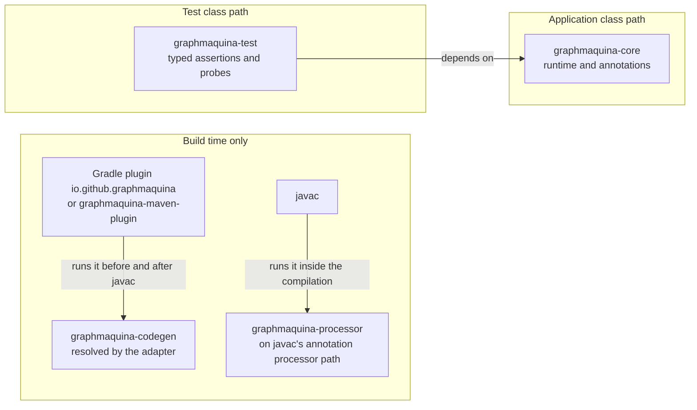

# Install and configure the build

GraphMaquina needs three things from a build: `graphmaquina-core` on the application's class path, the
GraphMaquina adapter for Gradle or Maven, which runs the generator before javac, and the annotation processor on
javac's processor path, which you declare. This page configures Gradle and Maven to resolve the latest GraphMaquina
version from Maven Central.



## Contents

- [Configure Gradle](#configure-gradle)
- [Configure Maven](#configure-maven)
- [Multiple modules and published JARs](#multiple-modules-and-published-jars)

## Configure Gradle

The following files build and run the [ticket quickstart](quickstart.md). Create a separate application
directory, `tickets-demo`, and put these files at its root.

### gradle.properties

```properties
graphmaquinaVersion=x.y.z
```

Replace `x.y.z` with the latest GraphMaquina version, the one
[Maven Central](https://central.sonatype.com/artifact/io.github.graphmaquina/graphmaquina-core) lists. The two scripts below read the
version from here, so no coordinate repeats it.

### settings.gradle.kts

```kotlin
pluginManagement {
    repositories {
        mavenCentral()
        gradlePluginPortal()
    }
    plugins {
        id("io.github.graphmaquina") version providers.gradleProperty("graphmaquinaVersion").get()
    }
}

dependencyResolutionManagement {
    repositories {
        mavenCentral()
    }
}

rootProject.name = "tickets-demo"
```

A `plugins` block in a build script cannot interpolate a version, so the plugin request carries it here and
the build script applies the plugin by ID alone. The plugin resolves through its plugin marker, which every
release publishes with the plugin, and the generator through the plugin, which defaults to the generator of its own
version. `gradlePluginPortal()` is there for other plugins only.

### build.gradle.kts

```kotlin
plugins {
    java
    application
    id("io.github.graphmaquina")
}

group = "com.example"
version = "1.0.0"

java {
    toolchain {
        languageVersion = JavaLanguageVersion.of(21)
    }
}

val graphmaquinaVersion: String = providers.gradleProperty("graphmaquinaVersion").get()

dependencies {
    implementation("io.github.graphmaquina:graphmaquina-core:$graphmaquinaVersion")
    annotationProcessor("io.github.graphmaquina:graphmaquina-processor:$graphmaquinaVersion")
}

application {
    mainClass = "com.example.tickets.App"
}

tasks.withType<JavaCompile>().configureEach {
    options.release = 21
    options.compilerArgs.addAll(listOf("-Xlint:all,-serial", "-Werror"))
}
```

The GraphMaquina plugin reacts to the Java plugin; it does not apply Java itself. The `application` plugin is
used here only to provide `run` and a distribution containing runtime dependencies.

From the application directory, use an installed Gradle to create a wrapper at 9.2.1, the Gradle version
this repository verifies, then build and run:

```bash
gradle wrapper --gradle-version 9.2.1
./gradlew clean run
./gradlew build
./gradlew installDist
```

### Add Lombok when you need it

Add these dependency declarations before the GraphMaquina processor declaration:

```kotlin
compileOnly("org.projectlombok:lombok:1.18.48")
annotationProcessor("org.projectlombok:lombok:1.18.48")
annotationProcessor("io.github.graphmaquina:graphmaquina-processor:$graphmaquinaVersion")
```

Do not duplicate the GraphMaquina entry already present in the build. Lombok supplies accessors; it does not
replace GraphMaquina's generator or annotation processor.

### Source sets and generator selection

Generation participates in a source set only when that source set declares the GraphMaquina processor, as a module
or project dependency of its annotation-processor configuration or of one that configuration extends; a file
dependency on the processor's jar does not count. Main uses `annotationProcessor`; test uses
`testAnnotationProcessor`. Tests that only call already generated main
facades normally do not need their own processor.

For graph declarations under `src/test/java`, add to the same `dependencies` block:

```kotlin
testAnnotationProcessor("io.github.graphmaquina:graphmaquina-processor:$graphmaquinaVersion")
```

The build script above compiles every source set under `-Xlint:all` and `-Werror`. The processor claims only
GraphMaquina's own annotations, so in a test source set that declares it, javac warns that no processor claimed
JUnit's `@Test`, and that warning fails `compileTestJava`. Turn javac's `processing` lint off there:

```kotlin
tasks.compileTestJava {
    options.compilerArgs.add("-Xlint:-processing")
}
```

If test entities use Lombok, add its test compile-only and annotation-processor dependencies, preserving order.

| Task | Purpose |
| --- | --- |
| `generateStateGraphApi` | Generate the main source set vocabulary |
| `generateTestStateGraphApi` | Generate test vocabulary if test participates |
| `generate<SourceSet>StateGraphApi` | Generate vocabulary for a custom source set |
| `compileJava` / `compileTestJava` | Run generation and the verified compilation lifecycle for participating scopes |

The plugin resolves the generator version matching its own version. Advanced overrides use:

```kotlin
graphmaquina {
    generatorVersion.set("x.y.z")  // defaults to the plugin's own version
}
```

An explicit dependency on `graphmaquinaGenerator` replaces the default dependency. The repository example uses
this to run the sibling codegen project. Use matching versions for every GraphMaquina artifact: the processor
refuses a manifest that a generator of another version wrote, with `SG602`.

## Configure Maven

This is a complete alternative build for the same ticket source files. Save it as `pom.xml` in
`tickets-demo`. It includes all six lifecycle executions and distinct main/test manifest arguments. Every
GraphMaquina artifact comes from the single version the `graphmaquina.version` property sets: replace `x.y.z`
with the latest GraphMaquina version. Maven resolves every artifact from Maven Central with no repository
declaration in this POM. For an internal repository, configure both dependency and plugin
repositories as shown in [the build guide](typed-annotations-build.md#where-the-artifacts-come-from).

### pom.xml

```xml
<?xml version="1.0" encoding="UTF-8"?>
<project xmlns="http://maven.apache.org/POM/4.0.0"
         xmlns:xsi="http://www.w3.org/2001/XMLSchema-instance"
         xsi:schemaLocation="http://maven.apache.org/POM/4.0.0
                             https://maven.apache.org/xsd/maven-4.0.0.xsd">
  <modelVersion>4.0.0</modelVersion>
  <groupId>com.example</groupId>
  <artifactId>tickets-demo</artifactId>
  <version>1.0.0</version>

  <properties>
    <project.build.sourceEncoding>UTF-8</project.build.sourceEncoding>
    <maven.compiler.release>21</maven.compiler.release>
    <graphmaquina.version>x.y.z</graphmaquina.version>
  </properties>

  <dependencies>
    <dependency>
      <groupId>io.github.graphmaquina</groupId>
      <artifactId>graphmaquina-core</artifactId>
      <version>${graphmaquina.version}</version>
    </dependency>
  </dependencies>

  <build>
    <plugins>
      <plugin>
        <groupId>org.apache.maven.plugins</groupId>
        <artifactId>maven-compiler-plugin</artifactId>
        <version>3.15.0</version>
        <configuration>
          <release>${maven.compiler.release}</release>
          <annotationProcessorPaths>
            <path>
              <groupId>io.github.graphmaquina</groupId>
              <artifactId>graphmaquina-processor</artifactId>
              <version>${graphmaquina.version}</version>
            </path>
          </annotationProcessorPaths>
        </configuration>
        <executions>
          <execution>
            <id>default-compile</id>
            <configuration>
              <compilerArgs>
                <arg>-Agraphmaquina.annotationManifest=${project.build.directory}/graphmaquina/main/annotation-manifest.json</arg>
                <arg>-Xlint:all,-serial</arg>
                <arg>-Werror</arg>
              </compilerArgs>
            </configuration>
          </execution>
          <execution>
            <id>default-testCompile</id>
            <configuration>
              <compilerArgs>
                <arg>-Agraphmaquina.annotationManifest=${project.build.directory}/graphmaquina/test/annotation-manifest.json</arg>
                <arg>-Xlint:all,-serial,-processing</arg>
                <arg>-Werror</arg>
              </compilerArgs>
            </configuration>
          </execution>
        </executions>
      </plugin>
      <plugin>
        <groupId>io.github.graphmaquina</groupId>
        <artifactId>graphmaquina-maven-plugin</artifactId>
        <version>${graphmaquina.version}</version>
        <executions>
          <execution>
            <id>graphmaquina-generate</id>
            <phase>generate-sources</phase>
            <goals><goal>generate</goal></goals>
          </execution>
          <execution>
            <id>graphmaquina-prepare</id>
            <phase>process-sources</phase>
            <goals><goal>prepare</goal></goals>
          </execution>
          <execution>
            <id>graphmaquina-complete</id>
            <phase>compile</phase>
            <goals><goal>complete</goal></goals>
          </execution>
          <execution>
            <id>graphmaquina-generate-test</id>
            <phase>generate-test-sources</phase>
            <goals><goal>generate-test</goal></goals>
          </execution>
          <execution>
            <id>graphmaquina-prepare-test</id>
            <phase>process-test-sources</phase>
            <goals><goal>prepare-test</goal></goals>
          </execution>
          <execution>
            <id>graphmaquina-complete-test</id>
            <phase>test-compile</phase>
            <goals><goal>complete-test</goal></goals>
          </execution>
        </executions>
      </plugin>
    </plugins>
  </build>
</project>
```

The test compilation turns javac's `processing` lint off. `<annotationProcessorPaths>` applies to both
compilations, so the GraphMaquina processor runs over the test sources too, and it claims only GraphMaquina's own
annotations: under `-Xlint:all`, javac warns that no processor claimed JUnit's `@Test`, and `-Werror` fails the
test compilation as soon as it holds a test. The main compilation keeps the lint, since the processor claims every
annotation the ticket's main sources carry; turn it off there too once they carry annotations no processor claims,
such as Spring's or Jakarta's.

Run from the application directory:

```bash
mvn --version
mvn clean verify
```

To run the quickstart after Maven has resolved the library and compiled the application, let Maven write the
dependency classpath and put the compiled classes in front of it:

```bash
mvn -q dependency:build-classpath -Dmdep.outputFile=target/classpath.txt
java -cp "target/classes:$(cat target/classpath.txt)" com.example.tickets.App
```

The generated file holds absolute paths into your local repository, wherever that is; on Windows, use `;` as
the Java classpath separator.

For Lombok, add `org.projectlombok:lombok:1.18.48` as a `provided` dependency and place its `<path>` before the
GraphMaquina processor's `<path>`. Unlike a Spring Boot parent, this standalone POM does not supply dependency
versions implicitly.

### Maven lifecycle and constraints

| Goal | Phase | Responsibility |
| --- | --- | --- |
| `generate` | `generate-sources` | Generate vocabulary and add the main generated source root |
| `prepare` | `process-sources` | Retire previous owned compilation outputs |
| `complete` | `compile`, after javac | Publish accepted exports and seal ownership |
| `generate-test` | `generate-test-sources` | Generate test vocabulary |
| `prepare-test` | `process-test-sources` | Prepare test compilation |
| `complete-test` | `test-compile`, after test javac | Publish test exports and seal ownership |

Merely declaring the plugin does not activate these goals. Use the executions above. Invoking
`compiler:compile` directly skips the required preceding lifecycle; use `mvn compile`, `mvn test-compile` or
`mvn verify` instead.

The adapter validates the effective Java release, processor path, manifest paths and JDK alignment. It rejects
`-proc:none` or `-proc:only` as the last `-proc:` option javac gets, whether from `proc` or from a compiler
argument, `failOnError=false`, `useIncrementalCompilation=false`, missing processor configuration, a
`-processor` list or `<annotationProcessors>` that leaves out
`io.github.graphmaquina.processor.StateGraphProcessor` or holds a name that is not a valid qualified class name,
a processor path compiler argument that does not reach the processor, unless it still holds a `${` once the check
evaluates it, a `--processor-module-path`, a processor that is only a dependency when javac 23 or later is not asked
to process, debug settings that leave out the `SourceFile` attribute, classes or processor sources sent elsewhere
than the project keeps them, as `<outputDirectory>`, `<multiReleaseOutput>`, `-d` or `-s` can,
`<compileSourceRoots>` without the generated directory, divergent main/test manifests, compiler includes or
excludes, incremental excludes included, that leave out the compilation carrier the generator emits, and includes
that hold only empty values. It checks the execution of the compiler's `compile` or `testCompile` goal that the
default lifecycle runs and that compiles the generated vocabulary, whatever its id, so a build may bind
`default-compile` to the phase `none` and compile through an execution of its own, as `kotlin-maven-plugin` asks a
mixed Kotlin and Java build to do; declare `maven-compiler-plugin` before this plugin then, since an execution of
its own runs in declaration order within its phase, and the opposite order, which would run `complete` before that
javac, is refused. Two running executions that both compile the vocabulary are refused. A compilation the build
switches off is skipped instead: `maven.main.skip` or `<skipMain>` makes the three main goals log that and do
nothing, `maven.test.skip` or `<skip>` the three test goals, a compilation the default lifecycle runs no execution
of the compiler's goal for, as when that goal is bound only to `none` or to phases of other lifecycles, is skipped
the same way, and a project packaged as `pom` skips all six. Run the normal lifecycle when generating graphs.

| Optional property | Meaning |
| --- | --- |
| `graphmaquina.javaExecutable` | Explicit `java` executable for generation, found as a process start finds it: a bare name on the `PATH`, any other relative path against the project directory; unset, the goal uses the `java` of the `jdk` toolchain selected for the build, else that of the JVM running Maven. It must belong to a JDK 21 or later, the one javac compiles with: the two are compared by JDK home after symbolic links are followed, so a wrapper launcher outside that JDK's `bin` directory is refused. On Windows, a name without an extension that names no file stands for the `.exe` beside it |
| `graphmaquina.compilationId` | Override compilation identity. Unset, it is `groupId:artifactId:main` and `groupId:artifactId:test`; set through the property, it applies to both compilations, so give each execution its own `<compilationId>` instead when they need distinct values |

See the [Maven adapter reference](build-maven.md) for toolchains and custom compiler paths.

## Multiple modules and published JARs

A producer built through the complete lifecycle packages its accepted graph exports in
`META-INF/graphmaquina/exports.json`. A consumer can use exported symbols and include published machines in its
set without needing the producer's sources. Generated dependencies remain typed and are validated against the
producer index.

For a multi-module build:

1. Configure generation and the processor in each module that declares or consumes generated graph APIs.
2. Build the producer before the consumer and declare it as a normal dependency.
3. Package the generated classes and export index together. Avoid assembly steps that silently drop or
   overwrite `META-INF/graphmaquina` metadata.
4. Regenerate and recompile consumers after changing a producer's exported API. A stale or missing index is a
   build error: one that is missing, or that does not list a machine or a symbol the classes beside it carry, is
   reported as `SG602`, naming the jar or directory of classes that carries it. The generator reports it where a
   machine declares that machine a peer with `@GraphPeers`, before it publishes anything; otherwise it is reported
   where a set holds that machine or a declaration binds that symbol. Build producers and consumers with the same
   GraphMaquina version: an index that another version wrote is refused with `SG602` too, and so is a machine that
   the indexes of two jars or directories on the classpath both describe, as two versions of one producer do: the
   error names both entries, and keeping one artifact of that producer on the classpath fixes it.

A consumer can also bind a machine of a dependency as the sub-machine of one of its own states, declaring it with
`@GraphPeers` like any child. The pair vocabulary is generated from what the dependency's export index says of that
machine, so its artifact must carry the index its build published, and the consumer's `@StateGraphs` set must hold
both machines.

---

Next: [Quickstart: a complete ticket machine](quickstart.md). Back to the [documentation index](README.md).
