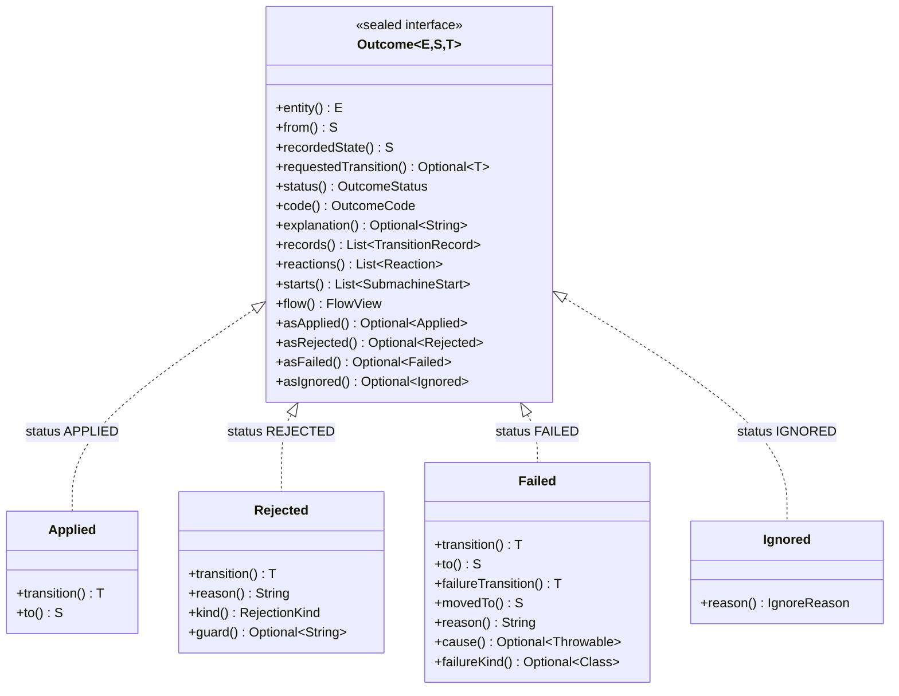

# Handle transition outcomes


`Outcome<E, S, T>` is a sealed interface with four variants. Every outcome classifies itself, so a caller that
only needs to know what happened and why reads it without narrowing:

| Variant | `status()` | `code()` | `explanation()` | State written? |
| --- | --- | --- | --- | --- |
| `Applied` | `APPLIED` | `APPLIED` | empty | Yes, the resolved edge committed |
| `Rejected` | `REJECTED` | `NO_TRANSITION`, `GUARD_REJECTED`, `DETACHED` or `RESERVED_EXIT` | the policy's reason, the guard's, or the library's fixed text for the last two | No |
| `Failed` | `FAILED` | `FAILURE_ROUTED` | the reason the action returned; empty when `failsOn` or a recovery rule routed a throwable | Yes, the failure route committed |
| `Ignored` | `IGNORED` | `NO_WATCH`, or `NO_RULE_MATCHED` | empty | No |

What each variant adds to the accessors every outcome has:



A cascade returns `Applied` or `Failed` to the action that called `cascade(...)`; a rejection inside it aborts the
root instead. Both are provisional there: their hops are written only if the root commits.

Every outcome also has `entity()`, `from()`, `recordedState()`, `requestedTransition()`, `records()`,
`reactions()`, `starts()` and `flow()`. `recordedState()` is `to` for `Applied`, `movedTo` for `Failed` and `from` for
the other two. `requestedTransition()` is empty only for `Ignored`, which selected no edge at all. [Records, journals
and reactions](#records-journals-and-reactions) describes what `records()`, `reactions()`, `starts()` and `flow()`
return.

Read the classification with its limits in mind:

- `recordedState()` is what the call recorded, not a read of the entity. An after-commit hook, a watch reaction
  or a later call can move the entity again; read the entity when you need its live state.
- `FAILED` does not mean that nothing happened: the failure route committed and the entity is at `movedTo`.
- `explanation()` holds the reasons the graph declares: a policy's reason, a guard's, or the reason an action
  returned with `ActionOutcome.failed(...)`. The only texts the library writes there are the fixed reason of a
  terminal state that declares no policy, such as `terminal state DONE accepts no transitions`, and the fixed reasons
  of the two refusals of a sub-machine: `DETACHED`, such as `no parent holds it in DEPOSIT`, and `RESERVED_EXIT`, such
  as `DEPOSIT_PAID leaves DEPOSIT only when its sub-machine ends`. When `failsOn` or a
  recovery rule routes an exception, the failure's reason is composed from that exception and may carry internal
  details; it stays in `Failed.reason()` and `Failed.cause()`.
- A commit here is GraphMaquina writing states through the setters. A JPA or other transaction around the call
  commits later and can still fail.
- The constant names of `OutcomeStatus` and `OutcomeCode` are stable identifiers, safe to persist or send. Each
  code knows the status it refines: `OutcomeCode.GUARD_REJECTED.status()` is `REJECTED`.

This method can be added to the quickstart's `App`:

```java
static String describe(Outcome<Ticket, TicketState, TicketTransition> outcome) {
    return outcome.code() + " at " + outcome.recordedState()
            + outcome.explanation().map((String text) -> ": " + text).orElse("");
}
```

## Contents

- [Map an outcome to a response](#map-an-outcome-to-a-response)
- [Read what only one variant carries](#read-what-only-one-variant-carries)
- [Records, journals and reactions](#records-journals-and-reactions)
- [Handle a failed call](#handle-a-failed-call)

## Map an outcome to a response

A web layer copies the classification into a type it owns, so its contract does not change when the library
does. The HTTP mapping below is one application's policy, not the library's; another application may just as well
answer `409` for every rejection and every handled failure:

```java
record TransitionResponse(
        String id,
        OutcomeStatus status,
        OutcomeCode code,
        TicketState from,
        TicketState state,
        TicketTransition transition,
        String explanation) {

    static TransitionResponse of(
            String id,
            Outcome<Ticket, TicketState, TicketTransition> outcome) {
        return new TransitionResponse(
            id,
            outcome.status(),
            outcome.code(),
            outcome.from(),
            outcome.recordedState(),
            outcome.requestedTransition().orElse(null),
            outcome.explanation().orElse(null));
    }
}

static int httpStatus(OutcomeCode code) {
    return switch (code) {
        case APPLIED, FAILURE_ROUTED, NO_WATCH, NO_RULE_MATCHED -> 200;
        case NO_TRANSITION, DETACHED, RESERVED_EXIT -> 409;
        case GUARD_REJECTED -> 422;
    };
}
```

The `switch` has no `default`: it is exhaustive, so a code added by a future release fails the build instead of
falling through. Do not serialize the `Outcome` itself: it holds the entity, a `Throwable`, reactions with their own
entities, and the call's flow, whose values are whatever the steps and hooks put. A call failure cannot be serialized
at all: every `CallFailedException`, whatever its subtype, holds its `MachineCall`, which is not `Serializable`, so
writing one to an `ObjectOutputStream` throws `NotSerializableException`.

## Read what only one variant carries

The sealed variants remain available when a caller needs what only one of them carries: the rejecting guard,
the recovery identifier, the requested destination of a failure or its cause. `asApplied()`, `asRejected()`,
`asFailed()` and `asIgnored()` return the outcome as that variant, with the outcome's type arguments, or empty:

```java
Optional<String> guard = outcome.asRejected().flatMap(Outcome.Rejected::guard);
Optional<TicketTransition> recovery = outcome.asFailed().map(Outcome.Failed::failureTransition);
```

A `switch` over the variants reads all of them at once:

```java
static String detail(Outcome<Ticket, TicketState, TicketTransition> outcome) {
    return switch (outcome) {
        case Outcome.Applied<Ticket, TicketState, TicketTransition> applied ->
                applied.transition() + " moved to " + applied.to();
        case Outcome.Rejected<Ticket, TicketState, TicketTransition> rejected ->
                "Refused " + rejected.transition() + " by "
                        + rejected.guard().orElse("the state's policy");
        case Outcome.Failed<Ticket, TicketState, TicketTransition> failed ->
                failed.failureTransition() + " moved to " + failed.movedTo() + ": "
                        + failed.reason();
        case Outcome.Ignored<Ticket, TicketState, TicketTransition> ignored ->
                "Unchanged at " + ignored.recordedState() + " (" + ignored.reason() + ")";
    };
}
```

Technical failures throw instead of becoming a fifth outcome. An abort (`TransitionAbortedException`), a commit
failure (`CommitFailedException`) and a failing hook (`AfterCommitException`) share the supertype
`CallFailedException`. It says as values which call failed (`call()`), where it was (`phase()`), how far it got
in writing states (`statesWritten()`) and which actions ran (`journal()`), and it hands out the call's flow
(`flow()`). A hook fails after state was already written. [Handle a failed call](#handle-a-failed-call) shows how to
read them.

## Records, journals and reactions

- `TransitionRecord` describes a hop the call took: machine key, entity, source, transition identifier,
  destination, kind, action label and cascade depth. Two actions that share a name and endpoints stay
  distinguishable because the identifier is part of the record. The records of an outcome and of an
  `AfterCommitException` are committed hops. In the trail of any other failure, a record is a hop the call took,
  and that failure's `statesWritten()` says whether none or some of their states were written.
- `records()` and `reactions()` answer on every outcome. A root `Applied` or `Failed` returns the
  transaction's records and the reactions of its commit; `Rejected`, `Ignored` and a nested `cascade` result
  return empty lists, the last because it is provisional and has no independent root commit or reaction list.
- `starts()` answers on every outcome too, and is empty in the same cases. When an edge enters a state that holds a
  sub-machine, the child moves to the initial state of its graph in the same unit of work, and a root `Applied` or
  `Failed` returns a `SubmachineStart` for each such start, in log order: the child's machine and entity (`key()`,
  `child()`), the state it had and the one it started in (`previous()`, `initial()`), the parent's machine, entity and
  bound state (`parentKey()`, `parent()`, `node()`), and the depth of the step (`depth()`). A start is no hop, so it is
  not in `records()` and runs no hook.
- `flow()` answers on every outcome as well. A root `Applied` or `Failed` hands out the call's flow, frozen once its
  hooks and reactions ran; `Ignored`, a nested `cascade` result, and a `Rejected` or any other root outcome of a call
  that records no trail and whose steps and hooks wrote nothing to its flow return `FlowView.empty()`.
  [Read the flow after the call](call-flow.md#read-the-flow-after-the-call) says what it holds, and
  [record the call's trail](call-flow.md#record-the-calls-trail) how its trail lists the hops and starts of `records()` and
  `starts()`.
- A failed call's journal uses `ActionRecord` and `ActionStatus` (`OK`, `FAILED`, `THREW`; never `RUNNING` once the
  call failed) to report actions that actually ran. A journal is execution evidence, not an undo log for external
  side effects.
- A watch produces `Reaction.Done`, carrying its own outcome, with the reaction's own flow, or `Reaction.Aborted`,
  carrying its exception. Inspect
  reactions even when the root operation succeeded. `Reaction.Aborted` can also report a hook failure after the reaction
  itself committed; it is not proof that the reaction left state unchanged. A reevaluation that failed carries its
  `CallFailedException`, whose `statesWritten()` says whether the reaction wrote anything. An owner lookup fails before
  any reevaluation, so the reaction carries what it threw: a `RuntimeException` as it is, and a checked exception or any
  other throwable that is neither a `RuntimeException` nor an `Error`, wrapped in `UndeclaredThrowableException`, with
  the thread interrupted again when what it threw is an `InterruptedException`. An `Error` is not caught: it propagates
  to the caller whose commit triggered the reaction.

## Handle a failed call

A call that does not return an outcome throws an `Error` or one of three `CallFailedException`s, always one of that
very call. A request refused before the call starts is not a call failure: a null argument throws
`NullPointerException`, an identifier of another catalogue `IllegalArgumentException`, and a call made where
no call may start `ReentrantTransitionException`. Read what happened from its values, not from its message:

| Type | `phase()` | `statesWritten()` |
| --- | --- | --- |
| `TransitionAbortedException` and its subclasses | `RESOLVE`, `GUARD` or `ACTION` | `NONE` |
| `CommitFailedException` | `COMMIT` | `NONE`, or `PARTIAL` when a setter threw |
| `AfterCommitException` | `HOOK` | `ALL` |

The phases follow the call: `RESOLVE` reads the identity and the state, checks the binding of a sub-machine and selects
the edge; `GUARD` runs the root edge's guards, and is entered only when it has any; `ACTION` lasts from the passed
guards until the step ends, its cascades, failure route, sub-machine starts and exits included, which never change
the phase; `COMMIT` checks the original states and calls the setters; `HOOK` runs the after-commit hooks; and
`REACTIONS` dispatches the watch reactions, which only an `Error` leaves as a failure. The names of `CallPhase` and
`StatesWritten` are stable identifiers, safe to log or to use as a metric tag.

`call()` is the call that failed, the same `MachineCall` an observer received, and `journal()` lists the actions that
ran. Any other exception involved is the cause, a failure of another call included, which keeps the flow of its own
call.

`flow()` is the call's flow, frozen when the call failed and attached before the observers hear of the failure. It
reads like an outcome's, as [read the flow after the call](call-flow.md#read-the-flow-after-the-call) shows, and holds what the
call wrote up to the failure:

- An abort undoes no write itself, so the failure keeps what the step that aborted and the steps before it wrote,
  except what a rollback removed earlier. A step whose failure its edge expects, a failure its action returned or a
  throwable of a type the edge declares, is rolled back whether a route takes the failure or not: an
  `UnhandledFailureException` therefore lacks the writes of its step and of the steps that step cascaded to. Each
  `COLLECT` element whose abort the cascade collects is rolled back too, so a `CascadeException` lacks their writes; an
  identity whose `equals` or `hashCode` throws stops that rollback, which leaves the writes and hops it had not undone.
  Once a failed cascade poisoned the call, a step whose action still returns or throws such a failure is not rolled back
  for it: it ends in the failure that poisoned the call and keeps its writes and its hop, unless a `COLLECT` collects
  that failure, which rolls back the whole element the step ran in.
- A `CommitFailedException` holds everything the steps wrote.
- An `AfterCommitException` also holds what the hooks wrote, the failing hook's writes before it threw included.
- When the call records its trail, its flow also lists the hops and starts the call took up to the failure, except
  those a rollback removed and the last one when the clock could not read its instant, which fails the call,
  followed by a `FlowEntry.Failed` entry with the failure, unless the trail's clock threw when
  the call read that entry's instant, as [record the call's trail](call-flow.md#record-the-calls-trail) shows.
- A `reevaluate` that fails before it runs an edge, while it reads the state, evaluates its watch or exceeds the
  limit of a watch chain, hands out `FlowView.empty()`, unless its machine records its trail: its flow then holds the
  entity, no value, and the `Failed` entry alone, or no entry when the clock threw while it read the entry's instant.
- Only the failure the call throws carries the call's flow: any other failure of the call holds `FlowView.empty()`,
  such as an element of the `errors()` of a `CascadeException` or a `PoisonedUnitOfWorkException` a context threw.
  A call that records no trail and whose steps and hooks wrote
  nothing to its flow hands out `FlowView.empty()` too.
- An `Error` carries no flow: it propagates as itself.

With
`import io.github.graphmaquina.error.CallFailedException;`, this method can be added to the quickstart's `App`:

```java
static String describe(CallFailedException failure) {
    String written = switch (failure.statesWritten()) {
        case NONE -> "no state was written";
        case PARTIAL -> "some states were written";
        case ALL -> "every state was written";
    };
    // actions may have run even when no state was written
    String actions = failure.journal().isEmpty()
            ? "no action ran"
            : failure.journal().size() + " action(s) ran";
    return failure.call() + " failed in " + failure.phase() + ": " + written + ", " + actions;
}
```

`statesWritten()` describes the setters only: a JPA or other transaction around the call commits or rolls back later,
on its own. Neither the phase nor `statesWritten()` decides a retry by itself. `NONE` with an action in the journal
that called a payment service means the payment may have happened although no state moved. Retry only what your
actions make idempotent, and reconcile the rest.

---

Next: [Programmatic DSL](dsl.md). Back to the [documentation index](README.md).
