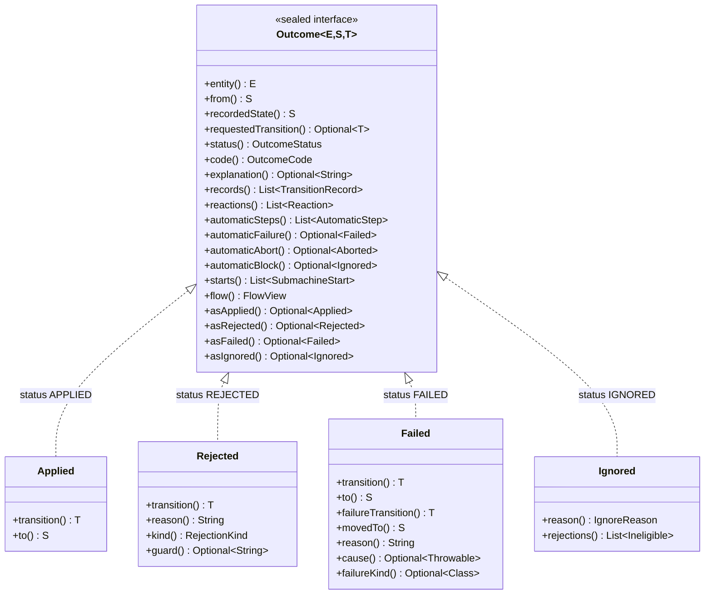

# Handle transition outcomes

![An operation resolves one edge by identity. With no edge the node's policy answers; otherwise guards run, then the action, and the outcome is applied, the declared failure route, or a technical exception. A sub-machine whose parent does not hold it is rejected before the edge is resolved, and an exit reserved to the sub-machine bound to the origin once it is resolved. A step that ends a held sub-machine also commits the parent's exit, unless the parent is in flight or the step moved it. An eligibility check runs the same admission in the same order, the binding check, the edge lookup, the reserved exit and the guards, and stops before the action: a refusal answers Ineligible with its kind, and once every guard passed it answers Eligible.](images/operation-decisions.svg)

`Outcome<E, S, T>` is a sealed interface with four variants. Every outcome classifies itself, so a caller that
only needs to know what happened and why reads it without narrowing:

| Variant | `status()` | `code()` | `explanation()` | State written? |
| --- | --- | --- | --- | --- |
| `Applied` | `APPLIED` | `APPLIED` | empty | Yes, the resolved edge committed |
| `Rejected` | `REJECTED` | `NO_TRANSITION`, `GUARD_REJECTED`, `DETACHED` or `RESERVED_EXIT` | the policy's reason, the guard's, or the library's fixed text for the last two | No |
| `Failed` | `FAILED` | `FAILURE_ROUTED` | the reason the action returned; empty when `failsOn` or a recovery rule routed a throwable | Yes, the failure route committed |
| `Ignored` | `IGNORED` | `NO_WATCH` or `NO_RULE_MATCHED` for `reevaluate`, `NO_AUTOMATIC_TRANSITION` or `NO_CANDIDATE_ADMITTED` for `advance` and the attempts of an automatic chain | empty, except for `NO_CANDIDATE_ADMITTED`, which names each candidate's rejection | No |

What each variant adds to the accessors every outcome has:



A cascade returns `Applied` or `Failed` to the action that called `cascade(...)`; a rejection inside it aborts the
root instead. Both are provisional there: their hops are written only if the root commits.

Every outcome also has `entity()`, `from()`, `recordedState()`, `requestedTransition()`, `records()`,
`reactions()`, `automaticSteps()`, `starts()` and `flow()`, and the three searches of its automatic steps,
`automaticFailure()`, `automaticAbort()` and `automaticBlock()`. `recordedState()` is `to` for `Applied`, `movedTo` for
`Failed` and `from` for the other two. `requestedTransition()` is the identifier the caller asked for, the one a reevaluation's watch
selected, or the automatic edge an `advance` ran; it is empty only for `Ignored`, which ran no edge at all. [Records, journals
and reactions](#records-journals-and-reactions) describes what `records()`, `reactions()`, `automaticSteps()`,
`starts()` and `flow()` return, and [find what the automatic steps did](#find-what-the-automatic-steps-did) what the
three searches return.

Read the classification with its limits in mind:

- `recordedState()` is what the call recorded, not a read of the entity. An after-commit hook, a watch reaction, an
  automatic attempt or a later call can move the entity again; read the entity when you need its live state.
- `FAILED` does not mean that nothing happened: the failure route committed and the entity is at `movedTo`.
- `explanation()` holds the reasons the graph declares: a policy's reason, a guard's, or the reason an action
  returned with `ActionOutcome.failed(...)`. The only texts the library writes there are the fixed reason of a
  terminal state that declares no policy, such as `terminal state DONE accepts no transitions`, the fixed reasons
  of the two refusals of a sub-machine: `DETACHED`, such as `no parent holds it in DEPOSIT`, and `RESERVED_EXIT`, such
  as `DEPOSIT_PAID leaves DEPOSIT only when its sub-machine ends`, and the text of an `advance` that admitted no
  automatic edge, which joins the rejection of each one it tried, such as
  `no automatic transition was admitted: COMPLETE_ADDRESS (GUARD addressComplete): address is incomplete`. When `failsOn` or a
  recovery rule routes an exception, the failure's reason is composed from that exception and may carry internal
  details; it stays in `Failed.reason()` and `Failed.cause()`.
- A commit here is GraphMaquina writing states through the setters. A JPA or other transaction around the call
  commits later and can still fail.
- The constant names of `OutcomeStatus` and `OutcomeCode` are stable identifiers, safe to persist or send. Each
  code knows the status it refines: `OutcomeCode.GUARD_REJECTED.status()` is `REJECTED`.

This method can be added to the quickstart's `App`:

```java
static String describe(Outcome<Ticket, TicketState, TicketTransition> outcome) {
    return outcome.code() + " at " + outcome.recordedState()
            + outcome.explanation().map((String text) -> ": " + text).orElse("");
}
```

## Contents

- [Map an outcome to a response](#map-an-outcome-to-a-response)
- [Read what only one variant carries](#read-what-only-one-variant-carries)
- [Records, journals and reactions](#records-journals-and-reactions)
- [Find what the automatic steps did](#find-what-the-automatic-steps-did)
- [Handle a failed call](#handle-a-failed-call)

## Map an outcome to a response

A web layer copies the classification into a type it owns, so its contract does not change when the library
does. The HTTP mapping below is one application's policy, not the library's; another application may just as well
answer `409` for every rejection and every handled failure:

```java
record TransitionResponse(
        String id,
        OutcomeStatus status,
        OutcomeCode code,
        TicketState from,
        TicketState state,
        TicketTransition transition,
        String explanation) {

    static TransitionResponse of(
            String id,
            Outcome<Ticket, TicketState, TicketTransition> outcome) {
        return new TransitionResponse(
            id,
            outcome.status(),
            outcome.code(),
            outcome.from(),
            outcome.recordedState(),
            outcome.requestedTransition().orElse(null),
            outcome.explanation().orElse(null));
    }
}

static int httpStatus(OutcomeCode code) {
    return switch (code) {
        case APPLIED, FAILURE_ROUTED, NO_WATCH, NO_RULE_MATCHED,
                NO_AUTOMATIC_TRANSITION -> 200;
        case NO_TRANSITION, DETACHED, RESERVED_EXIT -> 409;
        case GUARD_REJECTED, NO_CANDIDATE_ADMITTED -> 422;
    };
}
```

The `switch` has no `default`: it is exhaustive, so a code added by a future release fails the build instead of
falling through. Do not serialize the `Outcome` itself: it holds the entity, a `Throwable`, reactions with their own
entities, and the call's flow, whose values are whatever the steps and hooks put. A call failure cannot be serialized
at all: every `CallFailedException`, whatever its subtype, holds its `MachineCall`, which is not `Serializable`, so
writing one to an `ObjectOutputStream` throws `NotSerializableException`.

## Read what only one variant carries

The sealed variants remain available when a caller needs what only one of them carries: the rejecting guard,
the recovery identifier, the requested destination of a failure or its cause. `asApplied()`, `asRejected()`,
`asFailed()` and `asIgnored()` return the outcome as that variant, with the outcome's type arguments, or empty:

```java
Optional<String> guard = outcome.asRejected().flatMap(Outcome.Rejected::guard);
Optional<TicketTransition> recovery = outcome.asFailed().map(Outcome.Failed::failureTransition);
```

`Ignored.rejections()` lists why an `advance` with the reason `NO_CANDIDATE_ADMITTED` ran no automatic edge: one
`Eligibility.Ineligible` per edge it tried, in the order it tried them, each with the identifier, the state, the
`RejectionKind`, the guard of a `GUARD` rejection and the reason. It is empty for every other `Ignored`.

A `switch` over the variants reads all of them at once:

```java
static String detail(Outcome<Ticket, TicketState, TicketTransition> outcome) {
    return switch (outcome) {
        case Outcome.Applied<Ticket, TicketState, TicketTransition> applied ->
                applied.transition() + " moved to " + applied.to();
        case Outcome.Rejected<Ticket, TicketState, TicketTransition> rejected ->
                "Refused " + rejected.transition() + " by "
                        + rejected.guard().orElse("the state's policy");
        case Outcome.Failed<Ticket, TicketState, TicketTransition> failed ->
                failed.failureTransition() + " moved to " + failed.movedTo() + ": "
                        + failed.reason();
        case Outcome.Ignored<Ticket, TicketState, TicketTransition> ignored ->
                "Unchanged at " + ignored.recordedState() + " (" + ignored.reason() + ")"
                        + ignored.explanation().map((String text) -> ": " + text).orElse("");
    };
}
```

Technical failures throw instead of becoming a fifth outcome. An abort (`TransitionAbortedException`), a commit
failure (`CommitFailedException`) and a failing hook (`AfterCommitException`) share the supertype
`CallFailedException`. It says as values which call failed (`call()`), where it was (`phase()`), how far it got
in writing states (`statesWritten()`) and which actions ran (`journal()`), and it hands out the call's flow
(`flow()`). A hook fails after state was already written. [Handle a failed call](#handle-a-failed-call) shows how to
read them.

## Records, journals and reactions

- `TransitionRecord` describes a hop the call took: machine key, entity, source, transition identifier,
  destination, kind, action label and cascade depth. Two actions that share a name and endpoints stay
  distinguishable because the identifier is part of the record. The records of an outcome and of an
  `AfterCommitException` are committed hops. In the trail of any other failure, a record is a hop the call took,
  and that failure's `statesWritten()` says whether none or some of their states were written.
- `records()` and `reactions()` answer on every outcome. A root `Applied` or `Failed` returns the
  transaction's records and the reactions of its commit; `Rejected`, `Ignored` and a nested `cascade` result
  return empty lists, the last because it is provisional and has no independent root commit or reaction list.
- `starts()` answers on every outcome too, and is empty in the same cases. When an edge enters a state that holds a
  sub-machine, the child moves to the initial state of its graph in the same unit of work, and a root `Applied` or
  `Failed` returns a `SubmachineStart` for each such start, in log order: the child's machine and entity (`key()`,
  `child()`), the state it had and the one it started in (`previous()`, `initial()`), the parent's machine, entity and
  bound state (`parentKey()`, `parent()`, `node()`), and the depth of the step (`depth()`). A start is no hop, so it is
  not in `records()` and runs no hook.
- `flow()` answers on every outcome as well. A root `Applied` or `Failed` hands out the call's flow, frozen once its
  hooks, its reactions and its automatic steps ran; `Ignored`, a nested `cascade` result, and a `Rejected` or any
  other root outcome of a call that records no trail and whose steps and hooks wrote nothing to its flow return
  `FlowView.empty()`.
  [Read the flow after the call](call-flow.md#read-the-flow-after-the-call) says what it holds, and
  [record the call's trail](call-flow.md#record-the-calls-trail) how its trail lists the hops and starts of `records()` and
  `starts()`.
- A failed call's journal uses `ActionRecord` and `ActionStatus` (`OK`, `FAILED`, `THREW`; never `RUNNING` once the
  call failed) to report actions that actually ran. A journal is execution evidence, not an undo log for external
  side effects.
- A watch produces `Reaction.Done`, carrying its own outcome, with the reaction's own flow, or `Reaction.Aborted`,
  carrying its exception. Inspect
  reactions even when the root operation succeeded. `Reaction.Aborted` can also report a hook failure after the reaction
  itself committed; it is not proof that the reaction left state unchanged. A reevaluation that failed carries its
  `CallFailedException`, whose `statesWritten()` says whether the reaction wrote anything. An owner lookup fails before
  any reevaluation, so the reaction carries what it threw: a `RuntimeException` as it is, and a checked exception or any
  other throwable that is neither a `RuntimeException` nor an `Error`, wrapped in `UndeclaredThrowableException`, with
  the thread interrupted again when what it threw is an `InterruptedException`. An `Error` is not caught: it propagates
  to the caller whose commit triggered the reaction.
- `automaticSteps()` answers on every outcome too. A root `Applied` or `Failed` returns the automatic attempts its
  commit triggered once its reactions ran; `Rejected`, `Ignored` and a nested `cascade` result return an empty list.
  Each entity with a hop or a sub-machine start in the commit, a self-loop or a round trip included, runs its chain,
  in log order, unless its last hop there is a failure route that does not continue: from the state the commit left
  it in, while that state has an automatic edge, one `advance` of the entity after another, each a call of its own
  with its own outcome and flow. The list holds each chain whole, flat and in order. A chain stops after an attempt
  that admits no candidate, which the list still holds as `AutomaticStep.Done` with its `Ignored`, whose
  `rejections()` say why; after one whose failure takes a route that does not continue; and after one that aborts,
  which the list holds as `AutomaticStep.Aborted`, with the attempt's `CallFailedException`, whose `statesWritten()`
  says whether the attempt wrote anything. A chain that reaches a state without automatic edges makes no further
  attempt. An attempt past the registry's `maxAutomaticChain` that admits a candidate aborts with
  `AutomaticChainExceededException` before its action runs. The outcome of an `advance` is its first attempt, so the
  chain of its entity in the list starts with the attempt that followed. Like a reaction's, an attempt's failure
  never reaches the caller: inspect the steps even when the call succeeded. An `Error` is not caught: it propagates
  to the caller whose commit triggered the attempt.
- The deepest commit that moved an entity chains it. When a call made on the same thread inside the post-commit, a
  hook's call, a watch reaction or an attempt, committed a hop or a start of an entity before that entity's chain
  began, that call decided the chain, so the commit around it does not chain the entity again; and a chain stops
  after an attempt whose own post-commit ran such a call for its entity. So the attempts that an attempt's commit
  triggers for other entities are in that attempt's outcome, and a chain that a watch reaction decided is in that
  reaction's outcome. Entities compare as the commit log compares them, by machine and identity.
- Outside any call, the chain decides whether an attempt follows. Before its first attempt, it compares the entity with
  those that calls nested in the post-commit moved, then reads the automatic edges of its state. After an attempt that
  ended `Ignored`, or whose failure took a route that stops the chain, it stops without either; after any other, it
  compares the entity with those that calls nested in the attempt's post-commit moved and, unless one of them did, reads
  the automatic edges of the state the attempt left it in. A comparison runs the `hashCode` and `equals` of identities
  only when such a call moved something. When the entity's identity throws from `hashCode` or `equals` as it is
  compared, or a `GraphDefinition` written by hand throws from `automaticFrom` there, the chain ends as
  `AutomaticStep.Aborted` with what was thrown: a `RuntimeException` as it is, any other throwable but an `Error`
  wrapped in `UndeclaredThrowableException`, with the thread interrupted again for an `InterruptedException`. Such a
  step may follow the chain's last attempt. The identity of another entity that throws there ends no chain but that
  entity's own. The same `automaticFrom` throwing inside an attempt or an `advance` aborts that call in `RESOLVE`.

## Find what the automatic steps did

A call's automatic attempts can fail, abort or stop at a guard after the call itself committed, in its own chains or
in chains nested in its reactions and in other attempts. Three methods of every outcome search all of them and return
the first one that matches:

| Method | Returns | Present when |
| --- | --- | --- |
| `automaticFailure()` | `Optional<Outcome.Failed<?, ?, ?>>` | an attempt ended in `Failed`, whether its route stopped the chain or let it go on |
| `automaticAbort()` | `Optional<AutomaticStep.Aborted>` | an attempt aborted, on a domain failure that no route takes, a technical failure, any other exception or `maxAutomaticChain`, or the reads a chain makes around its attempts threw |
| `automaticBlock()` | `Optional<Outcome.Ignored<?, ?, ?>>` | an attempt admitted none of its candidates, `NO_CANDIDATE_ADMITTED`; its `rejections()` say why |

They search in the order the attempts ran. First come the `reactions()`, each `Reaction.Done` searched the same way
through its outcome; then the `automaticSteps()`, in order, each step looked at itself and then searched through its
outcome, its reactions and its steps. So an attempt nested in a reaction comes before the call's own steps. Only
`AutomaticStep` entries count: a `Reaction.Done` whose outcome is `Failed`, or a `Reaction.Aborted`, is the result of a
watch, which `reactions()` holds. The types carry wildcards because the attempts can be of other machines: peers,
children and parents. A failure and a block can happen in one call: with a route that continues, the chain goes on
from the recovery state, and `automaticFailure()` still returns the failure. `Rejected` and `Ignored` have neither
steps nor reactions, so the three are empty; the outcome of an `advance` is its own first attempt, which you read
directly.

`advance(entity)` goes on from where the entity stands: after a `Failed`, from the recovery state; after an abort
before any write, from the state the attempt started in. An aborted attempt's cause is its `CallFailedException`,
whose `statesWritten()` says whether it wrote: after a setter or a hook threw, the entity may have moved, and
`advance` goes on from whatever state it has.

## Handle a failed call

A call that does not return an outcome throws an `Error` or one of three `CallFailedException`s, always one of that
very call. A request refused before the call starts is not a call failure: a null argument throws
`NullPointerException`, an identifier of another catalogue `IllegalArgumentException`, and a call made where
no call may start `ReentrantTransitionException`. Read what happened from its values, not from its message:

| Type | `phase()` | `statesWritten()` |
| --- | --- | --- |
| `TransitionAbortedException` and its subclasses | `RESOLVE`, `GUARD` or `ACTION` | `NONE` |
| `CommitFailedException` | `COMMIT` | `NONE`, or `PARTIAL` when a setter threw |
| `AfterCommitException` | `HOOK` | `ALL` |

The phases follow the call: `RESOLVE` reads the identity and the state, checks the binding of a sub-machine and selects
the edge; `GUARD` runs the root edge's guards, and is entered only when it has any; `ACTION` lasts from the passed
guards until the step ends, its cascades, failure route, sub-machine starts and exits included, which never change
the phase; `COMMIT` checks the original states and calls the setters; `HOOK` runs the after-commit hooks;
`REACTIONS` dispatches the watch reactions; and `AUTOMATIC_STEPS` runs the automatic chains of the entities the commit
moved. Only an `Error` leaves either of the last two as a failure. The names of `CallPhase` and `StatesWritten` are
stable identifiers, safe to log or to use as a metric tag.

`call()` is the call that failed, the same `MachineCall` an observer received, and `journal()` lists the actions that
ran. Any other exception involved is the cause, a failure of another call included, which keeps the flow of its own
call.

`flow()` is the call's flow, frozen when the call failed and attached before the observers hear of the failure. It
reads like an outcome's, as [read the flow after the call](call-flow.md#read-the-flow-after-the-call) shows, and holds what the
call wrote up to the failure:

- An abort undoes no write itself, so the failure keeps what the step that aborted and the steps before it wrote,
  except what a rollback removed earlier. A step whose failure its edge expects, a failure its action returned or a
  throwable of a type the edge declares, is rolled back whether a route takes the failure or not: an
  `UnhandledFailureException` therefore lacks the writes of its step and of the steps that step cascaded to. Each
  `COLLECT` element whose abort the cascade collects is rolled back too, so a `CascadeException` lacks their writes; an
  identity whose `equals` or `hashCode` throws stops that rollback, which leaves the writes and hops it had not undone.
  Once a failed cascade poisoned the call, a step whose action still returns or throws such a failure is not rolled back
  for it: it ends in the failure that poisoned the call and keeps its writes and its hop, unless a `COLLECT` collects
  that failure, which rolls back the whole element the step ran in.
- A `CommitFailedException` holds everything the steps wrote.
- An `AfterCommitException` also holds what the hooks wrote, the failing hook's writes before it threw included.
- When the call records its trail, its flow also lists the hops and starts the call took up to the failure, except
  those a rollback removed and the last one when the clock could not read its instant, which fails the call,
  followed by a `FlowEntry.Failed` entry with the failure, unless the trail's clock threw when
  the call read that entry's instant, as [record the call's trail](call-flow.md#record-the-calls-trail) shows.
- A `reevaluate` that fails before it runs an edge, while it reads the state, evaluates its watch or exceeds the
  limit of a watch chain, hands out `FlowView.empty()`, unless its machine records its trail: its flow then holds the
  entity, no value, and the `Failed` entry alone, or no entry when the clock threw while it read the entry's instant.
  So does an `advance` that fails while it reads the state or, from a `GraphDefinition` written by hand, its
  automatic edges.
- Only the failure the call throws carries the call's flow: any other failure of the call holds `FlowView.empty()`,
  such as an element of the `errors()` of a `CascadeException` or a `PoisonedUnitOfWorkException` a context threw.
  A call that records no trail and whose steps and hooks wrote
  nothing to its flow hands out `FlowView.empty()` too.
- An `Error` carries no flow: it propagates as itself.

With
`import io.github.graphmaquina.error.CallFailedException;`, this method can be added to the quickstart's `App`:

```java
static String describe(CallFailedException failure) {
    String written = switch (failure.statesWritten()) {
        case NONE -> "no state was written";
        case PARTIAL -> "some states were written";
        case ALL -> "every state was written";
    };
    // actions may have run even when no state was written
    String actions = failure.journal().isEmpty()
            ? "no action ran"
            : failure.journal().size() + " action(s) ran";
    return failure.call() + " failed in " + failure.phase() + ": " + written + ", " + actions;
}
```

`statesWritten()` describes the setters only: a JPA or other transaction around the call commits or rolls back later,
on its own. Neither the phase nor `statesWritten()` decides a retry by itself. `NONE` with an action in the journal
that called a payment service means the payment may have happened although no state moved. Retry only what your
actions make idempotent, and reconcile the rest.

---

Next: [Check an operation before you call it](eligibility.md). Back to the [documentation index](README.md).
