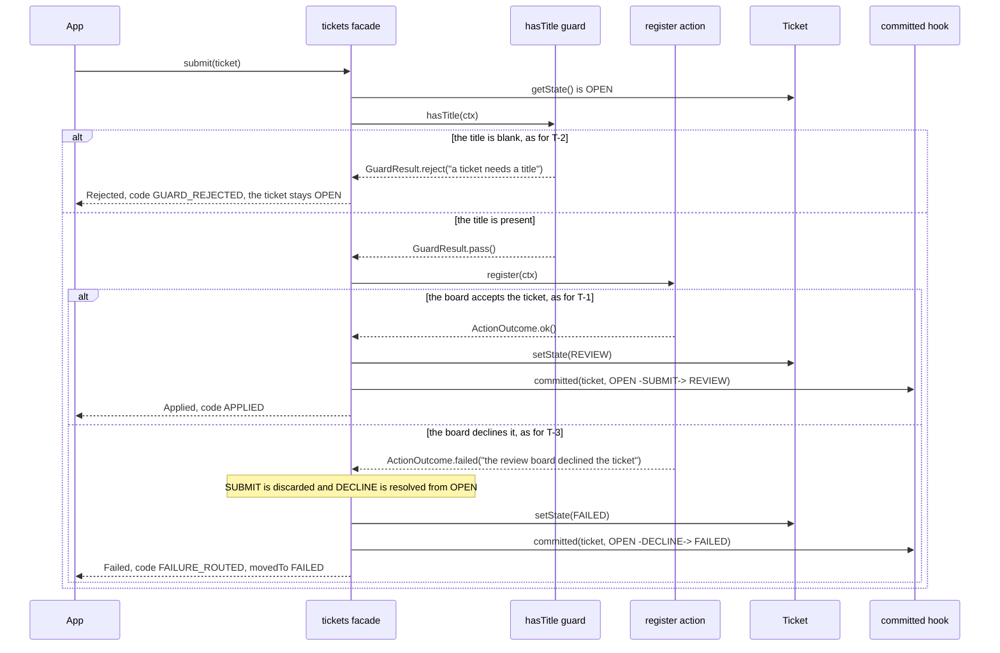

# Quickstart: a complete ticket machine

Configure the build first, with Gradle or Maven, as the [installation page](installation.md) shows. Then create
the following seven files under `src/main/java/com/example/tickets/`. Both build configurations compile them, and
they require no Lombok, framework or external service. You can write all seven files
before the first build; [the generation walkthrough](generation.md#how-your-flow-annotations-are-generated) explains why
the references to generated annotations are valid in this workflow.

A ticket is submitted for review, and submission registers it with the review board. A board that will not
take the ticket is a declared domain failure, so the ticket lands in `FAILED`. Once in review it can be
approved by a person, auto-approved by a rule, retouched in place, or rejected back to `OPEN`.


## Contents

- [TicketState.java](#ticketstatejava)
- [TicketTransition.java](#tickettransitionjava)
- [Ticket.java](#ticketjava)
- [TicketActions.java](#ticketactionsjava)
- [Tickets.java](#ticketsjava)
- [TicketMachines.java](#ticketmachinesjava)
- [App.java](#appjava)
- [What one call does](#what-one-call-does)
- [Test your machines](#test-your-machines)

## TicketState.java

```java
package com.example.tickets;

public enum TicketState {
    OPEN, REVIEW, DONE, FAILED
}
```

## TicketTransition.java

```java
package com.example.tickets;

public enum TicketTransition {
    SUBMIT, APPROVE, AUTO_APPROVE, RETOUCH, REJECT, DECLINE
}
```

Two enums, never one. `TicketState` names where a ticket can be; `TicketTransition` names the edges it can
take. You write both: GraphMaquina derives no identifier from an action name, a method name or a destination.

## Ticket.java

```java
package com.example.tickets;

import io.github.graphmaquina.annotation.GraphProperty;
import java.util.Objects;

public final class Ticket {
    @GraphProperty
    private final String id;

    @GraphProperty
    private TicketState state = TicketState.OPEN;

    private final String title;
    private final boolean accepted;

    public Ticket(String id, String title, boolean accepted) {
        this.id = Objects.requireNonNull(id);
        this.title = Objects.requireNonNull(title);
        this.accepted = accepted;
    }

    public String getId() { return id; }
    public TicketState getState() { return state; }
    public String getTitle() { return title; }
    public boolean isAccepted() { return accepted; }

    public void setState(TicketState state) {
        this.state = Objects.requireNonNull(state);
    }
}
```

The state starts initialized. `initial = OPEN` describes the graph; it does not initialize new entities.
The runtime calls the state setter during commit. Action code must not call it.

## TicketActions.java

```java
package com.example.tickets;

import io.github.graphmaquina.annotation.GraphAction;
import io.github.graphmaquina.annotation.GraphGuard;
import io.github.graphmaquina.annotation.GraphHook;
import io.github.graphmaquina.api.ActionOutcome;
import io.github.graphmaquina.api.CommitContext;
import io.github.graphmaquina.api.GuardContext;
import io.github.graphmaquina.api.GuardResult;
import io.github.graphmaquina.api.TransitionContext;
import java.util.ArrayList;
import java.util.List;

public final class TicketActions {
    private final List<String> decisions = new ArrayList<>();

    /** Which action actually ran, in order. Two edges to DONE never stand in for each other. */
    public List<String> decisions() {
        return List.copyOf(decisions);
    }

    @GraphGuard
    public GuardResult hasTitle(GuardContext<Ticket, TicketState, TicketTransition> ctx) {
        return ctx.entity().getTitle().isBlank()
                ? GuardResult.reject("a ticket needs a title")
                : GuardResult.pass();
    }

    @GraphAction
    public ActionOutcome register(TransitionContext<Ticket, TicketState, TicketTransition> ctx) {
        return ctx.entity().isAccepted()
                ? ActionOutcome.ok()
                : ActionOutcome.failed("the review board declined the ticket");
    }

    @GraphAction
    public ActionOutcome approve(TransitionContext<Ticket, TicketState, TicketTransition> ctx) {
        decisions.add("approve " + ctx.entity().getId());
        return ActionOutcome.ok();
    }

    @GraphAction
    public ActionOutcome autoApprove(TransitionContext<Ticket, TicketState, TicketTransition> ctx) {
        decisions.add("autoApprove " + ctx.entity().getId());
        return ActionOutcome.ok();
    }

    @GraphAction
    public ActionOutcome retouch(TransitionContext<Ticket, TicketState, TicketTransition> ctx) {
        decisions.add("retouch " + ctx.entity().getId());
        return ActionOutcome.ok();
    }

    @GraphHook
    public void committed(Ticket ticket, CommitContext<TicketState, TicketTransition> commit) {
        System.out.println("Committed " + ticket.getId() + ": " + commit.from()
                + " -" + commit.transition() + "-> " + commit.to());
    }
}
```

## Tickets.java

```java
package com.example.tickets;

import io.github.graphmaquina.annotation.GenerateGraphApi;
import io.github.graphmaquina.api.Machine;
import io.github.graphmaquina.api.Outcome;

@GenerateGraphApi
@TicketsGraph.Definition(initial=TicketState.OPEN,
    terminals={TicketState.DONE, TicketState.FAILED},
    allowsCycle={TicketState.OPEN, TicketState.REVIEW},
    state=TicketRefs.State.class, id=TicketRefs.Id.class,
    afterCommit=TicketActionsRefs.Committed.class)
@TicketsGraph.StatePolicy(state=TicketState.OPEN, otherwise="submit the ticket first")
@TicketsGraph.StatePolicy(state=TicketState.REVIEW, otherwise="approve, reject or retouch the ticket")
@TicketsGraph.Reject(from=TicketState.OPEN, transition=TicketTransition.APPROVE,
    reason="approval requires review")
@TicketsGraph.Transition(id=TicketTransition.DECLINE, from=TicketState.OPEN, to=TicketState.FAILED)
public interface Tickets extends Machine<Ticket,TicketState,TicketTransition> {

    @TicketsGraph.Transition(id=TicketTransition.SUBMIT, from=TicketState.OPEN,
        to=TicketState.REVIEW, action=TicketActionsRefs.Register.class,
        guards=TicketActionsRefs.HasTitle.class, onFailure=TicketTransition.DECLINE)
    Outcome<Ticket,TicketState,TicketTransition> submit(Ticket ticket);

    @TicketsGraph.Transition(id=TicketTransition.APPROVE, from=TicketState.REVIEW,
        to=TicketState.DONE, action=TicketActionsRefs.Approve.class)
    Outcome<Ticket,TicketState,TicketTransition> approve(Ticket ticket);

    @TicketsGraph.Transition(id=TicketTransition.AUTO_APPROVE, from=TicketState.REVIEW,
        to=TicketState.DONE, action=TicketActionsRefs.AutoApprove.class)
    Outcome<Ticket,TicketState,TicketTransition> autoApprove(Ticket ticket);

    @TicketsGraph.Transition(id=TicketTransition.RETOUCH, from=TicketState.REVIEW,
        to=TicketState.REVIEW, action=TicketActionsRefs.Retouch.class)
    Outcome<Ticket,TicketState,TicketTransition> retouch(Ticket ticket);

    @TicketsGraph.Transition(id=TicketTransition.REJECT, from=TicketState.REVIEW, to=TicketState.OPEN)
    Outcome<Ticket,TicketState,TicketTransition> reject(Ticket ticket);
}
```

`APPROVE` and `AUTO_APPROVE` are two edges between the same pair of states, each with its own action. They
are parallel edges, not duplicates: `approve(ticket)` can never run `autoApprove`'s action. `RETOUCH` is a
self-loop, an ordinary edge that happens to end where it started, and `REJECT` closes the `OPEN → REVIEW → OPEN`
loop. `allowsCycle` marks both cycles as intentional: each passes through `REVIEW`, so `REVIEW` alone would be
enough, and `OPEN` may be listed too because it lies on one. `DECLINE` has no method of its own: it is the route `SUBMIT`
names in `onFailure`, and it is resolved from `SUBMIT`'s origin.

`TicketsGraph`, `TicketRefs` and `TicketActionsRefs` do not exist in handwritten source. The generator writes
them before javac compiles this interface, using `@GenerateGraphApi`, `Machine<Ticket, TicketState, TicketTransition>`
and the marked members. See [the first-generation walkthrough](generation.md#how-your-flow-annotations-are-generated) for the
minimal-interface and complete-source workflows. Do not create placeholder versions of these classes.

## TicketMachines.java

```java
package com.example.tickets;

import io.github.graphmaquina.annotation.StateGraphs;
import io.github.graphmaquina.api.Machines;

@StateGraphs
public interface TicketMachines extends Machines {
    Tickets tickets();
}
```

The processor generates `TicketsRuntime` and `TicketMachinesRuntime`. The set owns the runtime machines
and closes their default executors together.

## App.java

```java
package com.example.tickets;

import io.github.graphmaquina.api.Outcome;
import io.github.graphmaquina.api.OutcomeCode;
import io.github.graphmaquina.api.OutcomeStatus;
import java.util.List;
import java.util.Optional;

public final class App {
    private App() { }

    public static void main(String[] args) {
        TicketActions actions = new TicketActions();
        try (TicketMachines machines = TicketMachinesRuntime.builder(actions).build()) {
            Tickets tickets = machines.tickets();

            Ticket accepted = new Ticket("T-1", "Document the workflow", true);
            require(tickets.submit(accepted).status() == OutcomeStatus.APPLIED, "submit should apply");
            require(tickets.approve(accepted).status() == OutcomeStatus.APPLIED, "approve should apply");
            require(accepted.getState() == TicketState.DONE, "an approved ticket should be DONE");

            Ticket untitled = new Ticket("T-2", "", true);
            require(tickets.submit(untitled).code() == OutcomeCode.GUARD_REJECTED, "blank title should reject");
            require(untitled.getState() == TicketState.OPEN, "a rejected ticket should remain OPEN");

            Ticket refused = new Ticket("T-3", "Await the board", false);
            Outcome<Ticket, TicketState, TicketTransition> declined = tickets.submit(refused);
            require(declined.code() == OutcomeCode.FAILURE_ROUTED
                    && declined.explanation().equals(Optional.of("the review board declined the ticket")),
                    "a decline should be handled");
            require(refused.getState() == TicketState.FAILED, "the failure route should commit FAILED");

            Ticket fresh = new Ticket("T-4", "Not submitted yet", true);
            Outcome<Ticket, TicketState, TicketTransition> refusal = tickets.approve(fresh);
            require(refusal.code() == OutcomeCode.NO_TRANSITION
                    && refusal.explanation().equals(Optional.of("approval requires review")),
                    "APPROVE leaves no edge from OPEN");

            Ticket revised = new Ticket("T-5", "Revise the wording", true);
            tickets.submit(revised);
            require(tickets.retouch(revised).status() == OutcomeStatus.APPLIED, "a self-loop should apply");
            require(revised.getState() == TicketState.REVIEW, "a self-loop ends where it started");
            require(tickets.reject(revised).status() == OutcomeStatus.APPLIED, "reject should apply");
            require(revised.getState() == TicketState.OPEN, "reject returns the ticket to OPEN");

            Ticket automatic = new Ticket("T-6", "Trivial typo fix", true);
            tickets.submit(automatic);
            require(tickets.autoApprove(automatic).status() == OutcomeStatus.APPLIED, "autoApprove should apply");
            require(actions.decisions().equals(List.of(
                    "approve T-1", "retouch T-5", "autoApprove T-6")),
                    "each operation runs its own action: " + actions.decisions());
            System.out.println("All ticket scenarios passed.");
        }
    }

    private static void require(boolean condition, String message) {
        if (!condition) {
            throw new IllegalStateException(message);
        }
    }
}
```

Expected application output:

```text
Committed T-1: OPEN -SUBMIT-> REVIEW
Committed T-1: REVIEW -APPROVE-> DONE
Committed T-3: OPEN -DECLINE-> FAILED
Committed T-5: OPEN -SUBMIT-> REVIEW
Committed T-5: REVIEW -RETOUCH-> REVIEW
Committed T-5: REVIEW -REJECT-> OPEN
Committed T-6: OPEN -SUBMIT-> REVIEW
Committed T-6: REVIEW -AUTO_APPROVE-> DONE
All ticket scenarios passed.
```

One `afterCommit` on `Definition` is the default hook of every edge, so each committed hop prints itself,
including the self-loop and the failure route. Nothing prints for `T-2`, whose guard rejected, or for `T-4`,
whose request had no edge: neither committed anything. The program checks an applied edge, a guard rejection,
a handled failure, a request with no edge, a self-loop, a cycle and two parallel edges. It does not rely on
Java assertions being enabled.

## What one call does

Every operation resolves one edge and runs it. For `tickets.submit(ticket)` the edge keyed by `(OPEN, SUBMIT)`
leads to `REVIEW`, and its guard and action decide which of three outcomes the caller gets:



A request with no edge from the current state, such as `approve` on the `OPEN` ticket `T-4`, runs no guard and no
action: the state's policy answers with `NO_TRANSITION` and its reason. [Handle transition outcomes](outcomes.md)
covers every variant.

## Test your machines

Test through generated facades using real entities and deterministic action dependencies. The quickstart's
`App` is an executable smoke test that covers an applied edge, a guard rejection, a handled failure, a
request with no edge, a self-loop, a cycle and two parallel edges, and
[OrderFlowTest](../graphmaquina-example/src/test/java/io/github/graphmaquina/example/OrderFlowTest.java)
shows JUnit tests for payment, retries, cascades, watches, journals, and the flow and the trail of a call.

The test below reads its outcome with `graphmaquina-test`, the module that holds the typed assertions. Every
release publishes it with the runtime, at the same version, and [settings.gradle.kts](installation.md#settingsgradlekts)
already resolves it. For
a Gradle application using JUnit, add to `build.gradle.kts`:

```kotlin
dependencies {
    testImplementation(platform("org.junit:junit-bom:5.13.4"))
    testImplementation("org.junit.jupiter:junit-jupiter")
    testRuntimeOnly("org.junit.platform:junit-platform-launcher")
    testImplementation("io.github.graphmaquina:graphmaquina-test:$graphmaquinaVersion")
}

tasks.test {
    useJUnitPlatform()
}
```

Create `src/test/java/com/example/tickets/TicketsTest.java`:

```java
package com.example.tickets;

import static io.github.graphmaquina.test.GraphAssertions.assertThat;

import org.junit.jupiter.api.Test;

class TicketsTest {
    @Test
    void aDomainFailureCommitsItsDeclaredFailureState() {
        try (TicketMachines machines = TicketMachinesRuntime.builder(new TicketActions()).build()) {
            Ticket ticket = new Ticket("T-7", "Declined at intake", false);
            assertThat(machines.tickets().submit(ticket)).isFailed()
                    .hasTarget(TicketState.REVIEW)
                    .hasFailureTransition(TicketTransition.DECLINE)
                    .movedTo(TicketState.FAILED)
                    .hasEntityState(Ticket::getState, TicketState.FAILED);
        }
    }
}
```

`isFailed()` narrows the outcome and fails with the kind it actually got. `hasTarget` is where `SUBMIT` was heading,
`hasFailureTransition` is the identifier of the edge that recovered, `movedTo` is where that edge landed, and
`hasEntityState` reads the entity itself. Run `./gradlew test` in your application. The repository's
[ReadmeQuickstartTest](../graphmaquina-test/src/test/java/consumer/ReadmeQuickstartTest.java) extracts these literal
Gradle blocks and Ticket Java files, generates and compiles the main sources, runs `App` and checks that its output contains
`All ticket scenarios passed.`, and
verifies this named JUnit test and its result counts in an external Gradle consumer using locally staged artifacts. This verifies the Gradle
workflow; it does not execute this JUnit sample through Maven. This test consumes generated main code; it does not
declare test graphs and needs no `testAnnotationProcessor`. In Maven, add JUnit and a compatible test runner through
your application's usual test configuration, together with the test-scoped `graphmaquina-test` dependency shown in
the [testing guide](testing.md#install). Preserve the graph generation lifecycle for any test graphs.

The [testing guide](testing.md) covers every assertion, probe, recorder and snapshot `graphmaquina-test` offers.

---

Next: [Code generation and IDE setup](generation.md). Back to the [documentation index](README.md).
