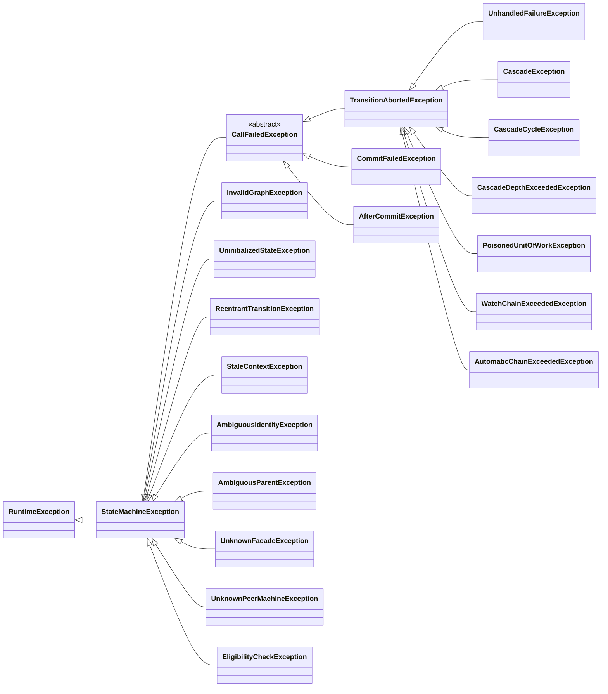

# Runtime exceptions

Every exception the library defines extends `StateMachineException`, an unchecked exception; misuse also raises JDK
exceptions such as `NullPointerException`, `IllegalArgumentException`, `IllegalStateException` and
`WrongThreadException`. The failures of a call
extend `CallFailedException`, which reports the call's `phase()`, `statesWritten()`, `journal()` and `flow()`: they
are `TransitionAbortedException`, `CommitFailedException` and `AfterCommitException`. `UnhandledFailureException`,
`CascadeException`, `CascadeCycleException`, `CascadeDepthExceededException`, `PoisonedUnitOfWorkException`,
`WatchChainExceededException` and `AutomaticChainExceededException` are `TransitionAbortedException`s, whose
`details()` also report the machine key, the entity, the action and the cascade path.

## Contents

- [Exception hierarchy](#exception-hierarchy)
- [What to investigate](#what-to-investigate)
- [Accessors](#accessors)
- [Aborts in detail](#aborts-in-detail)

## Exception hierarchy

## What to investigate

| Exception | What to investigate |
| --- | --- |
| `UninitializedStateException` | Entity state was null. Initialize or correctly hydrate it before calling the machine. A null root state arrives as the cause of an abort in `RESOLVE`; a peer's, reached by a cascade, as the cause of an abort in `ACTION`, and so does a sub-machine's, read when its parent enters the bound state. A parent's, read to check the binding of a sub-machine, arrives as the cause of an abort in `RESOLVE` when the sub-machine is the root and in `ACTION` inside a cascade or an exit. A peer's state read through a `PeerView`, such as `ctx.peer(Items.class).stateOf(item)`, throws it into the guard or action that read it, and a watch's owner lookup reports it in `Reaction.Aborted`. |
| `TransitionAbortedException` | A technical failure aborted execution; inspect cause, path and action journal. Its `from()`, `transition()` and `to()` are `Optional`. An abort raised before the entity's state was read, because its identity or its state could not be read, reports no state and no destination. One raised before any edge was resolved reports no destination, and one raised before any identifier was read, such as a watch chain over its limit, reports neither identifier nor destination. Its `phase()` is `RESOLVE`, `GUARD` or `ACTION`, and its `statesWritten()` is `NONE`. |
| `UnhandledFailureException` | The action returned a failure, or threw a type that its `failsOn` or one of its recovery rules declares; no recovery rule took it, and its edge has no `onFailure` route. Any other throwable aborts the call with a `TransitionAbortedException` whose cause it is, except an `Error` thrown as itself, which propagates, and a failure of the call itself, which the engine throws as itself or, when the transaction is poisoned, as the failure that poisoned it. The step was rolled back first, so its `flow()` lacks what that step and the steps it cascaded to wrote. |
| `CascadeException` | Thrown into the action by `cascadeAll` under `CascadePolicy.COLLECT`, after its last element ran, when the transitions of some elements aborted; it poisons the transaction. Inspect `errors()`, in element order, and the journal. |
| `CascadeCycleException` | A nested request reached an entity that is already in flight. It reports the in-flight and requested identifiers. |
| `CascadeDepthExceededException` | Nested work exceeded the configured cascade depth, which `maxDepth()` reports. |
| `WatchChainExceededException` | A watch chain exceeded its limit, which `maxChain()` reports; inspect reaction cycles. Neither `execute`, nor `reevaluate`, nor `advance` throws it to its caller: it arrives as the cause of a `Reaction.Aborted`, of phase `RESOLVE`, and the observers hear of it as a failed call. |
| `AutomaticChainExceededException` | An automatic attempt past the registry's `maxAutomaticChain`, which `maxChain()` reports, admitted a candidate: once that candidate's guards passed, the attempt aborted before its action ran, writing nothing, of phase `GUARD`, or `RESOLVE` when the candidate has no guard; its details name the candidate's edge. Inspect paths that keep moving entities through cascades, watches or sub-machines. Neither `execute`, nor `reevaluate`, nor `advance` throws it to its caller: it arrives as the cause of an `AutomaticStep.Aborted`, and the observers hear of it as a failed call. |
| `AmbiguousIdentityException` | Different instances represented one machine identity in the same unit of work. Raised by an action's cascade, or by the start of a sub-machine whose `childOf` answers an instance with the identity of another one already in the call, it arrives as the cause of that call's abort. A sub-machine whose `childOf` answers another instance with the identity of the child being called raises it too, and so does one whose `parentOf` answers another instance with the identity of a parent already in the call. |
| `AmbiguousParentException` | A sub-machine's entity was held by two bindings at once: two parents, each in its bound node or leaving it. A parent that leaves one bound node for another that binds the same child is not two: it holds the child only in the node it enters. It names the child machine and both parent machines and nodes. It arrives as the cause of the call's abort, of phase `RESOLVE` for the root's own step and `ACTION` inside a cascade or an exit. |
| `ReentrantTransitionException` | A guard, an action, a state accessor, an identity function, a sub-machine's `childOf` or `parentOf`, or a watch's owner lookup, peer lookup or condition, or an observer, called `execute`, `reevaluate`, `advance` or `eligibility`; so did a guard, a state accessor, an identity function, or a `childOf` or `parentOf` that an eligibility check runs. An action moves peers through `ctx.cascade(...)`; hooks may start transitions and checks; observers and the other callbacks may not on their own thread. Inside a call it arrives as the cause of the call's failure: an abort when a guard, an action, a state getter, an identity function, a sub-machine's `childOf` or `parentOf`, or a reevaluation's peers reader or condition throws it, and a `CommitFailedException` when a setter, or the getter during the commit's check, does. Inside a check it arrives as the cause of its `EligibilityCheckException`. An owner lookup's is what its `Reaction.Aborted` carries, and an observer's is contained. |
| `PoisonedUnitOfWorkException` | A context's `peer`, `cascade` or `cascadeAll` was called after a failed cascade poisoned the transaction; `original()` is that failure. When the action lets this exception through, or the engine has the action's outcome, while the transaction is poisoned, the engine throws the failure that poisoned the transaction; the `PoisonedUnitOfWorkException` Javadoc says what else can end the call. |
| `StaleContextException` | A context or context-derived view was used after invalidation, or the flow of a hook after that hook returned or threw. Used by a guard or an action of another call, it arrives as the cause of that call's abort. |
| `java.lang.WrongThreadException` | Context peer/cascade/flow access, a derived peer view, or an operation of a context's flow or of a hook's flow was used from another thread; it can appear as the cause of an abort or of an `AfterCommitException`. |
| `UnknownFacadeException` / `UnknownPeerMachineException` | The requested peer was not registered in the set/registry. Thrown by a guard or an action, it arrives as the cause of that call's abort. `MachineRegistry.of(key)` throws `UnknownPeerMachineException` too, outside any call. |
| `CommitFailedException` | Phase `COMMIT`: the commit stopped before its first setter, because the pre-commit check failed or reading the states or grouping the log by entity threw (`NONE` written), or a setter threw (`PARTIAL`); inspect `applied()`, `failedEntity()` and `pending()` before retrying. |
| `AfterCommitException` | A hook threw: phase `HOOK`, every state written; `hop()`, `records()` and `starts()` say what. |
| `EligibilityCheckException` | An eligibility check could not answer: reading the entity's identity or state failed, a sub-machine's binding check failed, or a guard threw, returned null, or returned a stage that was null, failed or answered null, or whose wait timed out against the machine's `asyncTimeout`, counted from the start of the check, was interrupted, or was refused by the thread's `ForkJoinPool`. Its cause is what the application threw, unwrapped from `CompletionException` and `ExecutionException`, or the engine's own exception: `UninitializedStateException`, a `NullPointerException` for an identity that returned null, `AmbiguousParentException`, `AmbiguousIdentityException`, `TimeoutException`, `InterruptedException`, after which the thread is still interrupted, or `RejectedExecutionException`; there is none when a guard returned null as a verdict or as a stage, when a stage answered null, or when a `parentOf` or a `childOf` returned null. It is no `CallFailedException`: a check is not a call, so it has no call, phase, states written, journal or flow. Its message reads `eligibility of <ID> for <key>#<identity> <FROM> could not be decided: <reason>`, with the key alone when the identity could not be read and `?` for a state not read. An `Error` propagates as itself. |
| `InvalidGraphException` | Programmatic DSL definition failed validation; inspect `problems()`, each a code and a message, or `codes()`. |

A refused request is not an exception. `Rejected` with `RejectionKind.NO_TRANSITION` is the ordinary answer
when no edge carries the requested identifier from the entity's current state. These are not HTTP status
codes either: map rejected transitions, business failures and technical failures to your application's own
API contract.

## Accessors

Every `CallFailedException` reports `call()`, `phase()`, `statesWritten()`, `journal()` and `flow()`. Besides that,
each exception exposes what identifies its cause:

| Exception | Accessors |
| --- | --- |
| `TransitionAbortedException` and its subtypes | `key()`, `entity()`, `from()`, `transition()`, `to()`, `action()`, `cascadePath()`, and `details()`, an `AbortDetails` whose `describeEdge()` prints `FROM -ID-> TO` |
| `UnhandledFailureException` | `reason()`, the reason of the failure no route took |
| `CascadeException` | `errors()`, the aborts of the elements, in element order |
| `CascadeCycleException` | `route()`, `inFlightTransition()`, `requestedTransition()` |
| `CascadeDepthExceededException` / `WatchChainExceededException` / `AutomaticChainExceededException` | `maxDepth()` / `maxChain()` / `maxChain()` |
| `PoisonedUnitOfWorkException` | `original()`, the failure that poisoned the transaction |
| `CommitFailedException` | `applied()`, `failedEntity()`, `pending()` |
| `AfterCommitException` | `hook()`, `hop()`, `records()`, `starts()` |
| `AmbiguousIdentityException` | `key()`, `id()`, `first()`, `second()` |
| `AmbiguousParentException` | `child()`, `parents()`, `nodes()` |
| `UnknownFacadeException` / `UnknownPeerMachineException` | `requested()`, `registered()` |
| `EligibilityCheckException` | `key()`, `entity()`, `transition()`, and the `Optional`s `from()` and `guard()` |
| `ReentrantTransitionException`, `StaleContextException`, `UninitializedStateException` | `key()`, `entity()` |
| `InvalidGraphException` | `problems()`, each an `InvalidGraphException.Problem` with its `code()` and `message()`, and `codes()` |

## Aborts in detail

An abort describes one step. The aborts raised for the caller of a cascade or a peer read describe the cascading
caller's own step, so their `key()`, `entity()`, `from()`, `transition()` and `to()` are the action's, not the peer's:
a cycle, the depth limit, the abort that names a failed cascade (`the cascade to <key> failed: …`, raised when the
failure is not one of the call's own), `COLLECT`'s `CascadeException` and a `PoisonedUnitOfWorkException`. An abort of
the peer's own step, such as a rejection inside the cascade, reaches the action as it is and describes the peer's step.
An abort raised because a terminal state maps to no exit, or because the exit would run deeper than `maxCascadeDepth`,
describes the step that ended: the child's step whose terminal state selected the exit or, when the child already
stood in a terminal state as its parent entered the bound state, the step that entered it. An abort of the exit's own
step, such as a rejection inside the exit, describes the parent's exit step. In `AbortDetails`, `transition()` is the identifier of the step the abort describes, which can be a cascaded
identifier, a recovery, an exit or the identifier a watch selected rather than the call's own; `action()` is empty for
a guard, a rejection, the watch-chain limit and an abort raised for the caller of a cascade or a peer read; and
`cascadePath()` lists the entities in flight, outermost first, as `key#identity`. A call failure's message names states
and identifiers by `name()` and entities as `key#identity`, never through an entity's `toString()`. `InvalidGraphException`
lists `problems()`, and `codes()`, by code, then origin state, then identifier, and its message reads
`the graph <key> has <n> problem(s):` followed by one `[code] message` line per problem.

A throwable from application code that the engine does not classify where it happens, such as an identity's
`hashCode` that throws while the log is rolled back, ends the call in a `TransitionAbortedException` of the current
phase, `the engine could not go on: …`, with that throwable as cause.

A peer read stages nothing, so `ctx.peer(...)` with a key or a facade the registry does not hold throws
`UnknownPeerMachineException` or `UnknownFacadeException` into the guard or action without poisoning the call: an action
that catches it can still commit. A cascade to an unknown machine does poison the call.

---

Next: [Testing GraphMaquina machines](testing.md). Back to the [documentation index](README.md).
