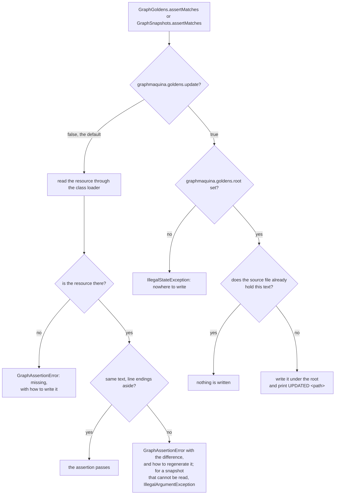

# Testing GraphMaquina machines


`graphmaquina-test` is a test-scoped module of typed assertions, probes and graph snapshots for machines
built with GraphMaquina. It asserts over the runtime's own values — definitions, edges,
node policies, outcomes, transition records, reactions, sub-machine starts, engine exceptions, the flow of a call and
its trail — and reports every unmet
expectation as a `GraphAssertionError` carrying the context, the property, the expected value and the actual
one.

It brings no test framework of its own. Nothing in its public API mentions JUnit or AssertJ, so it works
under whatever runner your project already uses; the examples here are JUnit 5 because the repository's own
example module is.

Every Java sample of the testing pages runs in this repository. Most are copied verbatim out of a test; the samples of
[failure kinds and recovery rules](testing-advanced.md#failure-kinds-and-recovery-rules), of [sub-machines](testing-advanced.md#sub-machines) and of
[the call's flow and its trail](testing-advanced.md#the-calls-flow-and-its-trail) go the other way: they are cut out of
[testing-advanced.md](testing-advanced.md) and run by a test. Each section names the test file.

## Contents

- [Install](#install)
- [Your first test](#your-first-test)
- [What each entry point checks](#what-each-entry-point-checks)
- [Asserting on identity](#asserting-on-identity)
- [More expectations](#more-expectations)
- [Goldens and structural snapshots](#goldens-and-structural-snapshots)
- [What a check does not prove](#what-a-check-does-not-prove)
- [Sharp edges](#sharp-edges)
- [Maintaining test support](#maintaining-test-support)

## Install

The [install command](installation.md#install-graphmaquina-201) installs `graphmaquina-test` with the other
modules, at the same version, and Maven Central publishes it with every release. Its coordinates follow the same version convention as the rest of the guide: a `graphmaquinaVersion` Gradle
property or a `graphmaquina.version` Maven property, set once per build, never a literal repeated per
dependency.

```kotlin
dependencies {
    testImplementation("io.github.graphmaquina:graphmaquina-test:$graphmaquinaVersion")
}
```

```xml
<dependency>
  <groupId>io.github.graphmaquina</groupId>
  <artifactId>graphmaquina-test</artifactId>
  <version>${graphmaquina.version}</version>
  <scope>test</scope>
</dependency>
```

The module is test-scoped: it depends on `graphmaquina-core` and adds nothing to your application's runtime
classpath. Its POM pins `graphmaquina-core` at its own version, so keep it equal to the runtime, generator and
processor versions you already align. Inside this repository no
publication is needed at all: `graphmaquina-example` depends on the project directly with
`testImplementation(project(":graphmaquina-test"))`.

## Your first test

The machines under test are built exactly as the application builds them: a real registry, real entities,
and test doubles only where the domain reaches outside the process. A `TransitionRecorder` is a
`MachineObserver`, so it is installed the way any observer is, and `recordTrail()` makes every call of the set
record its [trail](testing-advanced.md#the-calls-flow-and-its-trail). From
[OrderFlowTest](../graphmaquina-example/src/test/java/io/github/graphmaquina/example/OrderFlowTest.java):

```java
final FakeGateway gateway = new FakeGateway();
final FakeCarrier carrier = new FakeCarrier();
final TransitionRecorder recorder = TransitionRecorder.create();
final ShopMachines shop = ShopMachinesRuntime.builder(Duration.ofSeconds(10), new OrderActions(gateway, carrier),
                new ItemActions())
        .observer(recorder)
        .recordTrail()
        .build();
final Orders orders = shop.orders();
final Items items = shop.items();
```

One static import, `io.github.graphmaquina.test.GraphAssertions.assertThat`, reaches the views for every
subject a test holds directly: a definition, an outcome, an action or guard result, a recorded guard or action call,
a throwable or an `InvalidGraphException`, an entity, the flow
of a call.
A bare list of transition records, of reactions, of sub-machine starts, of journal entries or of trail entries would
need overloads with the same erasure, so each keeps its own factory, `TransitionRecordsAssert.assertThat`,
`ReactionsAssert.assertThat`, `StartsAssert.assertThat`, `JournalAssert.assertThat` and `TrailAssert.assertThat`;
inside a chain they are reached as `records()`, `reactions()`, `starts()`, `journal()` and `trail()`. The overload
is chosen from the subject's static type, and the chain keeps the entity, state and transition types of that
subject, so the two enums of the machine under test are the only ones the compiler accepts along it:

```java
@Test
void anIdentifierWithNoEdgeFromTheCurrentStateIsRejectedByTheNodePolicy() {
    Order order = new Order("o1");

    assertThat(orders.ship(order)).isRejected()
            .hasReason("cannot ship without payment")
            .hasNoTransition()
            .requestedTransition(OrderTransition.SHIP);
    assertThat(order, Order::status).isIn(OrderStatus.NEW);
}
```

The chain carries three type parameters — the entity, the state enum and the transition enum — so a
constant of another machine's catalogue does not compile inside it.

## What each entry point checks

| Subject | Entry point | What the view can expect |
| --- | --- | --- |
| Graph definition | `assertThat(definition)` | initial state, terminal set, presence or absence of async, the identifiers declared from a state, the absence of one identifier, the absence of a watch or of a sub-machine |
| One edge | `assertThat(definition).transition(from, id)` | destination, kind, action name and sync/async mode, guard names and modes in order, fallback failure identifier, `failsOn` classes, recovery rules in declaration order, timeout, after-commit hook |
| One node's policy | `assertThat(definition).policy(state)` | `hasDefaultReason`, and `rejects(id, reason)`: the reason that identifier gets, its own or the default, which also requires that no edge is keyed by it |
| A watched state | `assertThat(definition).watch(state)` | the peer machine and the ordered watch rules, each naming the identifier it executes |
| A bound state | `assertThat(definition).submachine(state, childKey)` | that the state holds that child machine, and its exits in declaration order, each the identifier of the parent that a terminal state of the child selects |
| Reachability | `assertThat(definition).topology()` | nodes, successors, reachable set, an explicit walk, the shortest path, absence of a path, cycles |
| Outcome | `assertThat(outcome)` | the variant, then `from`, the requested identifier, recorded state, live entity state, entity identity, `hasStatus`, `hasCode`, `hasExplanation` or `hasNoExplanation`, plus `records()`, `reactions()`, `starts()` and `flow()` |
| Applied outcome | `assertThat(outcome).isApplied()` | `movedTo` |
| Failed outcome | `assertThat(outcome).isFailed()` | `hasTarget`, `hasFailureTransition`, `movedTo`, failure kind, reason, cause |
| Rejected outcome | `assertThat(outcome).isRejected()` | reason, `hasNoTransition()` for `RejectionKind.NO_TRANSITION`, `isRejectedByGuardNamed` for `GUARD`, `isDetached()` for `DETACHED` and `isReservedExit()` for `RESERVED_EXIT` |
| Ignored outcome | `assertThat(outcome).isIgnored()` | `hasReason(IgnoreReason.NO_WATCH)` or `NO_RULE_MATCHED` |
| Transition records | `.records()`, a trail's `.hops()`, or `TransitionRecordsAssert.assertThat(list)` | size, exact content, and per entity: from, transition, to, kind, action, depth |
| Reactions | `.reactions()`, or `ReactionsAssert.assertThat(list)` | size, absence of aborts directly or recursively, and per entity: `isDone()` with its nested outcome, or `isAborted()` with its cause |
| Sub-machine starts | `.starts()`, or `StartsAssert.assertThat(list)` | size, and per child: the state it started at, its state before, the parent and the bound state that started it, and the depth |
| The call's flow | `.flow()`, or `assertThat(flow)` | the root entity by reference, the value of a key by equality, the absence of a value, the keys in the order of their writes, plus `trail()` |
| The call's trail | `.trail()`, or `TrailAssert.assertThat(list)` | size, the class of every entry in order, the identifier of every hop in order, that no instant goes back, and the kind of the final rejection or the phase of the final failure, plus `hops()`, the records of its hops |
| Engine failure | `assertThat(captureFailure(() -> ...))` | abort, cascade abort, commit failure, after-commit failure, invalid graph; cause identity or type; cascade path; journal; phase, states written and the failing call; the hops and starts of an after-commit failure; the call's flow |
| Action result, guard result | `assertThat(actionOutcome)`, `assertThat(guardResult)` | ok or failed, pass or rejected, the reason, and the failure kind of a failed action |
| Live entity | `assertThat(entity, Order::status)` | the state the getter reads at that moment |
| Completed calls | `TransitionRecorder.assertRecorded()` | size, the sequence of machine keys, the sequence of outcome statuses, and the outcome sequence of one entity |
| Tracked entities | `StateSnapshot` | which of the tracked entities moved since the capture, and that none did |
| Completion stage | `AsyncAssertions.await`, `AsyncAssertions.awaitFailure` | the outcome, or the throwable, the stage ended with inside the test's budget |
| Guard, action, hook | `GuardProbe`, `ActionProbe`, `HookProbe`, `CallTrace` | scripted answers per call, the calls each probe recorded, and the order callbacks were entered in |
| State setter | `StateWriteProbe` | every write in entry order with its status, and a failure armed on one call |
| Async callback | `ControlledAsyncAction`, `ControlledAsyncGuard` | that the engine entered the callback, with the test deciding when and how it answers |
| Rendered diagram | `GraphGoldens.assertMatches` | visual DOT output only; not machine logic |
| Whole definition | `GraphSnapshots.assertMatches` | the fields the definition declares against a checked-in resource, a sub-machine by its child's key and exits only, so the child's graph needs a snapshot of its own |

## Asserting on identity

Six expectations answer six different questions about an edge that may or may not be there. They are easy
to confuse, so keep them apart:

| What you want to establish | Expectation |
| --- | --- |
| This origin declares exactly these identifiers | `hasTransitionsExactly(from, ids…)` |
| This identifier has no edge from this origin | `hasNoTransition(from, id)` |
| The request was refused because nothing was keyed | `isRejected().hasNoTransition()` |
| The request was refused by a guard on an edge that does exist | `isRejected().isRejectedByGuardNamed(name)` |
| The request was refused because the entity is a sub-machine whose parent does not hold it | `isRejected().isDetached()` |
| The request named an exit of the sub-machine bound to the origin, which only the end of that sub-machine runs | `isRejected().isReservedExit()` |

`hasTransitionsExactly` takes identifiers, so two edges that reach the same state are two entries.

An `Ignored` outcome says which of the two reevaluation cases it is, through
`isIgnored().hasReason(IgnoreReason.NO_WATCH)` or `NO_RULE_MATCHED`. It is the only outcome with no
requested identifier, so `hasNoRequestedTransition()` holds on it and `requestedTransition(id)` holds on
every other variant.

Useful behavior to cover in your own domain:

- Every action's success and handled-failure result, including the actual entity state.
- Each guard rejection, and each identifier a state refuses, with the reason its policy gives.
- Two operations that reach the same state, so neither can quietly stand in for the other.
- Every self-loop you declare: it applies, and its hook runs.
- Every recovery rule, through a returned failure of its kind and through each throwable type it declares, and the
  most specific type winning where declared types overlap.
- Throwables that a recovery rule or `failsOn` maps, and those that must abort.
- Cascade rollback behavior and collected error details.
- First-match watch order, empty peer collections and aborted reactions.
- Async timeout behavior and late completions.
- Hooks that fail after state has committed.
- Declared graph contracts through typed assertions or structural snapshots.

Visual export tests may separately pin `.dot` goldens when changes to diagram output require review.

A passing runtime test does not replace compile-time graph validation. Conversely, a valid graph does not prove
that your action performs the correct domain operation.

## More expectations

The entry-point table names each view's main expectations. These complete them:

| View | Expectations |
| --- | --- |
| Graph definition | `hasNoAsync()`, `hasNoWatch(state)` |
| One edge | `isMove()`, `hasNoAction()`, `hasNoGuards()`, `hasNoFailureTransition()`, `hasNoTimeout()` |
| Topology | `hasNodesExactly(states)`, `hasSuccessorsExactly(from, states)`, `hasReachableExactly`, `hasNoCycles()`, `hasCyclesExactly(cycles)`, each cycle starting at its earliest declared state |
| One transition record | `hasKind(kind)`, `hasNoAction()` |
| Reactions | `hasNoAborted()`, which looks at this list alone, not at the reactions' own reactions |
| Journal | `hasEntry(key, entity, from, id, to, action, depth, status)`, with the entity compared by reference |
| Abort | `at(key, entity, from, id, to)` for the edge that was running; `atUnresolved(...)`, `atUnread(...)` and `atUnreadState(...)` for an abort before the edge, the identifier or the state was read; `hasActionNamed(name)`, `hasNoAction()`, `hasCascadePathExactly(route)` |
| Cascade abort | `error(i)`, the abort of the i-th failed element, counted among the failures rather than among the cascaded entities |
| Commit failure | `hasAppliedExactly(entities…)`, `hasPendingExactly(entities…)`, `hasFailedEntity(entity)`, `hasNoFailedEntity()` |
| After-commit failure | `hasHookNamed(name)`, `at(key, entity, from, id, to)` for the hop the hook ran for |
| Any failure | `isCommitFailure()` and `isInvalidGraph()` narrow it, as `isAbort()`, `isCascadeAbort()`, `isAfterCommit()` and `isCallFailure()` do |
| Invalid graph | `hasCodesExactly(codes…)`, in order and with repeats, `hasProblemCount(n)` |
| Action and guard results | `isOk()`, `isPass()` |

`captureFailure` takes a `ThrowingRunnable`, whose `run()` may throw any exception, so the body can call code that
declares checked exceptions. `TransitionRecorder.snapshot()` returns the calls recorded so far as
`RecordedTransition`s. A `StateWriteProbe` records each write as a `StateWrite`: the entity, the `requested` state, its
`status` and, when the write threw a `RuntimeException`, its `cause`. `ControlledAsyncAction` and `ControlledAsyncGuard`
take an `onCall(consumer)` side effect too, which runs when the engine enters the callback; if it throws, the stage
fails and the handle is never delivered. A `PendingInvocation` of a
controlled asynchronous fixture can also `cancelStage()`, and `isCancelled()` says whether it did. `GraphSnapshot`
exposes `capture(definition)`, `serialize()` and `parse(text)`, and `GraphDiff.compare(expected, actual)` returns
the path-by-path differences of two snapshots, each a `GraphDiff.Change` of a path with its expected and actual
values, `render()`ed as the lines a failing `GraphSnapshots.assertMatches` prints.

## Goldens and structural snapshots

Machine contracts and visual output have separate tests. Do not use a graphical export to validate machine
logic.

- `GraphSnapshots.assertMatches(definition, resource)` compares declared metadata with a checked-in
  `.graph` file: the machine key including the transition enum, the ordered catalogue of identifiers,
  ordered states, initial state, terminals, async mode, node policies, watches and their ordered rules with
  the identifier each one executes, each sub-machine with its child's machine key and the identifier each terminal
  state of the child exits through, and for every edge its `(from, id)` key, destination, kind, reason-free
  action and guard names/modes, fallback failure identifier, `failsOn` classes, timeout, after-commit hook and, only
  when the edge declares some, its recovery rules in declaration order, each with its failure kind, recovery
  identifier and `failsOn` classes. That order routes nothing, yet reordering the rules changes the snapshot.
  It reads `GraphDefinition` and its `TransitionSpec`s directly and does not call an exporter. Absence has no
  path at all: an identifier with no edge from a state simply does not appear. The graph of a bound child is not
  part of its parent's snapshot, so a change to that graph alone leaves the parent's snapshot as it was: give the
  child's definition a snapshot of its own. Use typed graph assertions for focused expectations. Neither approach
  executes domain logic; test guards, actions, cascades and watches through real operations and assert their
  outcomes, records, reactions and observed entity states.
- `GraphGoldens.assertMatches(definition, resource)` compares the Graphviz DOT output with a checked-in
  `.dot` file. There is no detail mode: the export draws the declared edges, draws a state that holds a
  sub-machine as a cluster containing the child's own graph, so the parent's golden changes with the child's graph, and renders each node's policy as that node's tooltip, or as the
  cluster's for a bound state. This is a visual regression test only: a diagram change must not be the evidence
  for a change in machine behavior.

Snapshots are `graphmaquina-snapshot-v1` documents; `GraphSnapshot.parse` refuses any other header. After that
version line comes one `path TAB value` line per field, each ending in a line feed, with backslash, tab, line feed and
carriage return escaped; `GraphSnapshot.fields()` returns the path-to-value map in that canonical order. Fields live
under `/machine/…`, `/states/<i>`, `/catalog/<i>`, `/transitions/<from>/<id>/…`, with recovery rules under
`recoveries/<i>/kind`, `transition` and `failsOn`, `/policies/…`, `/watches/…` and
`/submachines/<state>/{child/…, exits/<terminal>}`; a missing edge has no path at all.
`PublishedArtifactSmokeTest` compiles and runs a semantic consumer after removing every graphic-export class
from the core JAR; assertions, state observation and structural snapshots must still work.

From [DiagramsTest](../graphmaquina-example/src/test/java/io/github/graphmaquina/example/DiagramsTest.java):

```java
@Test
void orderDiagramMatchesGolden() {
    GraphGoldens.assertMatches(orderGraph(), "golden/order.dot");
}
```

From [GraphContractsTest](../graphmaquina-example/src/test/java/io/github/graphmaquina/example/GraphContractsTest.java):

```java
@Test
void orderContractMatchesSnapshot() {
    GraphSnapshots.assertMatches(orderGraph(), "contracts/order.graph");
}
```

A mismatch reports the lines that changed, or for a snapshot the field paths that differ — not both files in
full, and both it and a missing golden end with the flags that rewrite the file. In read mode a stored
snapshot of an unknown version or a broken format is reported as the fixture problem it is instead of being
compared, and carries no such flags. An
update run never reads the stored text as a snapshot: it replaces the file with a snapshot of the current
version, so an unreadable one is overwritten rather than reported, and the review of the rewritten file is
what checks the change.

### Reading and updating

The two directions resolve differently. Read mode never writes, and update mode writes only under the source
root. Nothing compares that root with the class path, so point it at the source directory, never at a
class-path output:

| Mode | Resource resolved through | Written to |
| --- | --- | --- |
| Read (the default) | the class loader, so the copy on the test class path | nothing |
| Update | the source file under the root, read only to skip an identical rewrite | the source root named by `graphmaquina.goldens.root`; each rewritten file is reported as `UPDATED <path>` |



Two system properties select the mode, named by `GoldenOptions.UPDATE_PROPERTY` and `GoldenOptions.ROOT_PROPERTY`.
A resource name must be a relative, `/`-separated path: an empty name, a leading `/`, a `\`, a drive prefix such as
`C:`, and an empty, `.` or `..` segment are refused with `IllegalArgumentException`.
`graphmaquina.goldens.update` accepts only the exact values `true`
and `false`; `graphmaquina.goldens.root` names the source root an update writes into and is required when
update mode is on. Read mode ignores it: `GoldenOptions.defaults()` makes it a path only in update mode, so in
read mode `sourceRoot()` is empty and a value that is not a path fails nothing. The resource string is a
class-path-relative path such as `golden/order.dot`, and update mode writes it at that same relative path under
the root, so pointing the root at `src/test/resources` puts the file back where the class path picked it up.

Both `assertMatches` methods have an overload that takes `GoldenOptions`: `GoldenOptions.defaults()` reads the two
properties each time it is called and uses the thread's context class loader, `readOnly(loader)` reads through a loader
of your choice, and `updating(loader, sourceRoot, reporter)` hands the reporter the absolute path of each golden it
writes; `loader()`, `update()` and `reporter()` expose them. An update writes a temporary file beside the golden and
moves it over the target, atomically where the file system supports it; a source that is not valid UTF-8 is replaced,
and a source root that is not a directory throws `IllegalStateException`. A golden is read as strict UTF-8, a leading byte-order mark
dropped, and a resource that names a directory fails with `GraphAssertionError`.

Update mode writes through a symbolic link inside the root, at the golden itself or at a directory above it, and
keeps the link. It does so even when what the link names does not exist yet: it creates that file, with any
directory missing on the way, unless a `.` or `..` follows a missing name in the path the link holds, which
fails with `IllegalStateException`. A link that leads out of the root, a dangling one included, is refused with
`IllegalArgumentException`, and nothing is written.

### Gradle

The source root has to be resolved when the build is configured, because a test worker has no `project` to
ask. An update run writes files instead of producing task outputs, so it must be neither skipped as
up to date nor served from the build cache. This is the golden-update part of the test configuration
`graphmaquina-example` applies:

```kotlin
val updateGoldens = providers.systemProperty("graphmaquina.goldens.update")
    .map { it.toBooleanStrict() }.orElse(false)
tasks.test {
    systemProperty("graphmaquina.goldens.update", updateGoldens.get().toString())
    systemProperty("graphmaquina.goldens.root",
        layout.projectDirectory.dir("src/test/resources").asFile.absolutePath)
    outputs.upToDateWhen { !updateGoldens.get() }
    outputs.doNotCacheIf("Golden update writes source resources") { updateGoldens.get() }
}
```

Rewrite the goldens with:

```bash
./gradlew test -Dgraphmaquina.goldens.update=true
```

Then read the diff and commit it. An update run is a deliberate act: it makes the test pass by definition,
so the review of the rewritten file is the only thing that checks the change.

### Maven

Surefire passes system properties to the test JVM through `systemPropertyVariables`. Add them to the
Surefire configuration your project already has, and do not pin a Surefire version here without checking the
one your build resolves:

```xml
<systemPropertyVariables>
  <graphmaquina.goldens.update>${graphmaquina.goldens.update}</graphmaquina.goldens.update>
  <graphmaquina.goldens.root>${project.basedir}/src/test/resources</graphmaquina.goldens.root>
</systemPropertyVariables>
```

Declare the default in `<properties>` so a normal build reads rather than writes:

```xml
<graphmaquina.goldens.update>false</graphmaquina.goldens.update>
```

Rewrite the goldens with `mvn test -Dgraphmaquina.goldens.update=true`.

This is property plumbing only. It replaces nothing in your project's GraphMaquina generation setup: the
generate, prepare-compile and complete-compile lifecycle stays exactly as the
[build integration guide](typed-annotations-build.md) describes it.

A test that needs no properties at all can pass options explicitly —
`GoldenOptions.readOnly(loader)` or `GoldenOptions.updating(loader, sourceRoot, reporter)` read none.

## What a check does not prove

| The check establishes | It does not establish |
| --- | --- |
| `topology().hasPath(...)`: the graph permits this walk | that any run took it. Only an outcome or a transition record shows a hop that happened. |
| `isApplied()`: the root transition committed | that everything it triggered did. A watch reaction inside an applied outcome may have aborted; `reactions().hasNoAbortedRecursively()` is the expectation that rules that out. |
| `hasStatus(APPLIED)` or `hasCode(...)`: what the root call reported | that its reactions committed, or where the entity is now. Read `reactions()` and `hasEntityState(...)` for those. |
| `movedTo(...)` and `hasRecordedState(...)`: the state the outcome recorded | where the entity is now. `hasEntityState(getter, ...)` reads the live entity, and the entity can move again right after. |
| `hasTransitionsExactly(from, ids…)`: which identifiers the state declares | that any of them would succeed for a given entity. It is structural; guards are not evaluated. |
| `isRejected().hasNoTransition()`: nothing was keyed by `(from, id)` | that the entity cannot move at all. Another identifier may well have an edge from the same state. |
| `calls().assertCount(n)`: a callback was entered n times | that the machine wrote a state. Only `StateWriteProbe.writes()` sees the setter. |
| `journal()`: which actions the aborted attempt entered, and how each ended | that the entities were put back. `StateSnapshot.assertUnchanged()` is the expectation that asserts the rollback. |
| `flow().hasValue(key, value)`: the flow holds a value equal to that one | that it is the object a step put. The flow keeps values by reference, and `get(key)` returns that very object. |
| `trail().hasHopsExactly(ids…)`: the identifiers of the hops the call took, in order | which machine or entity took each hop, or the states it joined. `trail().hops()` compares those field by field, on the trail of a failed call too. |
| the recorder: the outcome of every call that completed | anything about a call that threw, such as one whose step aborts, whose commit fails, whose hook throws, or whose reaction raises an `Error`. The recorder keeps completed calls only; capture the throwable instead. |
| `AsyncAssertions.await(stage, budget)`: the engine's transition finished | that work the action started in the background ended. Neither wait ever cancels a stage it was handed. |
| that budget: how long the test is willing to wait | the engine's deadline. That is `asyncTimeout(...)` on the machine and the edge's timeout, which `hasTimeout(...)` asserts, and an expired engine deadline leaves the user's stage alive. |

## Sharp edges

- **`hasNoPath(x, x)` can never hold.** It is the exact negation of `hasShortestPath`, and the graph's
  shortest path from a node to itself is the single-node walk `[x]`. The expectation that answers "can this
  state come back to itself" is `hasReachableExactly`, because `reachableFrom` excludes the origin unless a
  cycle leads back to it.
- **Call ordinals count from 1; list positions count from 0.** `StateWriteProbe.failOnCall(2, ...)` arms the
  second write, and a probe that runs out of scripted answers names the call the same way. The lists are
  plain lists: `writes()`, `calls().snapshot()` and `CallTrace.events()` are indexed from 0, and
  `TraceEvent.sequence()` starts at 0 too. So the write `failOnCall(2, ...)` arms is `writes().get(1)`.
- **`assertCount` returns different things in the two places it appears.** `ProbeCalls.assertCount(int)`
  returns `void`: a probe's calls are the end of a chain. `StateWriteProbe.assertCount(int)` returns the
  probe, so writes keep chaining. This is deliberate in both cases, not an oversight in one.
- **A null subject fails as an assertion; a null expected value fails as a bug in the test.** Handing a view
  a null subject makes the first expectation raise a `GraphAssertionError` whose actual value is `null`,
  never a bare `NullPointerException`. Passing `null` as a required expected value is a programming error
  and keeps raising `NullPointerException` or `IllegalArgumentException`.
- **`ActionStatus.THREW` does not mean your action threw.** The engine also marks actions still in flight as
  `THREW` while it unwinds an abort. The status is the runtime's, and the API does not reinterpret it.
- **A reaction completes before the call that triggered it.** A watch reaction is a call nested in the one whose
  commit triggered it: an observer sees the root start, then the reaction start and end, then the root end. The
  recorder keeps calls as they complete, so the reaction's outcome comes before the root's.
- **`hasAsyncAction()` is about the action alone.** An edge whose guard is async but whose action is not still
  satisfies `hasSyncAction()`.
- **A self-loop is asserted like any other edge.** `transition(REVIEW, RETOUCH).hasTarget(REVIEW)` describes
  it, and a request for it produces `Applied`, not `Ignored`. `Ignored` only ever comes from `reevaluate`.
- **Two edges to one state need two expectations.** `transition(from, APPROVE)` and
  `transition(from, AUTO_APPROVE)` are separate subjects even though both `hasTarget` the same state. A test
  that asserts only the destination cannot tell which action ran; assert the action name, or observe it.
- **Entities are selected by reference.** `forEntity(key, entity)` and `forChild(key, child)` match on identity, so
  two entities that carry the same id are two different subjects, and an entity with no match yields an empty view,
  not a failure.
- **A missing subject fails at its first expectation.** `transition(from, id)` on an undeclared key, and
  `watch(state)` on a state with no watch, return a view without a subject, and its first expectation fails with
  `GraphAssertionError`.
- **The waits fail as assertions.** `AsyncAssertions.await` fails with `GraphAssertionError` when the budget expires,
  the thread is interrupted, or the stage completes exceptionally or is cancelled; `awaitFailure` takes a cancellation
  as the failure and fails when the stage completes normally; `captureFailure` fails when its body completes normally,
  and returns an `InterruptedException` like any other exception, with the interrupt flag set again.
- **A wrong argument is no failed expectation.** A state or an identifier of another enum, reachable only through raw
  types, a negative index such as `CascadeAbortAssert.error(-1)`, an entity tracked twice under the same machine in a
  `StateSnapshot`, an unknown topology node, an empty `hasPath` walk, and a wait budget that is not positive or does
  not fit in nanoseconds throw `IllegalArgumentException` instead of `GraphAssertionError`.
- **Messages carry the evidence.** A failure names the view it came from: `<Entity>/<States>` for a graph, with
  ` FROM -ID->` added for an edge, `applied outcome` for a narrowed subject, or `recorded transitions for K[1] (applied)`
  for one reached through a list. A `GraphAssertionError` names its context, property, expected and actual values;
  when two distinct instances print alike, the message names both instances, and a value whose `toString()` throws is
  shown by its class and identity. A golden mismatch shows only the changed lines, each with three lines of context,
  and a snapshot mismatch one `path: expected ... but was ...` line per field, falling back to the line diff when the
  stored file holds the same fields in another line order. The line diff stops after 200 lines with
  `... N more diff lines omitted`, and marks a missing final line feed with `\ No newline at end of file`.
- **Helpers can raise the same error.** `new GraphAssertionError(context, property, expected, actual)`, with an optional
  advice line that goes into the message only, gives a test helper of your own the same inspectable failure.
- **`hasTerminalsExactly`, `hasTransitionsExactly` and the topology's `hasNodesExactly`, `hasSuccessorsExactly` and
  `hasReachableExactly` compare as sets; records, guards, reactions, starts and the entries and hops of a trail keep
  order and multiplicity, the flow's `hasKeysExactly` keeps the order of the writes, the recorder's keeps the order
  the calls completed, and `hasExitsExactly` keeps the declaration order of the exits.**
- **Assert on the fields, not the type.** A `GraphAssertionError` carries `context()`, `property()`,
  `expected()` and `actual()`. A test that only checks that something was thrown cannot tell a real
  rejection from an incidental failure. When the actual value is a throwable, it is the error's cause as well,
  so a report shows where it was thrown.

## Maintaining test support

Every GraphMaquina feature or behavior change must provide its counterpart in `graphmaquina-test` in the
same delivery. Extend the relevant assertions, probes, recorded calls or snapshots so a consuming project
can verify the new behavior. Include regression coverage and documented consumer usage. When existing
support already expresses the behavior, demonstrate it with an executable consumer test. Public test APIs
must also be exercised against the staged artifacts by `:graphmaquina-test:publishedArtifactTest`.

---

Next: [Testing samples: graphs, outcomes, probes and async](testing-samples.md). Back to the [documentation index](README.md).
